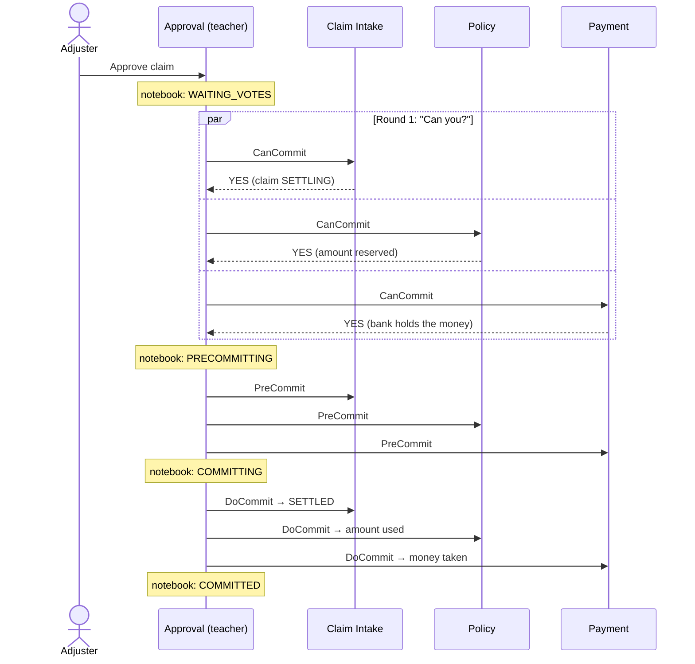

# The three-phase commit (3PC), explained simply

## 1. The problem: three notebooks that must agree

When an adjuster says **"yes, pay this claim"**, three different programs each have to write something down in
their own notebook (their own database):

| Program | What it writes down |
| --- | --- |
| **Claim Intake** | "This claim is now **SETTLED**." |
| **Policy** | "This family has used up ₹67,500 more of their insurance." |
| **Payment** | "We sent ₹67,500 to the family's bank account." |

These three notebooks live in three different places. No single "save" button covers all three at once.

So what if something breaks halfway? Say Payment sends the money, then the computer crashes before Policy writes
anything. The family has been paid, but their policy still shows the money as unused, so they could claim it
again. Or the claim says SETTLED, but no money was ever sent. **Both are disasters for an insurance company.**

We need a rule that makes sure **either all three write it down, or none of them do.** Never just one or two.
That rule is the **three-phase commit**: "3PC" for short.

## 2. The idea, as a story

Imagine a teacher planning a class trip. Three helpers must all be ready, or the trip can't happen:

- the **attendance keeper**, who marks the class as "going";
- the **class fund**, which must have enough money set aside;
- the **ticket office**, which must be able to sell the tickets.

The teacher is the **coordinator**. The three helpers are the **participants**. The teacher plans the trip in
three rounds.

**Round 1: "Can you?"**
The teacher asks each helper: *"Can you do your part?"*
- The class fund checks there's enough money, and **puts it aside** (it doesn't spend it yet).
- The ticket office **holds** the tickets (it doesn't sell them yet).
- The attendance keeper checks the class is allowed to go, and marks it "about to go".

Each helper answers **YES** or **NO**. If even one says NO, or doesn't answer within 5 seconds, the trip is
cancelled. Everyone then gives back what they set aside.

**Round 2: "Get ready, everyone said yes."**
Only if all three said YES, the teacher tells each helper: *"Everyone agreed. Get ready."*
This round seems pointless, but it's the clever part (see section 3).

**Round 3: "Do it."**
The teacher says *"Go!"*
- The class fund **spends** the money it set aside.
- The ticket office **sells** the tickets.
- The attendance keeper marks the class as "gone".

**The teacher's own notebook.** Before every round, the teacher writes in their own notebook which round they are
in. If the teacher faints and wakes up later, they read the notebook and know exactly where to carry on.

## 3. Why three rounds and not two?

The simpler version, the *two*-phase commit, skips Round 2. It goes straight from "Can you?" to "Do it." That has
one nasty problem.

Suppose a helper said YES in Round 1, and then **the teacher disappears.** The helper is stuck:
- it can't go ahead, because maybe another helper said NO;
- it can't cancel, because maybe everyone said YES and the others already went ahead.

So it just waits, holding the money or the tickets, for as long as the teacher is gone. That could be forever.

Round 2 fixes this, because now every helper can work things out for itself:

| What the helper last heard | What it knows | What it does if the teacher goes quiet |
| --- | --- | --- |
| Only Round 1 ("Can you?"), and it said YES | Someone else might have said NO | **Cancels** after **5 minutes**. Cancelling is always safe here |
| Round 2 ("Everyone said yes") | Everybody agreed | **Goes ahead** after **2 minutes**. Going ahead is safe, because the teacher never cancels after Round 2 |

So nobody is ever stuck holding money or tickets forever. That is the whole reason for the extra round.

## 4. Where it works in our system

In our system:
- the teacher is **Approval**;
- the three helpers are **Claim Intake**, **Policy** and **Payment**;
- they talk to each other with **gRPC**, a fast, strictly typed way for programs to call each other.

| | Teacher (coordinator) | Helper: attendance keeper | Helper: class fund | Helper: ticket office |
| --- | --- | --- | --- | --- |
| **Service** | Approval | Claim Intake | Policy | Payment |
| **Round 1: "Can you?"** | asks all three at the same time, waits up to 5 s each | checks the claim is APPROVED → marks it **SETTLING** | checks the policy has enough left → **reserves** the amount | asks the bank (the payment gateway) to **hold** the money (an "authorization") |
| **Round 2: "Get ready"** | only if all three said YES | notes "ready" | notes "ready" | notes "ready" |
| **Round 3: "Do it"** | then writes "done" | claim → **SETTLED** | reserved money → **used** | bank **takes** the held money (a "capture") |
| **Cancel** | if anyone said NO | claim → **SETTLEMENT_FAILED** (the adjuster can retry) | **releases** the reserved money | bank **drops** the hold (a "void") |
| **Its notebook (table)** | `settlement_tx`, `settlement_tx_participant` | `settlement_participation` | `limit_reservation` | `payment_tx_log` |
| **Code** | `ThreePhaseCommitCoordinator`, `CoordinatorRecovery`, `ApprovalService` | `ClaimSettlementParticipant` | `LimitReservationParticipant` | `PaymentParticipant`, `PaymentRecoverySweep` |

All three helpers share the same base code, `ThreePhaseParticipant`, in
[`backend/participant`](backend/participant/src/main/java/com/claims/participant/ThreePhaseParticipant.java). The
tricky rules (answering the same question twice, timeouts, cancels that arrive early) are written once, and each
helper only adds its own job. The messages they send are defined in
[`backend/proto/src/main/proto/claims/settlement`](backend/proto/src/main/proto/claims/settlement).

**Full code paths:**
- `backend/services/approval/src/main/java/com/claims/approval/service/ThreePhaseCommitCoordinator.java`, which
  runs the three rounds;
- `.../approval/service/CoordinatorRecovery.java`, which finishes interrupted settlements;
- `backend/services/claim-intake/src/main/java/com/claims/intake/service/ClaimSettlementParticipant.java`;
- `backend/services/policy/src/main/java/com/claims/policy/service/LimitReservationParticipant.java`;
- `backend/services/payment/src/main/java/com/claims/payment/service/PaymentParticipant.java`.

### One settlement, from click to money

1. **The click.** The adjuster clicks **Approve** in the website. Approval saves the decision and gets the amount
   from Assessment.
2. **The answer.** It replies straight away with "settlement started" (HTTP 202). The three rounds then run in the
   background, usually in well under a second.
3. **Watching it.** The website's settlement view shows each helper's vote and state as it happens.

## 5. What happens when things break

We designed for each of these, and we test each one:

| What goes wrong | What happens | Result |
| --- | --- | --- |
| The bank refuses to hold the money | Payment says **NO** in Round 1 | Everyone cancels. The claim is SETTLEMENT_FAILED and can be retried |
| A helper doesn't answer within 5 s | Counts as **NO** | Everyone cancels |
| **Approval crashes after Round 1** (before "Get ready") | When Approval restarts, it reads `WAITING_VOTES` in its notebook. It doesn't know if everyone said YES, so it **cancels** | Nothing is paid; nothing is lost |
| **Approval crashes after Round 2** | When it restarts, it reads `PRECOMMITTING`. Everyone said YES, so it **finishes** with "Do it" | Paid exactly once |
| Approval stays down for a long time | Helpers that only heard Round 1 cancel after 5 min; helpers that heard Round 2 go ahead after 2 min | Nobody is stuck |
| The bank fails while **taking** the money in Round 3 | Payment still says "done" (the money is safely held). A sweep retries the capture every 30 s until it works | Paid, just a little later |
| A message arrives twice | Every helper looks up the settlement by its ID (`tx_id`) and gives the same answer again | Nothing happens twice |
| "Cancel" arrives **before** "Can you?" | The helper writes a "cancelled" note first, so the late "Can you?" gets a NO | No half-done work |

**The recovery checker.** At startup and then every 30 seconds, `CoordinatorRecovery` reads Approval's notebook. It
finishes any settlement that has gone quiet for 15 seconds, following the rules in the table above.

**Try it yourself.** The **chaos buttons** on the Ops Dashboard cause these failures on purpose:

| Button | What it does | What you should see |
| --- | --- | --- |
| `CRASH_BEFORE_PRECOMMIT` | stops Approval after Round 1 | the settlement is **cancelled** |
| `CRASH_AFTER_PRECOMMIT` | stops Approval after Round 2 | the settlement **completes** |
| `FAIL_AUTHORIZE` | makes the bank refuse | the settlement is **cancelled** |
| `FAIL_CAPTURE` | makes the bank fail to take the money | **paid**, once the sweep succeeds |

The automated tests in `backend/services/approval` and `backend/services/payment` check every one of these.

## 6. Why only one Approval (one teacher)

Approval runs as **exactly one copy** (one pod); it never scales out. Two teachers working from the same notebook
could give opposite orders. For example, one says "cancel" while the other says "get ready", because each keeps in
its head which settlements it's personally running. One teacher, plus the notebook and the helpers' own timeouts,
is safe: if it crashes, Kubernetes restarts it and it carries on from the notebook.

## 7. The honest limit

3PC assumes that "no answer" means "crashed". Suppose the network splits in two for a long time right after
Round 2. One helper might go ahead on its 2-minute timer while another, cut off, had been told to cancel.

Our teacher **never** cancels after Round 2, which makes this very unlikely, but not impossible. Fully closing
that gap needs a heavier approach, such as a consensus protocol like Raft. That isn't worth it here.

## Words used

| Word | Meaning |
| --- | --- |
| **Coordinator** | The one in charge of the rounds: Approval |
| **Participant** | A helper that does one part of the job: Claim Intake, Policy, Payment |
| **Vote** | A helper's YES or NO in Round 1 |
| **Commit** | Make the change for real |
| **Abort** | Cancel and undo whatever was set aside |
| **Authorize / capture / void** | The bank holds money / takes the held money / drops the hold |
| **`tx_id`** | The settlement's unique ID, so a repeated message is recognised |
| **Notebook (log)** | The database table where each side writes its state *before* acting, so it can recover after a crash |

More detail: Section 6.4 and Appendix A.6 of the [design document](docs/design-document.md).
