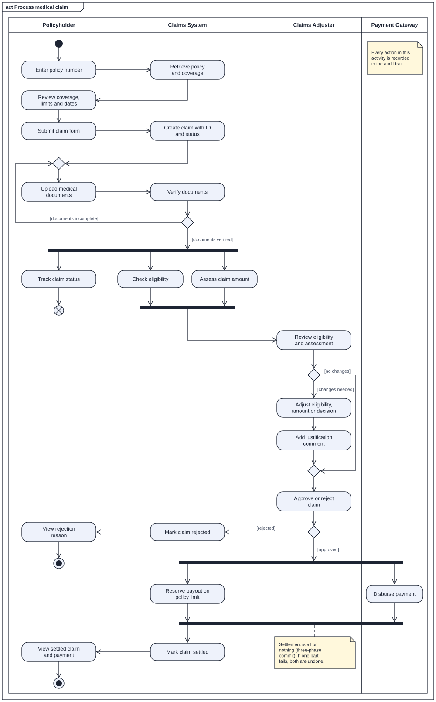
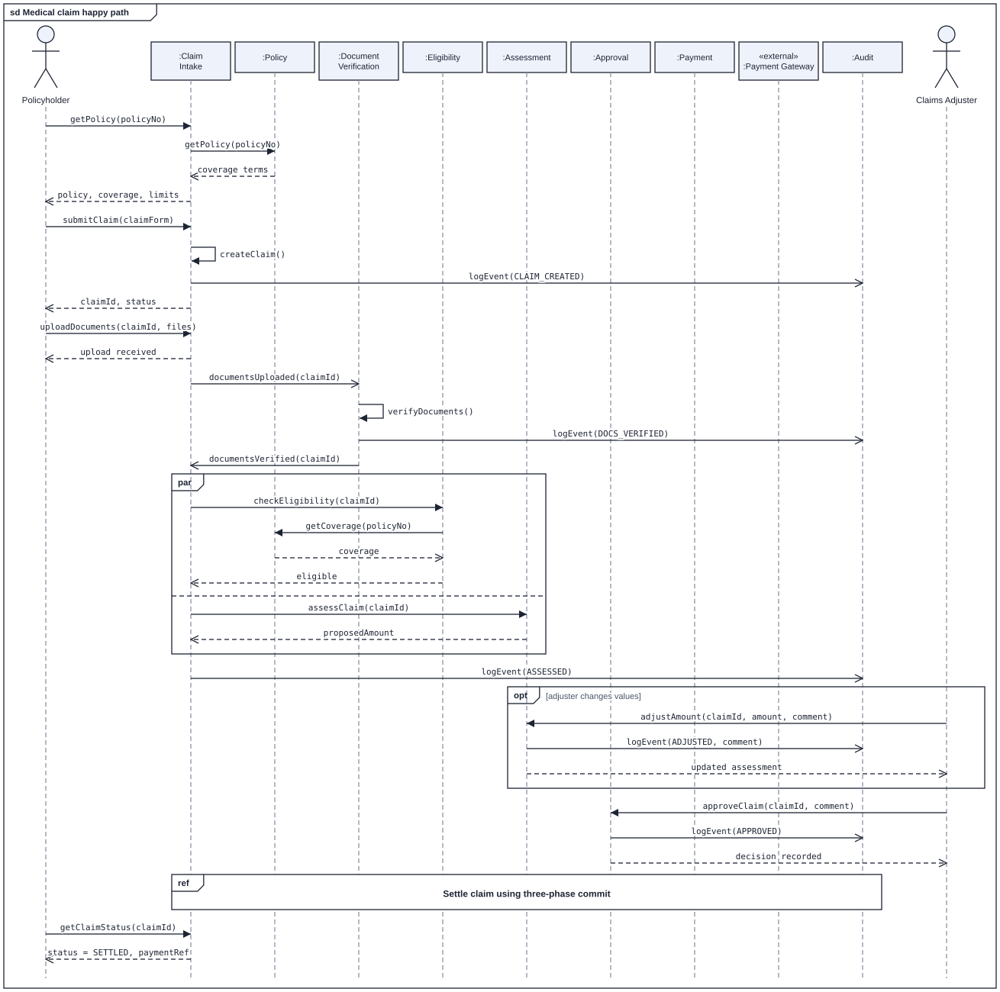
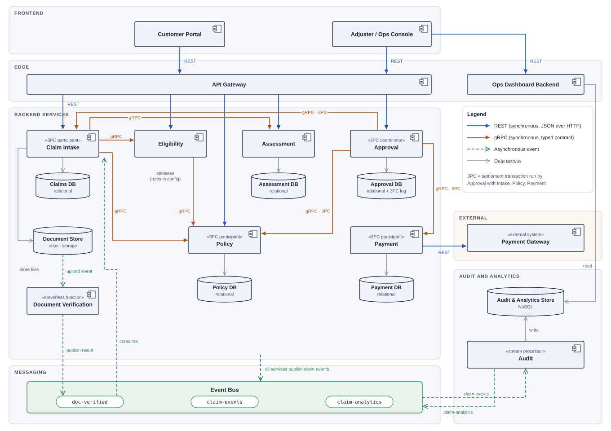
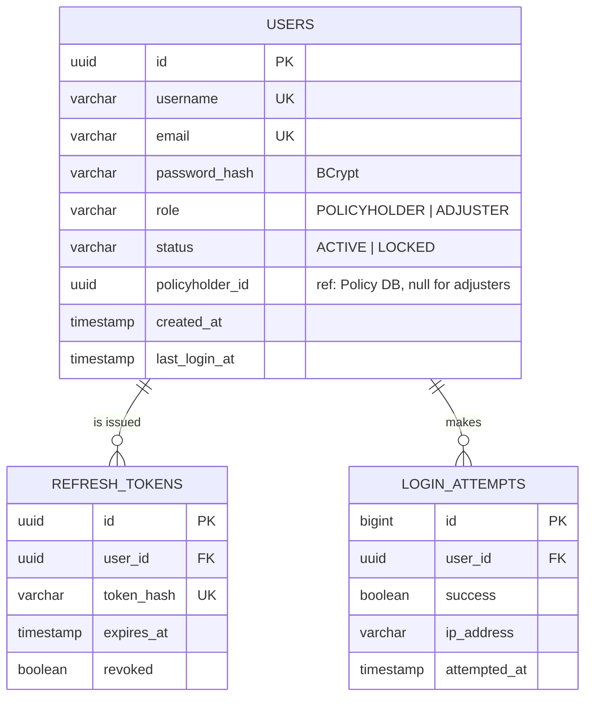
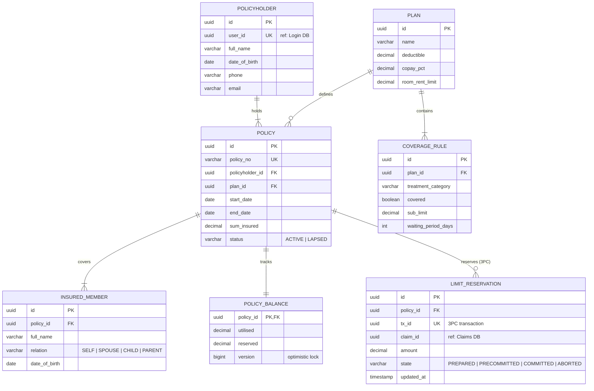
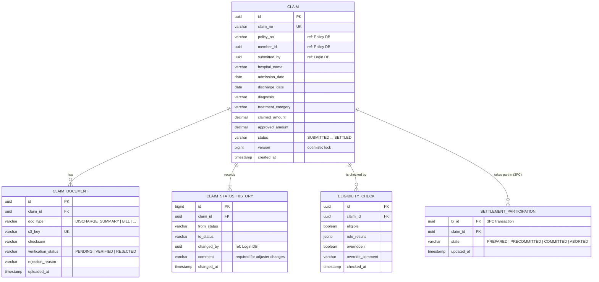
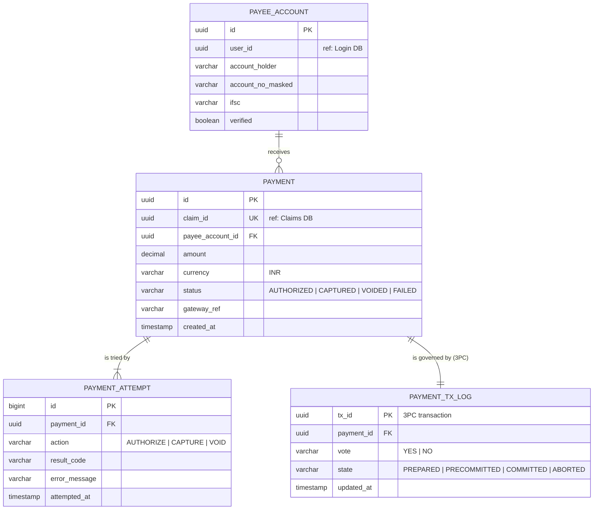
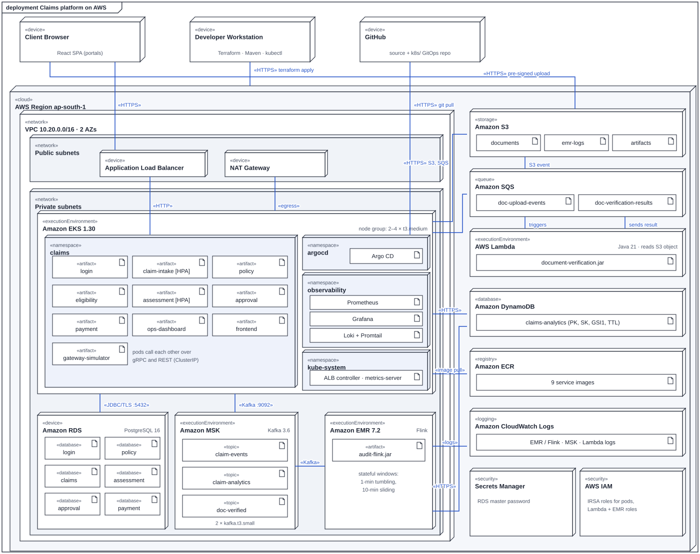

# Medical Insurance Claims Platform

A cloud-native system for processing medical insurance claims. It covers the full journey from filing a claim to settlement: eight microservices, with a **three-phase commit (3PC)** protocol making settlement all or nothing.

> **Status:** design phase, draft 1. This README covers the business (black-box) view only. The technical architecture, service placement and deployment come next.

---

## Contents

- [Actors](#actors)
- [Portals](#portals)
- [Business flow](#business-flow)
- [Use case diagram](#use-case-diagram)
- [Activity diagram](#activity-diagram)
- [Happy path sequence diagram](#happy-path-sequence-diagram)
- [High-level architecture](#high-level-architecture)
- [Data Design](#data-design)
- [NoSQL DB](#nosql-db)
- [Deployment Model](#deployment-model)

---

## Actors

| Actor | Role |
|---|---|
| **Policyholder** (customer) | Files and tracks claims. Talks only to the Claim Intake service. |
| **Claims Adjuster** | Reviews claims and can change eligibility, assessment and approval, always with a written justification. Also acts as the **Auditor**. |
| **Payment Gateway** (external system) | Pays out settled claims. Simulated, and able to fail on demand. |

## Portals

**Customer portal**: check my policy, check coverage, file a claim, upload documents, check claim status.

**Adjuster / ops console**: a queue of claims waiting for review, the status of every claim, and the live Flink analytics dashboard.

## Business flow

1. The policyholder enters a policy number and sees coverage terms, limits, deductible and validity dates.
2. They submit a claim. The claim is created with an ID and a status.
3. They upload medical documents, which are attached to the claim and verified.
4. Eligibility checks run.
5. The claim amount is assessed.
6. The claim is approved or rejected.
7. The claim is settled using **three-phase commit**.
8. Every step is **audited**.

From step 4 to step 6 the adjuster can make changes, and each change needs a comment explaining why.

---

## Use case diagram


- **Claims Adjuster generalizes Auditor** (hollow triangle), so the adjuster inherits every auditor use case.
- **Modify Claim Decision** `«extend»`s the three review steps, and always `«include»`s a justification comment.
- **Record Audit Entry** is `«include»`d by every use case that changes a claim.
- **Settle Claim** `«extend»`s Approve / Reject only on the condition `[approved]`, and involves the payment gateway.

## Activity diagram



- **Parallel flows:** eligibility and assessment run at the same time, and the policyholder can track status meanwhile (that branch ends at a flow-final node). Reserving the payout and disbursing payment also run in parallel.
- **Loop:** incomplete documents send the policyholder back to upload again.
- **Two outcomes:** a rejected claim or a settled claim.

## Happy path sequence diagram



- **Arrows:** a filled head is a synchronous call, an open head is an asynchronous message, and a dashed line is a reply.
- **Assumption:** Claim Intake drives the workflow. Which service orchestrates is still to be decided.
- **`ref` frame:** settlement is its own interaction and will be drawn separately, showing the full three-phase commit and its failure cases.

---

## Services

| # | Service | Responsibility |
|---|---|---|
| 1 | Policy | Retrieves policy details and coverage terms |
| 2 | Claim Intake | Creates and tracks claim requests |
| 3 | Document Verification | Validates required claim documents |
| 4 | Eligibility | Checks whether the claim falls within policy coverage |
| 5 | Assessment | Calculates a proposed claim amount |
| 6 | Approval | Records approval or rejection decisions |
| 7 | Payment | Simulates settlement and payment failure |
| 8 | Audit | Records transaction decisions, state changes and recovery actions |


## High-level Architecture


*Frontend and backend are separated by an API Gateway*. Browsers only ever speak REST; services talk to each other over gRPC.
*One database per service*. Eligibility is stateless. Document Verification writes nothing to a database; it publishes its result as an event.
*Settlement (3PC)*: Approval coordinates Claim Intake, Policy and Payment. Its transaction log lives in the Approval DB, so it can recover after a crash.
Audit reads every claim event from the event bus, keeps the audit trail and windowed analytics, and publishes results to claim-analytics. The Ops Dashboard Backend serves them to the console


## Data Design

### Authentication Database ER Diagram




### Policy Database



### Claim Database



### Payments Database




## NoSQL DB

Use a single DynamoDB table, **`claims-analytics`**, with a single-table design.

Items are distinguished by their partition key (`PK`) and sort key (`SK`) prefixes. Each screen in the Ops Console is served by a DynamoDB `Query` operation on a partition key.

- **Flink** writes window aggregates and fraud detection items.
- **Audit trail** and **settlement views** are written from `claim-events`, either by Flink as a secondary sink or by the Ops Dashboard Backend.
- Results are also published to the Kafka `claim-analytics` topic, satisfying the event-streaming requirement.
- DynamoDB acts as the queryable read model consumed by the Ops Console.

### Single-Table Design

| Item Type | PK | SK | Read By |
|---|---|---|---|
| Audit Event | `CLAIM#<claimId>` | `EVENT#<isoTs>#<eventId>` | Claim timeline, audit tab |
| Window Aggregate | `METRIC#<name>#<window>` | `WINDOW#<windowStart>` | Analytics charts and KPI tiles |
| Fraud Flag | `FRAUD#<policyNo>` | `WINDOW#<windowEnd>` | Fraud flags table |
| Settlement View | `TX#<txId>` | `STATE` | 3PC settlement stepper |

### Global Secondary Index (GSI)

**GSI1** supports audit log searches by event type and time.

| Attribute | Value |
|---|---|
| Partition Key | `GSI1PK = TYPE#<eventType>` |
| Sort Key | `GSI1SK = <isoTs>` |

This allows the Ops Console to retrieve audit events filtered by event type and ordered by timestamp.

### TTL (Time to Live)

Window aggregate and fraud flag items carry a `ttl` attribute to enable automatic expiration of older analytics data.

For example, a retention period of **7 days** can be configured for these items.

---

### Document Examples

#### Audit Event

**Source:** `claim-events` topic.

Represents a state transition or modification performed during claim processing.

```json
{
  "PK": "CLAIM#c-1042",
  "SK": "EVENT#2026-11-16T14:05:12.331Z#e-77f1",
  "type": "AuditEvent",
  "eventType": "ASSESSMENT_ADJUSTED",
  "service": "assessment",
  "actor": {
    "id": "u-adj-01",
    "role": "ADJUSTER"
  },
  "fromStatus": "ASSESSED",
  "toStatus": "UNDER_REVIEW",
  "change": {
    "field": "proposedAmount",
    "before": 82000,
    "after": 76500
  },
  "comment": "Room rent above plan limit; capped per sub-limit",
  "txId": null,
  "phase": null,
  "GSI1PK": "TYPE#ASSESSMENT_ADJUSTED",
  "GSI1SK": "2026-11-16T14:05:12.331Z"
}
```

#### Window Aggregate

**Source:** Apache Flink, using a 1-minute tumbling window.

Stores aggregated claim processing metrics for analytics dashboards and KPI tiles.

```json
{
  "PK": "METRIC#claims_overview#1m",
  "SK": "WINDOW#2026-11-16T14:05:00Z",
  "type": "WindowAggregate",
  "windowStart": "2026-11-16T14:05:00Z",
  "windowEnd": "2026-11-16T14:06:00Z",
  "countsByStatus": {
    "SUBMITTED": 14,
    "APPROVED": 9,
    "REJECTED": 2,
    "SETTLED": 7
  },
  "approvalRate": 0.82,
  "totalClaimedInr": 1245000,
  "avgClaimedInr": 88928,
  "settlementCommits": 7,
  "settlementAborts": 1,
  "ttl": 1763906700
}
```

#### Fraud Flag

**Source:** Apache Flink, using a 10-minute sliding window.

Flags policies associated with more than two claims within the configured window.

```json
{
  "PK": "FRAUD#POL-2026-00017",
  "SK": "WINDOW#2026-11-16T14:10:00Z",
  "type": "FraudFlag",
  "windowMinutes": 10,
  "claimCount": 3,
  "claimIds": [
    "c-1040",
    "c-1041",
    "c-1042"
  ],
  "ttl": 1763907000
}
```

#### Settlement View

**Source:** `claim-events`, updated on every Three-Phase Commit (3PC) event.

Maintains the current transaction state, including coordinator phase, participant votes, and participant states. This document powers the settlement stepper in the Ops Console.

```json
{
  "PK": "TX#tx-9a21",
  "SK": "STATE",
  "type": "SettlementView",
  "claimId": "c-1042",
  "coordinator": "approval",
  "phase": "PRECOMMIT",
  "outcome": null,
  "participants": {
    "claim-intake": {
      "vote": "YES",
      "state": "PRECOMMITTED"
    },
    "policy": {
      "vote": "YES",
      "state": "PRECOMMITTED"
    },
    "payment": {
      "vote": "YES",
      "state": "PREPARED"
    }
  },
  "startedAt": "2026-11-16T14:06:01Z",
  "updatedAt": "2026-11-16T14:06:02Z"
}
```

---

### Data Flow

The analytics pipeline follows this flow:

1. Microservices publish claim lifecycle and transaction events to Kafka.
2. Apache Flink consumes events from the relevant Kafka topics.
3. Flink performs windowed aggregations and fraud detection.
4. Audit events and settlement updates are materialized into DynamoDB, either through a Flink secondary sink or the Ops Dashboard Backend.
5. Analytics results are published to the Kafka `claim-analytics` topic.
6. The Ops Console reads the queryable DynamoDB projections.

**Storage and streaming responsibilities:**

| Component | Responsibility |
|---|---|
| Kafka (`claim-events`) | Source of claim lifecycle and transaction events |
| Apache Flink | Stream processing, window aggregation, and fraud detection |
| Kafka (`claim-analytics`) | Publishes processed analytics results |
| DynamoDB (`claims-analytics`) | Queryable analytics, audit, fraud, and settlement read models |
| Ops Dashboard Backend | Serves the console using DynamoDB queries |

**Design principle:** Kafka is the event distribution layer, Flink is the stream-processing layer, and DynamoDB is the low-latency query layer for the Ops Console.


## Deployment Model



Nodes (3D boxes) are hardware or managed services, stereotyped «device», «executionEnvironment», «cloud» or «network». Nesting shows what runs inside what.
Artifacts (folded-page icon) are what gets deployed: container images in the claims namespace, the Lambda jar, the Flink job, databases, topics and buckets.
Communication paths are labelled with their protocol. Inside the cluster, pods talk over gRPC and REST through ClusterIP services.
Everything inside the AWS region is created by Terraform. Workloads in EKS are deployed by Argo CD pulling from GitHub.