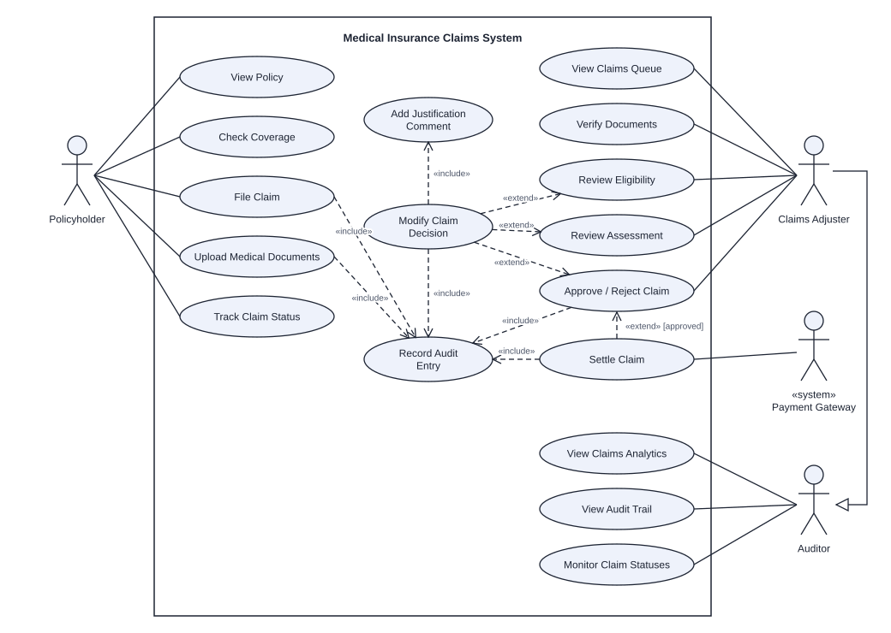

# Medical Insurance Claims Platform

A cloud-native system for processing medical insurance claims. It covers the full journey from filing a claim to settlement: eight microservices, with a **three-phase commit (3PC)** protocol making settlement all or nothing.

> **Status:** design phase, draft 1. This README covers the business (black-box) view only. The technical architecture, service placement and deployment come next.

---

## Contents

- [Actors](#actors)
- [Portals](#portals)
- [Business flow](#business-flow)
- [Use case diagram](#use-case-diagram)
- [Activity diagram](#activity-diagram)
- [Happy path sequence diagram](#happy-path-sequence-diagram)

---

## Actors

| Actor | Role |
|---|---|
| **Policyholder** (customer) | Files and tracks claims. Talks only to the Claim Intake service. |
| **Claims Adjuster** | Reviews claims and can change eligibility, assessment and approval, always with a written justification. Also acts as the **Auditor**. |
| **Payment Gateway** (external system) | Pays out settled claims. Simulated, and able to fail on demand. |

## Portals

**Customer portal**: check my policy, check coverage, file a claim, upload documents, check claim status.

**Adjuster / ops console**: a queue of claims waiting for review, the status of every claim, and the live Flink analytics dashboard.

## Business flow

1. The policyholder enters a policy number and sees coverage terms, limits, deductible and validity dates.
2. They submit a claim. The claim is created with an ID and a status.
3. They upload medical documents, which are attached to the claim and verified.
4. Eligibility checks run.
5. The claim amount is assessed.
6. The claim is approved or rejected.
7. The claim is settled using **three-phase commit**.
8. Every step is **audited**.

From step 4 to step 6 the adjuster can make changes, and each change needs a comment explaining why.

---

## Use case diagram

- **Claims Adjuster generalizes Auditor** (hollow triangle), so the adjuster inherits every auditor use case.
- **Modify Claim Decision** `«extend»`s the three review steps, and always `«include»`s a justification comment.
- **Record Audit Entry** is `«include»`d by every use case that changes a claim.
- **Settle Claim** `«extend»`s Approve / Reject only on the condition `[approved]`, and involves the payment gateway.

## Activity diagram

- **Parallel flows:** eligibility and assessment run at the same time, and the policyholder can track status meanwhile (that branch ends at a flow-final node). Reserving the payout and disbursing payment also run in parallel.
- **Loop:** incomplete documents send the policyholder back to upload again.
- **Two outcomes:** a rejected claim or a settled claim.

## Happy path sequence diagram

- **Arrows:** a filled head is a synchronous call, an open head is an asynchronous message, and a dashed line is a reply.
- **Assumption:** Claim Intake drives the workflow. Which service orchestrates is still to be decided.
- **`ref` frame:** settlement is its own interaction and will be drawn separately, showing the full three-phase commit and its failure cases.

---

## Services

| # | Service | Responsibility |
|---|---|---|
| 1 | Policy | Retrieves policy details and coverage terms |
| 2 | Claim Intake | Creates and tracks claim requests |
| 3 | Document Verification | Validates required claim documents |
| 4 | Eligibility | Checks whether the claim falls within policy coverage |
| 5 | Assessment | Calculates a proposed claim amount |
| 6 | Approval | Records approval or rejection decisions |
| 7 | Payment | Simulates settlement and payment failure |
| 8 | Audit | Records transaction decisions, state changes and recovery actions |

