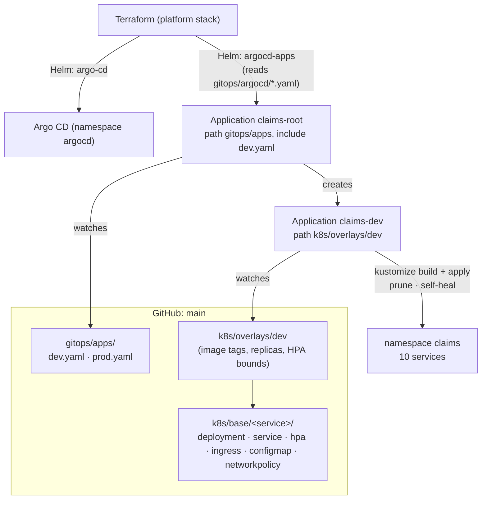
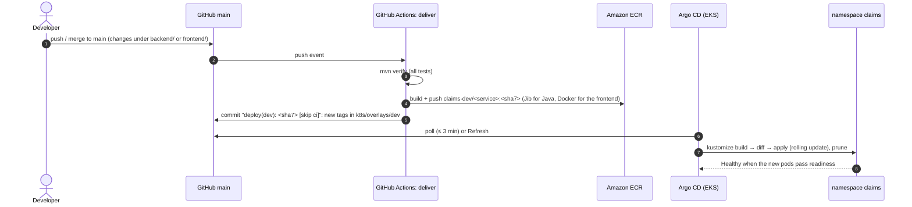

# Argo CD (GitOps)

How the claims platform's services get onto Kubernetes. Git is the only way in: nobody runs `kubectl apply` for a service, and the CI pipeline never talks to the cluster. Argo CD runs inside the EKS cluster, watches this repository, and makes the cluster match what is on `main`.

This file covers how it is built, why it is designed that way, how to sign in, and a set of demo commits that show it working. CI and rollback details are also in [gitops/README.md](gitops/README.md).

---

## 1. Sign in

| | |
|---|---|
| **URL** | `http://` + the output of `kubectl -n argocd get ingress argocd-server -o jsonpath='{.status.loadBalancer.ingress[0].hostname}'` (dev today: http://k8s-argocd-argocdse-628fffcf34-1068542555.ap-south-1.elb.amazonaws.com) |
| **Username** | `admin` |
| **Password** | generated by Argo CD at install time. Read it with the command below |
| **Who can reach it** | only the IPs in `ingress_allowed_cidrs` (`infra/terraform/platform/terraform.tfvars`). If the page times out, your public IP has probably changed: add it there and run `terraform apply` in `infra/terraform/platform` |

```bash
# Git Bash / Linux / macOS
kubectl -n argocd get secret argocd-initial-admin-secret -o jsonpath='{.data.password}' | base64 -d; echo
```

```powershell
# PowerShell
[Text.Encoding]::UTF8.GetString([Convert]::FromBase64String((kubectl -n argocd get secret argocd-initial-admin-secret -o jsonpath='{.data.password}')))
```

The password isn't written in this repository on purpose: the repository is shared, and that password grants deploy rights over the cluster. It is plain HTTP, so treat it as a demo credential. To change it, sign in, then **User Info → Update Password**, or run `argocd account update-password` with the CLI. After that, the `argocd-initial-admin-secret` Secret can be deleted.

Without the ALB (`expose_argocd = false`):

```bash
kubectl -n argocd port-forward svc/argocd-server 8080:80      # then http://localhost:8080
```

### From the terminal, without the UI

```bash
kubectl -n argocd get applications                            # claims-root and claims-dev: Synced / Healthy
kubectl -n argocd get application claims-dev -o jsonpath='{.status.sync.revision}{"\n"}'     # the Git commit running now
kubectl -n argocd annotate application claims-dev argocd.argoproj.io/refresh=normal --overwrite   # check Git now instead of waiting up to 3 min
```

---

## 2. How it is implemented

### What gets installed, and by whom

| Piece | Created by | Where |
|---|---|---|
| Argo CD itself (Helm chart `argo-cd` 7.9.1, Argo CD 2.14) in namespace `argocd` | Terraform, `platform` stack | [infra/terraform/platform/argocd.tf](infra/terraform/platform/argocd.tf) |
| Its ALB, restricted to `ingress_allowed_cidrs` | the same Helm release (`expose_argocd = true`) | `argocd.tf`, `argocd_ingress_values` |
| The **AppProject** `claims` and the **root Application** `claims-root` | Terraform, through the `argocd-apps` Helm chart, **reading the YAML files in Git** | [argocd-root-app.tf](infra/terraform/platform/argocd-root-app.tf) ← [gitops/argocd/project.yaml](gitops/argocd/project.yaml), [gitops/argocd/root-app.yaml](gitops/argocd/root-app.yaml) |
| The child Application `claims-dev` | **Argo CD itself**, from Git | [gitops/apps/dev.yaml](gitops/apps/dev.yaml) |
| Every service's Deployment, Service, HPA, Ingress, NetworkPolicy and ConfigMap | **Argo CD**, from Git | [k8s/overlays/dev](k8s/overlays/dev) → [k8s/base](k8s/base) |

Turned off to save pods: Dex (SSO) and the notifications controller. The server runs with `server.insecure = true`, because TLS would be terminated in front of it, and the dev ALB is plain HTTP.

### App of apps



1. **`claims-root`**, the "app of apps", watches `gitops/apps/`. Terraform sets its `directory.include` to `<env>.yaml`, so the dev cluster only ever creates `claims-dev`. A prod cluster, with its own Terraform state, would create only `claims-prod`.
2. **`claims-dev`** points at `k8s/overlays/dev`. Argo CD runs `kustomize build` there (base + dev overlay) and applies the result to the `claims` namespace.

### The sync policy of `claims-dev`

```yaml
syncPolicy:
  automated:
    prune: true        # a manifest removed from Git is deleted from the cluster
    selfHeal: true     # a manual change in the cluster is reverted to what Git says
  syncOptions:
    - CreateNamespace=true
    - RespectIgnoreDifferences=true
  retry: { limit: 5, backoff: { duration: 10s, factor: 2, maxDuration: 3m } }
ignoreDifferences:
  - group: apps
    kind: Deployment
    jsonPointers: [/spec/replicas]     # the HPA owns the replica count, not Git
```

| Setting | Effect |
|---|---|
| **automated** | a new commit is applied without anyone pressing *Sync*. Argo CD polls Git every **3 minutes**, or immediately after a *Refresh* |
| **prune** | Git deletions are real deletions |
| **selfHeal** | `kubectl edit` / `scale` / `delete` on a managed object is undone within seconds |
| **ignoreDifferences `/spec/replicas`** | without it, self-heal would fight the HPA: Git says 1 pod, the HPA says 2, and self-heal would keep putting it back to 1 |
| **retry** | a sync that fails, for example because the API server is briefly unavailable, is retried 5 times with back-off |

### The AppProject `claims`: the guard rails

[gitops/argocd/project.yaml](gitops/argocd/project.yaml) limits what Argo CD may do on behalf of this repository:

- **Source:** only `https://github.com/Krisha-cmd/Insurance-claim.git`.
- **Destinations:** only the namespaces `claims` (the services) and `argocd` (child Applications).
- **Cluster-scoped kinds:** only `Namespace`. A manifest in Git can't create a ClusterRole, a CRD or anything else cluster-wide.
- **Orphaned resources:** anything in those namespaces that Git doesn't describe is flagged in the UI (warning only).

### How a code change reaches the cluster



- **CI never has cluster credentials.** It only pushes images, using GitHub OIDC to assume an AWS role that can push to ECR, and then makes a commit. The cluster pulls from Git.
- **The image tag is the commit ID** (`a7e5507`, `95bcd76`, …), so the running version is traceable to an exact commit.
- **A change to `k8s/` only** (replicas, a ConfigMap, an HPA bound) needs no CI at all. Argo CD deploys it directly. That path is the quickest to demonstrate.
- **`[skip ci]`** in a commit message stops the deliver workflow from running for that push. The tag-bump commit uses it so it doesn't trigger itself.

What Terraform keeps for itself in `claims`: the namespace, the `<service>-db` and `jwt-keys` Secrets, the `platform-endpoints` ConfigMap and the IRSA service accounts. The manifests only reference them, so secrets never live in Git.

### Why it is designed this way

| Decision | Reason |
|---|---|
| **Pull, not push** (Argo CD in the cluster pulls from Git) | the cluster's credentials never leave the cluster. CI can't break production by running a bad `kubectl` command |
| **Git is the single source of truth** | the running state can be read from Git, reviewed in a pull request, and audited in history. A rollback is a `git revert` |
| **Terraform installs Argo CD; Argo CD installs the apps** | Terraform is good at long-lived infrastructure, and Argo CD is good at frequent releases. Each tool does what it is good at |
| **The AppProject and root app are read from YAML in Git** (`yamldecode(file(...))`) | defined once: the same files bootstrap Argo CD with or without Terraform |
| **App of apps, one environment per cluster** | adding an environment means one file in `gitops/apps/`. A dev cluster can never accidentally sync prod |
| **Kustomize base + overlays** | each manifest is written once in `base`. Environments differ only in what the overlay patches: image tags, replicas, HPA bounds, chaos flags |
| **Self-heal + ignore replicas** | drift is corrected automatically, but autoscaling still works |

---

## 3. Demo commits

Each demo is a small, harmless change, with what to watch in the Argo CD UI (**Applications → claims-dev**) and how to undo it. Open the UI before pushing, then press **Refresh** on `claims-dev` after the push to skip the up-to-3-minute poll.

> Each push below goes to `main` and deploys to the shared dev environment. Undo each demo by reverting its commit, which is itself the "rollback" demo.

### A. GitOps only: no build, visible in about a minute

These touch only `k8s/`, so the deliver workflow doesn't run. Argo CD applies them directly.

#### A1. Scale the frontend: watch a pod appear

`k8s/overlays/dev/kustomization.yaml`, in the frontend HPA patch:

```yaml
- patch: |-
    - { op: replace, path: /spec/minReplicas, value: 2 }   # was 1
    - { op: replace, path: /spec/maxReplicas, value: 3 }   # was 2
  target:
    kind: HorizontalPodAutoscaler
    name: frontend
```

```bash
git commit -am "demo(argocd): run at least 2 frontend pods" && git push
```

**Watch:** `claims-dev` turns **OutOfSync**, then syncs. In the resource tree, `hpa/frontend` updates and a second `frontend` pod appears under its ReplicaSet. `kubectl -n claims get pods -l app.kubernetes.io/name=frontend` shows 2.

#### A2. Change the website's runtime config: visible in the browser

`config.js` is mounted with `subPath`, so a ConfigMap change only reaches nginx when the pod restarts. Change the ConfigMap **and** bump a pod-template annotation in the same commit. The annotation makes the Deployment roll.

`k8s/base/frontend/configmap.yaml`:

```yaml
  config.js: |
    window.__APP_CONFIG__ = {
      API_BASE_URL: window.location.origin,
      USE_MOCKS: "false",
      DEPLOYED_BY: "argocd-demo-1",
    };
```

`k8s/base/frontend/deployment.yaml`, under `spec.template.metadata`:

```yaml
      annotations:
        demo/config-revision: "1"    # bump to roll the pods after a config change
```

```bash
git commit -am "demo(argocd): mark config.js as deployed by Argo CD" && git push
```

**Watch:** ConfigMap `frontend-config` changes, a new ReplicaSet appears and the old pod is replaced (a rolling update). Then open `http://<site>/config.js`: it contains `DEPLOYED_BY: "argocd-demo-1"`. The app ignores the extra key, so nothing breaks.

#### A3. Prune: Git deletions are real deletions

Create `k8s/base/frontend/demo-note.yaml`:

```yaml
apiVersion: v1
kind: ConfigMap
metadata:
  name: argocd-demo-note
  labels: { app.kubernetes.io/part-of: claims }
data:
  note: "Created from Git by Argo CD. Delete this file and Argo CD deletes the ConfigMap."
```

Add `- demo-note.yaml` under `resources:` in `k8s/base/frontend/kustomization.yaml`, then commit and push. **Watch:** `cm/argocd-demo-note` appears in the tree, and `kubectl -n claims get cm argocd-demo-note` finds it.

Then delete the file, remove the line, and commit and push again. **Watch:** the ConfigMap is **pruned**, it disappears from the tree and from the cluster.

#### A4. Rollback: `git revert`

```bash
git revert --no-edit HEAD && git push        # undoes the last demo
```

**Watch:** a new sync to the reverted state. The **History and Rollback** panel lists every revision Argo CD has deployed, each tied to a Git commit. Rolling back through Git rather than the UI's *Rollback* button keeps Git and the cluster in agreement. A UI rollback would be undone by the next automated sync.

### B. Self-heal: no commit at all

Change the cluster by hand and watch Argo CD put it back:

```bash
kubectl -n claims scale deployment frontend --replicas=0         # the website goes down …
kubectl -n claims get pods -l app.kubernetes.io/name=frontend -w # … and comes back within seconds

kubectl -n claims delete hpa frontend                            # recreated almost immediately
kubectl -n claims get hpa frontend
kubectl -n claims patch configmap claim-intake-config --type merge -p '{"data":{"GRPC_PORT":"9999"}}'
kubectl -n claims get configmap claim-intake-config -o jsonpath='{.data.GRPC_PORT}'; echo     # back to 9090
```

**Watch:** the app flips to **OutOfSync** for a moment, then to **Synced**, and the event log shows the self-heal sync. A manually *scaled* Deployment is the one exception: replicas are ignored on purpose, so the HPA restores the count instead. Run `kubectl -n claims get hpa frontend` to see it.

### C. Code changes: through CI, about 10–15 minutes

These touch `frontend/` or `backend/`, so pushing them runs the **deliver** workflow:
1. it runs all tests;
2. it builds every image;
3. it commits `deploy(dev): <sha> [skip ci]` with the new tags;
4. Argo CD rolls out the services whose image changed.

Follow it in GitHub → **Actions → deliver**, then in Argo CD.

#### C1. Frontend: a visible text change on the sign-in page

`frontend/src/pages/login/LoginPage.jsx`:

```jsx
<p className={s.subtitle}>File and track medical claims, or review them as an adjuster. Deployed by Argo CD.</p>
```

```bash
git commit -am "demo(argocd): sign-in page subtitle" && git push
```

**Watch:**
1. *deliver* goes green.
2. A `deploy(dev): <sha7>` commit appears on `main`.
3. In Argo CD, every Deployment's image tag changes to `<sha7>`. Only pods whose image *content* changed really differ; the frontend's does.
4. The sign-in page shows the new sentence after a hard refresh (Ctrl+F5).

#### C2. Frontend: change the brand colour

`frontend/src/styles/tokens.css`:

```css
  --accent: #0f8a5f;   /* was #1f5fbf: buttons and links turn green */
```

Same flow as C1: every button and link turns green once the new frontend pod is live. It is easy to spot from across a room.

#### C3. Backend: rename an eligibility rule

`backend/services/eligibility/src/main/java/com/claims/eligibility/rules/PolicyActiveRule.java`:

```java
@Override public String label() { return "Policy is active and in force"; }
```

```bash
git commit -am "demo(argocd): clearer eligibility rule label" && git push
```

**Watch:** after *deliver*, Argo CD rolls the `eligibility` Deployment. File a new claim and upload its three required documents. On the adjuster's **Eligibility** tab, the first check now reads "Policy is active and in force". Claims checked before the deploy keep their old label, which shows that the change applies from the moment the new version is running.

#### C4. Backend: a config-only change (no build)

Service settings in `k8s/base/<service>/configmap.yaml` deploy without CI. For example, to turn the chaos endpoints off in dev, change the patch at the end of `k8s/overlays/dev/kustomization.yaml`:

```yaml
- patch: '- { op: replace, path: /data/CHAOS_ENABLED, value: "false" }'
  target: { kind: ConfigMap, name: approval-config }
```

Then commit, push and Refresh. Because services read ConfigMaps as environment variables at startup, restart the pod once the sync finishes: `kubectl -n claims rollout restart deployment/approval`. Alternatively, add a pod annotation as in A2, which keeps the whole change in Git. The fix that let claims leave *Documents pending* (`55cc954`, `REQUIRED_DOC_TYPES` in `claim-intake-config`) was deployed exactly this way.

### Suggested 5-minute demo script

1. Open Argo CD → `claims-dev`, and show the tree: 10 services, all Synced and Healthy, with the running Git commit.
2. **A1**: push, Refresh, and a second frontend pod appears.
3. **B**: `kubectl -n claims delete hpa frontend`, and it comes back by itself.
4. **A3**: add the note ConfigMap, then delete it, and it is pruned.
5. **A4**: `git revert` A1, and back to 1 pod. Show **History and Rollback**.
6. *(If time allows)* **C1**: show the CI run and the `deploy(dev)` commit, then the new sign-in text.

---

## 4. Troubleshooting

| Symptom | Cause and fix |
|---|---|
| The UI times out | Your IP isn't in `ingress_allowed_cidrs`. Check it with `curl https://checkip.amazonaws.com`, add it, then `terraform apply` in `infra/terraform/platform` |
| `claims-dev` is **OutOfSync** and stays that way | Open **App Details → Events / Sync status**. Usually a manifest error: run `kubectl kustomize k8s/overlays/dev` locally to see it |
| **Degraded**, with a pod in `ImagePullBackOff` | The overlay points at a tag that isn't in ECR (for example after ECR was recreated). Build and push it, or let *deliver* run |
| Synced, but a service doesn't use the new config | ConfigMaps are read at startup. Restart the Deployment, or bump a pod annotation (A2) |
| Nothing happens after a push | Argo CD polls every 3 minutes. Press **Refresh**, or run `kubectl -n argocd annotate application claims-dev argocd.argoproj.io/refresh=normal --overwrite` |
| *deliver* didn't run after a code push | The commit message contained `[skip ci]`, or the change was outside `backend/`, `frontend/` and the workflow file. GitHub needs the `dev` environment's `AWS_ROLE_ARN` and `AWS_REGION` variables |
