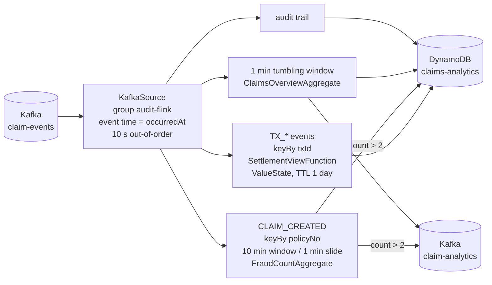

# Audit Flink Job

The real-time stream processor of the claims platform. It reads every event from the Kafka topic `claim-events`, keeps the audit trail, computes windowed analytics, and writes the results to the `claim-analytics` topic and the DynamoDB table `claims-analytics` (single-table design, see [NoSQL DB](../../../README.md#nosql-db)).

Built for **Apache Flink 1.20** on **Java 17**, which is what EMR `emr-7.6.0` and later run.

## Pipeline



| Output | DynamoDB `PK` / `SK` | Kafka `claim-analytics` |
|---|---|---|
| Audit event, one per input event with a `claimId` | `CLAIM#<claimId>` / `EVENT#<isoTs>#<eventId>`, plus `GSI1PK=TYPE#<eventType>`, `GSI1SK=<isoTs>` | no |
| Claims overview: counts by `toStatus`, approval rate, total and average claimed, settlement commits and aborts | `METRIC#claims_overview#1m` / `WINDOW#<windowStart>`, `ttl` = 7 days | `{"type":"WindowAggregate",...}` |
| Fraud flag: more than 2 distinct new claims on one policy in a 10-minute window | `FRAUD#<policyNo>` / `WINDOW#<windowEnd>`, `ttl` = 7 days, plus `GSI1PK=TYPE#FraudFlag`, `GSI1SK=<windowEnd>` (so the Ops Dashboard lists every policy's flags with one Query) | `{"type":"FraudFlag",...}` |
| Settlement view: current state of a 3PC transaction | `TX#<txId>` / `STATE` | no |

Every 1-minute slide re-checks the last 10 minutes, so one burst of claims raises a flag in each window that contains it (up to 10 items `FRAUD#<policy>` / `WINDOW#...`, one per window end).

**Guarantees.** Checkpoints are exactly-once every 30 s. The Kafka sink is `AT_LEAST_ONCE`, and every DynamoDB write is a PUT on a deterministic key, so a replay after a failure overwrites the same items instead of adding duplicates. Messages that are not valid JSON, or lack `eventId`, `eventType` or `occurredAt`, are logged and skipped.

## Input events

One JSON envelope for every event type. Fields that don't apply are left out or `null`. `occurredAt` can be epoch millis or an ISO-8601 string.

```json
{
  "eventId": "e-77f1",
  "eventType": "ASSESSMENT_ADJUSTED",
  "occurredAt": "2026-11-16T14:05:12.331Z",
  "service": "assessment",
  "claimId": "c-1042",
  "policyNo": "POL-2026-00017",
  "actor": { "id": "u-adj-01", "role": "ADJUSTER", "name": "Rohan Mehta" },
  "fromStatus": "ASSESSED",
  "toStatus": "UNDER_REVIEW",
  "amount": 76500,
  "change": { "field": "proposedAmount", "before": 82000, "after": 76500 },
  "comment": "Room rent above plan limit; capped per sub-limit",
  "txId": null, "phase": null, "participant": null, "vote": null, "participantState": null
}
```

Event types the job reads specially. Every other type is only audited.

| `eventType` | Used for |
|---|---|
| `CLAIM_CREATED` (with `policyNo`, `amount`) | claims created, total and average claimed, fraud detection |
| any event with `toStatus` | `countsByStatus`; `APPROVED` / `REJECTED` give the approval rate |
| `TX_STARTED` | settlement view; its `service` is the coordinator |
| `TX_VOTE`, `TX_PARTICIPANT_STATE` (with `participant`, `vote`, `participantState`) | a participant's vote and state |
| `TX_PHASE_CHANGED` (or any `TX_*` with `phase`) | the coordinator phase |
| `TX_COMMITTED` / `TX_ABORTED` | the outcome, and settlement commits / aborts |

## Configuration

Each setting is read from a job argument, then an environment variable, then a default.

| Argument | Env | Default |
|---|---|---|
| `--bootstrap` (or `--bootstrap-servers`) | `KAFKA_BOOTSTRAP` | `localhost:9092` |
| `--events-topic` (or `--source-topic`) | `EVENTS_TOPIC` | `claim-events` |
| `--results-topic` | `RESULTS_TOPIC` | `claim-analytics` |
| `--table` | `ANALYTICS_TABLE` | `claims-dev-analytics` |
| `--region` | `AWS_REGION` | `ap-south-1` |
| `--checkpoint-dir` | `CHECKPOINT_DIR` | `file:///tmp/audit-flink/checkpoints` |
| `--dynamodb-endpoint` (local only) | `DYNAMODB_ENDPOINT` | the real AWS endpoint |

## Build and test

Needs JDK 17 and Maven. Run from `backend/`:

```bash
mvn -f analytics/audit-flink/pom.xml package
```

This runs the unit tests (each aggregate, the settlement function in a `KeyedOneInputStreamOperatorTestHarness`, the DynamoDB item layout, the deserializer) and a MiniCluster test that pushes a fixed list of timestamped events through the whole topology. It checks the window output, a fraud flag for 3 claims on one policy within 10 minutes, and no flag for 3 claims spread over 15 minutes. The fat jar is `target/audit-flink.jar`.

## Run locally

**1. Start Kafka and DynamoDB Local** (from this folder):

```bash
docker compose up -d
```

```bash
docker compose exec kafka /opt/kafka/bin/kafka-topics.sh --bootstrap-server localhost:9092 --create --topic claim-events --partitions 1
```

```bash
docker compose exec kafka /opt/kafka/bin/kafka-topics.sh --bootstrap-server localhost:9092 --create --topic claim-analytics --partitions 1
```

```bash
AWS_ACCESS_KEY_ID=local AWS_SECRET_ACCESS_KEY=local aws dynamodb create-table --endpoint-url http://localhost:8000 --region ap-south-1 \
  --table-name claims-dev-analytics --billing-mode PAY_PER_REQUEST \
  --attribute-definitions AttributeName=PK,AttributeType=S AttributeName=SK,AttributeType=S AttributeName=GSI1PK,AttributeType=S AttributeName=GSI1SK,AttributeType=S \
  --key-schema AttributeName=PK,KeyType=HASH AttributeName=SK,KeyType=RANGE \
  --global-secondary-indexes 'IndexName=GSI1,KeySchema=[{AttributeName=GSI1PK,KeyType=HASH},{AttributeName=GSI1SK,KeyType=RANGE}],Projection={ProjectionType=ALL}'
```

**2. Start a local Flink 1.20 cluster** ([download](https://archive.apache.org/dist/flink/flink-1.20.0/flink-1.20.0-bin-scala_2.12.tgz) and unpack it). The DynamoDB Local credentials must be in the environment of the TaskManager, so export them before starting:

```bash
export AWS_ACCESS_KEY_ID=local AWS_SECRET_ACCESS_KEY=local
```

```bash
./flink-1.20.0/bin/start-cluster.sh
```

**3. Submit the job:**

```bash
./flink-1.20.0/bin/flink run -d target/audit-flink.jar --bootstrap localhost:9092 --table claims-dev-analytics --region ap-south-1 --dynamodb-endpoint http://localhost:8000 --checkpoint-dir file:///tmp/audit-flink/checkpoints
```

The Flink UI is at http://localhost:8081.

**4. Send the sample events.** [`sample-events.jsonl`](sample-events.jsonl) holds one claim lifecycle, a full 3PC commit and three claims on `POL-2026-00017` within 10 minutes. Its last event is 18 minutes later, which moves the watermark past every window.

```bash
docker compose exec -T kafka /opt/kafka/bin/kafka-console-producer.sh --bootstrap-server localhost:9092 --topic claim-events < sample-events.jsonl
```

**5. Look at the results:**

```bash
docker compose exec kafka /opt/kafka/bin/kafka-console-consumer.sh --bootstrap-server localhost:9092 --topic claim-analytics --from-beginning
```

```bash
AWS_ACCESS_KEY_ID=local AWS_SECRET_ACCESS_KEY=local aws dynamodb query --endpoint-url http://localhost:8000 --region ap-south-1 --table-name claims-dev-analytics --key-condition-expression 'PK = :pk' --expression-attribute-values '{":pk":{"S":"FRAUD#POL-2026-00017"}}'
```

Stop everything with `./flink-1.20.0/bin/stop-cluster.sh` and `docker compose down`.

> Running `AuditAnalyticsJob.main()` from an IDE also works: put the `provided` dependencies on the run classpath and add the JVM `--add-opens` flags listed in this module's `pom.xml` (surefire `argLine`).

## Run on EMR

The cluster, MSK, the bucket and the table come from [`infra/terraform`](../../../infra/README.md). The cluster must run `emr-7.6.0` or later (Flink 1.20). Its instance role can read the artifacts bucket and write checkpoints under `flink/checkpoints/`.

From `infra/terraform/infra`, after `mvn -f analytics/audit-flink/pom.xml package` in `backend/`:

```bash
CLUSTER_ID=$(terraform output -raw emr_cluster_id)
ARTIFACTS=$(terraform output -raw artifacts_bucket)
BROKERS=$(terraform output -raw msk_bootstrap_brokers)
TABLE=$(terraform output -raw analytics_table_name)
REGION=ap-south-1   # the region in dev.tfvars
```

```bash
aws s3 cp ../../../backend/analytics/audit-flink/target/audit-flink.jar s3://$ARTIFACTS/flink/audit-flink.jar
```

Step 1 starts a detached Flink YARN session. Step 2 copies the jar to the primary node and runs it in that session:

```bash
aws emr add-steps --cluster-id "$CLUSTER_ID" --steps \
  "Type=CUSTOM_JAR,Name=flink-session,ActionOnFailure=CONTINUE,Jar=command-runner.jar,Args=[flink-yarn-session,-d]" \
  "Type=CUSTOM_JAR,Name=audit-flink,ActionOnFailure=CONTINUE,Jar=command-runner.jar,Args=[bash,-c,aws s3 cp s3://$ARTIFACTS/flink/audit-flink.jar /home/hadoop/audit-flink.jar && flink run -d /home/hadoop/audit-flink.jar --bootstrap $BROKERS --events-topic claim-events --results-topic claim-analytics --table $TABLE --region $REGION --checkpoint-dir s3://$ARTIFACTS/flink/checkpoints]"
```

```bash
aws emr list-steps --cluster-id "$CLUSTER_ID" --query 'Steps[].{Name:Name,State:Status.State}' --output table
```

Both steps should reach `COMPLETED`. The job keeps running inside the session, and its logs go to the CloudWatch log group `/aws/emr/claims-dev/flink`.

## Code map

```
src/main/java/com/claims/analytics/
  AuditAnalyticsJob.java            main(), sources/sinks, and analytics() (the topology, used by the tests)
  config/JobConfig.java             arguments / env / defaults
  model/                            ClaimEvent, ClaimsOverview, FraudFlag, SettlementView, EventTypes, Timestamps
  serde/ClaimEventDeserializer.java Kafka JSON -> ClaimEvent (skips bad messages)
  serde/JsonSerializer.java         result -> claim-analytics JSON
  functions/                        ClaimsOverviewAggregate + WindowFunction, FraudCountAggregate + FraudFlagWindowFunction,
                                    SettlementViewFunction
  sinks/DynamoItems.java            single-table items and the DynamoDB sink element converters
```
