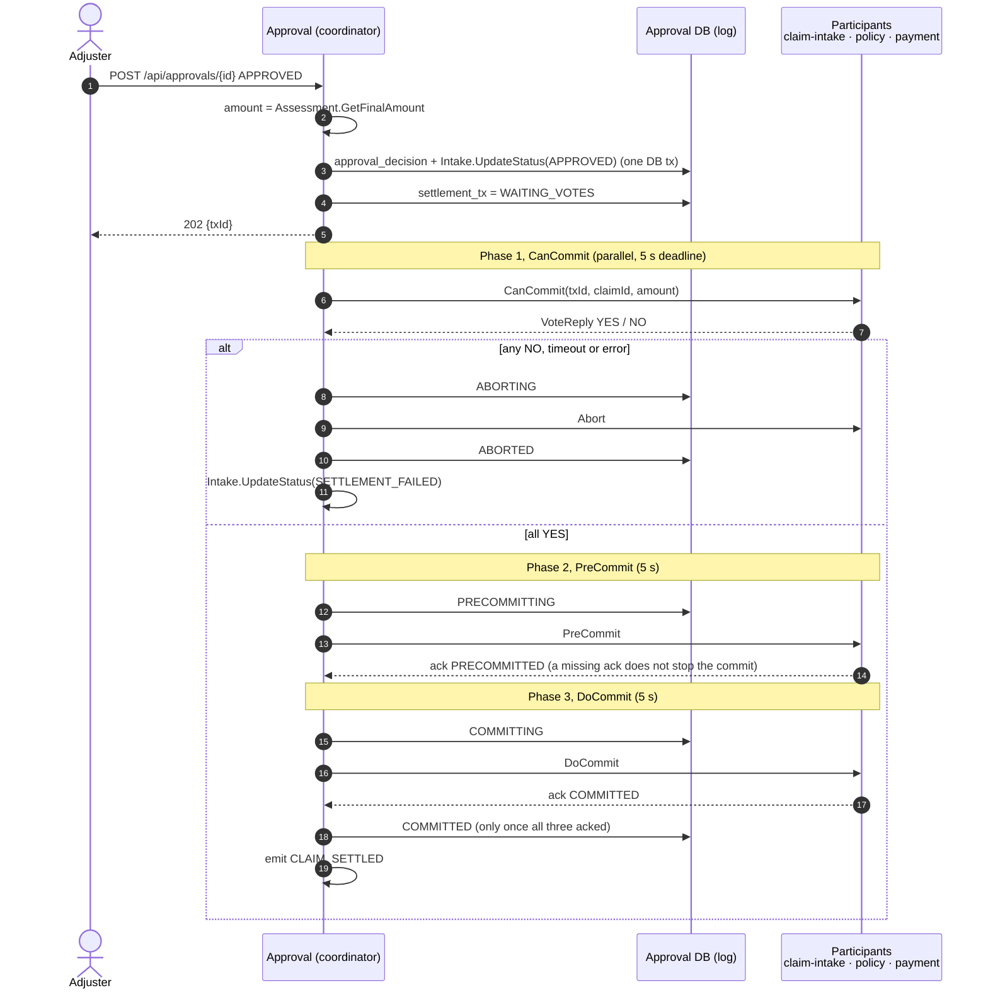

# Approval service

Records the adjuster's decision on a claim. When the claim is approved, it **settles the claim with a
three-phase commit (3PC)** across Claim Intake, Policy and Payment. Approval is the coordinator: its
Postgres database holds the coordinator's log, so a crash at any point can be finished by the recovery job.

```
REST (adjusters only)          gRPC (cluster-internal)
─────────────────────          ──────────────────────────────────────────────
POST /api/approvals/{id}  ──▶  AssessmentService.GetFinalAmount   (assessment)
GET  …/{id}/settlement         ClaimService.UpdateStatus          (claim-intake)
POST …/{id}/settlement/retry   SettlementParticipant ×3           (claim-intake, policy, payment)
POST /internal/chaos           Kafka claim-events                 (audit trail, when MSK is on)
```

The contracts are in [`backend/proto`](../../proto/src/main/proto).

## REST API

These are `ENDPOINTS.approval` in [`frontend/src/config/api.js`](../../../frontend/src/config/api.js). Each
call needs the login service's JWT with `role = ADJUSTER`. A missing or expired token gets 401, and a
policyholder token gets 403. Every error uses the shared `ApiError` shape `{status, message, path, timestamp}`.

| Method & path | Body | Result |
| --- | --- | --- |
| `POST /api/approvals/{claimId}` | `{decision: "APPROVED"\|"REJECTED", comment}` (comment ≥ 10 chars) | **REJECTED** → `200`; the claim becomes `REJECTED` and `CLAIM_REJECTED` is emitted. **APPROVED** → reads the amount from Assessment, sets the claim to `APPROVED`, emits `CLAIM_APPROVED`, starts the settlement in the background → `202 {claimId, decision, status, txId, attempt: 1}` |
| `GET /api/approvals/{claimId}/settlement` | | `200 SettlementView` of the latest attempt, or `204` if none has started |
| `POST /api/approvals/{claimId}/settlement/retry` | | Allowed only after the last attempt `ABORTED`, or if an approved claim has no attempt. `202` with the new `txId` and `attempt + 1` |
| `POST /internal/chaos` | `{mode: NONE\|CRASH_BEFORE_PRECOMMIT\|CRASH_AFTER_PRECOMMIT}` | Arms a one-shot crash. Not routed by the ingress. `CHAOS_ENABLED=false` removes it |

Errors you can expect:

- **409:** a decision already exists; the claim has not been assessed; Claim Intake refuses the status
  change (its message is passed through); a settlement is already running; the claim is already settled.
- **503:** Assessment or Claim Intake is unreachable.

The decision row and the claim's status change succeed or fail together. The `UpdateStatus` call runs
inside the database transaction, so if Claim Intake refuses or is down, nothing is recorded and the
adjuster can simply try again.

`SettlementView` has exactly the shape the settlement stepper in the frontend reads:

```jsonc
{
  "transactionId": "…", "claimId": "…", "attempt": 1,
  "state": "COMMITTED",            // coordinator log state
  "phase": "DONE",                 // CAN_COMMIT | PRE_COMMIT | DO_COMMIT | DONE
  "outcome": "COMMITTED",          // IN_PROGRESS | COMMITTED | ABORTED
  "coordinator": "UP", "amount": 67500.00,
  "participants": [ { "name": "CLAIM_INTAKE", "participant": "claim-intake", "vote": "YES",
                      "state": "COMMITTED", "preCommitAck": true, "doCommitAck": true,
                      "aborted": false, "lastContactAt": "…", "error": null }, … ],
  "startedAt": "…", "finishedAt": "…", "abortReason": null,
  "log": [ { "at": "…", "message": "…", "level": "info" }, … ]
}
```

`log` is a short history rebuilt from the coordinator log. The complete step-by-step trail is the
`TX_*` events on `claim-events`.

## The protocol



The rule that makes recovery possible: **the coordinator writes the next state to the log before it
sends a phase's messages.** Every participant call is idempotent, so repeating a phase is always safe.

```
WAITING_VOTES ──all YES──▶ PRECOMMITTING ──▶ COMMITTING ──all acked──▶ COMMITTED
      │
      └── NO / timeout / crash ──▶ ABORTING ──▶ ABORTED
```

Once `PRECOMMITTING` is logged, everyone has voted YES, so the only possible outcome is commit.
A participant that is `PRECOMMITTED` and hears nothing commits on its own timeout. One that is only
`PREPARED` aborts on its own timeout.

### Recovery

`CoordinatorRecovery` runs on `ApplicationReadyEvent` and every 30 s. It picks up each unfinished tx
that has been idle for at least `recovery-stale-after` (15 s) and is not being run by this process:

| Logged state | Action | Why |
| --- | --- | --- |
| `WAITING_VOTES` | Abort all, then `ABORTED` and the claim becomes `SETTLEMENT_FAILED` | Not all YES votes are known |
| `PRECOMMITTING` / `COMMITTING` | DoCommit to all, then `COMMITTED` | Everyone voted YES |
| `ABORTING` | Abort to all, then `ABORTED` | The decision was abort |

Each recovery emits `TX_RECOVERY {fromState, action}`.

### Failure scenarios

| Scenario | What happens | Covered by |
| --- | --- | --- |
| All vote YES | `COMMITTED`; each participant gets CanCommit → PreCommit → DoCommit | `happyPath_allYes_…` |
| Payment votes NO | `ABORTED`; all get Abort; claim `SETTLEMENT_FAILED`; `abortReason = "payment voted NO in CanCommit: …"` | `paymentVotesNo_…` |
| A participant does not answer CanCommit within 5 s | Counts as NO, so `ABORTED` | `participantTimesOutInPhaseOne_aborts` |
| Coordinator crashes after PRECOMMITTING (`CRASH_AFTER_PRECOMMIT`) | Restart → recovery sends DoCommit → `COMMITTED` | `crashAfterPrecommit_…` |
| Coordinator crashes after the votes, before PRECOMMITTING (`CRASH_BEFORE_PRECOMMIT`) | Restart → recovery aborts | `crashWhileWaitingForVotes_…` |
| A participant misses DoCommit | Stays `COMMITTING`; the sweep resends DoCommit until it acks | `missingDoCommitAck_…` |
| Adjuster retries after an abort | New tx, `attempt = 2` | `retryAfterAbort_startsAttemptTwo` |
| Retry while a settlement is running / after commit | 409 (a partial unique index allows one unfinished tx per claim) | `retryIsRefused…`, `retryAfterAbort…` |
| Claim Intake refuses `APPROVED` | 409, decision rolled back, no settlement | `whenClaimIntakeRefuses…` |

### Chaos for the demo

```bash
# from inside the cluster (e.g. the ops-dashboard pod, or kubectl port-forward svc/approval 8080:80)
curl -X POST localhost:8080/internal/chaos -H 'Content-Type: application/json' -d '{"mode":"CRASH_AFTER_PRECOMMIT"}'
```

The next settlement logs `PRECOMMITTING`, collects the PreCommit acks, publishes `COORDINATOR_CRASHED`
and calls `Runtime.halt(1)`. Kubernetes restarts the pod, and startup recovery finishes the commit.
The switch is in memory and one-shot, so it resets to `NONE` after a crash.

## Events (`claim-events`, key = claimId)

| Event | When |
| --- | --- |
| `CLAIM_APPROVED`, `CLAIM_REJECTED` | Decision recorded (actor = the adjuster, with comment and amount) |
| `TX_STARTED`, `SETTLEMENT_RETRIED` | A tx is logged (attempt, amount, participants) |
| `TX_VOTE` | Each participant's vote, or `NONE` with the error |
| `TX_PRECOMMIT`, `TX_PRECOMMIT_ACKS` | Phase 2 logged; who acknowledged |
| `TX_DOCOMMIT`, `TX_DOCOMMIT_INCOMPLETE`, `TX_COMMITTED`, `CLAIM_SETTLED` | Phase 3 |
| `TX_ABORT`, `TX_ABORTED` | Abort logged / finished (with reason) |
| `TX_RECOVERY`, `COORDINATOR_CRASHED` | Recovery action; chaos crash |

Every event uses the shared envelope in `common` (`ClaimEvent`), which is what the Audit Flink job reads:
`occurredAt`, top-level `amount`, and on `TX_VOTE` top-level `participant` / `vote` / `participantState`.
Approval never sets `toStatus`: Claim Intake owns the claim status and emits `CLAIM_STATUS_CHANGED` for
every change, so the Flink job counts each status once. Every `TX_*` event carries `txId` and `phase`. With no `KAFKA_BOOTSTRAP` (MSK disabled), events are only
logged; the coordinator log in Postgres stays the source of truth either way.

## Data (Approval DB)

- `approval_decision`: one row per claim (`claim_id` is unique); `amount` is NULL for a rejection.
- `settlement_tx`: one row per attempt. `state`, `attempt`, and `version` for optimistic locking.
  It is unique on `(claim_id, attempt)`, with at most one unfinished tx per claim.
- `settlement_tx_participant`: `(tx_id, participant)` with `vote`, last acknowledged `state`,
  `last_contact_at` and `error`.

## Configuration

| Variable | Default | Notes |
| --- | --- | --- |
| `SPRING_DATASOURCE_URL/USERNAME/PASSWORD` | `localhost:5432/approval` | `approval-db` Secret on EKS |
| `JWT_JWKS_URI` | `http://localhost:8080/.well-known/jwks.json` | On EKS: `http://login.claims.svc.cluster.local/.well-known/jwks.json` |
| `GRPC_INTAKE_TARGET` / `GRPC_POLICY_TARGET` / `GRPC_PAYMENT_TARGET` | `dns:///claim-intake:9090` … | The three participants |
| `GRPC_ASSESSMENT_TARGET` | `dns:///assessment:9090` | |
| `GRPC_CLAIM_TARGET` | same as `GRPC_INTAKE_TARGET` | Claim Intake's `ClaimService` |
| `KAFKA_BOOTSTRAP` | empty | `platform-endpoints` ConfigMap |
| `CHAOS_ENABLED` | `true` | |

You add a participant through configuration only:
`claims.coordinator.participants[3].name=…` and `…[3].target=…`. Timeouts are set with
`claims.coordinator.phase-timeout` (5 s), `recovery-interval` (PT30S) and `recovery-stale-after` (15 s).

## Build and test

```bash
cd backend
mvn -pl services/approval -am verify     # needs Docker (Testcontainers Postgres)
```

The integration tests run the real Spring context against Postgres 16. Claim Intake, Policy, Payment,
Assessment and ClaimService are **in-process gRPC servers** (`support/Fake*`), so the real gRPC client
code is exercised. Instead of `halt(1)`, the chaos crash throws, which stops the settlement thread at the
crash point. "Restart" means calling `CoordinatorRecovery.onStartup()`.

## Known limits

- Run **one replica** of this service. A second replica's sweep would not touch txs that are still
  running (because of the staleness window), and version checks reject conflicting writes, but the
  recovery has not been designed or tested for active-active coordinators.
- The access token is not revoked at logout (login service limitation), so it stays valid until it expires.
