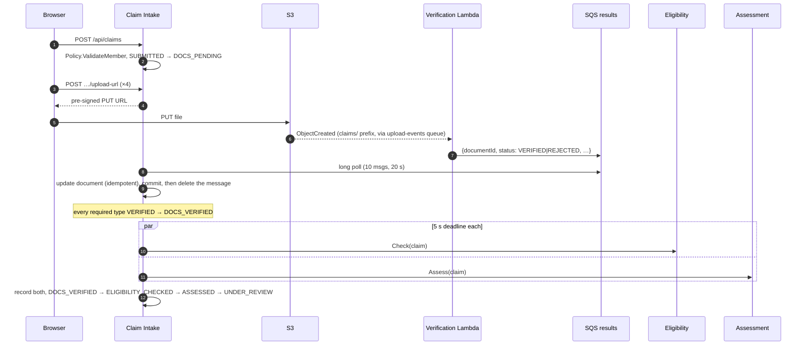

# Claim Intake service

The public entry point for claims, and the owner of each claim's status. It does five things:

- creates claims and issues pre-signed S3 upload URLs;
- reads the document verification results;
- runs Eligibility and Assessment in parallel once the documents are in;
- serves the adjuster queue;
- takes part in the settlement three-phase commit (3PC) for the claim itself.

```
REST :8080 (browser, via the ALB)          gRPC :9090 (inside the cluster)
──────────────────────────────────          ─────────────────────────────────────────────
POST /api/claims                     ──▶    PolicyService.ValidateMember        (policy)
GET  /api/claims/me | /{id} | /status       EligibilityService.Check            (eligibility)
POST /api/claims/{id}/documents/upload-url  AssessmentService.Assess            (assessment)
GET  /api/claims/{id}/documents
GET  /api/claims/queue | /api/claims        serves: ClaimService                (approval, eligibility, assessment)
                                                    SettlementParticipant       (approval = coordinator)
SQS  doc-verification-results  ──▶ listener        Kafka claim-events (when MSK is on)
S3   documents bucket  ◀── browser PUT (pre-signed)
```

The contracts are in [`backend/proto`](../../proto/src/main/proto).

## REST API

These are `ENDPOINTS.claims` in [`frontend/src/config/api.js`](../../../frontend/src/config/api.js). Each call
needs the login service's JWT. Errors use the shared `ApiError` shape `{status, message, path, timestamp}`.

| Method | Path | Who | Result |
| --- | --- | --- | --- |
| POST | `/api/claims` | POLICYHOLDER | Checks the policy and member through Policy (the policy must belong to the JWT's `policyholderId`). It creates the claim `CLM-<yyyy>-<6 digits>`, moves it from SUBMITTED to DOCS_PENDING, and returns `201` + `ClaimResponse` |
| GET | `/api/claims/me` | POLICYHOLDER | The caller's claims, newest first |
| GET | `/api/claims/{id}` | owner or ADJUSTER | The claim, its current documents, the latest eligibility result and the full status history |
| GET | `/api/claims/{id}/status` | owner or ADJUSTER | `{id, status, updatedAt}` (the frontend polls this) |
| POST | `/api/claims/{id}/documents/upload-url` | owner | `{fileName, contentType, docType, size?}` creates a PENDING document and returns `{uploadUrl, documentId, key, method: "PUT", headers, expiresAt}` |
| GET | `/api/claims/{id}/documents` | owner or ADJUSTER | Current documents with `status`, `reason` and a 5-minute `previewUrl` once checked |
| GET | `/api/claims/queue?page&size&status` | ADJUSTER | Claims in UNDER_REVIEW (or another reviewable status), oldest first |
| GET | `/api/claims?status&q&from&to&page&size` | ADJUSTER | Search: `q` matches the claim or policy number, `from`/`to` are inclusive `yyyy-MM-dd` dates; newest first |

Pages look like `{items, page, size, total}`, with `size` between 1 and 100 (default 50).

**Response shape.** It follows the frontend's claim object: `policyNumber`,
`patient {memberId, name, relation}`, `hospital`, `treatmentType`, `claimedAmount`, `proposedAmount`,
`approvedAmount`, `eligibility` (ELIGIBLE / INELIGIBLE / null), `status`, `rejectionReason`, `documents` and
`statusHistory`. `id` is a UUID, which every service uses; `claimNo` is the readable number.

**Uploads.**
- **Key:** `claims/{claimId}/{docType}/{documentId}-{safeFileName}`. The file name keeps only `[A-Za-z0-9._-]` and is at most 100 characters.
- **Expiry:** the URL is valid for 10 minutes.
- **Types and size:** PDF, JPEG and PNG only, at most 10 MB, matching the Lambda's `ALLOWED_TYPES` and `MAX_SIZE_MB`.
- **What the browser must send:** the signed `Content-Type`. The size limit cannot be part of a pre-signed PUT, so the Lambda enforces it.
- **When uploads are allowed:** only while the claim is SUBMITTED or DOCS_PENDING. A new upload of a type replaces that type's REJECTED document.

## Workflow



- **Required documents** (`REQUIRED_DOC_TYPES`): DISCHARGE_SUMMARY, FINAL_BILL, PRESCRIPTION and ID_PROOF.
  LAB_REPORT is optional.
- **A failed or slow check skips its own step, never the review.** If Eligibility is down, the claim goes
  DOCS_VERIFIED → ASSESSED → UNDER_REVIEW. An ineligible result still reaches UNDER_REVIEW, where the
  adjuster can override it. The status history comment says what happened.
- **Message handling.** A message is deleted only after its database transaction commits. If processing
  fails, the message comes back after the visibility timeout and goes to the DLQ after 3 receives. A
  message for an unknown document, or one that can't be read, is left for the DLQ. A repeated result
  changes nothing. A result that contradicts the first one is ignored and logged.
- **Claims left in DOCS_VERIFIED** (for example after a restart between the commit and the checks) are
  restarted by a sweep every 60 s.

### Verification result message (written by the Lambda)

```json
{"documentId":"…","claimId":"…","s3Key":"claims/…/FINAL_BILL/…-bill.pdf","docType":"FINAL_BILL",
 "status":"VERIFIED","reason":null,"checksum":"sha256:…","checkedAt":"2026-11-18T10:00:00Z"}
```

Only `status` and one of `documentId` / `s3Key` are required. When `documentId` is missing it is read
from the key.

## Status rules (`ClaimStateMachine`)

```
SUBMITTED → DOCS_PENDING → DOCS_VERIFIED → ELIGIBILITY_CHECKED → ASSESSED → UNDER_REVIEW
                                (a failed check skips its step: DOCS_VERIFIED → ASSESSED | UNDER_REVIEW)
ELIGIBILITY_CHECKED | ASSESSED | UNDER_REVIEW → APPROVED | REJECTED          (Approval, via UpdateStatus)
APPROVED | SETTLEMENT_FAILED → SETTLING → SETTLED | SETTLEMENT_FAILED         (3PC)
APPROVED → SETTLEMENT_FAILED
```

- **Every change** writes `claim_status_history` and emits `CLAIM_STATUS_CHANGED` after the commit.
- **An illegal move** (for example SUBMITTED → APPROVED) is a 409 inside the service and `FAILED_PRECONDITION` over gRPC, which Approval turns into 409.
- **Moving to the current status** is a no-op (`changed=false`), so retried calls are safe.

## gRPC

**`ClaimService`:**
- `UpdateStatus` (Approval)
- `GetClaim`
- `RecordEligibility` / `RecordAssessment`: the Eligibility and Assessment services use these for adjuster overrides and adjustments. They don't change the status.

**`SettlementParticipant`** (`ClaimSettlementParticipant`, built on the shared
[`participant`](../../participant) library):

| Phase | What happens to the claim |
| --- | --- |
| CanCommit | YES only if the claim is APPROVED (or SETTLEMENT_FAILED, for a retry) and the amount is positive and no more than the claimed amount. The claim becomes SETTLING. Otherwise NO with a reason |
| PreCommit | Nothing more |
| DoCommit | SETTLED, `approved_amount` = the settled amount |
| Abort | A SETTLING (or still APPROVED) claim becomes SETTLEMENT_FAILED |
| Timeouts | PREPARED for 5 min with no PreCommit aborts; PRECOMMITTED for 2 min with no DoCommit commits |

This service's log is `settlement_participation`. The participant passes all 11 shared contract cases
(`ClaimSettlementParticipantContractTest`).

## Events (`claim-events`)

The events use the shared envelope that the Audit Flink job reads. Claim Intake is the only service that
sets `toStatus`, because it owns the status:

- `CLAIM_CREATED` (with `policyNo`, `amount`)
- `CLAIM_STATUS_CHANGED`
- `DOCUMENT_VERIFIED` / `DOCUMENT_REJECTED`
- `ELIGIBILITY_CHECKED`
- `ASSESSMENT_COMPLETED`
- `CHECK_FAILED`
- `TX_VOTE` / `TX_PARTICIPANT_STATE`, with `participant = claim-intake`

## Data (Claims DB)

The tables are `claim`, `claim_document`, `claim_status_history`, `eligibility_check` and
`settlement_participation`, plus the sequence `claim_no_seq`. The migration adds a few columns the frontend
shows, marked `(UI)` in [`V1__init.sql`](src/main/resources/db/migration/V1__init.sql):

- on `claim`: member and policyholder names, `proposed_amount`, `eligible`, `rejection_reason`, `updated_at`;
- on `claim_document`: `file_name`, `content_type`, `size_bytes`, `verified_at`, `superseded_by`.

## Configuration

| Variable | Default | On EKS |
| --- | --- | --- |
| `SPRING_DATASOURCE_URL/USERNAME/PASSWORD` | `localhost:5432/claims` | `claims-db` Secret |
| `DOCUMENTS_BUCKET`, `RESULTS_QUEUE_URL`, `AWS_REGION`, `KAFKA_BOOTSTRAP` | empty / `ap-south-1` | `platform-endpoints` ConfigMap |
| AWS credentials | default chain | the `claim-intake` IRSA service account (S3 Put/Get on `claims/*`, SQS consume on the results queue) |
| `JWT_JWKS_URI` | `http://localhost:8080/.well-known/jwks.json` | `http://login.claims.svc.cluster.local/.well-known/jwks.json` |
| `GRPC_PORT` | `9090` | expose it on the ClusterIP Service next to 80 → 8080 |
| `GRPC_POLICY_TARGET` / `GRPC_ELIGIBILITY_TARGET` / `GRPC_ASSESSMENT_TARGET` | `dns:///policy:9090` … | |
| `REQUIRED_DOC_TYPES` | `DISCHARGE_SUMMARY,FINAL_BILL,PRESCRIPTION,ID_PROOF` | |
| `AWS_ENDPOINT_URL` | empty | LocalStack only |

## Build and test

```bash
cd backend
mvn -pl services/claim-intake -am verify     # needs Docker: Postgres 16 + LocalStack 3.8 (S3, SQS)
```

The tests run on one shared Spring context (`@IntakeTest`). Policy, Eligibility and Assessment are
in-process gRPC servers (`support/`), and Claim Intake's own gRPC server is in-process too.

| Test | Covers |
| --- | --- |
| `ClaimLifecycleE2ETest` | create → 4 upload URLs → real PUTs to LocalStack S3 → 4 VERIFIED messages on SQS → UNDER_REVIEW. It checks that eligibility and assessment were recorded, that the two calls overlapped (parallel), the 6-step history and the events. Also: duplicate messages change nothing; a rejected document followed by a re-upload |
| `ClaimGrpcIntegrationTest` | SUBMITTED → APPROVED is 409 / FAILED_PRECONDITION; UpdateStatus is idempotent; GetClaim and RecordAssessment; a full 3PC over gRPC |
| `ClaimSettlementParticipantContractTest` | the 11 shared participant cases from the `participant` test-jar |
| `WorkflowIntegrationTest` | ineligible, Eligibility down, Assessment slower than its deadline |
| `ClaimApiIntegrationTest` | response shape, validation, owner/adjuster access, upload rules, queue and search |
