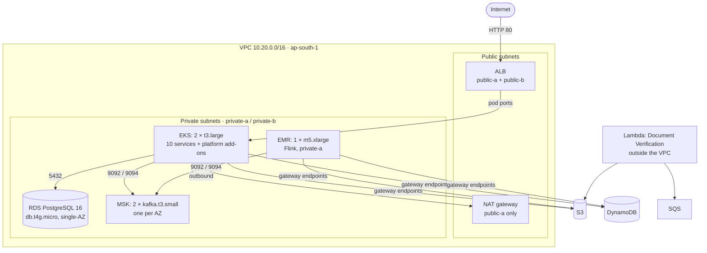

# Claims Platform: Infrastructure Sizing and Autoscaling

Nov 19, 2026 · @Krisha

The dev environment in `ap-south-1` runs on **6 machines (about 14 vCPU and 37 GiB)**, all in private subnets
behind one internet-facing load balancer. The EKS nodes and the EMR node use **exactly the account's 8-vCPU EC2
quota**, so neither can grow without shrinking the other. As load grows, the first things to run out are
**database connections**, then **node CPU requests**; memory is no longer the first limit. All figures come from
`infra/terraform` (dev values) and `k8s/` in the current working tree.

- **EKS:** 2 × `t3.large` nodes (2 vCPU, 8 GiB each), fixed at 2. There are 10 services, each with an HPA at 70%
  CPU: dev 1–2 pods, prod 2–6, Approval fixed at 1.
- **Data and streaming:** RDS PostgreSQL 16 on `db.t4g.micro`, 2 `kafka.t3.small` MSK brokers (Kafka 3.8.x), Flink
  on a **single-node** EMR cluster (1 × `m5.xlarge`), DynamoDB on demand.
- **Headline numbers:**
  - about 1.9 vCPU and 7.2 GiB schedulable per node;
  - 8 of 8 quota vCPUs in use;
  - 80 database connections at one replica each, against roughly 80–110 allowed.

## Architecture at a glance

The arrows show who connects to whom. Each data store's inbound rule is listed under [Security groups](#security-groups).

## Network

Everything sits in one VPC, `10.20.0.0/16`, in `ap-south-1` across 2 availability zones. Only the load balancer and
the NAT gateway are in public subnets; every node, database and broker has a private IP only.

| Subnet | CIDR | AZ | Usable IPs | Type | What runs there |
| --- | --- | --- | --- | --- | --- |
| private-a | 10.20.0.0/20 | AZ 1 | 4,091 | private | EKS nodes and pods, MSK broker 1, the EMR node |
| private-b | 10.20.16.0/20 | AZ 2 | 4,091 | private | EKS nodes and pods, MSK broker 2 |
| public-a | 10.20.200.0/24 | AZ 1 | 251 | public | ALB, NAT gateway |
| public-b | 10.20.201.0/24 | AZ 2 | 251 | public | ALB |

AWS reserves 5 addresses in every subnet, so a /20 gives 4,096 − 5 = 4,091 and a /24 gives 256 − 5 = 251. The
single-AZ RDS instance can land in either private subnet; AWS picks the AZ.

- **Internet in:** only through the Application Load Balancer. The AWS Load Balancer Controller creates it from the
  Kubernetes Ingresses (ingress group `claims`, routed by path). There is no API Gateway.
- **Internet out:** private subnets reach the internet through one NAT gateway in AZ 1 (`single_nat_gateway = true`).
  AZ 2's outbound traffic crosses to AZ 1, and an AZ 1 outage cuts outbound access for both.
- **Endpoints:** gateway endpoints for S3 and DynamoDB keep that traffic off the NAT gateway. That matters for Flink
  checkpoints, document uploads and the analytics table.
- **Kubernetes API:** public and private endpoints are both on. In dev the public one accepts `0.0.0.0/0`
  (`eks_public_access_cidrs`).
- **Lambda:** Document Verification has no VPC config. It runs in AWS's network and reaches S3 and SQS over their
  public endpoints.
- **Pod IPs:** the VPC CNI gives pods real VPC addresses from the private subnets. Prefix delegation is on
  (`ENABLE_PREFIX_DELEGATION = true`, `WARM_PREFIX_TARGET = 1`), so each node takes /28 blocks of 16 addresses
  instead of single IPs.

## Compute and data instances

The dev environment runs **6 machines**: 2 EKS workers, 1 EMR node, 2 Kafka brokers and 1 database. Together that
is about **14 vCPU and 37 GiB** of memory.

| Component | Instance type | Count | vCPU each | Memory each | Storage | Network | Where |
| --- | --- | --- | --- | --- | --- | --- | --- |
| EKS worker nodes | `t3.large` (burstable, on-demand, AL2023) | min 2, desired 2, max 2 | 2 (30% baseline each) | 8 GiB | 30 GiB gp3 root each | up to 5 Gbps | private subnets, both AZs |
| EMR node: YARN, Flink JobManager **and** TaskManager | `m5.xlarge` | 1 (single-node cluster, no core nodes) | 4 | 16 GiB | EMR default root and data volumes | up to 10 Gbps | private-a |
| MSK Kafka brokers (Kafka 3.8.x) | `kafka.t3.small` | 2 (one per AZ) | 2 (approximate) | 2 GiB (approximate) | 10 GiB EBS each | burstable | private subnets, both AZs |
| RDS PostgreSQL 16 | `db.t4g.micro` (Graviton, burstable) | 1, single-AZ | 2 | 1 GiB | 20 GiB gp3, encrypted (3,000 IOPS, 125 MiB/s) | up to 5 Gbps | private subnets, not public |
| Lambda Document Verification | Java 21, SnapStart | scales per SQS batch | about 0.29 (512 MB ÷ 1,769 MB per vCPU) | 512 MB | ephemeral | AWS-managed | outside the VPC |
| DynamoDB `claims-dev-analytics` | on-demand (pay per request) | serverless | – | – | grows with data; 7-day TTL on analytics rows | gateway endpoint | regional |
| NAT gateway | managed | 1 (AZ 1) | – | – | – | 5 Gbps, scales to 100 Gbps | public-a |

- **Burstable machines:** `t3`, `t4g` and `kafka.t3` run at a baseline and spend CPU credits to go above it. A
  `t3.large` earns 36 credits an hour; one credit is one vCPU at 100% for one minute. See
  [Performance calculations](#performance-calculations) for what that means under load.
- **MSK broker settings:**
  - `num.partitions = 3`, `default.replication.factor = 2`, `min.insync.replicas = 1`, topics auto-created.
  - Clients connect unauthenticated on 9092 (plaintext) or 9094 (TLS); `client_broker = TLS_PLAINTEXT`.
  - Broker-to-broker traffic is encrypted.
- **Totals:** EKS 4 vCPU and 16 GiB; EMR 4 vCPU and 16 GiB; MSK about 4 vCPU and 4 GiB; RDS 2 vCPU and 1 GiB.
- **Sources:** AWS's pages for `t3`, `m5`, the RDS instance classes, RDS gp3 storage, Lambda memory and CPU, and NAT
  gateway limits. AWS's MSK pages don't publish `kafka.t3.small` vCPU and memory, so those two figures are approximate.

### The 8-vCPU EC2 quota

The account's *Running On-Demand Standard (A, C, D, H, I, M, R, T, Z) instances* quota is **8 vCPUs**. Only plain EC2
instances count against it: the EKS nodes and the EMR node. MSK brokers, RDS, the NAT gateway and Lambda do not.

| Uses the quota | Instances | vCPU |
| --- | --- | --- |
| EKS nodes (counted at `node_max_size`) | 2 × `t3.large` | 4 |
| EMR | 1 × `m5.xlarge` | 4 |
| **Total** | | **8 of 8** |

- **Guard:** `infra/terraform/infra/quota.tf` looks up each instance type's vCPUs and **fails `terraform plan`** if
  the sizing needs more than `ec2_vcpu_quota`. `terraform output ec2_vcpu_usage` prints the total.
- **No room for node surges:** a changed instance type, or a node AMI update, starts new nodes before it stops the
  old ones, and at 8 of 8 AWS refuses them (`VcpuLimitExceeded`). Turn EMR off first (`enable_emr = false`, or let it
  stop itself after 2 h idle), change the nodes, then turn EMR back on.

## Security groups

Every data store accepts traffic only from named security groups, never from an IP range. The only group open to the
internet is the load balancer's, on port 80.

| Security group | Attached to | Inbound | Outbound | Defined in |
| --- | --- | --- | --- | --- |
| ALB (managed by the Load Balancer Controller) | the `claims` ALB | TCP 80 from 0.0.0.0/0 (HTTP only, no TLS listener yet) | to pod IPs on the service ports | Ingress annotations |
| EKS cluster (control plane) | EKS API ENIs | TCP 443 from the node SG | to nodes | `modules/eks` (module defaults) |
| EKS nodes | worker nodes and pods | 443, 10250 and webhook ports from the cluster SG; DNS 53 TCP/UDP and 1025–65535 node to node; pod ports from the ALB SG | all to 0.0.0.0/0 (through the NAT) | `modules/eks` (module defaults) |
| RDS | PostgreSQL | TCP 5432 from the EKS node SG only (plus any group in `rds_extra_allowed_security_groups`, empty in dev) | none needed | `modules/rds` |
| MSK | Kafka brokers | TCP 9092 and 9094 from the EKS node SG, the EMR primary SG and the EMR core SG | all to 0.0.0.0/0 (replication, AWS APIs) | `modules/msk` |
| EMR primary | the EMR node | rules EMR adds itself (managed group) | all to 0.0.0.0/0 | `modules/emr` |
| EMR core | nothing while there are no core nodes (EMR still requires the group) | rules EMR adds itself (managed group) | all to 0.0.0.0/0 | `modules/emr` |
| EMR service access | EMR private-subnet access | TCP 9443 from the EMR primary SG | all to 0.0.0.0/0 | `modules/emr` |

- **Encryption:** the RDS parameter group forces TLS on every connection (`rds.force_ssl`). MSK encrypts traffic
  between brokers, and clients may use TLS on 9094 or plaintext on 9092. MSK has no client authentication in dev.
- **Inside the cluster:** Kubernetes NetworkPolicies, enforced by the VPC CNI's eBPF agent, decide which pods may call
  which. The node SG allows pod-to-pod traffic and the policies narrow it, for example keeping `/internal/chaos` and
  the gateway simulator private.
- **No public databases:** RDS has `publicly_accessible = false`, and MSK, EMR and every node have private IPs only.

## Pod resources and HPA

Every service has a HorizontalPodAutoscaler that adds pods when average CPU passes 70% of the pod's CPU request. Dev
allows 1–2 pods per service and prod 2–6; Approval is fixed at exactly 1 everywhere.

| Service | CPU request | CPU limit | Memory request | Memory limit | DB pool (Hikari) | Dev min–max | Prod min–max |
| --- | --- | --- | --- | --- | --- | --- | --- |
| login | 200m | 1 vCPU | 384 Mi | 768 Mi | 10 | 1–2 | 2–6 |
| claim-intake | 200m | 1 vCPU | 384 Mi | 768 Mi | 15 | 1–2 | 2–6 |
| policy | 200m | 1 vCPU | 384 Mi | 768 Mi | 15 | 1–2 | 2–6 |
| eligibility | 200m | 1 vCPU | 384 Mi | 768 Mi | none (stateless) | 1–2 | 2–6 |
| assessment | 200m | 1 vCPU | 384 Mi | 768 Mi | 15 | 1–2 | 2–6 |
| approval (3PC coordinator) | 200m | 1 vCPU | 384 Mi | 768 Mi | 10 | 1–1 | 1–1 |
| payment | 200m | 1 vCPU | 384 Mi | 768 Mi | 15 | 1–2 | 2–6 |
| gateway-simulator | 50m | 500m | 192 Mi | 384 Mi | none | 1–2 | 2–6 |
| ops-dashboard | 200m | 1 vCPU | 384 Mi | 768 Mi | none (DynamoDB) | 1–2 | 2–6 |
| frontend (nginx) | 25m | none | 32 Mi | 128 Mi | none | 1–2 | 2–6 |

The base manifests (`k8s/base/*/hpa.yaml`) set 1–3 (Approval 1–1). The dev and prod Kustomize overlays replace those
bounds with the values above.

### How the HPA decides

metrics-server samples pod CPU, and every 15 seconds the HPA computes:

$$\text{desired} = \left\lceil \text{current pods} \times \frac{\text{average CPU used}}{70\% \times \text{CPU request}} \right\rceil$$

- **Trigger point:** 70% of a 200m request is 140m of average CPU per pod (17.5m for the frontend, 35m for the
  gateway simulator).
- **Example:** one claim-intake pod using 300m is at 150% of its request, so desired = ⌈1 × 150 ÷ 70⌉ = 3 pods. Dev
  caps it at 2, and prod allows the 3.
- **Speed:** no `behavior` block is set, so the Kubernetes defaults apply. Scaling up can double the pod count (or
  add 4 pods, whichever is more) every 15 seconds. Scaling down first waits for 5 minutes of lower usage, so short
  dips don't remove pods.
- **Only CPU:** memory is not a scaling metric. A JVM's heap stays allocated after a spike, so memory would hold pods
  up long after the load has gone.
- **Why Approval never scales:** it is the 3PC coordinator. Its crash-recovery sweep has not been designed or tested
  with two coordinators running at once, so `minReplicas = maxReplicas = 1`.
- **Scheduling:** each Deployment has a preferred pod anti-affinity, so replicas spread over the two nodes when there
  is room.

### Nodes do not scale

The node group is pinned at 2 (`min = desired = max = 2`), and no Cluster Autoscaler or Karpenter is installed.
Even if one were, the vCPU quota is fully used, so a third node could not start while EMR is running. When the HPAs
ask for more pods than the 2 nodes can hold, the extra pods stay Pending.

## Performance calculations

At its minimum size the dev cluster has room to spare. At dev maximum, CPU requests fill the two nodes before memory
does, and database connections run out before either. The figures below are worked out from the configuration. The
load test in `loadtest/` measures real throughput; run it against the cluster to confirm them.

### 1. Pods per node

Prefix delegation means pod IPs never run out, but the module does not raise the kubelet's `max-pods`, so the
instance-type default applies:

$$\text{max pods} = \text{ENIs} \times (\text{IPs per ENI} - 1) + 2 = 3 \times (12 - 1) + 2 = 35$$

That gives 70 pods on 2 nodes. At dev maximum the cluster needs about 19 service pods and about 25 platform pods,
DaemonSets included (Argo CD, Prometheus, Grafana, Loki, Promtail, the Load Balancer Controller, metrics-server,
CoreDNS, the EBS CSI driver, the VPC CNI, kube-proxy, node-exporter). That is about 44 of 70, so pod count is not the
limit.

### 2. What one node can schedule (approximate)

Kubernetes keeps part of each node for itself. On EKS images the memory reservation grows with `max-pods`:

$$\text{kube-reserved memory} = 255\,\text{Mi} + 11\,\text{Mi} \times 35\ \text{pods} = 640\,\text{Mi}$$

| Per `t3.large` | CPU | Memory |
| --- | --- | --- |
| Hardware | 2,000m | 8,192 Mi (the OS sees slightly less) |
| Reserved (kubelet, OS, eviction) | about 70m | about 740–1,000 Mi |
| Left for pods | about 1,930m | about 7,200 Mi |
| **2 nodes (fixed)** | **about 3,860m** | **about 14,400 Mi** |

### 3. What the services ask for

These are requests summed over every service: eight JVM services at 200m and 384 Mi, the gateway simulator at 50m
and 192 Mi, and the frontend at 25m and 32 Mi.

| Scenario | Pods | CPU requested | Memory requested | Fits on the 2 nodes? |
| --- | --- | --- | --- | --- |
| Dev minimum (1 each) | 10 | 1,675m | 3,296 Mi | yes: about 2.2 vCPU and 11 GiB left |
| Dev maximum = prod minimum (2 each, Approval 1) | 19 | 3,150m | 6,208 Mi | **only just on CPU**: 710m left for the add-ons, which request roughly 0.5–0.7 vCPU. Memory is fine |
| Prod maximum (6 each, Approval 1) | 55 | 9,050m | 17,856 Mi | no: needs about 2.3× the CPU |

The platform add-ons share the same two nodes. Most of their charts are installed with default resources; the ones
that request CPU (CoreDNS, kube-proxy, the VPC CNI, metrics-server, the EBS CSI driver) add up to roughly 0.5–0.7
vCPU. Check the real numbers with `kubectl describe nodes` ("Allocated resources"). In practice, dev can scale most
but not all services to 2 pods; the last few scale-outs may stay Pending.

### 4. Burstable CPU

A `t3.large` runs at 30% per vCPU as a baseline, which is 600m of sustained CPU per node. It earns 36 credits an hour:

$$\frac{36\ \text{credits/h}}{60\ \text{min/h}} = 0.6\ \text{vCPU sustained per node}$$

- **At rest:** the 10 dev pods request 1,675m but use far less, so the nodes bank credits for bursts.
- **One busy pod:** a JVM pod at its 1-vCPU limit spends credits about 1.7 times faster than its node earns them.
  JVM start-up (Flyway migrations, up to 3 minutes per the startup probe) is a typical burst.
- **Sustained load:** above 0.6 vCPU per node, T3 runs in "unlimited" mode by default, so the node stays fast and AWS
  bills the extra CPU time. In "standard" mode it would be slowed to baseline.

### 5. Database connections

Every replica opens its own Hikari pool, and Hikari keeps the whole pool open by default. Connections therefore grow
with the HPA:

| Scenario | login | claim-intake | policy | assessment | approval | payment | Total |
| --- | --- | --- | --- | --- | --- | --- | --- |
| 1 replica each | 10 | 15 | 15 | 15 | 10 | 15 | **80** |
| Dev max (2 each, Approval 1) | 20 | 30 | 30 | 30 | 10 | 30 | **150** |
| Prod max (6 each, Approval 1) | 60 | 90 | 90 | 90 | 10 | 90 | **430** |

RDS PostgreSQL sets `max_connections` from memory: `LEAST(DBInstanceClassMemory / 9,531,392, 5000)`. With 1 GiB that
is at most about 112, and less in practice, because AWS subtracts its own memory first and keeps a few connections
for administrators. Check the real value with `SHOW max_connections;`. At 80 connections the database is already
nearly full, and the dev maximum of 150 would be refused. **Database connections are the first hard limit this
platform hits when it scales.**

### 6. Kafka and Flink

- **Partitions:** topics are auto-created with 3 partitions and replication factor 2, so `claim-events` can be read by
  at most 3 Flink source subtasks at once.
- **Durability:** `min.insync.replicas = 1` lets a write succeed on one broker, so losing a broker at the wrong moment
  can lose recent events.
- **Flink:** one `m5.xlarge` (4 vCPU, 16 GiB) now holds everything: the YARN daemons, the Flink JobManager and the
  TaskManager. The 1-minute overview window runs as a single task (`windowAll`), so it uses one core whatever the
  parallelism.
- **Storage:** 2 brokers × 10 GiB at replication factor 2 holds about 10 GiB of unique data. Retention, which is not
  set here, decides how long that lasts.

### 7. Lambda document verification

512 MB gives about 512 ÷ 1,769 = 0.29 vCPU.
- **Batches:** SQS hands the function batches of up to 5 messages, waiting at most 1 second to fill a batch.
- **Failures:** a message that fails 3 times moves to the dead-letter queue.
- **Scaling:** with no reserved concurrency set, Lambda adds instances as the queue grows, so document checks scale
  independently of the cluster.

### 8. Network

- **NAT gateway:** it handles 5 Gbps, scaling to 100 Gbps, and up to 55,000 simultaneous connections to each
  destination. That is far above what 2 nodes can send, at up to 5 Gbps each.
- **IP space:** each private /20 has 4,091 addresses. 2 nodes × 35 pods = 70 pod IPs, plus nodes, RDS, MSK, EMR and
  the /28 prefix blocks, uses well under 5% of one subnet.

## Limits and what to change at higher load

The limits below are hit roughly in this order as load grows.

| # | Limit | Hit when | Change |
| --- | --- | --- | --- |
| 1 | RDS connections (about 80–110 on `db.t4g.micro`) | more than one replica of the database services | A larger class (`db.t4g.small` or above, which doesn't use the EC2 quota), smaller Hikari pools, or RDS Proxy to share connections |
| 2 | Node CPU requests (about 3.9 vCPU on 2 nodes) | most services scale to 2 pods | Lower the dev CPU requests (for example 100m) or turn EMR off to free 4 vCPU for EKS nodes. A quota increase is the real fix |
| 3 | The 8-vCPU EC2 quota | any node or EMR growth, and any node rolling update | Ask AWS for a higher *Running On-Demand Standard instances* quota, then raise `ec2_vcpu_quota` |
| 4 | Node CPU credits (0.6 vCPU sustained per node) | sustained traffic above baseline | Non-burstable nodes (`m6i.large`, `m7i.large`) for steady load |
| 5 | Prod HPA ceilings need about 9 vCPU and 17.5 GiB of requests | prod at full scale | Larger or more nodes in prod, which needs a quota well above 8 |

- **Single points of failure:** 1 NAT gateway, single-AZ RDS, a single-node EMR cluster (if that node fails, Flink
  stops until it restarts from its last checkpoint) and 1 Approval pod. Each is a deliberate dev saving. Prod would
  use a NAT gateway per AZ (`single_nat_gateway = false`), Multi-AZ RDS and EMR core nodes.
- **Security gaps for prod:** the ALB listens on HTTP 80 only, MSK accepts unauthenticated clients, and the
  Kubernetes API is open to `0.0.0.0/0`. Add an HTTPS listener with an ACM certificate, switch MSK to IAM auth, and
  narrow `eks_public_access_cidrs`.

## What changed since the previous version

| | Before | Now |
| --- | --- | --- |
| EKS nodes | 2–4 × `t3.medium` (4 GiB) | 2 × `t3.large` (8 GiB), fixed |
| EMR | 1 primary + 1 core `m5.xlarge` | single-node cluster, 1 × `m5.xlarge` |
| Machines | 7–9, about 18–22 vCPU and 45–53 GiB | 6, about 14 vCPU and 37 GiB |
| EC2 quota | not tracked | 8 of 8 vCPU, enforced by `quota.tf` |
| Kafka | 3.6.0 (deprecated on MSK) | 3.8.x |
| Max pods per node | stated as 110 | 35 (kubelet default; prefix delegation only adds IPs) |
| First node limit | memory (about 4.8 GiB on 2 nodes) | CPU requests (about 3.9 vCPU on 2 nodes) |
