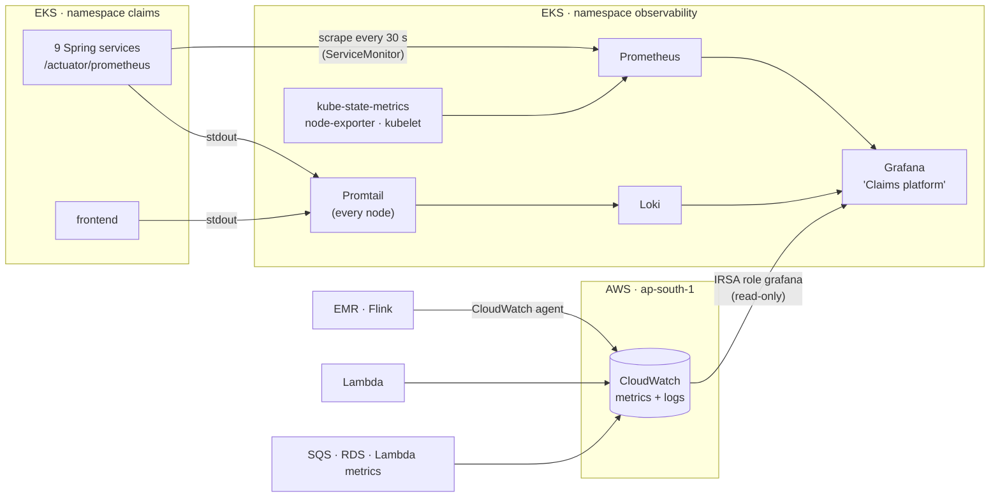

# Observability: Grafana, Prometheus, Loki, Promtail and CloudWatch

How the platform is monitored: what collects which metrics and logs, where each piece is defined, how to open it, how the dashboard is built, and how to change it.

Everything here is created by Terraform (`infra/terraform/platform`) and the Kubernetes manifests (`k8s/`). Nothing is set up by hand. For the design decisions behind it (why self-hosted Grafana, why Loki rather than Elasticsearch, what ap-south-1 offers), see [docs/observability.md](docs/observability.md). For the *business* analytics (audit trail, claim statistics, fraud flags), which is a separate pipeline, see [flink.md](flink.md).

---

## 1. The stack at a glance

| Component | What it does | Runs where | Defined in |
|---|---|---|---|
| **Prometheus** | scrapes and stores **metrics** (numbers over time) | EKS, namespace `observability`, 10 GiB gp3 volume, 7 days | `kube-prometheus-stack` Helm release, [platform/observability.tf](infra/terraform/platform/observability.tf) |
| **kube-state-metrics, node-exporter** | expose Kubernetes object state and node CPU, memory and disk as metrics | EKS (node-exporter on every node) | same Helm release |
| **Prometheus Operator** | turns `ServiceMonitor` resources into scrape configuration | EKS | same Helm release |
| **Grafana** | the **UI**: dashboards over every data source | EKS, `observability` | same Helm release |
| **Loki** | stores **logs**, indexing only labels (namespace, pod, container) | EKS, single binary, 10 GiB gp3 volume, 7 days | `loki` Helm release, `observability.tf` |
| **Promtail** | reads every container's stdout on each node and pushes it to Loki | EKS DaemonSet (one per node) | `promtail` Helm release, `observability.tf` |
| **CloudWatch** | AWS's own **metrics and logs**, for everything outside Kubernetes | AWS, ap-south-1 | log groups in `modules/lambda`, `modules/emr`, `modules/msk`; Grafana's data source in `observability.tf` |
| **CloudWatch agent** | ships Flink and YARN logs from the EMR node to CloudWatch | EMR (bootstrap action) | [modules/emr/main.tf](infra/terraform/modules/emr/main.tf) |
| **Micrometer** | exposes each Spring service's metrics at `/actuator/prometheus` | inside every service | each service's `application.yml` |
| **ServiceMonitor** `claims-services` | tells Prometheus to scrape every Spring service | namespace `claims` | [k8s/base/servicemonitor.yaml](k8s/base/servicemonitor.yaml) (deployed by Argo CD) |
| **"Claims platform" dashboard** | one dashboard across all the sources | Grafana | [platform/dashboards.tf](infra/terraform/platform/dashboards.tf) |

Chart versions are pinned in [platform/versions.tf](infra/terraform/platform/versions.tf) (`kube-prometheus-stack` 65.8.1, `loki` 6.55.0, `promtail` 6.17.1), and a copy of each chart sits in `platform/.charts/`.



**Grafana is the single place to look.** One dashboard shows Prometheus, Loki and CloudWatch side by side.

### Which signal lives where

| Signal | Source | Collected by | Stored in |
|---|---|---|---|
| REST and gRPC rate, errors, latency; JVM heap and CPU; Hikari DB pools | Micrometer in each service | Prometheus (ServiceMonitor) | Prometheus |
| Nodes, pods, resource requests, restarts, HPAs, volumes | kube-state-metrics, node-exporter, kubelet | Prometheus | Prometheus |
| Logs of every pod (services, frontend, platform) | container stdout | Promtail | Loki |
| Flink job logs | YARN containers on EMR | CloudWatch agent | CloudWatch Logs `/aws/emr/claims-dev/flink` |
| Lambda logs (one JSON line per document) | the function | Lambda | CloudWatch Logs `/aws/lambda/claims-dev-document-verification` |
| MSK broker logs | MSK | MSK | CloudWatch Logs |
| SQS depth, Lambda invocations and errors, RDS CPU and connections | AWS | CloudWatch | CloudWatch metrics |

---

## 2. How to access it

### Grafana

| | |
|---|---|
| URL (dev, through an ALB) | `kubectl -n observability get ingress kube-prometheus-stack-grafana -o jsonpath='{.status.loadBalancer.ingress[0].hostname}'`, or run `terraform output grafana_url_command` in `infra/terraform/platform` |
| User | `admin` |
| Password | `terraform output -raw grafana_admin_password` (in `infra/terraform/platform`) |
| Dashboard | **Dashboards → Claims platform** |
| Data sources | **Connections → Data sources**: Prometheus (default), Loki, CloudWatch |

The ALB exists only when `expose_grafana = true` in `platform/terraform.tfvars`. It accepts only the IP addresses in `ingress_allowed_cidrs`. If the page times out, your public IP has probably changed: update that list and run `terraform apply` in `platform`. It is plain HTTP.

Without the ALB, use a port-forward:

```bash
kubectl -n observability port-forward svc/kube-prometheus-stack-grafana 3000:80
# http://localhost:3000
```

### Prometheus and Loki directly

Neither is exposed outside the cluster. Use port-forwards:

```bash
kubectl -n observability port-forward svc/kube-prometheus-stack-prometheus 9090:9090
# http://localhost:9090/targets   every scrape target and whether it is UP
# http://localhost:9090/graph     run PromQL by hand

kubectl -n observability port-forward svc/loki 3100:3100
# curl 'http://localhost:3100/loki/api/v1/labels'
```

Usually you don't need either one. Grafana's **Explore** view queries Prometheus (PromQL) and Loki (LogQL) directly, with autocompletion.

### CloudWatch

- **In Grafana:** the "AWS" and "Logs" rows of the dashboard, or Explore → CloudWatch.
- **In the AWS console:** CloudWatch → Log groups / Metrics, region **ap-south-1**.
- **From the CLI:**

  ```bash
  MSYS_NO_PATHCONV=1 aws logs tail /aws/lambda/claims-dev-document-verification --since 1h
  MSYS_NO_PATHCONV=1 aws logs tail /aws/emr/claims-dev/flink --since 1h
  ```

  `MSYS_NO_PATHCONV=1` is only needed in Git Bash, which otherwise rewrites `/aws/...` into a Windows path.

### Useful queries to start from

| What | Where | Query |
|---|---|---|
| Requests per second, by service | Prometheus | `sum by (service) (rate(http_server_requests_seconds_count{namespace="claims"}[1m]))` |
| p95 latency of one service | Prometheus | `histogram_quantile(0.95, sum by (le) (rate(http_server_requests_seconds_bucket{service="claim-intake"}[5m])))` |
| 3PC calls by method | Prometheus | `sum by (method) (rate(grpc_server_processing_duration_seconds_count[1m]))` |
| Open DB connections | Prometheus | `sum by (service) (hikaricp_connections_active)` |
| Errors in claim-intake's logs | Loki | `{namespace="claims", container="claim-intake"} \|~ "(?i)error\|exception"` |
| Every log line for one claim | Loki | `{namespace="claims"} \|= "<claimId>"` |
| Rejected documents | CloudWatch Logs Insights, Lambda log group | `fields @timestamp, claimId, reason \| filter status = "REJECTED"` |

---

## 3. How metrics get from a service into Prometheus

1. **The service exposes metrics.** Each Spring Boot service includes Micrometer's Prometheus registry and serves `/actuator/prometheus` on its HTTP port. `application.yml` turns on **histograms** for REST and gRPC timings, which percentiles need:

   ```yaml
   management:
     metrics:
       distribution:
         percentiles-histogram:
           http.server.requests: true
           grpc.server.processing.duration: true
   ```

   gRPC metrics come from `MetricCollectingServerInterceptor`, registered on each gRPC server in `GrpcServerConfig`.

2. **The ServiceMonitor selects the services.** [k8s/base/servicemonitor.yaml](k8s/base/servicemonitor.yaml) matches every Kubernetes Service labelled `app.kubernetes.io/part-of: claims`, except the frontend, which has no actuator. It scrapes port `http`, path `/actuator/prometheus`, every **30 s**, and copies the Service name into a `service` label. Every dashboard query filters on that label.

3. **The Operator wires it up.** The Helm values set `serviceMonitorSelectorNilUsesHelmValues = false`, so Prometheus picks up *every* ServiceMonitor in any namespace, not only ones labelled for its own Helm release. A new service only needs the `part-of: claims` label to be scraped.

4. **The NetworkPolicies allow it.** Each service's NetworkPolicy admits traffic on port `http` from the `observability` namespace.

Logs need no wiring at all. Promtail tails `/var/log/pods/*` on every node, attaches `namespace`, `pod` and `container` labels, and pushes to `http://loki.observability.svc.cluster.local:3100/loki/api/v1/push`.

CloudWatch access uses **IRSA**. Grafana runs as service account `grafana`, annotated with the IAM role `claims-dev-grafana`. That role (`modules/iam`) is read-only: `cloudwatch:GetMetricData`, `ListMetrics`, `logs:StartQuery`, `GetQueryResults`, `FilterLogEvents`, plus the describe calls Grafana uses for its pickers. No AWS keys are stored in Grafana.

---

## 4. How the dashboard is made

The "Claims platform" dashboard is **code**, not something saved from the Grafana UI. [dashboards.tf](infra/terraform/platform/dashboards.tf) builds it in four steps:

1. **Short specs.** Each panel is a small HCL object in a list, `stat_specs`, `ts_specs` or `cw_specs`, for example:

   ```hcl
   {
     title = "p95 latency, by service", unit = "s", x = 0, y = 14, w = 12, h = 8, ds = "prom"
     desc  = "95th percentile of REST response time, from the Micrometer histogram buckets."
     q     = [["histogram_quantile(0.95, sum by (service, le) (rate(http_server_requests_seconds_bucket{${local.http}}[5m])))", "{{service}}"]]
   }
   ```

   `q` is a list of `[query, legend]` pairs. `x`, `y`, `w`, `h` place the panel on Grafana's 24-column grid. `local.http` is a shared selector (`namespace="$namespace", service=~"$service"`), so every panel follows the **Service** filter at the top.

2. **Expanded into Grafana JSON.** `for` expressions (`stat_panels`, `ts_panels`, `cw_panels`, …) turn each spec into Grafana's full panel model: data source, targets with `refId`s A–F, field config, thresholds and legend.

3. **AWS names come from the infra stack.** Queue names, the Lambda function, the log groups and the RDS instance ID are read from `terraform_remote_state` (`local.infra`). The CloudWatch panels therefore always point at the real resources. A panel whose component is disabled (for example `enable_lambda = false`) is simply left out.

4. **Published as a ConfigMap.** The whole dashboard is `jsonencode`d into the ConfigMap `claims-platform-dashboard` in namespace `observability`, labelled `grafana_dashboard = "1"`. Grafana's **dashboard sidecar** watches for that label in every namespace and loads the JSON. No Grafana API call and no click is involved.

Template variables at the top of the dashboard: **namespace**, **Service** (multi-select, default All) and **Log search** (a regular expression applied to every log panel).

### Rows and panels

| Row | Panels | Source |
|---|---|---|
| **Overview** | requests/s, 5xx error rate, p95 latency, pods ready, nodes ready, restarts in the last hour | Prometheus |
| **Services: REST** | rate, 5xx share and p95 by service; p50/p95/p99 for the selected services; responses by status code; the 10 slowest endpoints | Prometheus |
| **Services: gRPC** | calls/s, errors (status ≠ OK) and p95 by service and method, including CanCommit, PreCommit, DoCommit and Abort | Prometheus |
| **JVM and database pools** | heap and CPU by pod; Hikari connections open and waiting, by service | Prometheus |
| **Kubernetes cluster health** | node CPU and memory; requested vs allocatable; pods by phase; restarts; HPA current vs desired replicas; volume usage | Prometheus |
| **AWS (CloudWatch, ap-south-1)** | SQS messages waiting (both queues and both DLQs); Lambda invocations, errors, throttles, duration; RDS connections, CPU, free memory | CloudWatch |
| **Logs** | error lines per minute by service; service logs; Flink job logs; Lambda logs | Loki, CloudWatch Logs |

The same JSON is available as `terraform output grafana_dashboard_json`, for importing into another Grafana.

---

## 5. How to change it

### Add or edit a dashboard panel

1. Edit [infra/terraform/platform/dashboards.tf](infra/terraform/platform/dashboards.tf). Add a spec to `ts_specs` (time series), `stat_specs` (a single-number tile) or `cw_specs` (CloudWatch). Give it a free `x`/`y` position, and move the rows below it down if needed.
2. Try the query first in Grafana's **Explore**.
3. Apply:

   ```bash
   cd infra/terraform/platform
   terraform plan      # shows the ConfigMap change
   terraform apply
   ```

4. The sidecar reloads the dashboard within about a minute. Refresh the browser.

**Don't save changes in the Grafana UI.** The dashboard is provisioned from the ConfigMap, so edits made in the UI are overwritten on the next apply (Grafana warns that it "cannot be saved"). To build a panel visually anyway: design it in the UI, open **Inspect → Panel JSON**, and copy the query, unit and thresholds back into a spec.

### Add a whole new dashboard

Create another `kubernetes_config_map_v1` with the label `grafana_dashboard = "1"` and the dashboard JSON in `data`. It can be hand-written JSON (`file("dashboards/my.json")`) or built like the existing one. A ConfigMap with that label in *any* namespace, even one delivered by Argo CD from `k8s/`, is picked up too.

### Get a new service's metrics and logs

- **Metrics:** give its Kubernetes Service the label `app.kubernetes.io/part-of: claims` and a port named `http` that serves `/actuator/prometheus`. The ServiceMonitor picks it up. Its NetworkPolicy must allow the `observability` namespace.
- **Logs:** nothing to do. Promtail collects every container's stdout.
- **Dashboard:** it appears automatically in the **Service** filter, because the panels group by the `service` label.

### Change retention, storage or components

In `platform/terraform.tfvars`, then `terraform apply` in `platform`:

| Variable | Default | Effect |
|---|---|---|
| `prometheus_retention` | `7d` | how long metrics are kept |
| `prometheus_storage_size` | `10Gi` | Prometheus volume |
| `loki_storage_size` | `10Gi` | Loki volume (log retention is 168 h in `loki_values`) |
| `expose_grafana` / `ingress_allowed_cidrs` | `false` / `0.0.0.0/0` | the public ALB for Grafana, and who may reach it |

Other Helm settings (enabling Alertmanager, Grafana plugins, extra data sources, scrape intervals) go in the `kube_prometheus_values`, `loki_values` or Promtail `values` locals in [observability.tf](infra/terraform/platform/observability.tf).

### Add a CloudWatch log group or metric

1. If the log group or metric belongs to a new resource, create it in the right module, with `retention_in_days`, so `terraform destroy` removes it.
2. Add an output for its name in [infra/outputs.tf](infra/terraform/infra/outputs.tf), and `terraform apply` the **infra** stack.
3. Add a spec to `cw_specs` or `cw_log_specs` in `dashboards.tf` that reads it via `local.infra.<output>`, then apply **platform**.
4. If Grafana needs a new permission, extend `aws_iam_role_policy.grafana` in `modules/iam`.

---

## 6. Prometheus vs CloudWatch: why both

| | Prometheus (+ Loki) | CloudWatch |
|---|---|---|
| Covers | everything running **inside EKS**: services, pods, nodes | everything **outside EKS**: Lambda, EMR/Flink, SQS, RDS, MSK |
| Cost | runs on the existing nodes; two 10 GiB volumes | pay per log GB ingested and per metric API call |
| Cardinality and detail | per pod, per endpoint, per gRPC method, with histograms | per AWS resource |
| Query language | PromQL, LogQL | CloudWatch metric math, Logs Insights |
| Why it's used here | services and Kubernetes produce Prometheus metrics natively, and Loki stores logs cheaply | AWS-managed services send their metrics and logs there automatically, and nothing else can see inside them |

Grafana joins the two, so an incident can be followed across both. For example: a spike in claim-intake 5xx errors (Prometheus) next to a growing results queue (CloudWatch SQS) next to the Lambda's errors (CloudWatch Logs).

This whole stack watches the **system's health**. The audit trail and the business statistics (claims per minute, approval rate, fraud flags) come from the Flink pipeline and are shown inside the app. [flink.md](flink.md#6-how-this-differs-from-cloudwatch-prometheus-and-grafana) explains the difference.

---

## 7. Not included yet

- **Alerting.** Alertmanager is turned off (`alertmanager = { enabled = false }`) to save a pod and a volume. The next step would be Grafana alert rules on the overview tiles, or enabling Alertmanager with PrometheusRules.
- **Tracing.** There is no OpenTelemetry, Tempo or X-Ray. To follow one claim across services today, search the logs for its `claimId`, or a 3PC transaction for its `txId`.
- **Structured logs.** Service logs are plain text. Spring Boot's JSON logging would let LogQL filter on fields instead of regular expressions.
- **Container Insights / Managed Prometheus.** Not needed at this size. Amazon Managed Grafana isn't available in ap-south-1 (see [docs/observability.md](docs/observability.md)).
