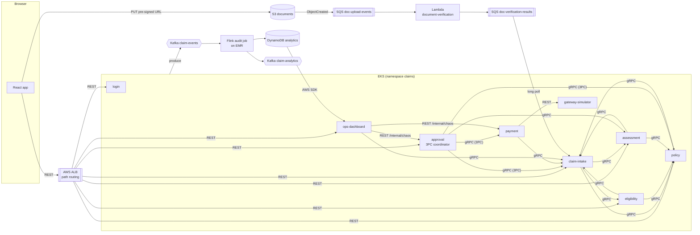

# Communication

Every way the parts of the claims platform talk to each other, which protocol each conversation uses, and why.

| Protocol | Style | Used for |
|---|---|---|
| [REST over HTTP/JSON](#1-rest-http--json) | synchronous request/response | browser → services, through the ALB; payment → gateway simulator; ops-dashboard → chaos endpoints; services → login for the JWT keys |
| [gRPC over HTTP/2 + Protobuf](#2-grpc) | synchronous request/response | service → service inside the cluster, including the 3PC settlement |
| [Kafka (Amazon MSK)](#3-kafka-publishsubscribe) | asynchronous publish/subscribe | every service → `claim-events` → the Flink audit job → `claim-analytics` and DynamoDB |
| [SQS](#4-sqs-point-to-point-queues) | asynchronous point-to-point queue | S3 → Lambda → Claim Intake, for document verification |
| [S3 event notifications](#5-s3-event-notifications) | asynchronous push | S3 → SQS when a document is uploaded |
| [AWS SDK calls](#6-aws-sdk-calls-https) | synchronous HTTPS | pods and the Lambda → S3, SQS, DynamoDB, using IAM roles |



---

## 1. REST (HTTP + JSON)

### Browser → services, through the ALB

The browser only ever speaks REST. All services share **one ALB**, through the Ingress group `claims`. The AWS Load Balancer Controller merges every service's Ingress into one load balancer and routes by path:

| Path prefix | Service | Examples |
|---|---|---|
| `/api/auth` | login | `POST /api/auth/login`, `POST /api/auth/logout`, `GET /api/auth/me` |
| `/api/policies` | policy | `GET /api/policies/me`, `GET /api/policies/{policyNo}`, `GET …/{policyNo}/coverage` |
| `/api/claims` | claim-intake | `POST /api/claims`, `GET /api/claims/me`, `GET /api/claims/{id}`, `GET /api/claims/queue`, `POST /api/claims/{id}/documents/upload-url` |
| `/api/eligibility` | eligibility | `GET /api/eligibility/{claimId}` |
| `/api/assessments` | assessment | `GET /api/assessments/{claimId}` |
| `/api/approvals` | approval | `POST /api/approvals/{claimId}`, `GET …/{claimId}/settlement`, `POST …/settlement/retry` |
| `/api/audit`, `/api/analytics`, `/api/ops` | ops-dashboard | audit trail, analytics summary, series and fraud flags, chaos controls |
| `/` | frontend (nginx) | the React app |

Because the API and the page share one origin, the browser makes **no cross-origin calls** to the API. The frontend's `config.js` sets `API_BASE_URL` to `window.location.origin`. Locally, the Vite dev server does the same path routing (see `frontend/vite.config.js`).

**Authentication.** `login` issues an **RS256 JWT**. The browser sends it as `Authorization: Bearer <token>`. Each service validates it itself, as a Spring Security OAuth2 resource server, using login's public keys. The services fetch those keys over in-cluster REST, from `http://login.claims.svc.cluster.local/.well-known/jwks.json` (`JWT_JWKS_URI`), and cache them. No service calls login once per request. Roles (`POLICYHOLDER`, `ADJUSTER`) come from the token.

**Health.** The ALB and Kubernetes probe each pod over HTTP at `/actuator/health/readiness`. Prometheus scrapes `/actuator/prometheus`.

### Service → service REST

These are the only places where services talk REST to each other:

| From → to | Calls | Why REST and not gRPC |
|---|---|---|
| payment → gateway-simulator | `POST /authorize`, `/capture`, `/void` (`GATEWAY_BASE_URL=http://gateway-simulator`) | It stands in for an external payment provider, and real providers expose HTTP APIs |
| ops-dashboard → approval, payment | `/internal/chaos` (switch failure injection on or off) | Operator controls, not part of the business flow. `/internal/*` is not routed by the ALB, so the browser can't reach it |
| every service → login | `GET /.well-known/jwks.json` | JWKS is a standard HTTP format |
| browser → S3 | `PUT` to a pre-signed URL | S3's own API. File bytes bypass the services entirely (see [lambda.md](lambda.md)) |

**Why REST at the edge:** every browser speaks it, it is easy to debug with DevTools or `curl`, and the ALB can route it by path.

---

## 2. gRPC

All synchronous **service-to-service** calls inside the cluster use gRPC: Protocol Buffers over HTTP/2, on port **9090** of each service. The contracts live in [backend/proto](backend/proto) and are compiled into Java stubs that every service shares.

| gRPC service | Served by | Methods |
|---|---|---|
| `PolicyService` | policy | `ValidateMember`, `GetPolicy`, `GetCoverage`, `GetBalance` |
| `ClaimService` | claim-intake | `GetClaim`, `UpdateStatus`, `RecordEligibility`, `RecordAssessment` |
| `EligibilityService` | eligibility | `Check` |
| `AssessmentService` | assessment | `Assess`, `GetFinalAmount` |
| `SettlementParticipant` (3PC) | claim-intake, policy, payment | `CanCommit`, `PreCommit`, `DoCommit`, `Abort` |

### Who calls whom

| Caller | Callee: method | Purpose |
|---|---|---|
| claim-intake | policy: `ValidateMember` | when a claim is filed: is the member covered by this policy? |
| claim-intake | eligibility: `Check`, assessment: `Assess` | once every document is verified, **in parallel**, from the workflow orchestrator |
| eligibility | policy: `GetPolicy`, `GetCoverage`, `GetBalance`; claim-intake: `GetClaim`, `RecordEligibility` | read the claim and the coverage, then record the decision on the claim |
| assessment | policy: `GetCoverage`, `GetBalance`; claim-intake: `GetClaim`, `RecordAssessment` | compute the payable amount and record it |
| approval | assessment: `GetFinalAmount`; claim-intake: `UpdateStatus` | the approve or reject decision |
| approval | claim-intake, policy, payment: `SettlementParticipant` | **three-phase commit** of the settlement (below) |
| policy, payment, ops-dashboard | claim-intake: `GetClaim` | look up a claim's owner or details (for example, the "is this the caller's claim?" checks) |

Targets come from each service's ConfigMap, for example `GRPC_POLICY_TARGET: "dns:///policy:9090"`. The `dns:///` scheme makes the client resolve the Kubernetes Service name.

### The three-phase commit over gRPC

Approval is the coordinator. The participants are claim-intake (mark the claim settled), policy (reserve and deduct the balance) and payment (pay out through the gateway). Each participant uses the shared `participant` library (`ParticipantGrpcAdapter`).

```
approval ──CanCommit──▶ claim-intake, policy, payment   "can you do it?"     (all must vote yes)
         ──PreCommit──▶ …                               "get ready"          (each one persists the prepared state)
         ──DoCommit───▶ …                               "do it"
         (any no vote or timeout before PreCommit completes ──Abort──▶ …)
```

Every call carries a **deadline** (`withDeadlineAfter`). A participant that hangs counts as a failure instead of blocking the coordinator forever. The coordinator's transaction log lives in the Approval database, so after a crash it can resume or abort. The full protocol and its failure cases are in [3pc.md](3pc.md).

### Why gRPC inside the cluster

- **Typed contracts:** the `.proto` files are the single source of truth. A field renamed in one service breaks the build, not production.
- **Efficient:** Protobuf is binary and HTTP/2 multiplexes many calls over one connection, which matters on fan-out paths like the 3PC.
- **Deadlines and status codes are built in**, which a distributed transaction needs.
- **Observability:** every gRPC server registers `MetricCollectingServerInterceptor`, so Grafana shows rate, latency and status per method.

**Security model.** gRPC runs in plaintext inside the cluster, with no per-call token. Trust is enforced at the network layer instead. Each service has a Kubernetes **NetworkPolicy** that only lets specific callers reach its `grpc` port. For example, policy's gRPC port accepts only approval, claim-intake, eligibility and assessment. The browser can never reach port 9090, because the ALB only routes HTTP paths.

---

## 3. Kafka (publish/subscribe)

Kafka, as **Amazon MSK** (2 brokers, plaintext on port 9092 inside the VPC), is the platform's **event bus**. It is pub/sub: producers don't know who consumes, and any number of consumers can read the same events independently.

### Topics

Created by the `kafka-topics` Job in the platform stack, with 3 partitions each:

| Topic | Produced by | Consumed by | Contents |
|---|---|---|---|
| `claim-events` | seven services: policy, claim-intake, eligibility, assessment, approval, payment, ops-dashboard (everything except login and the gateway simulator) | the Flink audit job | every state change and decision: claim created, `DOCUMENT_VERIFIED` / `DOCUMENT_REJECTED`, eligibility and assessment results, adjuster overrides with their justification, every 3PC phase and vote, payments, chaos actions |
| `claim-analytics` | the Flink audit job | open for downstream consumers (none in this repo yet) | the 1-minute claims overview windows and fraud flags, as JSON |
| `doc-verified` | (reserved) | (none) | created for a document-verified stream, but the results actually travel over SQS (section 4), and the audit event goes to `claim-events` |

### How events are produced

All services use one shared publisher, [EventPublishers](backend/common/src/main/java/com/claims/common/event/EventPublishers.java), in `backend/common`:

- **The key is the claim ID.** Kafka keeps the messages for one key on one partition, in order, so every event for a claim is read in the order it happened, even with 3 partitions.
- **The value is a JSON `ClaimEvent`**: event type, claim, actor, from/to status, 3PC transaction and phase, details.
- **Fire-and-forget by default** (`publish`). A failed send is logged as a warning and never fails the business operation. `publishAndWait` exists for the few places that should wait briefly.
- **It falls back to the log.** When `KAFKA_BOOTSTRAP` is empty (local runs, or AWS with `enable_msk = false`), events are written to the application log instead, so every service still runs without Kafka.

`KAFKA_BOOTSTRAP` reaches the pods through the `platform-endpoints` ConfigMap, which Terraform fills from the MSK output.

### How events are consumed: the Flink audit job

[AuditAnalyticsJob](backend/analytics/audit-flink/src/main/java/com/claims/analytics/AuditAnalyticsJob.java) runs on EMR. It reads `claim-events` with a Flink `KafkaSource`, using event-time watermarks, and writes four outputs:

| Output | Sink |
|---|---|
| The audit trail: every event, per claim | DynamoDB |
| Claims overview: a **1-minute tumbling window** of counts and amounts | DynamoDB and `claim-analytics` |
| Fraud flags: a **10-minute sliding window**, moving every minute, flagging repeat claims per policy (threshold 2) | DynamoDB and `claim-analytics` |
| Settlement records | DynamoDB |

Checkpoints go to S3, so the job resumes from its last Kafka offsets after a restart. The ops-dashboard then serves this data to the adjuster console from DynamoDB (`/api/audit`, `/api/analytics`).

### Why Kafka here

- **Decoupling:** services emit facts without knowing the audit system exists. A new consumer, such as a notifications service, can be added without touching any producer.
- **A durable, replayable log:** events are retained, so the Flink job can reprocess history, and an audit trail is never lost because a consumer was down.
- **Ordering per claim**, through the partition key, which an audit trail needs.
- **Stream processing:** Flink's windows (overview, fraud) are a natural fit on top of a Kafka topic.

---

## 4. SQS (point-to-point queues)

Amazon SQS carries the **document-verification** work. A queue is point-to-point: each message is handled by one consumer, and then deleted. The full flow is in [lambda.md](lambda.md).

| Queue | Producer | Consumer | DLQ |
|---|---|---|---|
| `claims-dev-doc-upload-events` | S3 event notification | the Lambda, through an event source mapping (batch 5) | `…-doc-upload-events-dlq`, after 3 receives |
| `claims-dev-doc-verification-results` | the Lambda (`SendMessage`) | claim-intake's `VerificationResultListener` (long poll, 20 s) | `…-doc-verification-results-dlq`, after 3 receives |

Both queues are encrypted (SSE), keep messages for 4 days, and use a visibility timeout of 6 × the Lambda timeout (360 s). The consumer deletes a message only after it has fully handled it, so a crash means redelivery, never loss. Handling is idempotent on the document ID, so redelivery is harmless.

### Why SQS here and not Kafka

| Need | SQS | Kafka |
|---|---|---|
| One job, done once, by one worker | ✅ a message is delivered to one consumer and deleted | messages stay; each consumer group tracks its own offset |
| Native Lambda trigger with per-message retry | ✅ event source mapping + `ReportBatchItemFailures` | possible, but needs MSK networking for the Lambda (VPC, ENIs) |
| Dead-letter queue for poison messages | ✅ built in (`redrive_policy`) | has to be built by hand |
| S3 can write to it directly | ✅ | ❌ |
| Cost when idle | ✅ nothing | the MSK brokers bill per hour anyway |

In short: **Kafka is for facts many parties may want to read** (events). **SQS is for tasks that one worker must do** (jobs).

### Pub/sub vs queues, side by side

| | Kafka `claim-events` | SQS `doc-upload-events` |
|---|---|---|
| Model | publish/subscribe (a log) | point-to-point (a queue) |
| After it is read | kept for the retention period | deleted |
| Many consumers | yes, each group reads everything | no, competing consumers split the messages |
| Ordering | per partition (per claim ID) | none (standard queue) |
| Replay | yes, by resetting offsets | no |
| Used for | audit, analytics, fraud detection | document verification jobs |

---

## 5. S3 event notifications

When the browser's `PUT` creates an object under `claims/` in the documents bucket, S3 itself pushes an `s3:ObjectCreated:*` notification into `doc-upload-events`. This is configured in Terraform as `aws_s3_bucket_notification.documents` in `modules/s3`. A queue policy only accepts messages from that bucket, in this account. This is what makes verification **event-driven**: nothing polls S3, and nothing runs while no documents arrive.

---

## 6. AWS SDK calls (HTTPS)

Calls from code to AWS APIs, authenticated with **IAM roles**, never stored keys. Pods get credentials through **IRSA** (a Kubernetes service account mapped to an IAM role). The Lambda uses its execution role.

| Caller | AWS API | Permission scope |
|---|---|---|
| claim-intake | S3 pre-signing (a local signature, no network call) | `s3:PutObject` and `s3:GetObject` on `documents/claims/*` |
| claim-intake | SQS `ReceiveMessage` / `DeleteMessage` | the results queue only |
| Lambda | S3 `HeadObject`; SQS `SendMessage` | read the documents bucket; send to the results queue |
| ops-dashboard | DynamoDB `Query` / `GetItem` | the analytics table, read only |
| Flink job (EMR role) | DynamoDB writes; S3 checkpoints | the analytics table; the artifacts bucket |

Traffic to S3 and DynamoDB from inside the VPC goes through **gateway VPC endpoints**, so it stays on the AWS network and avoids NAT gateway charges.

---

## 7. Data stores (for completeness)

These aren't messaging protocols, but they are how the remaining parts talk to their data:

| Service | Store | Protocol |
|---|---|---|
| login, policy, claim-intake, assessment, approval, payment | one PostgreSQL database each, on one RDS instance | JDBC over TLS (port 5432), Hikari pool of at most 5 per pod |
| eligibility | none (stateless) | n/a |
| ops-dashboard | DynamoDB analytics table | AWS SDK (HTTPS) |
| Flink | DynamoDB, plus S3 for checkpoints | AWS SDK (HTTPS) |

**Database per service:** no service reads another service's tables. When one needs another's data, it asks over gRPC (section 2). That is why the protocol split above exists at all.

---

## Summary: which protocol, and when

| If the interaction is… | Use | Here |
|---|---|---|
| a browser asking for data or an action | **REST** through the ALB | every `/api/*` call |
| one service needing an answer from another *now* | **gRPC** | validation, eligibility, assessment, 3PC |
| a fact that others may care about, now or later | **Kafka** (pub/sub) | `claim-events` → audit and analytics |
| a unit of work one worker must do once, reliably | **SQS** (queue) | document verification |
| "something happened in storage" | **S3 event notification** | upload → SQS |
| talking to an AWS service | **AWS SDK + IAM role** | S3, SQS, DynamoDB |
