# Medical Insurance Claims Platform: Design Document

This document describes the system as it exists in the repository
([github.com/Krisha-cmd/Insurance-claim](https://github.com/Krisha-cmd/Insurance-claim)): its code, its
Terraform, its Kubernetes manifests, and the designs in GitHub issues #1 to #9. It goes from the business view
down to classes and tables. Where a part is designed but not yet built, the text says so.

Every diagram has a number and a caption. Section 9 lists where each diagram came from and what was corrected
in it.

**Contents**

1. [Overview](#1-overview)
2. [Cloud deployment](#2-cloud-deployment)
3. [Microservices architecture](#3-microservices-architecture)
4. [Services: API, data and dependencies](#4-services-api-data-and-dependencies)
5. [Interconnection](#5-interconnection)
6. [Low-level design](#6-low-level-design)
7. [Design rationale](#7-design-rationale)
8. [GitOps and CI/CD](#8-gitops-and-cicd)
9. [Diagram sources and corrections](#9-diagram-sources-and-corrections)

---

## 1. Overview

The platform processes medical insurance claims from filing to payment. A policyholder files a claim and uploads
documents. The documents are verified, eligibility and the payable amount are worked out, and an adjuster
approves or rejects the claim. An approved claim is **settled with a three-phase commit (3PC)** across three
services, so that the claim status, the policy's remaining sum insured and the payment change together or not at
all. Every step is **audited** through an event stream.

**Actors** (from the root README):

| Actor | Role |
| --- | --- |
| Policyholder | Files and tracks claims through the customer portal |
| Claims Adjuster | Reviews claims, may change eligibility, assessment and the decision with a written justification; also acts as Auditor |
| Payment Gateway | External system that pays settled claims; simulated here, and able to fail on demand |

**Business flow.** Policy lookup → submit claim → upload documents → verification → eligibility check →
assessment → approve or reject → settlement by 3PC → audit of every step. Between eligibility and approval the
adjuster can change values, and each change needs a comment.

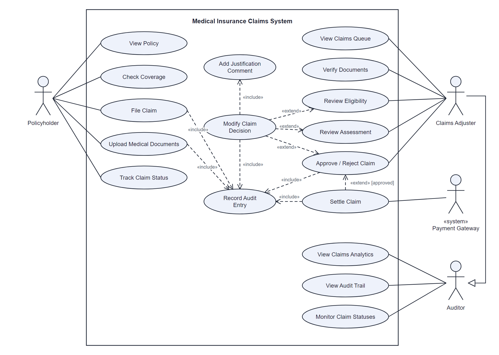

*Figure 1. Use case diagram.* Shows the system boundary, the three actors, and the use cases each actor
reaches; Claims Adjuster generalizes Auditor, and every claim-changing use case «include»s Record Audit Entry.

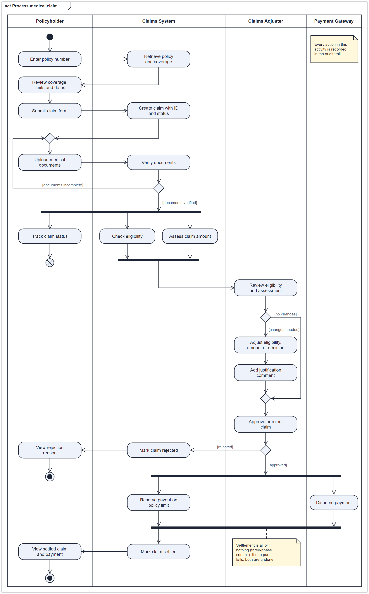

*Figure 2. Activity diagram, "Process medical claim".* Shows the end-to-end flow in swimlanes, with the
document loop, the parallel eligibility and assessment checks, and the parallel settlement branches.

**Building blocks.** The table maps the eight services named in the brief to what is in the repository.

| # | Service | Implementation | Runs on |
| --- | --- | --- | --- |
| 1 | Policy | `backend/services/policy` | EKS |
| 2 | Claim Intake | `backend/services/claim-intake` | EKS |
| 3 | Document Verification | `backend/functions/document-verification` | AWS Lambda |
| 4 | Eligibility | designed in issue #4; `backend/services/eligibility` holds only a `pom.xml` | EKS (manifests ready, not deployed) |
| 5 | Assessment | designed in issue #5; `backend/services/assessment` holds only a `pom.xml` | EKS (manifests ready, not deployed) |
| 6 | Approval (3PC coordinator) | `backend/services/approval` | EKS, exactly one replica |
| 7 | Payment | `backend/services/payment`, plus `gateway-simulator` | EKS |
| 8 | Audit | `backend/analytics/audit-flink` (Flink on EMR) and `backend/services/ops-dashboard` (read API) | EMR + EKS |
| | Login (supporting) | `backend/services/login`: issues RS256 JWTs, publishes the JWKS | EKS |
| | Frontend (supporting) | `frontend/`: React/Vite customer portal and adjuster/ops console | EKS (nginx image) |

---

## 2. Cloud deployment

Everything runs in one AWS region, `ap-south-1`, and **all of it is created by Terraform**
(`infra/terraform`), split into three stacks with separate state.

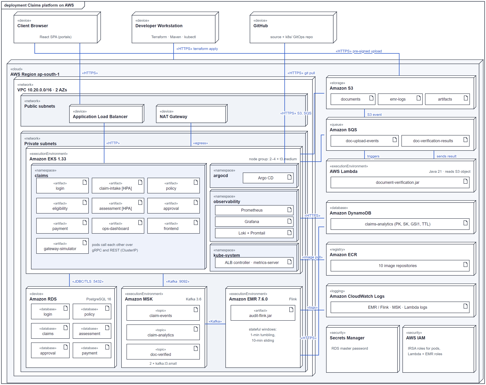

*Figure 3. UML deployment diagram.* Shows the nodes (3D boxes) nested by containment: region, VPC, subnets, EKS
and its namespaces, and the managed services. It also shows the artifacts deployed on each node and the
communication paths with their protocols.

*Figure 4. Terraform stacks as a UML component diagram.* Shows `bootstrap` creating the state backend, `infra`
creating the AWS resources, `platform` reading `infra`'s outputs and installing Argo CD, and Argo CD deploying
from Git.

| Area | What Terraform builds (dev values) | Where |
| --- | --- | --- |
| **VPC** | `10.20.0.0/16` across 2 AZs. Private subnets are `cidrsubnet(/16, 4, i)`, i.e. `10.20.0.0/20` and `10.20.16.0/20`, for nodes, RDS, MSK, EMR and Lambda. Public subnets are `10.20.200.0/24` and `10.20.201.0/24`, for the ALB and the NAT gateway. There is a single NAT gateway, plus S3 and DynamoDB gateway endpoints | `modules/network` |
| **EKS** | Kubernetes 1.33, one managed node group of `t3.medium` (min 2, desired 2, max 4). Add-ons: VPC CNI with network policy enforcement, EBS CSI and a `gp3` StorageClass | `modules/eks` |
| **In-cluster platform** | AWS Load Balancer Controller, metrics-server (for the HPAs), Argo CD, kube-prometheus-stack (Prometheus and Grafana), Loki with Promtail. Also database users, Secrets, and IRSA service accounts | `platform/` |
| **RDS** | PostgreSQL 16 on `db.t4g.micro`, 20 GB, single-AZ, with the master password in Secrets Manager. One database plus one owner user per service: `login`, `policy`, `claims`, `assessment`, `approval`, `payment` | `modules/rds`, `platform/` |
| **S3** | Buckets `documents` (pre-signed uploads; S3 CORS limited to `frontend_origins`), `emr-logs`, `artifacts` | `modules/s3` |
| **SQS** | `doc-upload-events` (fed by S3 `ObjectCreated` on `claims/`) and `doc-verification-results`. Each has a DLQ that receives a message after 3 receives. Visibility timeout is 6 × the Lambda timeout | `modules/sqs` |
| **Lambda** | `document-verification`: Java 21 with SnapStart, 60 s timeout, SQS event source mapping on `doc-upload-events` | `modules/lambda` |
| **MSK** | Kafka 3.6.0 on 2 × `kafka.t3.small`. A Kubernetes Job creates the topics `claim-events`, `claim-analytics` and `doc-verified` | `modules/msk`, `platform/` |
| **EMR** | `emr-7.6.0` (Flink 1.20): 1 primary and 1 core `m5.xlarge`, which stop after 2 h idle. Runs the Audit Flink job | `modules/emr` |
| **DynamoDB** | `claims-<env>-analytics`, on demand: `PK`/`SK`, `GSI1`, TTL | `modules/dynamodb` |
| **ECR** | 10 repositories `claims-<env>/<image>` (lifecycle: keep the newest 10) | `modules/ecr` |
| **IAM** | IRSA roles (`claim_intake`, `ops_dashboard`, `alb_controller`, `grafana`), the Lambda role, EMR roles, and an optional GitHub OIDC role for CI with ECR push only. There are no long-lived keys | `modules/iam` |

**API Gateway.** The brief lists API Gateway, but the repository has **no Amazon API Gateway resource**. That
role is filled by the **Application Load Balancer**, which the AWS Load Balancer Controller creates from the
Kubernetes Ingresses. All services join one ALB through the ingress group `claims`, which routes by path
(Figure 5). Authentication happens in each service, which validates the login service's JWT against its JWKS.
The original architecture drawing showed an "API Gateway" box; Figure 5 replaces it with the ALB ingress.

---

## 3. Microservices architecture

Two figures split the architecture: synchronous interfaces (Figure 5) and data stores plus asynchronous
paths (Figure 6). Together they replace `diagrams/architecture-diagram.svg`.

*Figure 5. UML component diagram: synchronous interfaces.* Shows the browser reaching services only through the
ALB with REST, and the services calling each other with gRPC (contracts in `backend/proto`). Approval depends on
the three 3PC participants; dashed components are designed but not built.

*Figure 6. UML component diagram: data and events.* Shows the database per service on RDS, the S3 → SQS →
Lambda → SQS path for documents, every event publisher feeding `claim-events`, and Audit (Flink) writing
DynamoDB, which the Ops Dashboard reads.

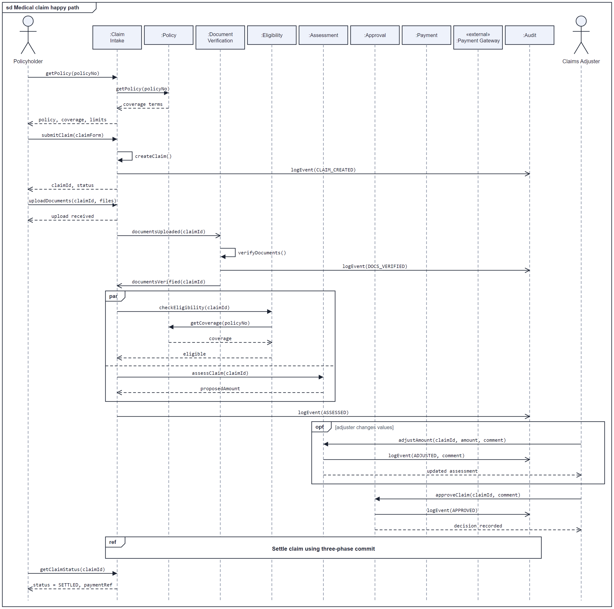

*Figure 7. Happy-path sequence diagram (business level).* Shows one claim from policy lookup to settlement
across all services. The settlement itself is a `ref` to the 3PC interaction in Figure 9.

**Architectural rules visible in the code:**

- **Browsers speak REST only**, and only through the ALB. Every service exposes HTTP on 8080 (Service port 80).
  The gRPC services also expose 9090.
- **Database per service.** No service reads another's tables. Cross-service references are plain ids marked
  "ref: … DB" in the ER diagrams, resolved through gRPC (for example `ClaimService.GetClaim`).
- **Claim Intake owns the claim status.** Every other service changes it only through `ClaimService.UpdateStatus`
  or as a 3PC participant, and only Claim Intake emits `toStatus`.
- **Shared event envelope.** Every event uses the `ClaimEvent` envelope in `backend/common`, keyed by `claimId`
  on `claim-events`. With `KAFKA_BOOTSTRAP` empty (MSK disabled) events are only logged; the databases stay the
  source of truth.
- **No public internal endpoints.** `/internal/chaos` and the gateway simulator are not in any Ingress, and
  NetworkPolicies restrict who may call them (Section 8).

---

## 4. Services: API, data and dependencies

The REST paths are exactly the ones the frontend calls (`frontend/src/config/api.js`). Every endpoint except
login and the JWKS requires the login service's JWT. Errors use one shape:
`ApiError {status, message, path, timestamp}`.

### 4.1 Login

| | |
| --- | --- |
| **REST** | `POST /api/auth/login`, `POST /api/auth/logout`, `GET /api/auth/me`, `GET /.well-known/jwks.json` |
| **Tokens** | RS256 JWTs, issuer `claims-login`, 60 min lifetime. The key pair comes from the `jwt-keys` Secret, which Terraform creates. Other services fetch the JWKS from `http://login.claims.svc.cluster.local/.well-known/jwks.json` |
| **Data** | Login DB: `users`, `refresh_tokens`, `login_attempts` (Figure 20) |
| **Depends on** | RDS |
| **Known limit** | Access tokens are not revoked at logout; they stay valid until they expire |

### 4.2 Policy (issue #1)

| | |
| --- | --- |
| **REST** | `GET /api/policies/me` (`?all=true`), `GET /api/policies/{policyNo}`, `GET /api/policies/{policyNo}/coverage`. A policyholder sees only their own policies; an adjuster sees all of them |
| **gRPC serves** | `PolicyService.ValidateMember` (Claim Intake), `GetPolicy` / `GetCoverage` / `GetBalance` (Eligibility, Assessment), `SettlementParticipant` (Approval) |
| **gRPC calls** | `ClaimService.GetClaim` during prepare |
| **3PC role** | Reserves the payout against `sum_insured − utilised − reserved`. DoCommit moves the amount from reserved to utilised; Abort releases it. An optimistic lock on `policy_balance` ensures two concurrent reservations can never both overdraw the policy |
| **Data** | Policy DB: `policyholder`, `plan`, `coverage_rule`, `policy`, `insured_member`, `policy_balance`, `limit_reservation` (Figure 21) |
| **Events** | `TX_VOTE`, `TX_PARTICIPANT_STATE` on `claim-events` |

### 4.3 Claim Intake (issue #2)

| | |
| --- | --- |
| **REST** | Policyholder: `POST /api/claims`, `GET /api/claims/me`, `POST /api/claims/{id}/documents/upload-url`. Owner or adjuster: `GET /api/claims/{id}`, `GET …/status`, `GET …/documents`. Adjuster only: `GET /api/claims/queue`, `GET /api/claims?status&q&from&to` |
| **gRPC serves** | `ClaimService` (`UpdateStatus`, `GetClaim`, `RecordEligibility`, `RecordAssessment`), `SettlementParticipant` |
| **gRPC calls** | `PolicyService.ValidateMember`, `EligibilityService.Check`, `AssessmentService.Assess` (the last two in parallel, 5 s deadline each; a failed check skips its own step, never the review) |
| **AWS** | Pre-signs S3 PUTs (key `claims/{claimId}/{docType}/{documentId}-{file}`, 10 min, PDF/JPEG/PNG). Long-polls `doc-verification-results`. Credentials come through the `claim-intake` IRSA service account |
| **3PC role** | CanCommit votes YES only for an APPROVED (or SETTLEMENT_FAILED, for a retry) claim with a valid amount; the claim then becomes SETTLING. DoCommit → SETTLED; Abort → SETTLEMENT_FAILED |
| **Data** | Claims DB: `claim`, `claim_document`, `claim_status_history`, `eligibility_check`, `settlement_participation` (Figure 22) |
| **Events** | `CLAIM_CREATED`, `CLAIM_STATUS_CHANGED`, `DOCUMENT_VERIFIED/REJECTED`, `ELIGIBILITY_CHECKED`, `ASSESSMENT_COMPLETED`, `CHECK_FAILED`, `TX_*` |

### 4.4 Document Verification (issue #3)

| | |
| --- | --- |
| **Trigger** | SQS `doc-upload-events` (S3 event notifications), batch 5, `ReportBatchItemFailures` |
| **Work** | Parses the key, calls `HeadObject`, runs `KeyFormatRule`, `NonEmptyRule`, `SizeRule` (`MAX_SIZE_MB`) and `ContentTypeRule` (`ALLOWED_TYPES` plus a file-extension check) |
| **Output** | A `VerificationResult` JSON (VERIFIED or REJECTED with reasons) on `doc-verification-results` |
| **Failures** | A rule failure is a REJECTED result, not an error. An S3/SQS error makes only that message fail, so it is retried and then lands in the DLQ. A malformed body is dropped |
| **Data** | None; no database, no Spring |

### 4.5 Eligibility (issue #4): designed, not built

Designed REST: `GET /api/eligibility/{claimId}` and an adjuster override. Designed gRPC: `Check`. A rule engine
(`EligibilityRule` implementations: policy active, within period, member covered, treatment covered, waiting
period, balance available) runs over data from Policy and Claim Intake (Figure 14). The design keeps it
stateless; results are stored by Claim Intake (`eligibility_check`). Manifests exist in `k8s/base/eligibility`
but are not in the overlays, and no `eligibility` database is created (`db_services`).

### 4.6 Assessment (issue #5): designed, not built

Designed REST: `GET /api/assessments/{claimId}` and an adjuster adjustment. Designed gRPC: `Assess` and
`GetFinalAmount` (Approval reads the amount to settle from here). `AssessmentCalculator` applies deductible,
co-pay, sub-limits and the remaining balance (Figure 15). Terraform already creates the `assessment` database.
Manifests exist in `k8s/base/assessment` but are not deployed.

### 4.7 Approval: 3PC coordinator (issue #7)

| | |
| --- | --- |
| **REST** (adjuster) | `POST /api/approvals/{claimId}` `{decision, comment ≥ 10 chars}`: REJECTED → 200; APPROVED → 202 with `txId`. `GET …/settlement` returns the `SettlementView`. `POST …/settlement/retry` is allowed only after an abort |
| **Internal** | `POST /internal/chaos` (`CRASH_BEFORE_PRECOMMIT`, `CRASH_AFTER_PRECOMMIT`), disabled with `CHAOS_ENABLED=false` (prod) |
| **gRPC calls** | `AssessmentService.GetFinalAmount`, `ClaimService.UpdateStatus`, `SettlementParticipant` ×3 (claim-intake, policy, payment; participants are configuration only) |
| **Data** | Approval DB: `approval_decision`, `settlement_tx` (the coordinator log), `settlement_tx_participant` (Figure 24) |
| **Events** | `CLAIM_APPROVED/REJECTED`, `TX_STARTED`, `TX_VOTE`, `TX_PRECOMMIT(_ACKS)`, `TX_DOCOMMIT(_INCOMPLETE)`, `TX_COMMITTED`, `CLAIM_SETTLED`, `TX_ABORT(ED)`, `TX_RECOVERY`, `COORDINATOR_CRASHED` |
| **Deployment** | Exactly **one replica**: recovery is not designed for active-active coordinators, so the HPA max is 1 |

### 4.8 Payment and the gateway simulator (issue #6)

| | |
| --- | --- |
| **REST** | None public; only `/internal/chaos` (forwarded to the gateway) and actuator |
| **gRPC** | Serves `SettlementParticipant`; calls `ClaimService.GetClaim` (to find the payee) |
| **3PC role** | CanCommit authorizes at the gateway (3 s timeout) → YES, or NO with the gateway's reason. DoCommit captures, with up to 3 tries; if all fail it still acks the commit, and the 30 s `PaymentRecoverySweep` keeps capturing. Abort voids |
| **Gateway simulator** | In-memory `POST /authorize`, `/capture`, `/void` (idempotent) and `/chaos` (`NONE`, `FAIL_AUTHORIZE`, `FAIL_CAPTURE`, `SLOW`) |
| **Data** | Payments DB: `payee_account`, `payment`, `payment_attempt`, `payment_tx_log` (Figure 23). At most one AUTHORIZED or CAPTURED payment per claim (partial unique index) |
| **Events** | `PAYMENT_AUTHORIZED/CAPTURED/VOIDED/FAILED/CAPTURE_PENDING`, `TX_VOTE`, `TX_PARTICIPANT_STATE` |
| **Known limit** | If the process dies between the gateway's authorize and the local commit, nothing voids that hold; real gateways expire it |

### 4.9 Audit: Flink job and Ops Dashboard (issues #8 and #9)

| | |
| --- | --- |
| **Audit Flink job** | Consumes `claim-events` (event time `occurredAt`, 10 s out-of-order). Produces: the audit trail; 1-min overview windows; fraud flags (more than 2 claims per policy in 10 min, sliding 1 min); and settlement views per `txId` (Figure 10). Sinks: DynamoDB `claims-analytics` and Kafka `claim-analytics`. Exactly-once checkpoints every 30 s, plus deterministic DynamoDB keys, so a replay overwrites rather than duplicates |
| **DynamoDB layout** | `CLAIM#<id>` / `EVENT#<ts>#<eventId>` (audit), `METRIC#claims_overview#1m` / `WINDOW#<start>`, `FRAUD#<policyNo>` / `WINDOW#<end>`, `TX#<txId>` / `STATE`. `GSI1` = `TYPE#<eventType>` / `<ts>`; TTL 7 days on aggregates and flags |
| **Ops Dashboard REST** (adjuster; audit trail also for the claim owner) | `GET /api/analytics/summary`, `/series`, `/fraud-flags`; `GET /api/audit/claims/{id}`, `/api/audit/events`; `GET/POST /api/ops/chaos` (forwards to Approval and Payment) |
| **Access** | `ops-dashboard` IRSA role with `dynamodb:Query`, `GetItem`, `DescribeTable` only (no `Scan`) |

---

## 5. Interconnection

| Mechanism | Used for | Properties |
| --- | --- | --- |
| **REST/JSON over HTTP** | Browser → services via the ALB; Payment → gateway; Ops Dashboard → `/internal/chaos` | Stateless; JWT bearer auth; the shared `ApiError` shape |
| **gRPC (HTTP/2, protobuf)** | Every service-to-service call, including all 3PC messages | Typed contracts in `backend/proto`; per-call deadlines (5 s per 3PC phase); `dns:///<svc>:9090` targets |
| **S3 + SQS** | Document upload and verification | Pre-signed PUT, so the file never passes through a service; S3 events are queued, so bursts are buffered; DLQs after 3 receives; idempotent consumers (a message is deleted only after its DB commit) |
| **Kafka (MSK)** | `claim-events` (every service → Audit), `claim-analytics` (Audit → consumers) | Keyed by `claimId`; at-least-once; the consumer is idempotent through deterministic keys |
| **DynamoDB** | Read model for the ops console | Written only by Flink, read only by the Ops Dashboard |

### 5.1 Documents: S3 and SQS

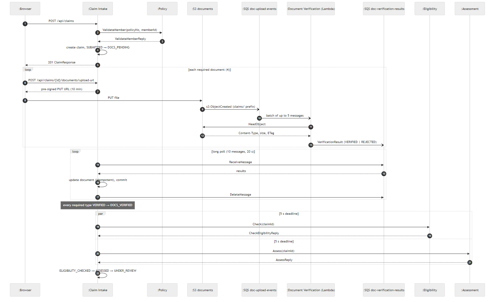

*Figure 8. Sequence diagram: claim creation and document verification.* Shows the browser uploading straight to
S3 with a pre-signed URL; S3 → SQS → Lambda → SQS messages are asynchronous (open arrowheads). Claim Intake
long-polls the results and then runs Eligibility and Assessment in a `par` fragment.

### 5.2 Settlement: the three-phase commit

*Figure 9. Sequence diagram: settlement by three-phase commit.* Shows the decision and status update committing
together, then CanCommit, PreCommit and DoCommit sent to the three participants in parallel, with the abort path
in an `alt` fragment.

1. **Decision.** The decision row and Claim Intake's `UpdateStatus(APPROVED)` run in one database
   transaction: if Claim Intake refuses or is down, nothing is recorded. Approval then logs `WAITING_VOTES`
   and answers 202.
2. **Phase 1, CanCommit** (parallel, 5 s). Each participant prepares and votes. A NO, a timeout or an error
   counts as NO.
3. **Phase 2, PreCommit** (5 s), only if all three voted YES. `PRECOMMITTING` is logged first; from here the
   outcome can only be commit. A missing PreCommit ack does not stop the commit.
4. **Phase 3, DoCommit** (5 s). `COMMITTED` is logged once all three ack; `CLAIM_SETTLED` is emitted.
5. **Abort.** `ABORTING` is logged, Abort is sent to all, then `ABORTED`, and the claim becomes
   SETTLEMENT_FAILED. The adjuster may retry, which creates attempt 2.

### 5.3 Audit

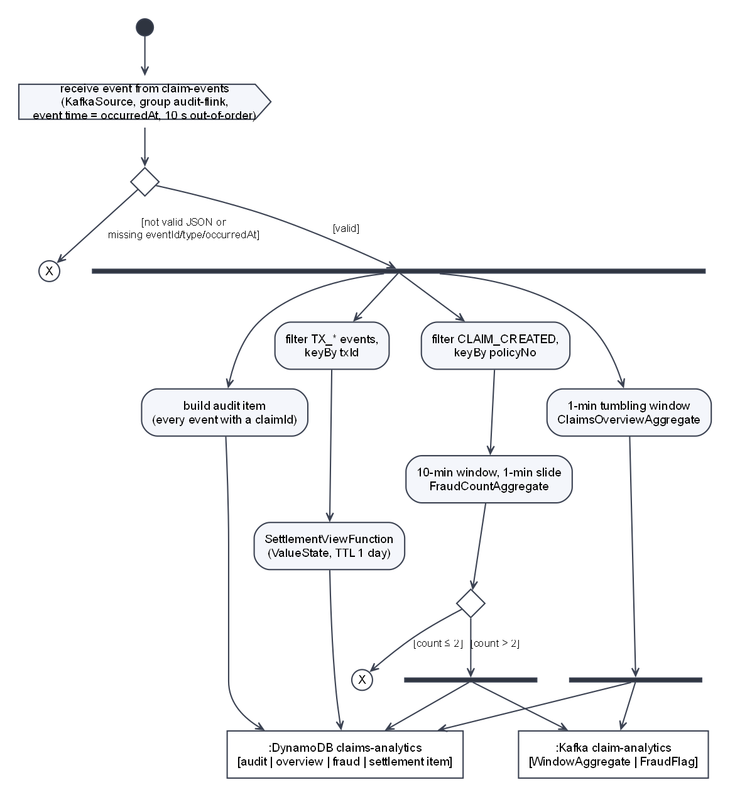

*Figure 10. UML activity diagram: the Audit Flink job.* Shows each valid event forking into four parallel
branches (audit trail, overview window, fraud window, settlement view) that write to DynamoDB and
`claim-analytics`; invalid events and small counts end at flow-final nodes.

Each service publishes after its own transaction commits. The Flink job is the only writer of the audit table,
so the audit trail is a projection of `claim-events` and can be rebuilt by replaying the topic.

---

## 6. Low-level design

### 6.1 Class diagrams

The class diagrams are the designs from issues #1 to #9, converted to UML member notation
(`name : Type`, `op(param: Type) : Return`). `ThreePhaseParticipant<T>` and `ParticipantTx` come from the shared
`backend/participant` library. Policy, Claim Intake and Payment extend it, so the three participants share one
implementation of the protocol, its idempotency and its timeouts.

*Figure 11. Class diagram: Policy (issue #1).* Shows the policy aggregate (Policy composes InsuredMember and
PolicyBalance) and `LimitReservationParticipant` extending the shared participant base.

*Figure 12. Class diagram: Claim Intake (issue #2).* Shows the controllers, the services, the workflow
orchestrator and state machine, and the `Claim` aggregate composing documents, history and eligibility checks.

*Figure 13. Class diagram: Document Verification Lambda (issue #3).* Shows `Handler` delegating to a parser, a
validator that aggregates four `ValidationRule` realizations, and a result publisher.

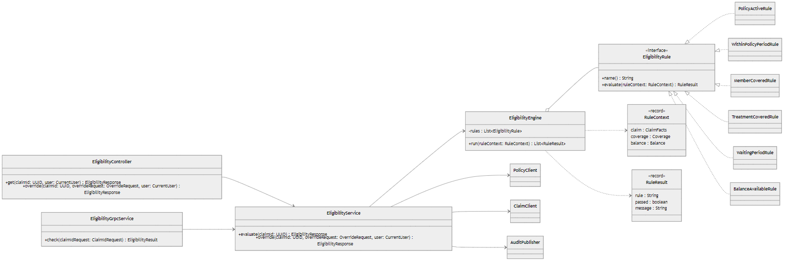

*Figure 14. Class diagram: Eligibility (issue #4, not built).* Shows a rule engine aggregating six
`EligibilityRule` realizations, evaluated over a `RuleContext`.

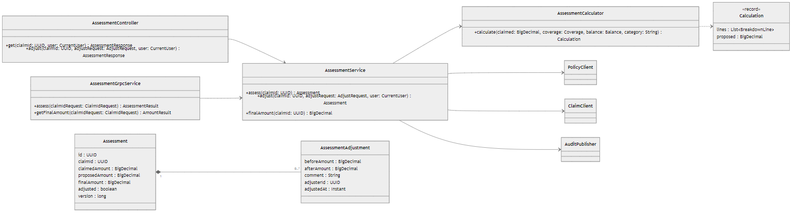

*Figure 15. Class diagram: Assessment (issue #5, not built).* Shows the calculator producing a `Calculation`,
and `Assessment` composing its adjustment history.

*Figure 16. Class diagram: Approval (issue #7).* Shows the coordinator, its recovery and chaos switch, the
participant client registry, and `SettlementTx` composing exactly three participants.

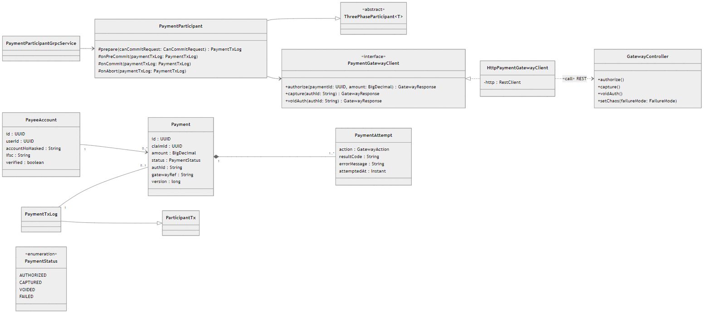

*Figure 17. Class diagram: Payment (issue #6).* Shows `PaymentParticipant`, the `PaymentGatewayClient` interface
and its HTTP realization calling the simulator, and `Payment` composing its attempts.

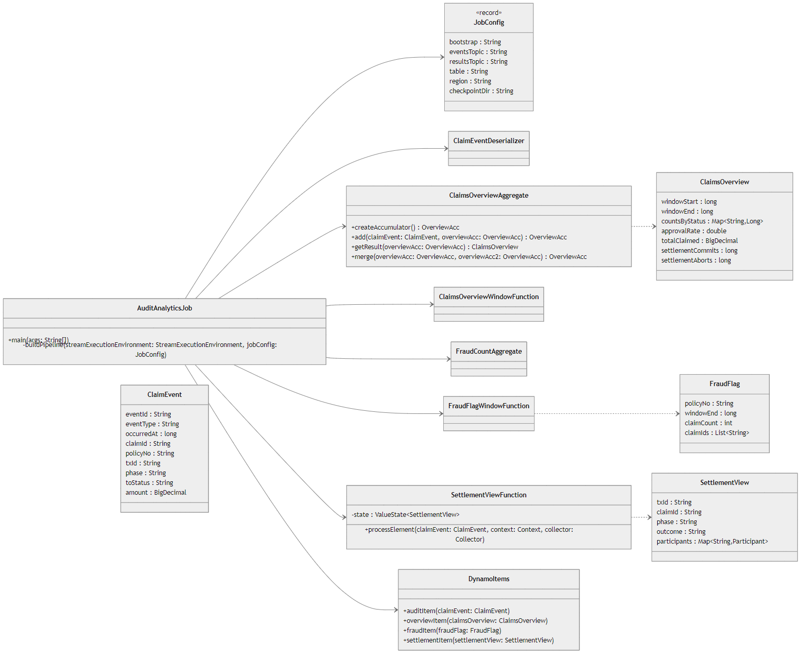

*Figure 18. Class diagram: Audit Flink job (issue #8).* Shows the job wiring its aggregate and window functions
and the DynamoDB item mapper.

*Figure 19. Class diagram: Ops Dashboard (issue #9).* Shows three controllers over their services, a single
DynamoDB repository, and the chaos clients for Approval and Payment.

### 6.2 Entity-relationship diagrams

These use crow's-foot (IE) notation: `||` means exactly one, `o|` zero or one, `o{` zero or many, `|{` one or
many. Each figure is one service's own database. The schemas are the Flyway migrations
(`src/main/resources/db/migration/V1__init.sql`).

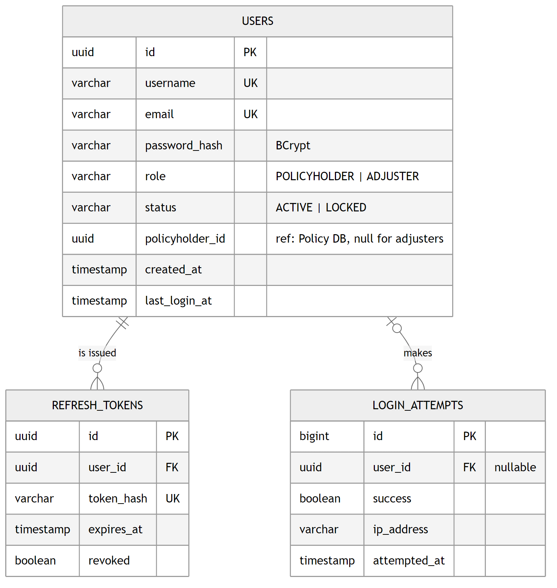

*Figure 20. ER diagram: Login DB.* Shows users with their refresh tokens and login attempts; an attempt for an
unknown username has no user.

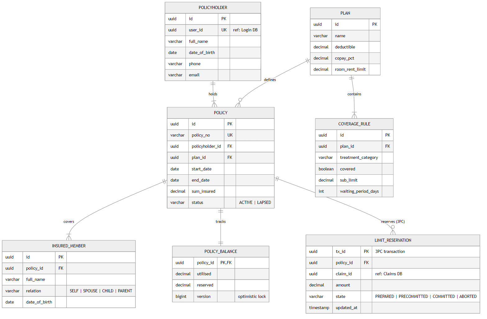

*Figure 21. ER diagram: Policy DB.* Shows policyholders, plans and coverage rules, policies with members, a 1:1
balance, and 3PC limit reservations keyed by `tx_id`.

*Figure 22. ER diagram: Claims DB.* Shows the claim with its documents, status history, eligibility checks and
3PC participation log.

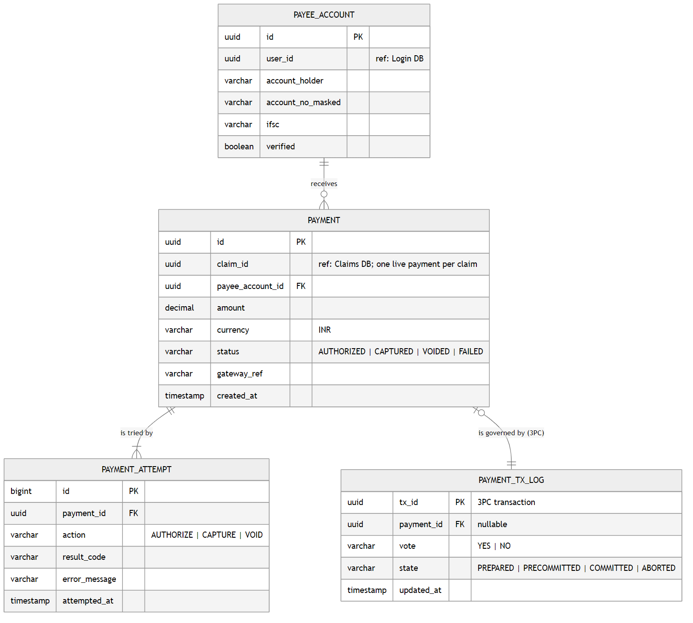

*Figure 23. ER diagram: Payments DB.* Shows payee accounts, payments with their gateway attempts, and the 3PC
log; one live payment per claim.

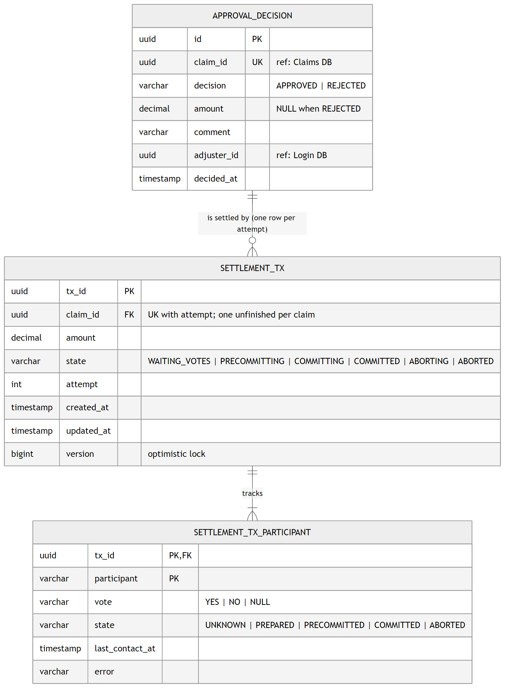

*Figure 24. ER diagram: Approval DB (coordinator log).* Shows one decision per claim, one settlement
transaction per attempt, and one row per participant per transaction.

**Concurrency and integrity rules in the schemas:**
- `version` columns give optimistic locking on `policy_balance`, `settlement_tx` and `payment`.
- Partial unique indexes allow one unfinished settlement per claim (Approval) and one live payment per claim
  (Payment).
- `(claim_id, attempt)` is unique in Approval.
- Each participant log is keyed by `tx_id`, so a repeated CanCommit finds the existing row instead of
  preparing twice.

### 6.3 State machines

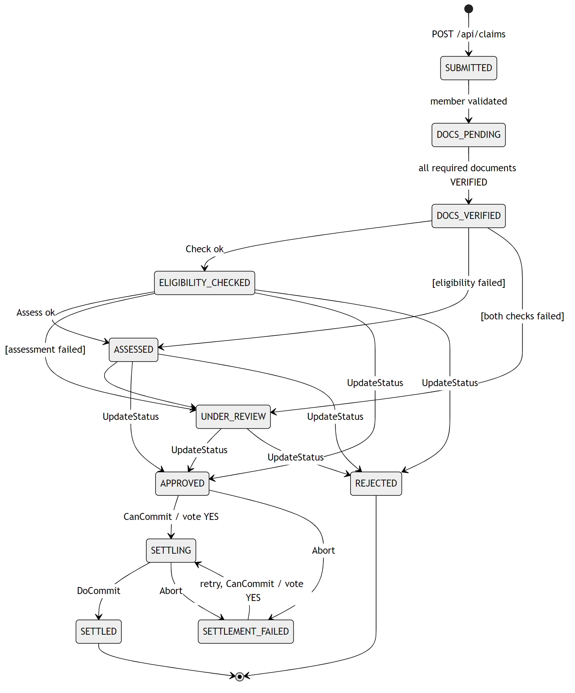

*Figure 25. State machine: claim status (`ClaimStateMachine.ALLOWED`).* Shows the review path, where a failed
check skips its own step; Approval's decision through `UpdateStatus`; and the 3PC transitions into SETTLING,
SETTLED and SETTLEMENT_FAILED (which can be retried).

*Figure 26. State machine: 3PC coordinator (`settlement_tx.state`).* Shows each transition as
`trigger [guard] / effect`, including the recovery transitions. Each state is logged before that phase's
messages are sent.

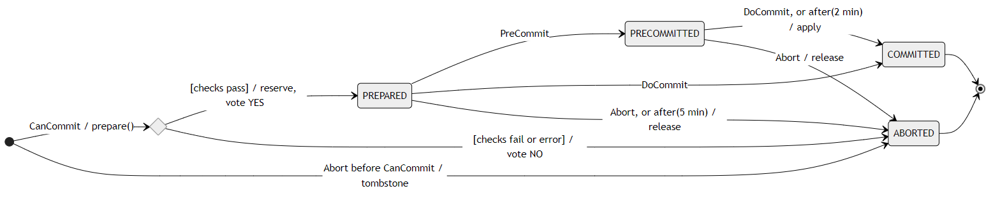

*Figure 27. State machine: 3PC participant (`ParticipantTxState`).* Shows the vote choice, the PreCommit and
DoCommit transitions, and the two participant timeouts.

### 6.4 3PC phases, timeouts and recovery

| Phase | Coordinator (Approval) | Participant | Timeout and default |
| --- | --- | --- | --- |
| 1 CanCommit | logs `WAITING_VOTES`, sends CanCommit to all in parallel | prepares and votes. YES → PREPARED; NO → ABORTED. An Abort that arrives first leaves a tombstone, so a late CanCommit votes NO | 5 s per call (`claims.coordinator.phase-timeout`); no answer = NO |
| 2 PreCommit | logs `PRECOMMITTING`, sends PreCommit | PREPARED → PRECOMMITTED | 5 s; a missing ack does not block. **A participant left PREPARED for 5 min aborts on its own** |
| 3 DoCommit | logs `COMMITTING`, sends DoCommit; logs `COMMITTED` when all ack | → COMMITTED (also from PREPARED) | 5 s; a missing ack keeps `COMMITTING`, and the sweep resends. **A participant left PRECOMMITTED for 2 min commits on its own** |
| Abort | logs `ABORTING`, sends Abort, logs `ABORTED` | PREPARED or PRECOMMITTED → ABORTED; releases what was reserved | |

**Coordinator recovery** (`CoordinatorRecovery`, at startup and every 30 s, for transactions idle for at least
15 s):

| Logged state | Action | Why |
| --- | --- | --- |
| `WAITING_VOTES` | send Abort to all → `ABORTED`, claim SETTLEMENT_FAILED | Not every YES is known |
| `PRECOMMITTING`, `COMMITTING` | send DoCommit to all → `COMMITTED` | Everyone voted YES |
| `ABORTING` | send Abort to all → `ABORTED` | Abort was decided |

**Participant recovery.** Each participant runs `expireTimedOut()` periodically and applies the two timeouts
above. Payment also runs `PaymentRecoverySweep` every 30 s: it captures a committed payment that is still
AUTHORIZED and voids an aborted one. Every call is idempotent, so repeating any phase is safe.

**Chaos testing.** `CRASH_BEFORE_PRECOMMIT` halts the coordinator after the votes, and recovery aborts.
`CRASH_AFTER_PRECOMMIT` halts it after the PreCommit acks, and recovery commits. `FAIL_AUTHORIZE` makes Payment
vote NO, which aborts the transaction. `FAIL_CAPTURE` makes the commit succeed while the capture stays pending
until the sweep succeeds. The integration tests in `backend/services/approval` and `payment` cover each case.

---

## 7. Design rationale

The repository has no separate decision records. Each point below explains a choice by the behaviour or
constraint that the code, the Terraform and the READMEs show.

**AWS as the platform.** The services map onto managed services one-to-one. Postgres per service runs on RDS,
the event bus on MSK, streaming on EMR (Flink 1.20), the event-driven function on Lambda, object storage on S3,
queues on SQS, and the read model on DynamoDB. IAM roles for service accounts (IRSA) and GitHub OIDC remove
long-lived credentials entirely. Everything is Terraform, so an environment can be created and destroyed on
demand; the infra README budgets roughly $0.90–1.00/hour with everything on, and every expensive part has an
`enable_*` toggle.

**EKS for the services.** Seven long-running Spring Boot services need the same things: rolling updates, health
probes, autoscaling, service discovery for gRPC (`dns:///<svc>:9090`), and network isolation. Kubernetes gives
all of them declaratively:
- HPAs, which the Assessment design (issue #5) relies on for a CPU-bound calculation.
- ClusterIP DNS, so gRPC targets are plain service names.
- NetworkPolicies, enforced by the VPC CNI.
- One ALB shared by all Ingresses.

Kubernetes also makes GitOps possible: Argo CD can reconcile the whole namespace from Git. The coordinator's
crash test depends on Kubernetes restarting the pod after `Runtime.halt(1)`.

**Lambda only for Document Verification.** It is the one component that is:
- **event-driven and bursty.** It runs only when a file lands in S3.
- **stateless.** It has no database and no Spring, and its only input is the object's metadata.
- **independent of the other services.** It talks only to S3 and SQS.

Paying per invocation suits that load better than a pod running idle. SQS in front of it adds buffering, retries
of single messages (`ReportBatchItemFailures`) and a DLQ. SnapStart reduces Java cold starts.

The other services don't fit Lambda:
- They hold gRPC servers and connection pools.
- They keep long-polling loops and periodic sweeps running.
- The coordinator and participants must survive and resume their logs, which needs long-lived processes.

**3PC instead of 2PC.** In two-phase commit, a participant that voted YES and then loses the coordinator has to
wait: it cannot safely commit or abort on its own. 3PC adds the PreCommit phase so that a participant always
knows enough to decide by itself after a timeout, and the participant code does exactly that:
- **PREPARED participant.** Some participant may not have voted YES, so after 5 min it **aborts**.
- **PRECOMMITTED participant.** Everyone voted YES, so after 2 min it **commits**.

This bounds how long a policy's reserved amount or a payment authorization can stay locked when Approval is
down. On the coordinator side, logging every state before sending a phase's messages makes the outcome
recoverable from the log alone (Section 6.4). That is what the chaos modes demonstrate.

The 3PC trade-offs:
- One extra round trip per settlement.
- 3PC's guarantee assumes timeouts can tell a crash from a network partition, which is not true in general. A
  long partition after PreCommit could let a participant commit on timeout while another has aborted. The
  coordinator never aborts after `PRECOMMITTING`, which narrows the window but doesn't close it.

**Database per service.** Each service owns its schema and migrations (Flyway), and the 3PC participant log
lives in the same database as the data it protects. A participant's state change and its business change
(`reserved += amount`, the claim status, the payment) therefore commit in one local transaction. No service can
couple to another's tables, which is why claim data is fetched with `ClaimService.GetClaim` instead of a join.
Since there are no cross-service joins, a cross-service change needs the 3PC protocol, and cross-service queries
are served by a projection (DynamoDB via Flink). To keep costs low, all databases share one RDS instance; they
stay separate logical databases with separate users and Secrets.

**Other trade-offs the repository records:**
- **Single-instance infrastructure** in dev: RDS single-AZ, one NAT gateway, EMR stops when idle. These are cost
  choices, controlled by variables.
- **The coordinator runs as one replica** (HPA max 1). Recovery was not designed for active-active coordinators.
- **The Ingress serves HTTP on port 80 only.** No certificate or TLS listener is configured in `k8s/`; adding
  ACM and HTTPS is open work.
- **Kafka is optional.** With MSK off, events are only logged, and the services keep working because their
  databases are the source of truth.
- **The Payment authorization orphan** (Section 4.8) and **tokens that are not revoked at logout** (Section 4.1)
  are documented limits.
- **Eligibility and Assessment are designed but not built.** Claim Intake already tolerates their absence: a
  failed check skips its step.

---

## 8. GitOps and CI/CD

Kubernetes workloads reach the cluster **only from Git**. Terraform installs Argo CD and seeds it. CI builds
images and commits new tags. Argo CD applies what is in Git. No pipeline and no person runs `kubectl apply` for
a service.

*Figure 28. Sequence diagram: delivery.* Shows a merge to `main` triggering the deliver workflow, which tests,
pushes images to ECR and commits the new tag to `k8s/overlays/dev`; Argo CD then pulls and applies it.

| Piece | Location | What it does |
| --- | --- | --- |
| Kustomize base | `k8s/base/<service>/` | Per service: a Deployment (requests/limits, startup/liveness/readiness probes on `/actuator/health/*`, non-root user, read-only root filesystem), a ClusterIP Service (80 → 8080, plus gRPC 9090), a ConfigMap, a Secret reference (`<svc>-db` from Terraform; no secret values in Git), an HPA (70% CPU) and a NetworkPolicy. Shared: the `claims` Namespace, default-deny ingress, a ServiceMonitor. The Ingress belongs to the services the ALB routes to |
| Overlays | `k8s/overlays/dev`, `k8s/overlays/prod` | dev: 1 replica, HPA max 2, chaos on, `claims-dev/*` images. prod: 2 replicas, HPA max 6, chaos off, `claims-prod/*` images. Approval is pinned to 1 in both |
| Argo CD | `gitops/argocd/project.yaml`, `root-app.yaml`; `gitops/apps/<env>.yaml` | The AppProject `claims` (this repository; namespaces `claims` and `argocd` only). The root app-of-apps picks `<env>.yaml`. Each environment Application syncs automatically with prune, selfHeal, `CreateNamespace=true` and retries, and ignores `replicas` because the HPA owns them |
| Bootstrap | `infra/terraform/platform/argocd.tf`, `argocd-root-app.tf` | Helm `argo-cd` plus `argocd-apps`, whose values are read from the `gitops/argocd/*.yaml` files, so there is a single definition |
| CI: validate | `.github/workflows/validate.yml` | On every PR: `kustomize build` both overlays → `kubeconform -strict` (including CRD schemas); `terraform fmt` and `validate` for all three stacks; `mvn verify` |
| CI: deliver | `.github/workflows/deliver.yml` | On a push to `main`: test → build with Jib (7 services) and Docker (frontend) → push to ECR through GitHub OIDC → `kustomize edit set image` in the overlay → commit `deploy(<env>): <sha> [skip ci]`. A manual run with `environment=prod` rebuilds a chosen commit for prod. The Lambda jar is built as an artifact for `terraform apply` |
| Rollback | Git | `git revert` of the deploy commit, or setting one image back with `kustomize edit set image`. Argo CD's history rollback is for emergencies only (auto-sync must be off) |

Terraform owns the parts that hold secrets or AWS identities: the `claims` namespace, the `<svc>-db` and
`jwt-keys` Secrets, the `platform-endpoints` ConfigMap and the IRSA service accounts. The manifests only
reference them, and the namespace carries `Prune=false,Delete=false`, so Argo CD never deletes it. Full
details are in [`gitops/README.md`](../gitops/README.md) and [`infra/README.md`](../infra/README.md).

---

## 9. Diagram sources and corrections

Sources are under [`docs/diagrams/src/`](diagrams/src). Mermaid sources were rendered with mermaid-cli 11.4.2
and Graphviz sources with `dot` 14.0.2. The hand-drawn SVGs were rasterized with headless Chrome.

| Fig. | Diagram | Found in | Origin | Correction made |
| --- | --- | --- | --- | --- |
| 1 | Use case | `diagrams/use-case-diagram.svg` | commit 79430af | None needed: system boundary, «include»/«extend», actor generalization and «system» actor are UML-conformant |
| 2 | Activity | `diagrams/activity-diagram.svg` | commit 79430af | None needed: initial/final/flow-final nodes, decision/merge, fork/join, partitions and notes are UML-conformant |
| 3 | Deployment | `diagrams/deployment-diagram.svg` | commit 8216c58 | Facts updated to match Terraform: EKS 1.30 → **1.33**, EMR 7.2 → **7.6.0**, "9 service images" → **10 image repositories**. Notation was already UML (nodes, «artifact»s, communication paths). Also fixed in the original file |
| 4 | Terraform stacks | `infra/README.md` "How the stacks connect" | mermaid flowchart | A flowchart is not a UML diagram: redrawn as a **component diagram** (stacks as «Terraform stack» components, dependencies as dashed open arrows); paths updated to `gitops/apps` |
| 5, 6 | Architecture | `diagrams/architecture-diagram.svg` | commit d9d922c | Not UML: it used database cylinders, colour-coded protocol arrows with a legend, and an "API Gateway" box that does not exist. Redrawn as two **component diagrams** with «component»/«database»/«queue»/«topic» stereotypes and labelled UML dependencies. The ALB Ingress replaces "API Gateway" |
| 7 | Happy-path sequence | `diagrams/sequence-diagram.svg` | commit 79430af | None needed: lifelines, sync/async/reply arrows, `par`/`opt`/`ref` fragments are UML-conformant |
| 8 | Claim intake sequence | `backend/services/claim-intake/README.md`; identical block in issue #12 / PR #12 | mermaid | **Calls to other services drawn as self-messages** (`Policy.ValidateMember`) were moved to their own lifelines. **Asynchronous S3/SQS/Lambda messages drawn as dashed replies** were changed to async messages, with the queues as lifelines. Missing replies were added |
| 9 | 3PC sequence | `backend/services/approval/README.md`; identical block in issue #11 / PR #11 | mermaid | **One lifeline stood for three participants**; they are now three lifelines with `par` fragments. **`Assessment.GetFinalAmount` and `Intake.UpdateStatus` were self-messages**; they now go to their own lifelines. The event is an async message to a Kafka lifeline |
| 10 | Audit pipeline | `backend/analytics/audit-flink/README.md` | mermaid flowchart | A flowchart is not UML: redrawn as an **activity diagram** with an accept-event action, a fork, decisions with one guard per branch, object nodes and flow-final nodes |
| 11–19 | Class diagrams | GitHub issue bodies #1–#9 | mermaid | **Attributes** changed from `Type name` to UML `name : Type`. **Parameters** changed to `name: Type`; unnamed ones got a name derived from the type. **Approval:** the association `SettlementTx → CoordinatorState` duplicated the `state` attribute, so it was removed. **Payment:** the same fix for `Payment → PaymentStatus`; `Payment 1–1 PaymentTxLog` became `PaymentTxLog 1 — 0..1 Payment` (`payment_id` is nullable); the REST dependency was labelled «call» |
| 20 | Login ER | root `README.md` | mermaid | `USERS ||--o{ LOGIN_ATTEMPTS` → `|o--o{`: `login_attempts.user_id` is nullable in the migration |
| 21 | Policy ER | root `README.md` | mermaid | `limit_reservation` is keyed by `tx_id` (PK) in the migration, not by a separate `id` |
| 22 | Claims ER | root `README.md` | mermaid | `settlement_participation.claim_id` is nullable (abort tombstone): `||--o{` → `|o--o{` |
| 23 | Payments ER | root `README.md` | mermaid | `UNIQUE (claim_id)` → one *live* payment per claim (partial unique index; the plain constraint would block a retry). `PAYMENT ||--|| PAYMENT_TX_LOG` → `|o--||` (nullable `payment_id`) |
| 24 | Approval ER | none existed | new | Drawn from `approval/.../V1__init.sql` |
| 25 | Claim state machine | `claim-intake/README.md` (ASCII) | text | Drawn as a UML state machine; checked against `ClaimStateMachine.ALLOWED` |
| 26 | Coordinator state machine | `approval/README.md` (ASCII + recovery table) | text | Drawn as a UML state machine with `trigger [guard] / effect` labels |
| 27 | Participant state machine | none existed | new | Drawn from `ThreePhaseParticipant` and the participant READMEs |
| 28 | GitOps sequence | `gitops/README.md` | new (this change) | — |

There were no `*.puml`, `*.mmd`, `*.png` or `*.drawio` files and no PlantUML blocks in the repository. The ER
diagrams use crow's-foot notation, which is the ER notation the brief asks for.
