# Medical Insurance Claims Platform: Design Document

This document describes the system as it exists in the repository
([github.com/Krisha-cmd/Insurance-claim](https://github.com/Krisha-cmd/Insurance-claim)): its code, its
Terraform, its Kubernetes manifests, and the designs in GitHub issues #1 to #9. It goes from the business view
down to classes and tables. Where a part is designed but not yet built, the text says so.

Every diagram has a number and a caption. Section 9 lists where each diagram came from and what was corrected
in it.

**Contents**

1. [Overview](#1-overview)
2. [Cloud deployment](#2-cloud-deployment)
3. [Microservices architecture](#3-microservices-architecture)
4. [Services: API, data and dependencies](#4-services-api-data-and-dependencies)
5. [Interconnection](#5-interconnection)
6. [Low-level design](#6-low-level-design)
7. [Design rationale](#7-design-rationale)
8. [GitOps and CI/CD](#8-gitops-and-cicd)
9. [Diagram sources and corrections](#9-diagram-sources-and-corrections)

Appendix A. [Why the system is designed this way](#appendix-a-why-the-system-is-designed-this-way)

---

## 1. Overview

The platform processes medical insurance claims from filing to payment. A policyholder files a claim and uploads
documents. The documents are verified, eligibility and the payable amount are worked out, and an adjuster
approves or rejects the claim. An approved claim is **settled with a three-phase commit (3PC)** across three
services, so that the claim status, the policy's remaining sum insured and the payment change together or not at
all. Every step is **audited** through an event stream.

**Actors** (from the root README):

| Actor | Role |
| --- | --- |
| Policyholder | Files and tracks claims through the customer portal |
| Claims Adjuster | Reviews claims, may change eligibility, assessment and the decision with a written justification; also acts as Auditor |
| Payment Gateway | External system that pays settled claims; simulated here, and able to fail on demand |

**Business flow.** Policy lookup → submit claim → upload documents → verification → eligibility check →
assessment → approve or reject → settlement by 3PC → audit of every step. Between eligibility and approval the
adjuster can change values, and each change needs a comment.

*Figure 1. Use case diagram.* Shows the system boundary, the three actors, and the use cases each actor
reaches; Claims Adjuster generalizes Auditor, and every claim-changing use case «include»s Record Audit Entry.

*Figure 2. Activity diagram, "Process medical claim".* Shows the end-to-end flow in swimlanes, with the
document loop, the parallel eligibility and assessment checks, and the parallel settlement branches.

**Building blocks.** The table maps the eight services named in the brief to what is in the repository.

| # | Service | Implementation | Runs on |
| --- | --- | --- | --- |
| 1 | Policy | `backend/services/policy` | EKS |
| 2 | Claim Intake | `backend/services/claim-intake` | EKS |
| 3 | Document Verification | `backend/functions/document-verification` | AWS Lambda |
| 4 | Eligibility | `backend/services/eligibility` (stateless, no database) | EKS |
| 5 | Assessment | `backend/services/assessment` | EKS (HPA on CPU, like every service) |
| 6 | Approval (3PC coordinator) | `backend/services/approval` | EKS, exactly one replica |
| 7 | Payment | `backend/services/payment`, plus `gateway-simulator` | EKS |
| 8 | Audit | `backend/analytics/audit-flink` (Flink on EMR) and `backend/services/ops-dashboard` (read API) | EMR + EKS |
| | Login (supporting) | `backend/services/login`: issues RS256 JWTs, publishes the JWKS | EKS |
| | Frontend (supporting) | `frontend/`: React/Vite customer portal and adjuster/ops console | EKS (nginx image) |

---

## 2. Cloud deployment

Everything runs in one AWS region, `ap-south-1`, and **all of it is created by Terraform**
(`infra/terraform`), split into three stacks with separate state.

*Figure 3. UML deployment diagram.* Shows the nodes (3D boxes) nested by containment: region, VPC, subnets, EKS
and its namespaces, and the managed services. It also shows the artifacts deployed on each node and the
communication paths with their protocols.

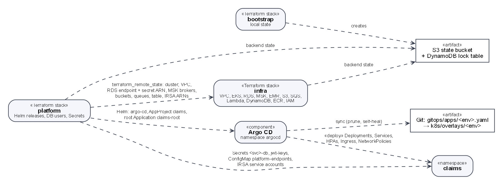

*Figure 4. Terraform stacks as a UML component diagram.* Shows `bootstrap` creating the state backend, `infra`
creating the AWS resources, `platform` reading `infra`'s outputs and installing Argo CD, and Argo CD deploying
from Git.

| Area | What Terraform builds (dev values) | Where |
| --- | --- | --- |
| **VPC** | `10.20.0.0/16` across 2 AZs. Private subnets are `cidrsubnet(/16, 4, i)`, i.e. `10.20.0.0/20` and `10.20.16.0/20`, for nodes, RDS, MSK, EMR and Lambda. Public subnets are `10.20.200.0/24` and `10.20.201.0/24`, for the ALB and the NAT gateway. There is a single NAT gateway, plus S3 and DynamoDB gateway endpoints | `modules/network` |
| **EKS** | Kubernetes 1.33, one managed node group of `t3.large` (min 2, desired 2, max 2: the account has an 8-vCPU EC2 quota, checked by `infra/quota.tf`). Add-ons: VPC CNI with network policy enforcement, EBS CSI and a `gp3` StorageClass | `modules/eks` |
| **In-cluster platform** | AWS Load Balancer Controller, metrics-server (for the HPAs), Argo CD, kube-prometheus-stack (Prometheus and Grafana), Loki with Promtail. Also database users, Secrets, and IRSA service accounts | `platform/` |
| **RDS** | PostgreSQL 16 on `db.t4g.micro`, 20 GB, single-AZ, with the master password in Secrets Manager. One database plus one owner user per service: `login`, `policy`, `claims`, `assessment`, `approval`, `payment` | `modules/rds`, `platform/` |
| **S3** | Buckets `documents` (pre-signed uploads; S3 CORS limited to `frontend_origins`), `emr-logs`, `artifacts` | `modules/s3` |
| **SQS** | `doc-upload-events` (fed by S3 `ObjectCreated` on `claims/`) and `doc-verification-results`. Each has a DLQ that receives a message after 3 receives. Visibility timeout is 6 × the Lambda timeout | `modules/sqs` |
| **Lambda** | `document-verification`: Java 21 with SnapStart, 60 s timeout, SQS event source mapping on `doc-upload-events` | `modules/lambda` |
| **MSK** | Kafka 3.8.x on 2 × `kafka.t3.small`. A Kubernetes Job creates the topics `claim-events`, `claim-analytics` and `doc-verified` | `modules/msk`, `platform/` |
| **EMR** | `emr-7.6.0` (Flink 1.20): a single-node cluster, one `m5.xlarge` primary with no core nodes, which stops after 2 h idle. Runs the Audit Flink job | `modules/emr` |
| **DynamoDB** | `claims-<env>-analytics`, on demand: `PK`/`SK`, `GSI1`, TTL | `modules/dynamodb` |
| **ECR** | 10 repositories `claims-<env>/<image>` (lifecycle: keep the newest 10) | `modules/ecr` |
| **IAM** | IRSA roles (`claim_intake`, `ops_dashboard`, `alb_controller`, `grafana`), the Lambda role, EMR roles, and an optional GitHub OIDC role for CI with ECR push only. There are no long-lived keys | `modules/iam` |

**API Gateway.** The brief lists API Gateway, but the repository has **no Amazon API Gateway resource**. That
role is filled by the **Application Load Balancer**, which the AWS Load Balancer Controller creates from the
Kubernetes Ingresses. All services join one ALB through the ingress group `claims`, which routes by path
(Figure 5). Authentication happens in each service, which validates the login service's JWT against its JWKS.
The original architecture drawing showed an "API Gateway" box; Figure 5 replaces it with the ALB ingress.

---

## 3. Microservices architecture

Two figures split the architecture: synchronous interfaces (Figure 5) and data stores plus asynchronous
paths (Figure 6). Together they replace `diagrams/architecture-diagram.svg`.

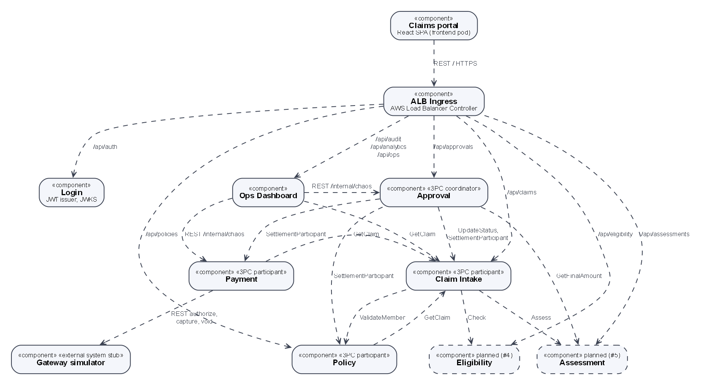

*Figure 5. UML component diagram: synchronous interfaces.* Shows the browser reaching services only through the
ALB with REST, and the services calling each other with gRPC (contracts in `backend/proto`). Approval depends on
the three 3PC participants.

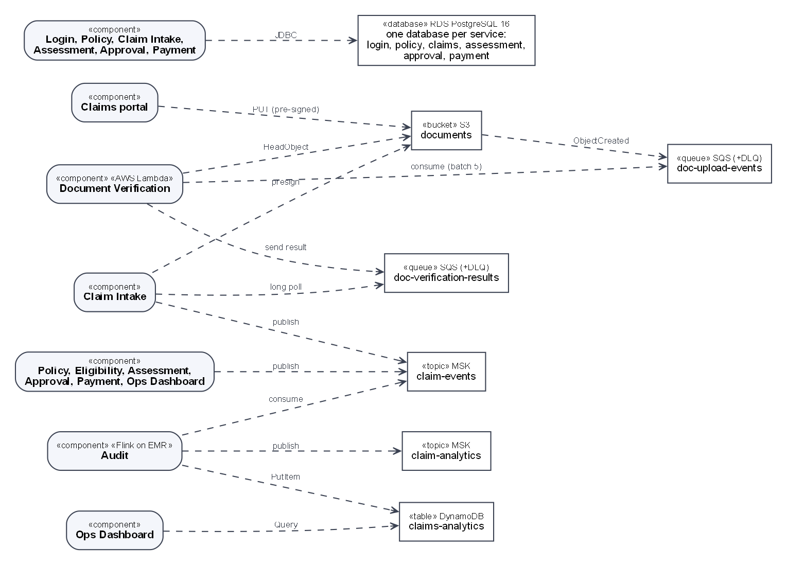

*Figure 6. UML component diagram: data and events.* Shows the database per service on RDS, the S3 → SQS →
Lambda → SQS path for documents, every event publisher feeding `claim-events`, and Audit (Flink) writing
DynamoDB, which the Ops Dashboard reads.

*Figure 7. Happy-path sequence diagram (business level).* Shows one claim from policy lookup to settlement
across all services. The settlement itself is a `ref` to the 3PC interaction in Figure 9.

**Architectural rules visible in the code:**

- **Browsers speak REST only**, and only through the ALB. Every service exposes HTTP on 8080 (Service port 80).
  The gRPC services also expose 9090.
- **Database per service.** No service reads another's tables. Cross-service references are plain ids marked
  "ref: … DB" in the ER diagrams, resolved through gRPC (for example `ClaimService.GetClaim`).
- **Claim Intake owns the claim status.** Every other service changes it only through `ClaimService.UpdateStatus`
  or as a 3PC participant, and only Claim Intake emits `toStatus`.
- **Shared event envelope.** Every event uses the `ClaimEvent` envelope in `backend/common`, keyed by `claimId`
  on `claim-events`. With `KAFKA_BOOTSTRAP` empty (MSK disabled) events are only logged; the databases stay the
  source of truth.
- **No public internal endpoints.** `/internal/chaos` and the gateway simulator are not in any Ingress, and
  NetworkPolicies restrict who may call them (Section 8).

---

## 4. Services: API, data and dependencies

The REST paths are exactly the ones the frontend calls (`frontend/src/config/api.js`). Every endpoint except
login and the JWKS requires the login service's JWT. Errors use one shape:
`ApiError {status, message, path, timestamp}`.

### 4.1 Login

| | |
| --- | --- |
| **REST** | `POST /api/auth/login`, `POST /api/auth/logout`, `GET /api/auth/me`, `GET /.well-known/jwks.json` |
| **Tokens** | RS256 JWTs, issuer `claims-login`, 60 min lifetime. The key pair comes from the `jwt-keys` Secret, which Terraform creates. Other services fetch the JWKS from `http://login.claims.svc.cluster.local/.well-known/jwks.json` |
| **Data** | Login DB: `users`, `refresh_tokens`, `login_attempts` (Figure 20) |
| **Depends on** | RDS |
| **Known limit** | Access tokens are not revoked at logout; they stay valid until they expire |

### 4.2 Policy (issue #1)

| | |
| --- | --- |
| **REST** | `GET /api/policies/me` (`?all=true`), `GET /api/policies/{policyNo}`, `GET /api/policies/{policyNo}/coverage`. A policyholder sees only their own policies; an adjuster sees all of them |
| **gRPC serves** | `PolicyService.ValidateMember` (Claim Intake), `GetPolicy` / `GetCoverage` / `GetBalance` (Eligibility, Assessment), `SettlementParticipant` (Approval) |
| **gRPC calls** | `ClaimService.GetClaim` during prepare |
| **3PC role** | Reserves the payout against `sum_insured − utilised − reserved`. DoCommit moves the amount from reserved to utilised; Abort releases it. An optimistic lock on `policy_balance` ensures two concurrent reservations can never both overdraw the policy |
| **Data** | Policy DB: `policyholder`, `plan`, `coverage_rule`, `policy`, `insured_member`, `policy_balance`, `limit_reservation` (Figure 21) |
| **Events** | `TX_VOTE`, `TX_PARTICIPANT_STATE` on `claim-events` |

### 4.3 Claim Intake (issue #2)

| | |
| --- | --- |
| **REST** | Policyholder: `POST /api/claims`, `GET /api/claims/me`, `POST /api/claims/{id}/documents/upload-url`. Owner or adjuster: `GET /api/claims/{id}`, `GET …/status`, `GET …/documents`. Adjuster only: `GET /api/claims/queue`, `GET /api/claims?status&q&from&to` |
| **gRPC serves** | `ClaimService` (`UpdateStatus`, `GetClaim`, `RecordEligibility`, `RecordAssessment`), `SettlementParticipant` |
| **gRPC calls** | `PolicyService.ValidateMember`, `EligibilityService.Check`, `AssessmentService.Assess` (the last two in parallel, 5 s deadline each; a failed check skips its own step, never the review) |
| **AWS** | Pre-signs S3 PUTs (key `claims/{claimId}/{docType}/{documentId}-{file}`, 10 min, PDF/JPEG/PNG). Long-polls `doc-verification-results`. Credentials come through the `claim-intake` IRSA service account |
| **3PC role** | CanCommit votes YES only for an APPROVED (or SETTLEMENT_FAILED, for a retry) claim with a valid amount; the claim then becomes SETTLING. DoCommit → SETTLED; Abort → SETTLEMENT_FAILED |
| **Data** | Claims DB: `claim`, `claim_document`, `claim_status_history`, `eligibility_check`, `settlement_participation` (Figure 22) |
| **Events** | `CLAIM_CREATED`, `CLAIM_STATUS_CHANGED`, `DOCUMENT_VERIFIED/REJECTED`, `ELIGIBILITY_CHECKED`, `ASSESSMENT_COMPLETED`, `CHECK_FAILED`, `TX_*` |

### 4.4 Document Verification (issue #3)

| | |
| --- | --- |
| **Trigger** | SQS `doc-upload-events` (S3 event notifications), batch 5, `ReportBatchItemFailures` |
| **Work** | Parses the key, calls `HeadObject`, runs `KeyFormatRule`, `NonEmptyRule`, `SizeRule` (`MAX_SIZE_MB`) and `ContentTypeRule` (`ALLOWED_TYPES` plus a file-extension check) |
| **Output** | A `VerificationResult` JSON (VERIFIED or REJECTED with reasons) on `doc-verification-results` |
| **Failures** | A rule failure is a REJECTED result, not an error. An S3/SQS error makes only that message fail, so it is retried and then lands in the DLQ. A malformed body is dropped |
| **Data** | None; no database, no Spring |

### 4.5 Eligibility (issue #4)

| | |
| --- | --- |
| **REST** | `GET /api/eligibility/{claimId}` (owner or adjuster): re-evaluates now and merges the latest override recorded in Claim Intake. `PUT /api/eligibility/{claimId}/override` (adjuster) `{eligible, reason, comment}`: comment ≥ 10 characters, only before a decision |
| **gRPC serves** | `Check(ClaimDetails)` (Claim Intake's workflow): `{eligible, rules[], checked_at}`; stores and emits nothing |
| **gRPC calls** | `PolicyService.GetPolicy` / `GetCoverage` / `GetBalance`; `ClaimService.GetClaim` (with `latest_eligibility`) and `RecordEligibility` (an override, with its reason) |
| **Rules** | Six `EligibilityRule` beans in `@Order`: policy active, admission within the period, member covered, treatment covered, waiting period passed, balance > 0. The engine runs all of them and collects every result; eligible = all passed. A new rule is a new bean (Figure 14) |
| **Data** | None. Results live in Claim Intake's `eligibility_check` (with `override_reason`, migration V2) |
| **Events** | `ELIGIBILITY_OVERRIDDEN {before, after, reason}` with the comment; `ELIGIBILITY_CHECKED` is emitted by Claim Intake |

### 4.6 Assessment (issue #5)

| | |
| --- | --- |
| **REST** | `GET /api/assessments/{claimId}` (owner or adjuster): the breakdown, the calculated and final amounts, and the adjustments. `PUT /api/assessments/{claimId}/adjust` (adjuster) `{amount, comment}`: `0 < amount ≤ claimed`, comment ≥ 10 characters, only before a decision |
| **gRPC serves** | `Assess(ClaimDetails)` (Claim Intake): idempotent, one row per claim; recalculates unless adjusted. `GetFinalAmount` (Approval): the adjusted amount, else the proposed one; NOT_FOUND until assessed |
| **gRPC calls** | `PolicyService.GetCoverage` / `GetBalance`; `ClaimService.GetClaim` (status check) and `RecordAssessment` (after an adjustment, in the same transaction) |
| **Calculation** | `AssessmentCalculator`, a pure function: `capped = min(claimed, subLimit)` → `max(capped − deductible, 0)` → minus co-pay → `min(…, remaining sum insured)`, 2 decimals HALF_UP. Timed by `claims.assessment.calculate` (CPU only), the HPA's signal |
| **Data** | Assessment DB: `assessment` (every step of the calculation, `final_amount`, `adjusted`), `assessment_adjustment` |
| **Events** | `ASSESSMENT_ADJUSTED {before, after}`; `ASSESSMENT_COMPLETED` is emitted by Claim Intake |

### 4.7 Approval: 3PC coordinator (issue #7)

| | |
| --- | --- |
| **REST** (adjuster) | `POST /api/approvals/{claimId}` `{decision, comment ≥ 10 chars}`: REJECTED → 200; APPROVED → 202 with `txId`. `GET …/settlement` returns the `SettlementView`. `POST …/settlement/retry` is allowed only after an abort |
| **Internal** | `POST /internal/chaos` (`CRASH_BEFORE_PRECOMMIT`, `CRASH_AFTER_PRECOMMIT`), disabled with `CHAOS_ENABLED=false` (prod) |
| **gRPC calls** | `AssessmentService.GetFinalAmount`, `ClaimService.UpdateStatus`, `SettlementParticipant` ×3 (claim-intake, policy, payment; participants are configuration only) |
| **Data** | Approval DB: `approval_decision`, `settlement_tx` (the coordinator log), `settlement_tx_participant` (Figure 24) |
| **Events** | `CLAIM_APPROVED/REJECTED`, `TX_STARTED`, `TX_VOTE`, `TX_PRECOMMIT(_ACKS)`, `TX_DOCOMMIT(_INCOMPLETE)`, `TX_COMMITTED`, `CLAIM_SETTLED`, `TX_ABORT(ED)`, `TX_RECOVERY`, `COORDINATOR_CRASHED` |
| **Deployment** | Exactly **one replica**: recovery is not designed for active-active coordinators, so the HPA max is 1 |

### 4.8 Payment and the gateway simulator (issue #6)

| | |
| --- | --- |
| **REST** | None public; only `/internal/chaos` (forwarded to the gateway) and actuator |
| **gRPC** | Serves `SettlementParticipant`; calls `ClaimService.GetClaim` (to find the payee) |
| **3PC role** | CanCommit authorizes at the gateway (3 s timeout) → YES, or NO with the gateway's reason. DoCommit captures, with up to 3 tries; if all fail it still acks the commit, and the 30 s `PaymentRecoverySweep` keeps capturing. Abort voids |
| **Gateway simulator** | In-memory `POST /authorize`, `/capture`, `/void` (idempotent) and `/chaos` (`NONE`, `FAIL_AUTHORIZE`, `FAIL_CAPTURE`, `SLOW`) |
| **Data** | Payments DB: `payee_account`, `payment`, `payment_attempt`, `payment_tx_log` (Figure 23). At most one AUTHORIZED or CAPTURED payment per claim (partial unique index) |
| **Events** | `PAYMENT_AUTHORIZED/CAPTURED/VOIDED/FAILED/CAPTURE_PENDING`, `TX_VOTE`, `TX_PARTICIPANT_STATE` |
| **Known limit** | If the process dies between the gateway's authorize and the local commit, nothing voids that hold; real gateways expire it |

### 4.9 Audit: Flink job and Ops Dashboard (issues #8 and #9)

| | |
| --- | --- |
| **Audit Flink job** | Consumes `claim-events` (event time `occurredAt`, 10 s out-of-order). Produces: the audit trail; 1-min overview windows; fraud flags (more than 2 claims per policy in 10 min, sliding 1 min); and settlement views per `txId` (Figure 10). Sinks: DynamoDB `claims-analytics` and Kafka `claim-analytics`. Exactly-once checkpoints every 30 s, plus deterministic DynamoDB keys, so a replay overwrites rather than duplicates |
| **DynamoDB layout** | `CLAIM#<id>` / `EVENT#<ts>#<eventId>` (audit), `METRIC#claims_overview#1m` / `WINDOW#<start>`, `FRAUD#<policyNo>` / `WINDOW#<end>`, `TX#<txId>` / `STATE`. `GSI1` = `TYPE#<eventType>` / `<ts>`; TTL 7 days on aggregates and flags |
| **Ops Dashboard REST** (adjuster; audit trail also for the claim owner) | `GET /api/analytics/summary`, `/series`, `/fraud-flags`; `GET /api/audit/claims/{id}`, `/api/audit/events`; `GET/POST /api/ops/chaos` (forwards to Approval and Payment) |
| **Access** | `ops-dashboard` IRSA role with `dynamodb:Query`, `GetItem`, `DescribeTable` only (no `Scan`) |

---

## 5. Interconnection

| Mechanism | Used for | Properties |
| --- | --- | --- |
| **REST/JSON over HTTP** | Browser → services via the ALB; Payment → gateway; Ops Dashboard → `/internal/chaos` | Stateless; JWT bearer auth; the shared `ApiError` shape |
| **gRPC (HTTP/2, protobuf)** | Every service-to-service call, including all 3PC messages | Typed contracts in `backend/proto`; per-call deadlines (5 s per 3PC phase); `dns:///<svc>:9090` targets |
| **S3 + SQS** | Document upload and verification | Pre-signed PUT, so the file never passes through a service; S3 events are queued, so bursts are buffered; DLQs after 3 receives; idempotent consumers (a message is deleted only after its DB commit) |
| **Kafka (MSK)** | `claim-events` (every service → Audit), `claim-analytics` (Audit → consumers) | Keyed by `claimId`; at-least-once; the consumer is idempotent through deterministic keys |
| **DynamoDB** | Read model for the ops console | Written only by Flink, read only by the Ops Dashboard |

### 5.1 Documents: S3 and SQS

*Figure 8. Sequence diagram: claim creation and document verification.* Shows the browser uploading straight to
S3 with a pre-signed URL; S3 → SQS → Lambda → SQS messages are asynchronous (open arrowheads). Claim Intake
long-polls the results and then runs Eligibility and Assessment in a `par` fragment.

### 5.2 Settlement: the three-phase commit

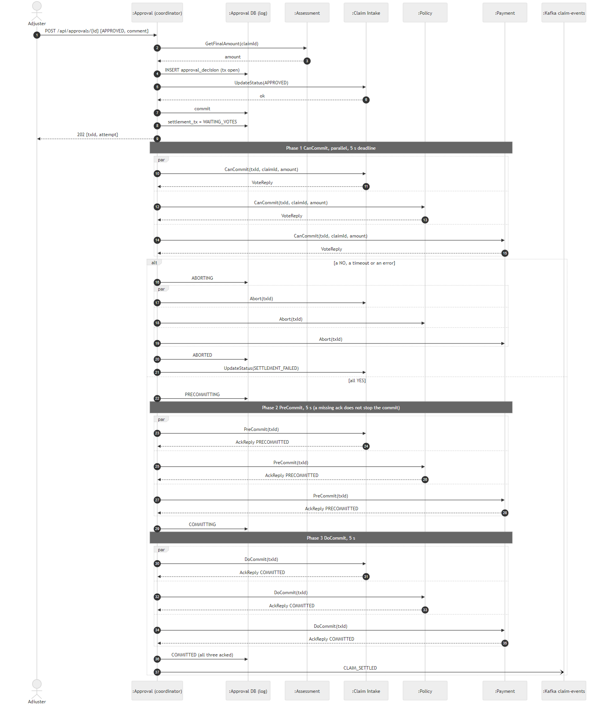

*Figure 9. Sequence diagram: settlement by three-phase commit.* Shows the decision and status update committing
together, then CanCommit, PreCommit and DoCommit sent to the three participants in parallel, with the abort path
in an `alt` fragment.

1. **Decision.** The decision row and Claim Intake's `UpdateStatus(APPROVED)` run in one database
   transaction: if Claim Intake refuses or is down, nothing is recorded. Approval then logs `WAITING_VOTES`
   and answers 202.
2. **Phase 1, CanCommit** (parallel, 5 s). Each participant prepares and votes. A NO, a timeout or an error
   counts as NO.
3. **Phase 2, PreCommit** (5 s), only if all three voted YES. `PRECOMMITTING` is logged first; from here the
   outcome can only be commit. A missing PreCommit ack does not stop the commit.
4. **Phase 3, DoCommit** (5 s). `COMMITTED` is logged once all three ack; `CLAIM_SETTLED` is emitted.
5. **Abort.** `ABORTING` is logged, Abort is sent to all, then `ABORTED`, and the claim becomes
   SETTLEMENT_FAILED. The adjuster may retry, which creates attempt 2.

### 5.3 Audit

*Figure 10. UML activity diagram: the Audit Flink job.* Shows each valid event forking into four parallel
branches (audit trail, overview window, fraud window, settlement view) that write to DynamoDB and
`claim-analytics`; invalid events and small counts end at flow-final nodes.

Each service publishes after its own transaction commits. The Flink job is the only writer of the audit table,
so the audit trail is a projection of `claim-events` and can be rebuilt by replaying the topic.

---

## 6. Low-level design

### 6.1 Class diagrams

The class diagrams are the designs from issues #1 to #9, converted to UML member notation
(`name : Type`, `op(param: Type) : Return`). `ThreePhaseParticipant<T>` and `ParticipantTx` come from the shared
`backend/participant` library. Policy, Claim Intake and Payment extend it, so the three participants share one
implementation of the protocol, its idempotency and its timeouts.

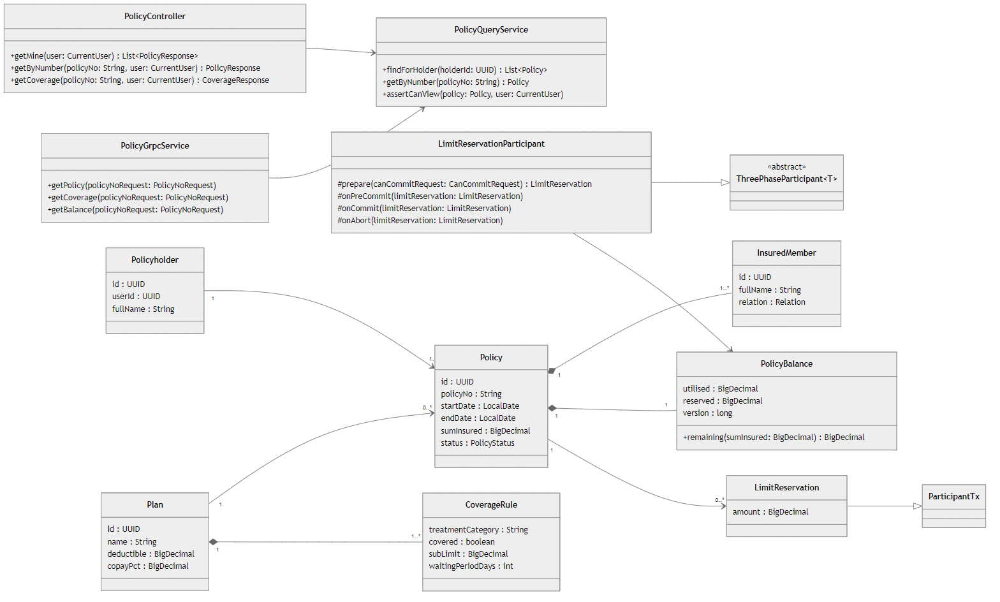

*Figure 11. Class diagram: Policy (issue #1).* Shows the policy aggregate (Policy composes InsuredMember and
PolicyBalance) and `LimitReservationParticipant` extending the shared participant base.

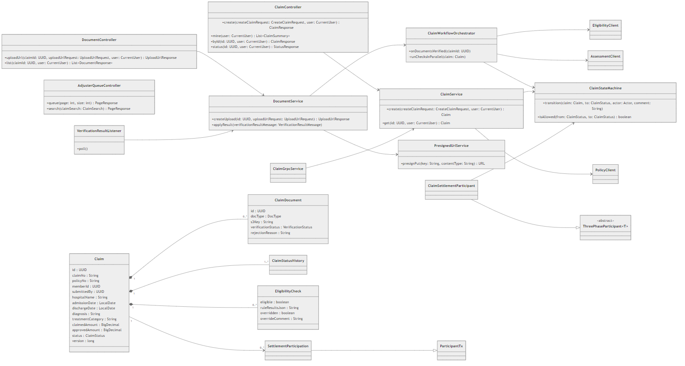

*Figure 12. Class diagram: Claim Intake (issue #2).* Shows the controllers, the services, the workflow
orchestrator and state machine, and the `Claim` aggregate composing documents, history and eligibility checks.

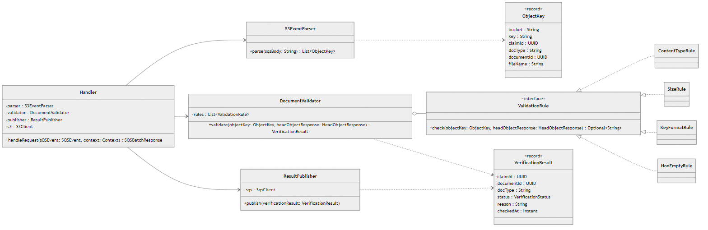

*Figure 13. Class diagram: Document Verification Lambda (issue #3).* Shows `Handler` delegating to a parser, a
validator that aggregates four `ValidationRule` realizations, and a result publisher.

*Figure 14. Class diagram: Eligibility (issue #4).* Shows a rule engine aggregating six
`EligibilityRule` realizations, evaluated over a `RuleContext`.

*Figure 15. Class diagram: Assessment (issue #5).* Shows the calculator producing a `Calculation`,
and `Assessment` composing its adjustment history.

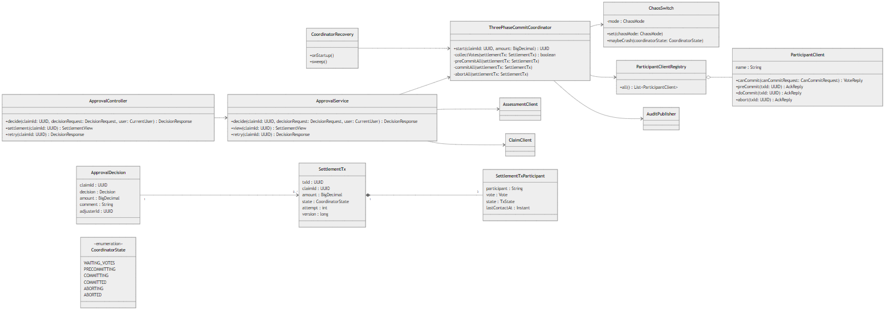

*Figure 16. Class diagram: Approval (issue #7).* Shows the coordinator, its recovery and chaos switch, the
participant client registry, and `SettlementTx` composing exactly three participants.

*Figure 17. Class diagram: Payment (issue #6).* Shows `PaymentParticipant`, the `PaymentGatewayClient` interface
and its HTTP realization calling the simulator, and `Payment` composing its attempts.

*Figure 18. Class diagram: Audit Flink job (issue #8).* Shows the job wiring its aggregate and window functions
and the DynamoDB item mapper.

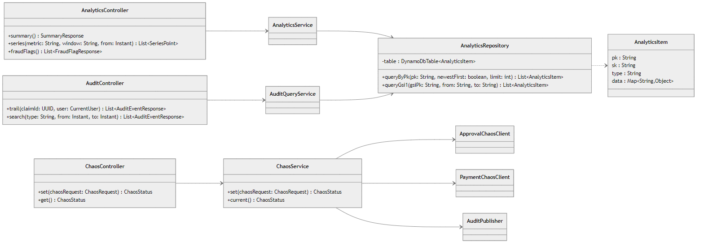

*Figure 19. Class diagram: Ops Dashboard (issue #9).* Shows three controllers over their services, a single
DynamoDB repository, and the chaos clients for Approval and Payment.

### 6.2 Entity-relationship diagrams

These use crow's-foot (IE) notation: `||` means exactly one, `o|` zero or one, `o{` zero or many, `|{` one or
many. Each figure is one service's own database. The schemas are the Flyway migrations
(`src/main/resources/db/migration/V1__init.sql`).

*Figure 20. ER diagram: Login DB.* Shows users with their refresh tokens and login attempts; an attempt for an
unknown username has no user.

*Figure 21. ER diagram: Policy DB.* Shows policyholders, plans and coverage rules, policies with members, a 1:1
balance, and 3PC limit reservations keyed by `tx_id`.

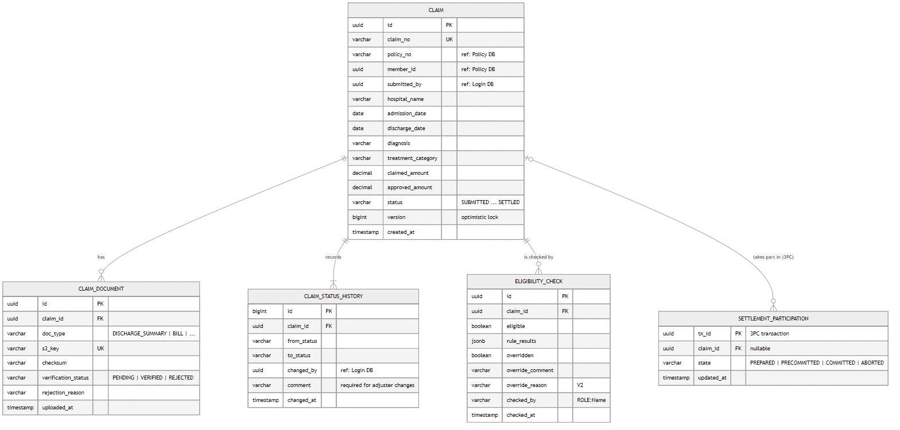

*Figure 22. ER diagram: Claims DB.* Shows the claim with its documents, status history, eligibility checks and
3PC participation log.

*Figure 23. ER diagram: Payments DB.* Shows payee accounts, payments with their gateway attempts, and the 3PC
log; one live payment per claim.

*Figure 24. ER diagram: Approval DB (coordinator log).* Shows one decision per claim, one settlement
transaction per attempt, and one row per participant per transaction.

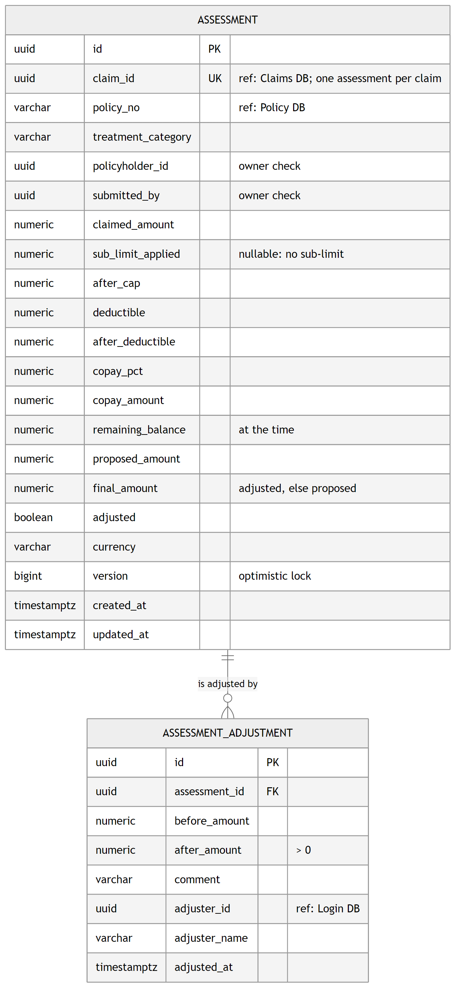

*Figure 25. ER diagram: Assessment DB.* Shows one assessment per claim, storing every step of the calculation, and its
history of adjuster changes.

**Concurrency and integrity rules in the schemas:**
- `version` columns give optimistic locking on `policy_balance`, `settlement_tx` and `payment`.
- Partial unique indexes allow one unfinished settlement per claim (Approval) and one live payment per claim
  (Payment).
- `(claim_id, attempt)` is unique in Approval.
- Each participant log is keyed by `tx_id`, so a repeated CanCommit finds the existing row instead of
  preparing twice.

### 6.3 State machines

*Figure 26. State machine: claim status (`ClaimStateMachine.ALLOWED`).* Shows the review path, where a failed
check skips its own step; Approval's decision through `UpdateStatus`; and the 3PC transitions into SETTLING,
SETTLED and SETTLEMENT_FAILED (which can be retried).

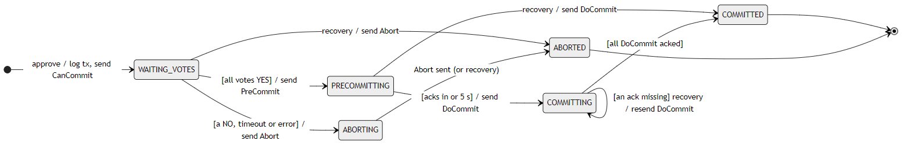

*Figure 27. State machine: 3PC coordinator (`settlement_tx.state`).* Shows each transition as
`trigger [guard] / effect`, including the recovery transitions. Each state is logged before that phase's
messages are sent.

*Figure 28. State machine: 3PC participant (`ParticipantTxState`).* Shows the vote choice, the PreCommit and
DoCommit transitions, and the two participant timeouts.

### 6.4 3PC phases, timeouts and recovery

| Phase | Coordinator (Approval) | Participant | Timeout and default |
| --- | --- | --- | --- |
| 1 CanCommit | logs `WAITING_VOTES`, sends CanCommit to all in parallel | prepares and votes. YES → PREPARED; NO → ABORTED. An Abort that arrives first leaves a tombstone, so a late CanCommit votes NO | 5 s per call (`claims.coordinator.phase-timeout`); no answer = NO |
| 2 PreCommit | logs `PRECOMMITTING`, sends PreCommit | PREPARED → PRECOMMITTED | 5 s; a missing ack does not block. **A participant left PREPARED for 5 min aborts on its own** |
| 3 DoCommit | logs `COMMITTING`, sends DoCommit; logs `COMMITTED` when all ack | → COMMITTED (also from PREPARED) | 5 s; a missing ack keeps `COMMITTING`, and the sweep resends. **A participant left PRECOMMITTED for 2 min commits on its own** |
| Abort | logs `ABORTING`, sends Abort, logs `ABORTED` | PREPARED or PRECOMMITTED → ABORTED; releases what was reserved | |

**Coordinator recovery** (`CoordinatorRecovery`, at startup and every 30 s, for transactions idle for at least
15 s):

| Logged state | Action | Why |
| --- | --- | --- |
| `WAITING_VOTES` | send Abort to all → `ABORTED`, claim SETTLEMENT_FAILED | Not every YES is known |
| `PRECOMMITTING`, `COMMITTING` | send DoCommit to all → `COMMITTED` | Everyone voted YES |
| `ABORTING` | send Abort to all → `ABORTED` | Abort was decided |

**Participant recovery.** Each participant runs `expireTimedOut()` periodically and applies the two timeouts
above. Payment also runs `PaymentRecoverySweep` every 30 s: it captures a committed payment that is still
AUTHORIZED and voids an aborted one. Every call is idempotent, so repeating any phase is safe.

**Chaos testing.** `CRASH_BEFORE_PRECOMMIT` halts the coordinator after the votes, and recovery aborts.
`CRASH_AFTER_PRECOMMIT` halts it after the PreCommit acks, and recovery commits. `FAIL_AUTHORIZE` makes Payment
vote NO, which aborts the transaction. `FAIL_CAPTURE` makes the commit succeed while the capture stays pending
until the sweep succeeds. The integration tests in `backend/services/approval` and `payment` cover each case.

---

## 7. Design rationale

The repository has no separate decision records. Each point below explains a choice by the behaviour or
constraint that the code, the Terraform and the READMEs show.

**AWS as the platform.** The services map onto managed services one-to-one. Postgres per service runs on RDS,
the event bus on MSK, streaming on EMR (Flink 1.20), the event-driven function on Lambda, object storage on S3,
queues on SQS, and the read model on DynamoDB. IAM roles for service accounts (IRSA) and GitHub OIDC remove
long-lived credentials entirely. Everything is Terraform, so an environment can be created and destroyed on
demand; the infra README budgets roughly $0.75–0.80/hour with everything on, and every expensive part has an
`enable_*` toggle.

**EKS for the services.** Nine long-running Spring Boot services need the same things: rolling updates, health
probes, autoscaling, service discovery for gRPC (`dns:///<svc>:9090`), and network isolation. Kubernetes gives
all of them declaratively:
- HPAs, which Assessment relies on: its calculation is CPU-bound and timed (`claims.assessment.calculate`).
- ClusterIP DNS, so gRPC targets are plain service names.
- NetworkPolicies, enforced by the VPC CNI.
- One ALB shared by all Ingresses.

Kubernetes also makes GitOps possible: Argo CD can reconcile the whole namespace from Git. The coordinator's
crash test depends on Kubernetes restarting the pod after `Runtime.halt(1)`.

**Lambda only for Document Verification.** It is the one component that is:
- **event-driven and bursty.** It runs only when a file lands in S3.
- **stateless.** It has no database and no Spring, and its only input is the object's metadata.
- **independent of the other services.** It talks only to S3 and SQS.

Paying per invocation suits that load better than a pod running idle. SQS in front of it adds buffering, retries
of single messages (`ReportBatchItemFailures`) and a DLQ. SnapStart reduces Java cold starts.

The other services don't fit Lambda:
- They hold gRPC servers and connection pools.
- They keep long-polling loops and periodic sweeps running.
- The coordinator and participants must survive and resume their logs, which needs long-lived processes.

**3PC instead of 2PC.** In two-phase commit, a participant that voted YES and then loses the coordinator has to
wait: it cannot safely commit or abort on its own. 3PC adds the PreCommit phase so that a participant always
knows enough to decide by itself after a timeout, and the participant code does exactly that:
- **PREPARED participant.** Some participant may not have voted YES, so after 5 min it **aborts**.
- **PRECOMMITTED participant.** Everyone voted YES, so after 2 min it **commits**.

This bounds how long a policy's reserved amount or a payment authorization can stay locked when Approval is
down. On the coordinator side, logging every state before sending a phase's messages makes the outcome
recoverable from the log alone (Section 6.4). That is what the chaos modes demonstrate.

The 3PC trade-offs:
- One extra round trip per settlement.
- 3PC's guarantee assumes timeouts can tell a crash from a network partition, which is not true in general. A
  long partition after PreCommit could let a participant commit on timeout while another has aborted. The
  coordinator never aborts after `PRECOMMITTING`, which narrows the window but doesn't close it.

**Database per service.** Each service owns its schema and migrations (Flyway), and the 3PC participant log
lives in the same database as the data it protects. A participant's state change and its business change
(`reserved += amount`, the claim status, the payment) therefore commit in one local transaction. No service can
couple to another's tables, which is why claim data is fetched with `ClaimService.GetClaim` instead of a join.
Since there are no cross-service joins, a cross-service change needs the 3PC protocol, and cross-service queries
are served by a projection (DynamoDB via Flink). To keep costs low, all databases share one RDS instance; they
stay separate logical databases with separate users and Secrets.

**Other trade-offs the repository records:**
- **Single-instance infrastructure** in dev: RDS single-AZ, one NAT gateway, EMR stops when idle. These are cost
  choices, controlled by variables.
- **The coordinator runs as one replica** (HPA max 1). Recovery was not designed for active-active coordinators.
- **The Ingress serves HTTP on port 80 only.** No certificate or TLS listener is configured in `k8s/`; adding
  ACM and HTTPS is open work.
- **Kafka is optional.** With MSK off, events are only logged, and the services keep working because their
  databases are the source of truth.
- **The Payment authorization orphan** (Section 4.8) and **tokens that are not revoked at logout** (Section 4.1)
  are documented limits.
- **Eligibility and Assessment are optional for the workflow.** If either is down, Claim Intake skips that step
  and still sends the claim to review, where the adjuster sees what is missing.

---

## 8. GitOps and CI/CD

Kubernetes workloads reach the cluster **only from Git**. Terraform installs Argo CD and seeds it. CI builds
images and commits new tags. Argo CD applies what is in Git. No pipeline and no person runs `kubectl apply` for
a service.

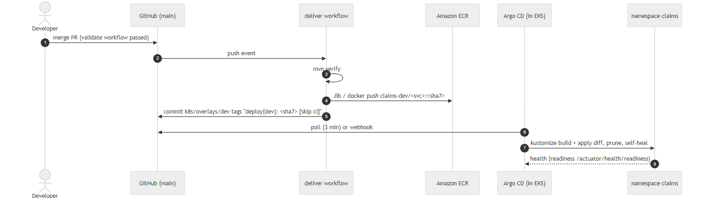

*Figure 29. Sequence diagram: delivery.* Shows a merge to `main` triggering the deliver workflow, which tests,
pushes images to ECR and commits the new tag to `k8s/overlays/dev`; Argo CD then pulls and applies it.

| Piece | Location | What it does |
| --- | --- | --- |
| Kustomize base | `k8s/base/<service>/` | Per service: a Deployment (requests/limits, startup/liveness/readiness probes on `/actuator/health/*`, non-root user, read-only root filesystem), a ClusterIP Service (80 → 8080, plus gRPC 9090), a ConfigMap, a Secret reference (`<svc>-db` from Terraform; no secret values in Git), an HPA (70% CPU) and a NetworkPolicy. Shared: the `claims` Namespace, default-deny ingress, a ServiceMonitor. The Ingress belongs to the services the ALB routes to |
| Overlays | `k8s/overlays/dev`, `k8s/overlays/prod` | dev: 1 replica, HPA max 2, chaos on, `claims-dev/*` images. prod: 2 replicas, HPA max 6, chaos off, `claims-prod/*` images. Approval is pinned to 1 in both |
| Argo CD | `gitops/argocd/project.yaml`, `root-app.yaml`; `gitops/apps/<env>.yaml` | The AppProject `claims` (this repository; namespaces `claims` and `argocd` only). The root app-of-apps picks `<env>.yaml`. Each environment Application syncs automatically with prune, selfHeal, `CreateNamespace=true` and retries, and ignores `replicas` because the HPA owns them |
| Bootstrap | `infra/terraform/platform/argocd.tf`, `argocd-root-app.tf` | Helm `argo-cd` plus `argocd-apps`, whose values are read from the `gitops/argocd/*.yaml` files, so there is a single definition |
| CI: validate | `.github/workflows/validate.yml` | On every PR: `kustomize build` both overlays → `kubeconform -strict` (including CRD schemas); `terraform fmt` and `validate` for all three stacks; `mvn verify` |
| CI: deliver | `.github/workflows/deliver.yml` | On a push to `main`: test → build with Jib (7 services) and Docker (frontend) → push to ECR through GitHub OIDC → `kustomize edit set image` in the overlay → commit `deploy(<env>): <sha> [skip ci]`. A manual run with `environment=prod` rebuilds a chosen commit for prod. The Lambda jar is built as an artifact for `terraform apply` |
| Rollback | Git | `git revert` of the deploy commit, or setting one image back with `kustomize edit set image`. Argo CD's history rollback is for emergencies only (auto-sync must be off) |

Terraform owns the parts that hold secrets or AWS identities: the `claims` namespace, the `<svc>-db` and
`jwt-keys` Secrets, the `platform-endpoints` ConfigMap and the IRSA service accounts. The manifests only
reference them, and the namespace carries `Prune=false,Delete=false`, so Argo CD never deletes it. Full
details are in [`gitops/README.md`](../gitops/README.md) and [`infra/README.md`](../infra/README.md).

---

## 9. Diagram sources and corrections

Sources are under [`docs/diagrams/src/`](diagrams/src). Mermaid sources were rendered with mermaid-cli 11.4.2
and Graphviz sources with `dot` 14.0.2. The hand-drawn SVGs were rasterized with headless Chrome.

| Fig. | Diagram | Found in | Origin | Correction made |
| --- | --- | --- | --- | --- |
| 1 | Use case | `diagrams/use-case-diagram.svg` | commit 79430af | None needed: system boundary, «include»/«extend», actor generalization and «system» actor are UML-conformant |
| 2 | Activity | `diagrams/activity-diagram.svg` | commit 79430af | None needed: initial/final/flow-final nodes, decision/merge, fork/join, partitions and notes are UML-conformant |
| 3 | Deployment | `diagrams/deployment-diagram.svg` | commit 8216c58 | Facts updated to match Terraform: EKS 1.30 → **1.33**, EMR 7.2 → **7.6.0**, "9 service images" → **10 image repositories**. Notation was already UML (nodes, «artifact»s, communication paths). Also fixed in the original file |
| 4 | Terraform stacks | `infra/README.md` "How the stacks connect" | mermaid flowchart | A flowchart is not a UML diagram: redrawn as a **component diagram** (stacks as «Terraform stack» components, dependencies as dashed open arrows); paths updated to `gitops/apps` |
| 5, 6 | Architecture | `diagrams/architecture-diagram.svg` | commit d9d922c | Not UML: it used database cylinders, colour-coded protocol arrows with a legend, and an "API Gateway" box that does not exist. Redrawn as two **component diagrams** with «component»/«database»/«queue»/«topic» stereotypes and labelled UML dependencies. The ALB Ingress replaces "API Gateway" |
| 7 | Happy-path sequence | `diagrams/sequence-diagram.svg` | commit 79430af | None needed: lifelines, sync/async/reply arrows, `par`/`opt`/`ref` fragments are UML-conformant |
| 8 | Claim intake sequence | `backend/services/claim-intake/README.md`; identical block in issue #12 / PR #12 | mermaid | **Calls to other services drawn as self-messages** (`Policy.ValidateMember`) were moved to their own lifelines. **Asynchronous S3/SQS/Lambda messages drawn as dashed replies** were changed to async messages, with the queues as lifelines. Missing replies were added |
| 9 | 3PC sequence | `backend/services/approval/README.md`; identical block in issue #11 / PR #11 | mermaid | **One lifeline stood for three participants**; they are now three lifelines with `par` fragments. **`Assessment.GetFinalAmount` and `Intake.UpdateStatus` were self-messages**; they now go to their own lifelines. The event is an async message to a Kafka lifeline |
| 10 | Audit pipeline | `backend/analytics/audit-flink/README.md` | mermaid flowchart | A flowchart is not UML: redrawn as an **activity diagram** with an accept-event action, a fork, decisions with one guard per branch, object nodes and flow-final nodes |
| 11–19 | Class diagrams | GitHub issue bodies #1–#9 | mermaid | **Attributes** changed from `Type name` to UML `name : Type`. **Parameters** changed to `name: Type`; unnamed ones got a name derived from the type. **Approval:** the association `SettlementTx → CoordinatorState` duplicated the `state` attribute, so it was removed. **Payment:** the same fix for `Payment → PaymentStatus`; `Payment 1–1 PaymentTxLog` became `PaymentTxLog 1 — 0..1 Payment` (`payment_id` is nullable); the REST dependency was labelled «call» |
| 20 | Login ER | root `README.md` | mermaid | `USERS ||--o{ LOGIN_ATTEMPTS` → `|o--o{`: `login_attempts.user_id` is nullable in the migration |
| 21 | Policy ER | root `README.md` | mermaid | `limit_reservation` is keyed by `tx_id` (PK) in the migration, not by a separate `id` |
| 22 | Claims ER | root `README.md` | mermaid | `settlement_participation.claim_id` is nullable (abort tombstone): `||--o{` → `|o--o{`. `eligibility_check` gains the missing `checked_by` and `override_reason` (migration V2) |
| 23 | Payments ER | root `README.md` | mermaid | `UNIQUE (claim_id)` → one *live* payment per claim (partial unique index; the plain constraint would block a retry). `PAYMENT ||--|| PAYMENT_TX_LOG` → `|o--||` (nullable `payment_id`) |
| 24 | Approval ER | none existed | new | Drawn from `approval/.../V1__init.sql` |
| 25 | Assessment ER | none existed | new | Drawn from `assessment/.../V1__init.sql` |
| 26 | Claim state machine | `claim-intake/README.md` (ASCII) | text | Drawn as a UML state machine; checked against `ClaimStateMachine.ALLOWED` |
| 27 | Coordinator state machine | `approval/README.md` (ASCII + recovery table) | text | Drawn as a UML state machine with `trigger [guard] / effect` labels |
| 28 | Participant state machine | none existed | new | Drawn from `ThreePhaseParticipant` and the participant READMEs |
| 29 | GitOps sequence | `gitops/README.md` | new (this change) | — |

There were no `*.puml`, `*.mmd`, `*.png` or `*.drawio` files and no PlantUML blocks in the repository. The ER
diagrams use crow's-foot notation, which is the ER notation the brief asks for.

---

## Appendix A. Why the system is designed this way

Section 7 gives the short version of the main decisions. This appendix gives the full reasoning, from the top down:

| Part | Level | Covers |
| --- | --- | --- |
| A.1 | Platform | Why each technology is in the system at all |
| A.2 | Order | Why the services come in the order they do |
| A.3 | Service | Which technologies each service uses, and why that one |
| A.4 | Messaging | Exactly where Kafka and SQS are used |
| A.5 | Deployment | Why Approval runs as a single pod |
| A.6 | Protocol | How the three-phase commit works, step by step |
| A.7 | Classes | Why the classes are shaped as they are |
| A.8 | Tables | Why the tables are shaped as they are |

Every reason is tied to something in the repository: a class, a migration, a Terraform module or a test.

### A.1 Level 1: why each technology

The guiding constraints were:
- **Correct money movement.** A claim is paid once, never twice, and never over the policy's limit.
- **A full audit trail.** Every change is recorded, with who made it and why.
- **Independent services.** Each service can be changed, deployed and scaled on its own.
- **Rebuildable from code.** The whole environment can be created and destroyed on demand, cheaply.

Each technology answers one or more of these.

| Technology | What it does here | Why it was chosen | What it replaced or ruled out |
| --- | --- | --- | --- |
| **AWS** (`ap-south-1`) | Hosts everything | Every building block in the brief has a managed AWS equivalent (RDS, MSK, EMR, Lambda, S3, SQS, DynamoDB), so no infrastructure software is self-hosted. IAM roles for service accounts (IRSA) and GitHub OIDC mean there are no long-lived keys | Self-managed Kafka, Postgres or Flink on VMs |
| **Terraform**, three stacks | Creates all of AWS and the in-cluster platform | "Nothing is created by hand": an environment can be rebuilt or destroyed with one command, and every expensive part has an `enable_*` toggle. There are three stacks because their lifecycles differ: `bootstrap` (state bucket, made once), `infra` (AWS resources) and `platform` (Helm releases that need a running cluster). A failed Helm install never blocks or taints the AWS stack | Console clicks; a single stack whose Kubernetes providers depend on a cluster that doesn't exist yet |
| **Java 21 + Spring Boot 3** | Every long-running service | One stack for all nine services means shared libraries (`backend/common`, `backend/participant`), one build (Maven), one test style (Testcontainers) and production features for free: actuator health probes, Micrometer metrics, Spring Security JWT validation and Flyway migrations | Mixed languages, which would need two of everything |
| **Docker images** (built with Jib) | Packaging | The same image runs in CI, on a laptop and on EKS. Jib builds images from Maven without a Dockerfile or a Docker daemon in CI, and its layers change only when code changes | Hand-written Dockerfiles per service |
| **Kubernetes on EKS** | Runs the nine services and the frontend | Long-running services need restarts, rolling updates, health probes, service discovery (`dns:///<svc>:9090` for gRPC), autoscaling (HPA), network isolation (NetworkPolicy) and one shared load balancer (Ingress → ALB). Kubernetes provides all of these declaratively, which also makes GitOps possible | ECS (no NetworkPolicies, no Argo CD); EC2 VMs (manual everything) |
| **Argo CD (GitOps)** + **GitHub Actions** | Deploys from Git | Git becomes the only way to change what runs. CI builds and commits an image tag; Argo CD applies it; `git revert` is the rollback. No human or pipeline holds cluster-admin credentials for deploys | `kubectl apply` from CI, which leaves no record of what is deployed and drifts |
| **REST/JSON** through an **ALB** | Browser → services | Browsers speak HTTP/JSON natively. The ALB is created by the Load Balancer Controller from Ingresses, so routing lives in Git with each service. Authentication is a JWT checked by every service, so no gateway is needed to enforce it | Amazon API Gateway (a second routing layer, and extra cost, for no added function) |
| **JWT (RS256) + JWKS** | Authentication | Login signs tokens with a private key, and every other service verifies them with the public JWKS. No service calls Login on each request, so Login is not a bottleneck or a single point of failure for reads | Shared-secret HS256 (every service would hold the signing key); session lookups |
| **gRPC** (protobuf) | Service → service | Typed contracts in `backend/proto` are compiled into both sides, so a breaking change fails the build instead of production. HTTP/2 multiplexing and deadlines are built in: every 3PC phase has a 5 s deadline. It is also cheaper on the CPU-bound paths than JSON | REST between services (untyped, with no deadline propagation) |
| **PostgreSQL 16 on RDS**, a database per service | Durable state | Money and claim state need ACID transactions and constraints: optimistic locks, partial unique indexes and check constraints all do real work here (Section A.8). One database per service keeps the services independent; one RDS instance hosting all of them keeps dev cheap | A shared schema (tight coupling); NoSQL for transactional data |
| **S3** with pre-signed URLs | Document storage | Files go from the browser straight to S3, so no service handles large uploads or holds them in memory. URLs expire after 10 minutes, and the key layout `claims/{claimId}/{docType}/…` ties each file to its claim | Uploading through Claim Intake |
| **SQS** | The asynchronous hand-off for documents | Uploads arrive in bursts, at any time. A queue buffers them, retries a failure on its own, and parks repeated failures in a dead-letter queue (DLQ) after 3 tries, so no upload is lost while a consumer is down. See A.4 | Direct S3 → Lambda invocation (no buffering or redrive on our side) |
| **Lambda** | Document Verification | It is event-driven, bursty, stateless and has no database, so pay-per-use fits better than an idle pod. SnapStart hides the Java cold start | A pod polling S3 |
| **Kafka (MSK)** | The event stream (`claim-events`) | One ordered, replayable log of everything that happened. Services publish facts after they commit; the audit job reads them. Keying by `claimId` keeps one claim's events in order. Replay rebuilds the audit trail. See A.4 | Services writing to an audit table directly (coupling, and no replay) |
| **Flink on EMR** | The audit and analytics job | Windowed, stateful stream processing with event time and exactly-once checkpoints: the audit trail, 1-minute overviews, 10-minute fraud windows and per-transaction settlement views. EMR runs Flink 1.20 managed, and stops after 2 h idle | Hand-written Kafka consumers (no windows, no checkpoints) |
| **DynamoDB** | The read model for the ops console | The dashboard needs fast key lookups (`CLAIM#…`, `METRIC#…`, `FRAUD#…`) at any scale, with no joins. It is written only by Flink and read only by the Ops Dashboard (Query, no Scan) | Querying six service databases live |
| **Prometheus, Grafana, Loki** | Metrics, dashboards, logs | They watch the HPAs, latencies and error rates the load tests exercise, in the cluster itself | CloudWatch only (less useful for per-pod metrics) |
| **React + Vite**, served by nginx | The UI | One app for policyholders and adjusters. `frontend/src/config/api.js` is the single API map, and the built-in mock backend lets the UI be built before the services existed | Server-rendered pages per service |

### A.2 Why the services come in this order

There are two orders that matter: the order in which a claim moves through the services, and the order in which
the services were built. Both follow from dependencies.

**The claim's path.** Each step needs what the previous step produced:

1. **Policy lookup.** Nothing can be claimed without a valid policy and an insured member, and every later step
   needs the policy's plan, coverage rules and balance.
2. **Claim Intake.** It creates the claim and becomes the owner of its status. Every other step reads the claim
   through `ClaimService.GetClaim` and changes its status only through Claim Intake.
3. **Document Verification.** Eligibility and Assessment would be wasted on a claim whose documents are missing
   or invalid. Verification is asynchronous, so the user is never kept waiting for it.
4. **Eligibility.** It answers the yes/no question first: is this claim covered at all? It runs six rules,
   including policy active, member covered and waiting period passed.
5. **Assessment.** It answers how much to pay. Eligibility and Assessment are independent of each other, so
   Claim Intake runs them **in parallel** (Figure 8), and either one failing skips only its own step.
6. **Approval.** A person decides, using both results. This is the last point where values can still change,
   and every change needs a written comment.
7. **Settlement (3PC).** Only an approved claim is paid. The money moves in one atomic step across Claim
   Intake, Policy and Payment (A.6).
8. **Audit.** It observes every step above without being in their path, so a slow or broken audit can never block
   a claim.

**Build order (issues #1 to #9).** Each service was built after the services it calls:
- **Policy (#1)** depends on nothing.
- **Claim Intake (#2)** calls Policy.
- **Document Verification (#3)** feeds Claim Intake.
- **Eligibility (#4)** and **Assessment (#5)** read Policy and Claim Intake.
- **Payment (#6)** comes before **Approval (#7)**, because the coordinator needs its participants to exist and
  to be testable on their own.
- **Audit (#8)** and the **Ops Dashboard (#9)** come last, because they consume what every other service emits.

The shared libraries came first of all. `backend/common` holds the error shape and the event envelope;
`backend/participant` holds the 3PC participant, so the three participants were not each written from scratch.

### A.3 Level 2: which technology each service uses, and why

| Service | Talks over | Stores in | Emits to Kafka | Why this combination |
| --- | --- | --- | --- | --- |
| **Login** | REST (login, me, JWKS) | Postgres (`users`, `refresh_tokens`, `login_attempts`) | — | It must be the one place that knows passwords (bcrypt) and signs tokens. It is on every user's path, so its only job is to sign. Verification happens elsewhere, from the JWKS |
| **Policy** | REST (read), gRPC server (`ValidateMember`, `GetPolicy`, `GetCoverage`, `GetBalance`, 3PC participant) | Postgres, with an optimistic lock on `policy_balance` | `TX_VOTE`, `TX_PARTICIPANT_STATE` | It holds the money limit. Reservations must be transactional and must never overdraw, which Postgres plus a version column guarantees. Many callers read it, so gRPC keeps those calls cheap and typed |
| **Claim Intake** | REST, gRPC server and client, S3 (pre-signs), SQS (reads results) | Postgres | `CLAIM_CREATED`, `CLAIM_STATUS_CHANGED`, document, check and `TX_*` events | It owns the claim's status, so it alone writes status history and emits `toStatus`. It orchestrates the review (parallel gRPC to Eligibility and Assessment) and joins the document flow through SQS. It is also a 3PC participant, because the claim's status must flip in the same atomic step as the money |
| **Document Verification** | SQS in, SQS out, S3 `HeadObject` | nothing | — | It checks only metadata (key, size, content type), so it needs no database or framework. It is a pure function from an S3 event to a result, which is exactly what Lambda is good at |
| **Eligibility** | REST, gRPC server and client | nothing (results are stored by Claim Intake) | `ELIGIBILITY_OVERRIDDEN` | Its rules are derived from Policy data at check time, so re-running them is always correct and stateless. Storing results in Claim Intake keeps the claim's full history in one database |
| **Assessment** | REST, gRPC server and client | Postgres (`assessment`, `assessment_adjustment`) | `ASSESSMENT_ADJUSTED` | Unlike eligibility, an amount can be **adjusted by a person**, and that adjustment must survive a re-assessment. So it needs its own table, and the calculator stays a pure function. Its CPU-bound calculation is timed as a metric |
| **Approval** | REST, gRPC client (to 3 participants, Assessment and Claim Intake) | Postgres (decision, coordinator log) | the decision and all coordinator `TX_*` events | It is the 3PC coordinator, and the coordinator's log must be durable so a restart can finish what a crash left behind (A.6). One replica (A.5) |
| **Payment** + **gateway simulator** | gRPC server (participant); REST to the gateway | Postgres (payments, attempts, 3PC log) | `PAYMENT_*`, `TX_*` | Real gateways speak HTTP, so the simulator does too, and it can fail on demand to drive the chaos tests. Payment records every gateway call as an attempt, for audit and for the recovery sweep |
| **Audit (Flink)** | Kafka in, DynamoDB and Kafka out | DynamoDB (projection) | `claim-analytics` | It is the only consumer of the full event stream. Being a projection, it can be rebuilt by replaying `claim-events` |
| **Ops Dashboard** | REST, DynamoDB Query, REST to `/internal/chaos` | nothing (reads DynamoDB) | `CHAOS_CHANGED` | A read-only API over the projection, plus the chaos switches. Its IAM role allows Query and GetItem but not Scan, so it can't run expensive table scans by accident |

### A.4 Exactly where Kafka and SQS are used

The two are used for different jobs:
- **SQS** carries *work that must be done*. Each message must be handled exactly once, so it uses retries, a
  DLQ, and a delete only after the work has committed.
- **Kafka** carries *facts that already happened*. Any number of readers can see every event, in order, and
  replay it later.

**SQS: only the document path** (Figure 8):

| Queue | Written by | Read by | Settings and code |
| --- | --- | --- | --- |
| `doc-upload-events` | **S3** itself: an `s3:ObjectCreated:*` notification on the `claims/` prefix of the documents bucket (`modules/s3`) | **Lambda** `document-verification`, through an event source mapping (`modules/lambda`) | Batch of 5, wait up to 1 s, `ReportBatchItemFailures`, so only the failed messages retry. DLQ after 3 receives (`modules/sqs`). Visibility timeout = 6 × the Lambda timeout. Code: `Handler.handleRequest`, `S3EventParser` |
| `doc-verification-results` | **Lambda** (`ResultPublisher`, `SqsClient.sendMessage`): `VERIFIED`, or `REJECTED` with reasons | **Claim Intake** (`messaging/VerificationResultListener`): a background thread long-polls with `waitTimeSeconds = 20`, up to 10 messages | A message is deleted only **after** its result has committed. Applying a result twice is harmless (idempotent), and a failure retries, then goes to the DLQ after 3 receives. Claim Intake reaches SQS through its IRSA role. An empty `RESULTS_QUEUE_URL` turns the listener off (local runs) |

No other service uses SQS.

**Kafka: one topic carries everything; the Flink job is its only reader.**

| Topic | Written by | Read by | Notes |
| --- | --- | --- | --- |
| `claim-events` | Every service that changes something, through `EventPublisher` in `backend/common` (`EventPublishers.Kafka` → `KafkaTemplate`): Claim Intake, Policy, Eligibility, Assessment, Approval, Payment and the Ops Dashboard. Login and the gateway simulator publish nothing; the Lambda reports through SQS, and Claim Intake emits the `DOCUMENT_*` event | **Audit Flink job** only (`AuditAnalyticsJob`, consumer group `audit-flink`) | JSON `ClaimEvent` envelope, keyed by `claimId` so one claim's events stay ordered on one partition. Published **after** the service's own transaction commits. With `KAFKA_BOOTSTRAP` empty, `EventPublishers.Logging` writes events to the log instead, so services run without MSK |
| `claim-analytics` | The **Flink job** (1-minute overviews and fraud flags) | Nobody in this repository yet | For future consumers, such as alerting. The same data is in DynamoDB, which the Ops Dashboard reads |
| `doc-verified` | Nobody | Nobody | Created by the `kafka-topics` Job (`platform/variables.tf`) but **not used**: document results travel over SQS. It can be removed from `kafka_topics` |

Kafka carries no commands. No service waits for, or reacts to, a Kafka message. Commands and replies use gRPC,
and the settlement uses 3PC. That is why turning MSK off breaks only the audit trail and the charts, never a claim.

### A.5 Why Approval has exactly one pod

The coordinator keeps two things in memory that a second replica would not see:

- **Which transactions it is running.** `CoordinatorRecovery` runs every 30 s and picks up any unfinished
  transaction idle for 15 s or more, unless `coordinator.isInFlight(txId)` says this process is running it. That
  check is an in-memory map. With two pods, pod B cannot see pod A's in-flight transactions. If one of A's runs
  stalls past 15 s (a slow participant, a DoCommit retry), B treats it as abandoned and "recovers" it. B could
  then send Abort for a transaction that is still `WAITING_VOTES` while A is about to send PreCommit. The
  optimistic lock on `settlement_tx` stops two writes of the log, but not two coordinators sending conflicting
  messages before one of them loses.
- **The chaos switch.** `ChaosSwitch` is an in-memory `AtomicReference`. With two pods, the Ops Dashboard's
  request would reach only one of them, so a crash test might never trigger.

Making Approval scale out would need leader election or a lease on each transaction (for example `SELECT … FOR
UPDATE SKIP LOCKED` when claiming work) and a shared chaos flag. That was not designed or tested, so the HPA is
pinned at `minReplicas = maxReplicas = 1` in both overlays.

This is safe, because one Approval pod is not a single point of failure for *money*:
- **Restart and resume.** If it dies, Kubernetes restarts it, and startup recovery finishes every transaction
  from the log.
- **Participants decide on their own.** Participants left waiting resolve themselves through their timeouts
  (A.6).
- **Light load.** Approval does little work per request: one decision, then a few gRPC calls, so one pod handles
  the load.

### A.6 How the three-phase commit works

**The problem.** Paying a claim changes three databases owned by three services:
- the claim's status, in Claim Intake;
- the policy's used sum insured, in Policy;
- the payment, in Payment.

There is no shared database transaction across them. Without a protocol, a crash halfway could leave a claim
SETTLED with no payment, or a policy charged for a claim that was never paid. A commit protocol makes all three
change together, or none of them.

**The roles.** Approval is the **coordinator**. Claim Intake, Policy and Payment are **participants**; all three
extend the shared `ThreePhaseParticipant<T>`. Each side writes its state to its own database **before** it acts,
so after a crash the log says exactly where things stood.

| Participant | CanCommit: prepare and vote | PreCommit | DoCommit | Abort |
| --- | --- | --- | --- | --- |
| **Claim Intake** | YES if the claim is APPROVED (or SETTLEMENT_FAILED, for a retry) and the amount is valid. The claim becomes **SETTLING** | records PRECOMMITTED | claim → **SETTLED** | claim → **SETTLEMENT_FAILED** |
| **Policy** | YES if `sum_insured − utilised − reserved ≥ amount`; then **reserves** the amount (optimistic lock on `policy_balance`) | records PRECOMMITTED | moves the amount from *reserved* to *utilised* | releases the reservation |
| **Payment** | asks the gateway to **authorize** (3 s timeout). YES, or NO with the gateway's reason | records PRECOMMITTED | **captures** (up to 3 tries; if all fail it still commits, and a sweep keeps capturing) | **voids** the authorization |

**A run, step by step** (Figure 9; Figures 27 and 28 show the state machines):

1. **Decision.** The adjuster approves. Approval writes the decision and calls Claim Intake's
   `UpdateStatus(APPROVED)` in **one** database transaction: if Claim Intake refuses, nothing is recorded. It
   reads the amount from `Assessment.GetFinalAmount`, creates a `settlement_tx` row, and returns 202 with the
   `txId`. The rest runs in the background.
2. **Phase 1, CanCommit.** The coordinator logs `WAITING_VOTES`, then asks all three participants in parallel
   (5 s deadline each). Each participant prepares as shown in the table and logs PREPARED (YES) or ABORTED (NO).
   **Any NO, error or timeout counts as NO**, and the transaction aborts.
3. **Phase 2, PreCommit.** All three voted YES, so the coordinator logs `PRECOMMITTING`. **From this point the
   outcome can only be commit.** It sends PreCommit, and each participant logs PRECOMMITTED. PreCommit tells
   every participant "everyone said yes".
4. **Phase 3, DoCommit.** The coordinator logs `COMMITTING` and sends DoCommit. Each participant makes its
   change permanent. When all three ack, the coordinator logs `COMMITTED` and emits `CLAIM_SETTLED`.
5. **Abort path.** The coordinator logs `ABORTING`, sends Abort to all three (each undoes what it prepared), logs
   `ABORTED`, and the claim becomes SETTLEMENT_FAILED. The adjuster may **retry**, which starts attempt 2 with a
   new `txId`.

**Why three phases, not two.** In 2PC, a participant that voted YES and then loses the coordinator is stuck. It
cannot tell whether the others voted YES too, so it can neither commit nor abort, and its locks stay held. The
PreCommit phase gives every participant enough information to decide alone:
- **PREPARED, no news for 5 min → abort.** The participant has not heard that everyone voted YES, so commit
  might not be safe. Aborting is.
- **PRECOMMITTED, no news for 2 min → commit.** The participant knows everyone voted YES, and the coordinator
  never aborts after `PRECOMMITTING`, so committing is safe.

So a policy's reserved amount, or a held authorization, can never stay locked forever, even if Approval stays down.

**Recovery, coordinator side.** At startup and every 30 s, `CoordinatorRecovery` reads the log and finishes
anything idle for 15 s or more:

| Logged state | Recovery action | Reason |
| --- | --- | --- |
| `WAITING_VOTES` | send Abort → `ABORTED` | not every YES is known |
| `PRECOMMITTING`, `COMMITTING` | send DoCommit → `COMMITTED` | everyone already voted YES |
| `ABORTING` | send Abort → `ABORTED` | abort was already decided |

**What makes repeats safe.** Every message can arrive twice, late, or out of order, and must still be correct:
- **Keyed by transaction.** Each participant's log is keyed by `tx_id`. A repeated CanCommit finds the existing
  row and returns the same vote instead of preparing twice.
- **Tombstones.** If an Abort arrives *before* its CanCommit (the coordinator gave up early), the participant
  writes an ABORTED tombstone, so the late CanCommit votes NO.
- **Commit from PREPARED.** DoCommit is accepted from PREPARED as well as PRECOMMITTED, in case a PreCommit was
  lost.
- **Payment sweep.** `PaymentRecoverySweep` captures any committed payment still only AUTHORIZED, and voids any
  aborted one, so a gateway hiccup during DoCommit never loses money.

**Proven by chaos tests.** The integration tests in `approval` and `payment`, and the Ops Dashboard buttons, cover
each failure:

| Chaos switch | What happens | Expected result |
| --- | --- | --- |
| `CRASH_BEFORE_PRECOMMIT` | Approval halts after the votes | recovery **aborts** |
| `CRASH_AFTER_PRECOMMIT` | Approval halts after the PreCommit acks | recovery **commits** |
| `FAIL_AUTHORIZE` | Payment votes NO | **abort** |
| `FAIL_CAPTURE` | the commit succeeds, but the capture fails | capture **pending** until the sweep succeeds |

**The known limit.** 3PC assumes a timeout means a crash. During a long network partition after PreCommit, one
participant could commit on its timeout while another has already aborted. Because the coordinator never aborts
once it has logged `PRECOMMITTING`, the window is small, but it is not zero. Section 7 records this trade-off.

### A.7 Level 3: why the classes look the way they do

The class diagrams are Figures 11–19. The same few ideas recur across services; each answers a specific risk.

| Design | Where | Why |
| --- | --- | --- |
| **Template method:** abstract `ThreePhaseParticipant<T extends ParticipantTx>` with hooks `newTx`, `prepare`, `onPreCommit`, `onCommit`, `onAbort` | `backend/participant`; extended by `LimitReservationParticipant` (Policy), `ClaimSettlementParticipant` (Claim Intake) and `PaymentParticipant` (Payment) | The protocol (state checks, idempotency, tombstones, timeouts) is hard to get right and must behave identically in all three participants. Written once and tested once (`*ParticipantContractTest` runs the same contract against each), each service supplies only its business action. A new participant is one subclass |
| **Ports for storage and transport:** `ParticipantTxStore<T>`, `ParticipantGrpcAdapter` | `backend/participant` | The library knows neither JPA nor gRPC directly. Each service plugs in its own table (`limit_reservation`, `settlement_participation`, `payment_tx_log`) and exposes the same `SettlementParticipant` gRPC service through the adapter |
| **The coordinator split into three classes:** `ThreePhaseCommitCoordinator`, `CoordinatorRecovery`, `ParticipantClientRegistry` | Approval | Running a transaction, recovering one from the log, and knowing who the participants are change for different reasons. The participant list is configuration only, so adding a participant is not a code change. `ChaosSwitch` and `Halter` are injected, so tests can crash the coordinator deterministically |
| **Table-driven state machine:** `ClaimStateMachine.ALLOWED` | Claim Intake | Every status change in the system goes through one map of allowed transitions, so an illegal jump (for example SUBMITTED → SETTLED) is impossible from any caller. Figure 26 is drawn directly from it |
| **Orchestrator:** `ClaimWorkflowOrchestrator` | Claim Intake | The review steps (verify → eligibility and assessment in parallel → review) live in one class instead of being spread across event handlers, so the flow is readable and testable. Each check has its own deadline, and a failure skips only that step |
| **Strategy list:** six `EligibilityRule` beans with `@Order`, run by `EligibilityEngine` | Eligibility | Each rule is a small class with a table-driven test. The engine runs **all** rules and reports every result (not just the first failure), so the adjuster sees the full picture. A rule that throws fails on its own without stopping the others. A new rule is a new bean, and the engine never changes |
| **Pure function:** `AssessmentCalculator` | Assessment | The money calculation has no I/O. It takes the claim, coverage and balance and returns a `Calculation` with every intermediate step, so it is exhaustively unit-tested with parameterised cases, and its result can be stored step by step (A.8) |
| **Interface for the outside world:** `PaymentGatewayClient`, implemented by `HttpPaymentGatewayClient` | Payment | The gateway is external and unreliable. Behind an interface, tests swap in WireMock for slow, failing and flaky gateways, and the client turns HTTP failures into typed `GatewayException` codes |
| **Rules plus a parser:** `S3EventParser`, a validator over four `ValidationRule`s, `ResultPublisher` | Lambda | Plain Java with no Spring keeps the cold start small. Rule failures are *results* (REJECTED), not exceptions, so only real infrastructure errors trigger a retry |
| **Swappable publisher:** `EventPublisher`, with `Kafka` and `Logging` implementations | `backend/common` | Every service publishes the same `ClaimEvent` envelope. Without MSK the logging implementation is used, so local runs and minimal setups need no `if (kafka)` checks anywhere |
| **One error shape:** `ApiError`, `ApiException`, `GlobalExceptionHandler` | `backend/common` | Every service returns `{status, message, path, timestamp}`, so the frontend shows a backend's message without per-service code |
| **Translation layer:** `AuditEventMapper` | Ops Dashboard | The services' event names (`CLAIM_CREATED`, `TX_STARTED`, …) differ from the UI's (`CLAIM_SUBMITTED`, `SETTLEMENT_STARTED`, …). The mapper translates at one boundary, so neither side has to change |
| **`CurrentUser`** built from the JWT | each REST service | Ownership checks ("a policyholder sees only their own claims") use the token's claims, with no call to Login |

### A.8 Level 4: why the tables look the way they do

The ER diagrams are Figures 20–25. Each database belongs to one service. Cross-database references are plain ids
marked "ref:", never foreign keys, because the other database may be on another server tomorrow.

**Login DB (Figure 20).**
- **`users`:** usernames and emails are unique; a status of ACTIVE or LOCKED supports lockout.
- **`login_attempts`:** kept as rows rather than a counter on the user. Lockout is decided from *recent* failures,
  and an attempt for an unknown username still needs to be recorded, so `user_id` is nullable.
- **`refresh_tokens`:** only a hash of each token is stored, so a stolen database cannot be replayed.

**Policy DB (Figure 21).**
- **`plan` and `coverage_rule`:** separate from `policy`, because many policies share one plan, and the sub-limits
  and waiting periods per treatment belong to the plan.
- **`insured_member`:** a child of `policy`, because one policy covers a family.
- **`policy_balance` is 1:1 with `policy` but its own table.** It is the hot row: every reservation updates it.
  Splitting it keeps the policy row stable, and its `version` column gives optimistic locking, so two concurrent
  reservations can never both pass the limit check.
- **`limit_reservation` is keyed by `tx_id`, not a surrogate id.** The primary key *is* the 3PC transaction, so a
  repeated CanCommit hits the same row (idempotency by construction), and the row's state is the participant's
  log.

**Claims DB (Figure 22).**
- **`claim`:** carries `status` and a `version` (optimistic lock) because several actors change it.
- **`claim_status_history`:** append-only, with a `from_status`/`to_status` row per change. The claim's own
  timeline survives even if Kafka was off.
- **`claim_document`:** one row per uploaded file, with a unique `s3_key` (a repeated SQS result finds the same
  row) and its `verification_status`.
- **`eligibility_check`:** one row **per check**, not a column on the claim. Checks are re-run, and an override
  must keep the original result next to who changed it and why (`checked_by`, `override_reason`).
- **`settlement_participation`:** the 3PC log, keyed by `tx_id`. `claim_id` is nullable because an Abort that
  arrives before CanCommit writes a tombstone that may not know the claim yet.

**Assessment DB (Figure 25).**
- **`assessment` stores every step of the calculation:** `after_cap`, `deductible`, `after_deductible`,
  `copay_amount`, the `remaining_balance` at the time, and the proposed amount. The amount is then explainable
  later even if the plan changes.
- **One row per claim** (`UNIQUE (claim_id)`): re-assessing updates the row (idempotent `Assess`).
- **`adjusted` and `final_amount`:** a re-assessment never overwrites a person's adjustment.
- **`assessment_adjustment`:** the history of changes, with before, after, a mandatory comment and the adjuster.
  This is the audit trail for amount changes.
- **Check constraints** keep every amount non-negative, and an adjusted amount above zero.

**Payments DB (Figure 23).**
- **`payment`:** at most one *live* payment (AUTHORIZED or CAPTURED) per claim, enforced by a **partial unique
  index**. A plain `UNIQUE (claim_id)` would block a retry after a voided attempt.
- **`payment_attempt`:** records every gateway call, so a failed or pending capture is visible and the recovery
  sweep knows what to retry.
- **`payment_tx_log`:** the 3PC log, keyed by `tx_id`, with a nullable `payment_id` (NO votes and tombstones have
  no payment).
- **`payee_account`:** the policyholder's bank account, kept apart because one account receives many payments. Only a masked
  account number is stored, and the IFSC is format-checked.

**Approval DB (Figure 24).**
- **`approval_decision`:** one row per claim (`UNIQUE claim_id`). A claim is decided once; retries are new
  settlement attempts, not new decisions.
- **`settlement_tx`:** the coordinator log, one row per attempt.
  - `(claim_id, attempt)` is unique.
  - A partial unique index allows **one unfinished settlement per claim**, so two retries can't run at once.
  - `version` stops two writers from moving the state at the same time.
- **`settlement_tx_participant`:** one row per participant per transaction, with the vote and the last-known
  state. Recovery and the settlement view in the UI read it.

**Across all of them:**
- Every 3PC log is keyed by `tx_id`.
- Every contended row has a `version`.
- History is kept in append-only child tables rather than overwritten columns, so "who changed what, and why"
  is answerable from each service's own database, independent of the audit stream.
