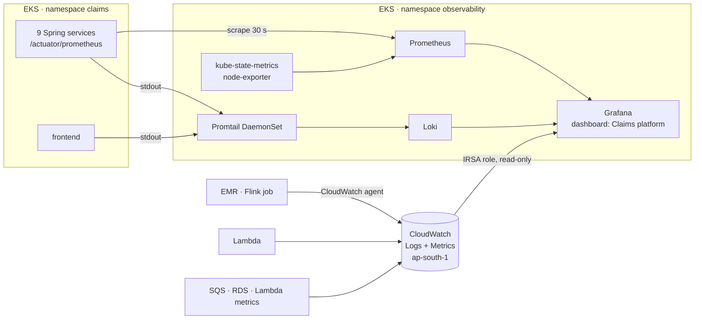

# Observability

Metrics, logs and one Grafana dashboard for the whole platform, running in `ap-south-1`. Everything is created
by Terraform (`infra/terraform/platform`) and the Kubernetes manifests (`k8s/`); nothing is set up by hand.

| Signal | Comes from | Collected by | Stored in | Viewed in |
| --- | --- | --- | --- | --- |
| **Service metrics:** REST and gRPC rate, errors and latency; JVM; DB pools | every Spring service at `/actuator/prometheus` (Micrometer) | Prometheus, through the `claims-services` ServiceMonitor (`k8s/base/servicemonitor.yaml`) | Prometheus (gp3 volume, 7 days) | Grafana |
| **Cluster health:** nodes, pods, requests, restarts, HPAs, volumes | kube-state-metrics, node-exporter, kubelet | Prometheus (kube-prometheus-stack) | Prometheus | Grafana |
| **Service logs:** all ten Deployments and the platform pods | each container's stdout | Promtail (a DaemonSet, on every node) | Loki (single binary, gp3 volume, 7 days) | Grafana |
| **Analytics job logs:** Flink on EMR | YARN container, Flink and YARN daemon logs | CloudWatch agent (EMR bootstrap action, `modules/emr`) | CloudWatch Logs `/aws/emr/<prefix>/flink` | Grafana (CloudWatch data source) |
| **Lambda logs:** Document Verification | the function's output | Lambda | CloudWatch Logs `/aws/lambda/<function>` | Grafana (CloudWatch data source) |
| **AWS metrics:** SQS, Lambda, RDS | AWS | CloudWatch | CloudWatch | Grafana (CloudWatch data source) |



Grafana is the single place to look: one dashboard shows Prometheus, Loki and CloudWatch side by side.

## The dashboard: "Claims platform"

It is defined in [`infra/terraform/platform/dashboards.tf`](../infra/terraform/platform/dashboards.tf).
Terraform publishes it as a ConfigMap labelled `grafana_dashboard=1`, and Grafana's sidecar loads it. The filters at
the top are **Service** (one or more) and **Log search**, a regular expression applied to every log panel.

| Row | Panels |
| --- | --- |
| **Overview** | Requests/s, error rate (5xx), p95 latency, pods ready, nodes ready, container restarts in the last hour. Tiles turn orange or red past their thresholds |
| **Services: REST** | Requests/s by service; 5xx share by service; p95 by service; p50/p95/p99 for the selected services; requests by status code; the ten slowest endpoints (p95) |
| **Services: gRPC** | Calls/s, errors (status ≠ OK) and p95, by service and method. This covers every service-to-service call, including the 3PC messages (CanCommit, PreCommit, DoCommit, Abort) |
| **JVM and database pools** | Heap by pod, process CPU by pod, Hikari connections open and waiting by service. Database connections are the first limit to run out ([capacity.md](../capacity.md)) |
| **Kubernetes cluster health** | Node CPU and memory; CPU and memory requested vs allocatable; pods by phase; restarts by pod; HPA current vs desired replicas; volume usage |
| **AWS (CloudWatch, ap-south-1)** | SQS messages waiting (both queues and their DLQs); Lambda invocations, errors, throttles and duration; RDS connections, CPU and free memory |
| **Logs** | Error lines per minute by service (Loki); service logs (Loki); Flink job logs and Lambda logs (CloudWatch Logs Insights) |

Rates use a 1-minute window and the error rate and percentiles a 5-minute one. Latency percentiles come from
histogram buckets, so they are correct across several pods.

**Open it:**

```bash
cd infra/terraform/platform
terraform output -raw grafana_admin_password; echo                 # user: admin
kubectl -n observability port-forward svc/kube-prometheus-stack-grafana 3000:80
# http://localhost:3000 → Dashboards → Claims platform
```

To give it a public address instead, set `expose_grafana = true` in `platform/terraform.tfvars` and `apply`;
`terraform output grafana_url_command` prints the address. The same JSON is in `terraform output
grafana_dashboard_json`, for import into another Grafana.

## What had to change for this to work

The stack itself (Prometheus, Grafana, Loki, Promtail, the CloudWatch data source and its IRSA role) was already in
`platform/`. These gaps were closed:

| Gap | Fix |
| --- | --- |
| No latency histograms, so p95 and p99 could not be computed | `management.metrics.distribution.percentiles-histogram` for `http.server.requests` and `grpc.server.processing.duration` in all nine services' `application.yml` |
| gRPC calls (most internal traffic, all of the 3PC) produced no metrics | Micrometer's `MetricCollectingServerInterceptor` on the gRPC server of Policy, Claim Intake, Eligibility, Assessment and Payment (`GrpcServerConfig`) |
| Lambda logs and SQS/RDS metrics were not on any dashboard | New panels. The infra stack now also outputs `rds_instance_id` and both DLQ URLs for them |
| The old 8-panel dashboard had no cluster health, gRPC, JVM, AWS or per-service filtering | Replaced by the dashboard above |
| Error-rate panels showed "No data" instead of 0 % when nothing had failed | The queries treat "no 5xx yet" as zero |

**Checked locally.** All nine services ran with their new configuration, scraped by Prometheus 3.1, with
Promtail → Loki 3.3 reading their logs, and the generated dashboard loaded in Grafana 11.4. A k6 smoke run drove
traffic. The REST, gRPC, JVM, pool, overview and Loki panels all showed real data. The cluster-health and AWS
panels need EKS and CloudWatch, so they are only verified on AWS.

## Doing this in ap-south-1 (Mumbai)

| Option | Available in ap-south-1? | Fit here |
| --- | --- | --- |
| **Self-hosted Prometheus, Grafana and Loki in EKS** (chosen) | yes: it runs on our own nodes | No extra AWS service and no per-sample charge. It uses the two existing nodes, so it needs no extra vCPUs under the 8-vCPU quota; only two 10 GiB gp3 volumes are added. All data stays in the region |
| **Amazon Managed Grafana** | **no.** It has no endpoint in ap-south-1 (`grafana.ap-south-1.amazonaws.com` does not resolve; checked with `aws grafana list-workspaces --region ap-south-1`) | It would have to run in another region (for example `ap-southeast-1`) and read Mumbai's data across regions. Self-hosted Grafana avoids that |
| **Amazon Managed Service for Prometheus** | yes (`aws amp list-workspaces --region ap-south-1` answers) | A later option: Prometheus could `remote_write` to it to free node memory, at a per-sample cost. Not needed at this size |
| **CloudWatch** (Logs, metrics, Container Insights) | yes | Used already for what lives outside Kubernetes: EMR/Flink and Lambda logs, and SQS, Lambda and RDS metrics. Grafana reads it through the `grafana` IRSA role (read-only: `logs:StartQuery`, `cloudwatch:GetMetricData`, …) |
| **EFK** (Elasticsearch or OpenSearch, Fluentd, Kibana) | yes (Amazon OpenSearch Service) | Heavier: a search cluster indexes every word, so it needs far more memory than Loki, which indexes only labels. It doesn't fit on two nodes within the quota |

**Region settings.**
- **CloudWatch data source:** its default region is `var.region` (`ap-south-1`), and every CloudWatch panel uses
  that default.
- **Flink logs:** the EMR CloudWatch agent writes to the same region.
- **Gateway endpoints:** the VPC has S3 and DynamoDB gateway endpoints. CloudWatch traffic goes through the NAT
  gateway, which is only a small amount at this volume.

## Not included yet

- **Alerting:** Alertmanager is off to save a pod. Grafana alert rules on the overview tiles are the next step.
- **Tracing:** there is no tracing (OpenTelemetry → Tempo or X-Ray). The `claimId` and `txId` in every log line and
  event are the current way to follow one claim across services.
- **JSON logs:** logs are plain text. Spring's structured (JSON) logging would let Loki filter by field instead of
  by regular expression.
