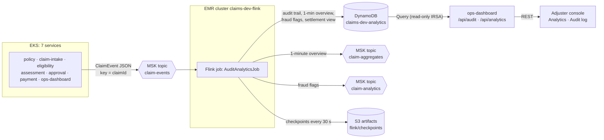

# Flink, MSK and EMR: the audit and analytics pipeline

How the platform turns what the services do into an audit trail, live claim statistics and fraud alerts. This covers the three AWS pieces that make it work: **MSK** (Kafka), **EMR** (where Flink runs) and the **Flink job**. It also explains how this differs from the CloudWatch, Prometheus and Grafana monitoring.

| | |
|---|---|
| Flink job code | [backend/analytics/audit-flink](backend/analytics/audit-flink) (README with the DynamoDB key layout and how to run it locally) |
| Kafka (MSK) | [infra/terraform/modules/msk](infra/terraform/modules/msk) |
| EMR cluster | [infra/terraform/modules/emr](infra/terraform/modules/emr) |
| Results table | [infra/terraform/modules/dynamodb](infra/terraform/modules/dynamodb), `claims-dev-analytics` |
| Read by | ops-dashboard: [AnalyticsService](backend/services/ops-dashboard/src/main/java/com/claims/ops/service/AnalyticsService.java), [AuditQueryService](backend/services/ops-dashboard/src/main/java/com/claims/ops/service/AuditQueryService.java) |
| Shown in | the adjuster console: **Analytics** and **Audit log** pages ([frontend/src/pages/adjuster](frontend/src/pages/adjuster)) |

---

## 1. The pipeline at a glance



The three pieces split the work like this:

1. **MSK carries the events.** Every service publishes a `ClaimEvent` to Kafka whenever something happens to a claim.
2. **EMR provides the compute.** It is the managed Hadoop/YARN cluster the Flink job runs on.
3. **Flink is the logic.** It reads the event stream continuously, and writes the audit trail, windowed statistics and fraud alerts to DynamoDB.

---

## 2. MSK: the event bus

**Amazon MSK** (Managed Streaming for Apache Kafka) runs the Kafka brokers for us. AWS handles broker provisioning, patching, storage and replacing failed brokers.

| Setting | Value (dev) | Where |
|---|---|---|
| Kafka version | 3.8.x | `kafka_version` in `modules/msk/variables.tf` |
| Brokers | 2 × `kafka.t3.small`, one per AZ, 10 GiB EBS each | `msk_broker_*` in `dev.tfvars` |
| Replication | `default.replication.factor = 2`, `min.insync.replicas = 1` | `aws_msk_configuration` |
| Client access | plaintext on **9092** and TLS on 9094, only from the EKS node and EMR security groups | `modules/msk` security group |
| Authentication | none (demo). The switch to IAM authentication is a recipe in [infra/README.md](infra/README.md) | `client_authentication { unauthenticated = true }` |
| Broker logs | CloudWatch Logs, 7 days | `aws_cloudwatch_log_group.broker` |
| Topics | `claim-events`, `claim-aggregates`, `claim-analytics`, `doc-verified`, 3 partitions each | the `kafka-topics` Job, `platform/secrets.tf` |

**What goes in.** All seven business services (everything except login and the gateway simulator) publish through the shared `EventPublishers` class in `backend/common`. Each event is JSON, and its **key is the claim ID**. Kafka keeps all messages with one key on one partition, in order, so a claim's events are always read in the order they happened. Publishing is fire-and-forget: if Kafka is down, the business operation still succeeds, and the failure is logged.

**Why Kafka sits between the services and Flink:**

- **Decoupling.** The services don't know the audit job exists. They emit facts. Adding a new consumer later, such as notifications or a data lake export, needs no change to any service.
- **Durability and replay.** Events are stored on the brokers, not just passed along. If the Flink job is stopped for an hour, it carries on from its last offset when it restarts, and nothing is lost.
- **Ordering per claim**, through the partition key, which an audit trail needs.
- **Buffering.** A burst of claims is absorbed by Kafka. Flink reads at its own pace.

How Kafka compares with SQS, which the document verification uses, is covered in [communication.md](communication.md#pub-sub-vs-queues-side-by-side).

---

## 3. EMR: where Flink runs

**Amazon EMR** is AWS's managed big-data cluster service. It starts EC2 instances already set up with Hadoop, YARN and Flink. Flink needs a cluster manager to give it memory and CPU slots, and EMR provides that with YARN.

| Setting | Value (dev) | Why |
|---|---|---|
| Release | `emr-7.6.0` (Flink 1.20, Hadoop) | the job is built for Flink 1.20 on Java 17 |
| Applications | `Flink`, `Hadoop` | Hadoop provides YARN and S3 access for checkpoints |
| Size | **one** `m5.xlarge` primary node (4 vCPU, 16 GiB), **0 core nodes** | a single-node cluster: YARN and Flink run on the primary. This keeps EKS (4 vCPU) + EMR (4 vCPU) within the account's 8-vCPU quota (`infra/quota.tf`) |
| Network | private subnet; the EMR service reaches the node on 9443 through its own security group | no public IP; the node reaches MSK and DynamoDB inside the VPC |
| Stays up between jobs | `keep_job_flow_alive_when_no_steps = true` | the Flink job is submitted as a step after the cluster starts |
| Idle auto-termination | 7200 s (2 hours) | stops the bill if the cluster is forgotten. A running Flink job keeps it busy |
| Logs | full EMR logs to `s3://claims-dev-emr-logs-<account_id>/`; Flink and YARN logs to CloudWatch `/aws/emr/claims-dev/flink` through a CloudWatch agent bootstrap action | Grafana shows the CloudWatch logs in its **Flink job logs** panel |
| Access | SSM Session Manager (no SSH keys) | |
| Instance role | DynamoDB write on the analytics table, S3 read/write on `flink/checkpoints/*`, read on the jar, Kafka connect | least privilege for the job |

**Why EMR, rather than running Flink on EKS or using Amazon Managed Service for Apache Flink?**

- **On EKS** it would compete with the services for the two nodes' CPU and memory, and need the Flink Kubernetes Operator added. Keeping it separate means a heavy analytics window can't slow down claim processing.
- **The managed Flink service** is a good production option, but it bills per KPU, and the project explicitly uses EMR to show a big-data cluster alongside the microservices.
- **EMR** gives a real YARN cluster with Flink preinstalled. It can grow by adding core nodes (`emr_core_instance_count`) when the vCPU quota allows.

### Submitting the job

The job isn't deployed by Terraform or Argo CD. It is submitted to the running cluster as two **EMR steps** (see step 7 of [RUN.md](RUN.md)):

1. `flink-yarn-session -d` starts a detached Flink session on YARN: a JobManager plus TaskManagers.
2. A `bash` step copies `audit-flink.jar` from `s3://<artifacts>/flink/` to the node and runs `flink run -d … --bootstrap <MSK brokers> --aggregates-topic claim-aggregates --results-topic claim-analytics --table claims-dev-analytics --checkpoint-dir s3://<artifacts>/flink/checkpoints`.

Both steps finish (`COMPLETED`) in about a minute. The job itself keeps running inside the session.

To ship a new version of the job, rebuild the jar, upload it, and submit **one** step that cancels the running job and starts the new one. Add `--starting-offsets earliest` to recompute everything with the new logic. That is safe, because every DynamoDB write is idempotent:

```bash
flink list -r | grep -oE '[0-9a-f]{32}' | sort -u | xargs -r -n1 flink cancel
flink run -d /home/hadoop/audit-flink.jar … --starting-offsets earliest
```

Pass it to `aws emr add-steps` as JSON (`--steps file://step.json`). The CLI's shorthand syntax splits on commas and quotes, which breaks both the broker list and the script.

---

## 4. The Flink job: what it computes

[AuditAnalyticsJob](backend/analytics/audit-flink/src/main/java/com/claims/analytics/AuditAnalyticsJob.java) is one streaming job with one source and four branches:

```
KafkaSource(claim-events, group audit-flink, event time = occurredAt, 10 s out-of-order allowed,
            watermark follows the clock after 5 s without events)
 ├─ audit trail      every event with a claimId                        → DynamoDB
 ├─ claims overview  1-minute tumbling window over all events          → DynamoDB + claim-aggregates
 ├─ fraud detection  CLAIM_CREATED, keyBy policyNo,                    → DynamoDB + claim-analytics
 │                   10-minute window sliding every minute, > 2 claims
 └─ settlement view  TX_* events, keyBy txId, keyed state (TTL 1 day)  → DynamoDB
```

| Output | What it holds | DynamoDB key | Shown as |
|---|---|---|---|
| **Audit trail** | one item per event: who did what, when, from which status to which, the before/after values of any change, and the adjuster's justification | `CLAIM#<claimId>` / `EVENT#<time>#<eventId>`, plus GSI1 `TYPE#<eventType>` | the claim's timeline, and the **Audit log** search |
| **Claims overview** | per minute: claims by status, approval rate, total and average amount claimed, settlement commits and aborts | `METRIC#claims_overview#1m` / `WINDOW#<start>`, kept 7 days | the **Analytics** page: KPI tiles and time series |
| **Fraud flags** | a policy with more than 2 new claims within 10 minutes | `FRAUD#<policyNo>` / `WINDOW#<end>`, GSI1 `TYPE#FraudFlag`, kept 7 days | the **Analytics** page's fraud list |
| **Settlement view** | the live state of each 3PC transaction: coordinator phase, each participant's vote and state, outcome | `TX#<txId>` / `STATE` | settlement status |

### Concepts that matter here

- **Event time, not arrival time.** Windows use the event's `occurredAt`, so a delayed message still lands in the minute it happened. Watermarks allow 10 seconds of disorder, and after 5 quiet seconds they follow the wall clock, so each minute closes about 10–15 s after it ends even with no further traffic. The full logic is in [analytics.md](analytics.md).
- **Windows.** A *tumbling* window (the overview) is a fixed, non-overlapping bucket. A *sliding* window (fraud) overlaps: every minute it re-checks the last 10 minutes, so one burst is flagged in each window that contains it.
- **Keyed state.** The settlement view remembers each transaction's state between events, using Flink's managed state, with a 1-day time-to-live.
- **Checkpoints = exactly-once state.** Every 30 seconds Flink saves its state and Kafka offsets to S3. After a crash it restores the last checkpoint and replays from there.
- **Idempotent sinks.** Every DynamoDB write is a PUT on a deterministic key, so a replay overwrites the same items instead of creating duplicates. The Kafka sink is at-least-once.
- **Bad input is skipped.** A message that isn't valid JSON, or lacks `eventId`, `eventType` or `occurredAt`, is logged and dropped. It doesn't stop the job.

---

## 5. What Flink powers

| Feature | Who uses it | Data path |
|---|---|---|
| **Audit trail per claim:** every change, with the actor and the written justification | adjuster and auditor (the `README` actors) | Flink → DynamoDB → `GET /api/audit/claims/{claimId}` |
| **Audit log search** by event type and time range | adjuster / auditor | DynamoDB GSI1 → `GET /api/audit/events` |
| **Live claim statistics:** volumes by status, approval rate, amounts | adjuster console, Analytics page | DynamoDB → `GET /api/analytics/summary`, `/series` |
| **Fraud alerts:** too many claims on one policy too quickly | adjuster console, Analytics page | DynamoDB → `GET /api/analytics/fraud-flags` |
| **3PC settlement visibility:** which phase, who voted what | debugging and demos with the chaos buttons | DynamoDB `TX#<txId>` |
| **`claim-aggregates`** (1-minute windows) and **`claim-analytics`** (fraud flags) streams | any future consumer (none in this repo yet) | Kafka |

The audit trail is part of the business requirements ("every step is audited"). That is why it is built from a durable event log, not from application logs.

---

## 6. How this differs from CloudWatch, Prometheus and Grafana

They answer different questions for different people.

| | **Flink pipeline** (this file) | **Prometheus + Grafana** | **CloudWatch** |
|---|---|---|---|
| Question it answers | *What is happening to the claims?* | *Are the services healthy and fast?* | *Are the AWS services healthy?*, plus logs from outside Kubernetes |
| Data | **business events**: claim created, document rejected, amount adjusted with a reason, settlement committed | **technical metrics**: requests/s, 5xx rate, p95 latency, JVM heap, DB pool, pod restarts | AWS metrics (SQS depth, Lambda errors, RDS CPU) and logs (Lambda, Flink, MSK brokers) |
| Source | `ClaimEvent`s the code deliberately emits to Kafka | numbers Micrometer exposes at `/actuator/prometheus`, scraped every 30 s | emitted automatically by AWS, plus agents |
| Granularity | **every single event**, per claim, with full detail | aggregated numbers over time. No per-claim detail | aggregated metrics; raw log lines |
| Correctness | exactly-once state, ordered per claim, replayable from Kafka | sampled every 30 s, approximate, and a scrape can be missed | as AWS reports it |
| Retention | DynamoDB: audit items kept; windows and flags 7 days | 7 days (Prometheus volume) | 7 days (log groups) |
| Audience | **adjusters and auditors**, inside the product | **engineers / on-call** | **engineers** |
| Where you see it | the app's Analytics and Audit log pages | Grafana → "Claims platform" | Grafana's AWS and log panels, or the AWS console |
| If it's lost | a compliance problem: the audit trail is a product feature | a blind spot during an incident; the business is unaffected | the same |

A concrete example: an adjuster cuts a claim from ₹82,000 to ₹76,500.

- **Flink** records *who* changed it, *from* 82,000 *to* 76,500, *why* ("room rent above plan limit"), and when. It updates the minute's average claimed amount.
- **Prometheus** records that `assessment` served one more `POST` with a 200 in 38 ms.
- **CloudWatch** sees nothing specific. Perhaps RDS CPU rises by a fraction of a percent.

Two overlaps to be aware of:

- **Flink's own health is in CloudWatch, not Prometheus.** The job's logs reach Grafana through the CloudWatch data source (the **Flink job logs** panel). Its *output* is not in Grafana: that lives in DynamoDB and is shown by the app.
- **The analytics tiles look like a monitoring dashboard**, but they count *claims*, not requests. A spike in requests/s in Grafana could be one user refreshing a page. A spike in claims created in Flink's overview is real business volume.

See [cloudwatch.md](cloudwatch.md) for the monitoring stack.

---

## 7. Operating it

### Check it is running

```bash
cd infra/terraform/infra
C=$(terraform output -raw emr_cluster_id); T=$(terraform output -raw analytics_table_name)

aws emr describe-cluster --cluster-id $C --query 'Cluster.Status.State'          # WAITING = up (and the job runs in its session)
aws emr list-steps --cluster-id $C --query 'Steps[].[Name,Status.State]' --output table
aws dynamodb scan --table-name $T --select COUNT                                  # items written so far
aws dynamodb query --table-name $T --key-condition-expression "PK = :p" \
  --expression-attribute-values '{":p":{"S":"METRIC#claims_overview#1m"}}' --select COUNT   # closed 1-minute windows
MSYS_NO_PATHCONV=1 aws logs tail /aws/emr/claims-dev/flink --since 15m           # Flink logs (Git Bash needs MSYS_NO_PATHCONV)
```

An overview window is only written for a minute that *had* events, about 10–15 s after that minute ends. File a claim, and the Analytics page shows it shortly after the minute is over.

The Flink web UI runs on the EMR node (YARN → the session's ApplicationMaster). Reach it through SSM port forwarding if you need it. Usually the logs and the DynamoDB items are enough.

### Common problems

| Symptom | Likely cause and fix |
|---|---|
| The EMR cluster is `TERMINATED` | The 2-hour idle timeout fired before a job was submitted, or the cluster lost capacity. Run `terraform apply -var-file=dev.tfvars` in `infra` (it creates a new cluster), then submit the two steps again |
| The steps `COMPLETED` but DynamoDB stays empty | No events yet (file a claim), the watermark hasn't moved (the overview needs a later event), or the job failed after starting: check `/aws/emr/claims-dev/flink` |
| `TimeoutException` to the brokers in the Flink logs | The `--bootstrap` value is wrong, or MSK's security group doesn't allow the EMR group. Use `terraform output -raw msk_bootstrap_brokers` |
| `VcpuLimitExceeded` when the cluster is created | EKS and EMR share the 8-vCPU quota. See the troubleshooting table in [infra/README.md](infra/README.md) |
| The Analytics page says "not available" | ops-dashboard can't reach DynamoDB (`enable_dynamodb = false`, or running locally) |

### Cost

MSK (about $0.09/h) and EMR (about $0.25/h) are roughly 40% of the dev environment's hourly cost. For a run that doesn't need analytics, set `enable_emr = false` (and optionally `enable_msk = false`) in `dev.tfvars`. The services keep working, and without Kafka they write events to their logs instead.
