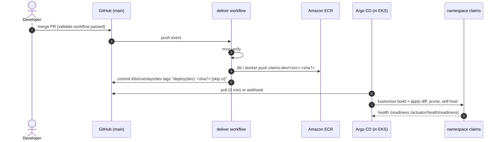

# GitOps

Git is the only way workloads reach the cluster. CI builds images and **commits** new image tags. Argo CD,
running inside EKS, notices the commit and applies it. No pipeline and no person runs `kubectl apply` for a
service.

```
gitops/
├── argocd/
│   ├── project.yaml     AppProject "claims": this repository only, namespaces claims + argocd, cluster-scoped kinds limited to Namespace
│   └── root-app.yaml    Application "claims-root" (app of apps) → gitops/apps/, picks <env>.yaml
└── apps/
    ├── dev.yaml         Application "claims-dev"  → k8s/overlays/dev
    └── prod.yaml        Application "claims-prod" → k8s/overlays/prod
```

Both child Applications sync automatically with `prune` and `selfHeal`, `CreateNamespace=true`, and retry
with backoff. They ignore `Deployment /spec/replicas` (`RespectIgnoreDifferences=true`) so the HPA owns the
replica count after the first sync.

**One environment per cluster.** Each environment has its own EKS cluster (its own Terraform workspace and
tfvars). Terraform sets the root app's `directory.include` to `<env>.yaml`, so the dev cluster runs only
`claims-dev` and the prod cluster only `claims-prod`.

## Flow



| Step | Where | Notes |
| --- | --- | --- |
| Checks on every PR | [`validate.yml`](../.github/workflows/validate.yml) | `kustomize build` both overlays, `kubeconform -strict` (incl. CRD schemas), `terraform fmt` + `validate` for all three stacks, `mvn verify` |
| Build and push | [`deliver.yml`](../.github/workflows/deliver.yml) `images`, `frontend` | Jib for the 7 Spring Boot services, Docker for the frontend. Tag = short commit id. AWS access through GitHub OIDC, no stored keys |
| Bump the tag | `deliver.yml` `bump-overlay` | `kustomize edit set image` in `k8s/overlays/<env>`, commit to `main` with `[skip ci]` |
| Deploy | Argo CD | Syncs `claims-<env>`. CI never talks to the cluster |
| Lambda | Terraform `infra` stack | The document-verification jar is a workflow artifact; `terraform apply` in `infra` deploys it. It is not a Kubernetes workload |

**Promotion to prod.** Run *deliver* manually with `environment = prod` and `ref` = the commit running in
dev. It rebuilds that commit into `claims-prod/<svc>` (Jib builds are reproducible: same commit, same
layers) and commits the tags to `k8s/overlays/prod`. Protect the `prod` GitHub environment with required
reviewers to make that an approval step.

## Bootstrap

Nothing is created by hand. Terraform installs Argo CD and seeds it from the files in this folder.

1. **One-time CI access.** In `infra/terraform/infra/<env>.tfvars` set
   `enable_github_oidc = true` and `github_repository = "Krisha-cmd/Insurance-claim"`, then
   `terraform apply` in `infra`. In GitHub → Settings → Environments create `dev` (and `prod`) with the
   variables `AWS_ROLE_ARN` (output `irsa_role_arns.github_actions`) and `AWS_REGION`.
2. **Argo CD.** `terraform apply` in `infra/terraform/platform` with `gitops_repo_url` set
   ([infra README, step 5](../infra/README.md)). This installs the `argo-cd` Helm chart and the
   `argocd-apps` chart, whose values are [`argocd/project.yaml`](argocd/project.yaml) and
   [`argocd/root-app.yaml`](argocd/root-app.yaml) read with `yamldecode(file(...))`. Repo URL, revision and
   environment come from Terraform variables, so the YAML here stays the single definition.
3. **First images.** Push to `main` (or run *deliver*). Until the overlay has real tags the pods sit in
   `ImagePullBackOff`; the first `deploy(dev)` commit fixes that.
4. Check: `kubectl -n argocd get applications` shows `claims-root` and `claims-dev` *Synced / Healthy*
   (read-only; port-forward the UI as in the infra README).

Without Terraform (e.g. a local kind cluster with Argo CD already installed) the same two files can be
applied once: `kubectl apply -f gitops/argocd/`. That is the only manual `kubectl apply`, and it creates
Argo CD objects, not services.

**What Terraform owns in `claims`.** The namespace itself, the `<svc>-db` Secrets, `jwt-keys`, the
`platform-endpoints` ConfigMap and the IRSA service accounts `claim-intake` and `ops-dashboard`. The
manifests only reference them. The namespace carries `Prune=false,Delete=false`, so Argo CD never deletes it.

## Rollback

Rollback is a Git change too, so the cluster and Git never disagree.

| Situation | Do this |
| --- | --- |
| Bad release | `git revert <deploy commit>` on `main` and push. Argo CD syncs the previous tags. Each commit has its own tag (CI never reuses one), so the old images are still in ECR; the lifecycle policy keeps the newest 10 per repository |
| One service only | `cd k8s/overlays/<env> && kustomize edit set image payment=<registry>/claims-<env>/payment:<old sha7>`, commit, push |
| Bad manifest change | Revert the commit that changed `k8s/`. `prune` removes anything the revert drops |
| Emergency, Git unavailable | Argo CD UI → `claims-<env>` → *History and rollback*. Auto-sync must be disabled first, otherwise self-heal reverts it; re-enable it after Git is fixed |

Find what is running: `git log --oneline -- k8s/overlays/<env>/kustomization.yaml`, or the Argo CD UI's
*History*.

## Things to know

- **Branch protection.** `bump-overlay` pushes to `main` as `github-actions[bot]`. If `main` requires PRs,
  allow that bot to bypass, or change the job to open a PR instead.
- **Placeholder registry.** The overlays in Git start with `account-id.dkr.ecr.ap-south-1.amazonaws.com`.
  The first CI run replaces it with the real registry from `amazon-ecr-login`; no account ID is written
  by hand.
- **Eligibility** has manifests in `k8s/base` but is not listed in the base kustomization until the
  service exists (issue #4).
