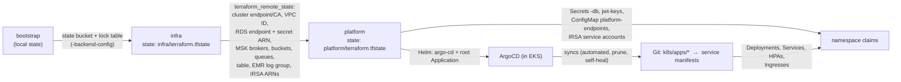

# Infrastructure (Terraform on AWS)

All of the AWS infrastructure for the claims platform is built here with Terraform. That covers the network, the Kubernetes cluster, the databases, storage, messaging, IAM, and everything installed inside the cluster. **Nothing is created by hand**, and services are never deployed with `kubectl apply`: ArgoCD deploys them from Git.

The code is split into three **stacks**. A stack is a folder you run `terraform` in, and each one keeps its own state.

| Stack | What it creates | Run it |
|---|---|---|
| `terraform/bootstrap` | The S3 bucket and DynamoDB table that store the state of the other two stacks | once per account |
| `terraform/infra` | Every AWS resource: VPC, EKS, RDS, MSK, EMR, S3, SQS, Lambda, DynamoDB, ECR, IAM | each time the AWS side changes |
| `terraform/platform` | Everything inside the cluster: ALB controller, metrics-server, ArgoCD and the root app, Prometheus, Grafana, Loki, database users, secrets | after `infra` |

---

## 1. What gets built

| AWS resource | Purpose | Approx. cost / hour* |
|---|---|---|
| VPC across 2 AZs: 2 public and 2 private subnets, **1 NAT gateway**, S3 and DynamoDB gateway endpoints | Private network. The gateway endpoints are free and keep S3/DynamoDB traffic off the NAT | ~$0.06 + data |
| **EKS** `claims-dev` (Kubernetes 1.33) with 2 × `t3.medium` nodes, plus the EBS CSI driver and a default `gp3` StorageClass | Runs the six services, ArgoCD and monitoring | $0.10 + ~$0.09 |
| **ECR**: 9 repositories (`claims-dev/<service>`) | Container images | storage only |
| **RDS PostgreSQL 16**, `db.t4g.micro`, 20 GB gp3, single-AZ | One database per service. The master password lives in Secrets Manager | ~$0.02 |
| **MSK** Kafka 3.6.0, 2 × `kafka.t3.small` | Event bus between services (`claim-events`, `claim-analytics`, `doc-verified`) | ~$0.09 |
| **EMR** 7.2.0 (Flink + Hadoop), 1 primary + 1 core `m5.xlarge`. Stops itself after 2 h idle | Runs the Audit Flink job (Kafka → results topic + DynamoDB) | ~$0.53 |
| **Lambda** `document-verification` (Java 21, SnapStart) | Event-driven, asynchronous document checks | per use (pennies) |
| **SQS** `doc-upload-events` and `doc-verification-results`, each with a dead-letter queue | S3 → Lambda → Claim Intake | per use (pennies) |
| **S3** buckets `documents`, `emr-logs` and `artifacts` | Claim documents (pre-signed uploads), EMR logs, jars | storage only |
| **DynamoDB** `claims-dev-analytics` (on demand) | Audit trail and analytics windows | per use (pennies) |
| **IAM** IRSA roles, the Lambda role, EMR roles, and an optional GitHub OIDC role | Least-privilege access with no long-lived keys | free |
| CloudWatch log groups (7-day retention) | MSK broker logs, Lambda logs, Flink logs | pennies |
| ALBs, **only** if you expose ArgoCD/Grafana or apps create Ingresses | Public HTTP access | ~$0.025 each |

\* **These figures are approximate**, on-demand prices in `ap-south-1` (Mumbai) at the time of writing. With everything on, expect **about $0.90 to $1.00 per hour**, roughly $22 a day. The minimal "login test" setup (section 4) costs **about $0.27 per hour**.

> ### ⚠️ Run `terraform destroy` as soon as you are finished (see step 9). These resources bill every hour whether or not you use them.

---

## 2. Prerequisites

You need:

1. **An AWS account**, and an IAM user or role with `AdministratorAccess` for this demo.
2. **AWS CLI v2**, configured with a named profile:
   ```bash
   aws configure --profile claims      # paste the access key, the secret, region ap-south-1, output json
   export AWS_PROFILE=claims           # PowerShell: $env:AWS_PROFILE = "claims"
   aws sts get-caller-identity         # shows your account ID: the CLI works
   ```
3. **Terraform 1.6 or newer**, **kubectl**, **Helm 3**, and, only for the Lambda, **Java 21 + Maven**.

Check each version:

```bash
aws --version          # aws-cli/2.x
terraform -version     # Terraform v1.6.0 or newer
kubectl version --client
helm version           # v3.x  (only needed for troubleshooting; Terraform installs the charts itself)
java -version          # 21    (only for the Lambda)
mvn -version           # 3.9+  (only for the Lambda)
```

> **Windows:** run the commands in **Git Bash** so they work exactly as written. In PowerShell, replace the line-continuation `\` with a backtick `` ` `` and use `$env:NAME = "value"` instead of `export`.

Terraform runs `aws eks get-token` to sign in to the cluster, so the AWS CLI has to be on your `PATH`, and `AWS_PROFILE` must be set in the same terminal.

---

## 3. Happy path (default values, top to bottom)

Run every command from the repository root unless a step says otherwise.

### Step 1: Create the state backend (about 1 minute, once)

```bash
cd infra/terraform/bootstrap
terraform init
terraform apply          # type "yes" when asked
```

**Check:** the outputs show `state_bucket = "claims-dev-tfstate-<account_id>"`, `lock_table = "claims-dev-tf-locks"` and `region = "ap-south-1"`. Keep this terminal open, or run `terraform output` again later.

`backend_config_args` is the exact text to paste into the next `terraform init` commands.

### Step 2: Build the Lambda jar (about 2 minutes), or skip the Lambda

```bash
cd ../../../backend
mvn -pl functions/document-verification -am package
ls functions/document-verification/target/document-verification.jar
```

Terraform expects the file at `backend/functions/document-verification/target/document-verification.jar`. In the function's `pom.xml`, set `<finalName>document-verification</finalName>` and build a shaded jar with the Maven Shade plugin, or point `lambda_jar_path` at the jar Maven produced.

**If the backend isn't written yet**, open `infra/terraform/infra/dev.tfvars` and set `enable_lambda = false`. Without that, the next step stops with a clear `Lambda jar not found` error.

### Step 3: Create the AWS infrastructure (about 25 to 35 minutes)

```bash
cd ../infra/terraform/infra          # from backend/ ; or: cd infra/terraform/infra from the repo root
terraform init \
  -backend-config="bucket=claims-dev-tfstate-<account_id>" \
  -backend-config="region=ap-south-1" \
  -backend-config="dynamodb_table=claims-dev-tf-locks"
terraform apply -var-file=dev.tfvars
```

- `init` should end with `Terraform has been successfully initialized!`
- `apply` prints a plan of roughly 150 to 180 resources. Type `yes`.
- The slow parts are **MSK** (20 to 30 min), **EKS** (12 to 15 min) and **EMR** (10 to 15 min). Terraform builds them in parallel.

**Check:** the run ends with `Apply complete!` and a list of outputs such as `cluster_name`, `rds_endpoint`, `msk_bootstrap_brokers` and `ecr_repository_urls`. You can print them again at any time with `terraform output`.

### Step 4: Connect kubectl to the cluster (about 1 minute)

```bash
aws eks update-kubeconfig --name claims-dev --region ap-south-1
kubectl get nodes
```

**Check:** you see 2 nodes with `STATUS = Ready`.

### Step 5: Install the in-cluster platform (about 8 to 12 minutes)

Tell ArgoCD which Git repository to watch. Create `infra/terraform/platform/terraform.tfvars`. Git ignores this file.

```hcl
gitops_repo_url = "https://github.com/Krisha-cmd/Insurance-claim.git"
# gitops_revision = "main"       # branch to track (default)
# gitops_path     = "k8s/apps"   # folder with the Application manifests (default)
```

For a **private** repository, also add `gitops_repo_private = true`, then pass the token through the environment so it never lands in a file:

```bash
export TF_VAR_gitops_repo_token=<github personal access token with repo read access>
```

Then apply the platform stack:

```bash
cd ../platform
terraform init \
  -backend-config="bucket=claims-dev-tfstate-<account_id>" \
  -backend-config="region=ap-south-1" \
  -backend-config="dynamodb_table=claims-dev-tf-locks"
terraform apply
```

**Check:** the run ends with `Apply complete!`. It reads the infra outputs automatically, so you don't need any other variables.

### Step 6: Verify everything (about 5 minutes)

```bash
kubectl get pods -A
```
Every pod should be `Running`. The two Jobs show `Completed`:

```bash
kubectl -n claims get jobs           # db-init   1/1   and   kafka-topics   1/1
kubectl -n claims logs job/db-init   # "... database login: created ... db-init finished"
kubectl -n claims get secrets        # login-db, policy-db, claims-db, assessment-db, approval-db, payment-db, jwt-keys
kubectl -n claims get configmap platform-endpoints -o yaml
```

**ArgoCD UI**

```bash
kubectl -n argocd port-forward svc/argocd-server 8080:80
# in a second terminal: the admin password
kubectl -n argocd get secret argocd-initial-admin-secret -o jsonpath='{.data.password}' | base64 -d; echo
```
Open <http://localhost:8080> and sign in as `admin` with that password. You should see the **`root`** application. Until `k8s/apps` exists in the repository, it shows a *ComparisonError* ("path does not exist"). That's expected: ArgoCD is working, and there is just nothing to deploy yet.

**Grafana**

```bash
kubectl -n observability port-forward svc/kube-prometheus-stack-grafana 3000:80
terraform output -raw grafana_admin_password; echo     # run inside infra/terraform/platform
```
Open <http://localhost:3000> and sign in as `admin` with that password.
- **Dashboards → Claims overview**: RPS, error rate, p95 latency, HPA replicas, node and pod CPU/memory, plus the Loki and Flink log panels. The service panels stay empty until services are deployed.
- **Connections → Data sources** lists Prometheus, Loki and CloudWatch.

**Prometheus** (optional): `kubectl -n observability port-forward svc/kube-prometheus-stack-prometheus 9090:9090`, then open <http://localhost:9090/targets>.

### Step 7: Push images and let ArgoCD deploy

1. Log in to ECR. The registry address is the `ecr_registry` output of the infra stack.
   ```bash
   aws ecr get-login-password --region ap-south-1 | docker login --username AWS --password-stdin <account_id>.dkr.ecr.ap-south-1.amazonaws.com
   ```
2. Build and push each service as `<account_id>.dkr.ecr.ap-south-1.amazonaws.com/claims-dev/<service>:<tag>`. The backend README has the build commands.
3. Commit the Kubernetes manifests under `k8s/`. `k8s/apps/` holds one Argo CD `Application` per service. Push to `main`. ArgoCD syncs within about 3 minutes, or immediately if you click **Refresh**.

What the manifests can rely on (they never need an account ID):
- `envFrom: secretRef: <service>-db` and `configMapRef: platform-endpoints`
- `serviceAccountName: claim-intake` / `ops-dashboard`. These service accounts already carry their IAM role (IRSA).
- the `jwt-keys` Secret (`private.pem`, `public.pem`) for the login service
- HPAs work, because metrics-server is installed.

### Step 8: Submit the Flink job to EMR

```bash
cd infra/terraform/infra
CLUSTER_ID=$(terraform output -raw emr_cluster_id)
ARTIFACTS=$(terraform output -raw artifacts_bucket)
BROKERS=$(terraform output -raw msk_bootstrap_brokers)
TABLE=$(terraform output -raw analytics_table_name)

# upload the jar built from backend/analytics/audit-flink
aws s3 cp ../../../backend/analytics/audit-flink/target/audit-flink.jar s3://$ARTIFACTS/flink/audit-flink.jar

# step 1: start a detached Flink YARN session; step 2: copy the jar to the primary node and run it in that session
aws emr add-steps --cluster-id "$CLUSTER_ID" --steps \
  "Type=CUSTOM_JAR,Name=flink-session,ActionOnFailure=CONTINUE,Jar=command-runner.jar,Args=[flink-yarn-session,-d]" \
  "Type=CUSTOM_JAR,Name=audit-flink,ActionOnFailure=CONTINUE,Jar=command-runner.jar,Args=[bash,-c,aws s3 cp s3://$ARTIFACTS/flink/audit-flink.jar /home/hadoop/audit-flink.jar && flink run -d /home/hadoop/audit-flink.jar --bootstrap-servers $BROKERS --source-topic claim-events --results-topic claim-analytics --table $TABLE]"

aws emr list-steps --cluster-id "$CLUSTER_ID" --query 'Steps[].{Name:Name,State:Status.State}' --output table
```

**Check:** both steps reach `COMPLETED`. The job itself keeps running inside the session. The job arguments above are an example, so match them to the job's `main()`.

Flink logs appear in the CloudWatch log group `/aws/emr/claims-dev/flink` (the `emr_flink_log_group` output). Grafana shows them in the **Flink job logs** panel. The full EMR logs are archived in `s3://claims-dev-emr-logs-<account_id>/`.

### Step 9: Tear down (about 20 to 30 minutes)

Do the steps **in this order**. AWS won't delete the VPC while load balancers created by Kubernetes still exist.

```bash
# 1. stop ArgoCD from re-creating what you delete (self-heal)
kubectl -n argocd scale statefulset argocd-application-controller --replicas=0

# 2. delete everything that owns an AWS load balancer, then wait for the ALBs/NLBs to disappear
kubectl delete ingress --all -A
kubectl get svc -A -o jsonpath='{range .items[?(@.spec.type=="LoadBalancer")]}{.metadata.namespace} {.metadata.name}{"\n"}{end}' \
  | while read -r ns name; do kubectl -n "$ns" delete svc "$name"; done
aws elbv2 describe-load-balancers --query 'LoadBalancers[].LoadBalancerName' --output text   # repeat until empty (1-3 min)

# 3. destroy the in-cluster platform, then the AWS infrastructure
cd infra/terraform/platform && terraform destroy
cd ../infra && terraform destroy -var-file=dev.tfvars
```

**Check:** both runs end with `Destroy complete!`. Leave `bootstrap` in place, because it costs nearly nothing and holds your state. Only once you're completely done, run `terraform destroy` in `bootstrap` as well. The state bucket has versioning on, so empty it in the S3 console first if destroy complains.

---

## 4. Tweaking (optional)

### Variables of `infra` (set them in `dev.tfvars`)

| Variable | Default | What it changes | When to change it |
|---|---|---|---|
| `region` | `ap-south-1` | Region of every resource | You want another region. Use the same value in `platform` and `bootstrap` |
| `project` / `env` | `claims` / `dev` | The name prefix `claims-dev-…` | A second environment (`env = "staging"`) |
| `vpc_cidr` | `10.20.0.0/16` | VPC address range | It overlaps a network you peer with |
| `az_count` | `2` | Subnets per tier | Higher availability (MSK brokers must be a multiple of it) |
| `single_nat_gateway` | `true` | One NAT, or one per AZ | Production: set `false` |
| `frontend_origins` | `["http://localhost:5173"]` | S3 CORS for browser uploads | You host the frontend somewhere |
| `eks_public_access_cidrs` | `["0.0.0.0/0"]` | Who can reach the Kubernetes API | Lock it to `["<your-ip>/32"]` |
| `ecr_repositories` | 9 services | ECR repositories | You add or rename a service |
| `rds_extra_allowed_security_groups` | `{}` | Extra clients allowed into PostgreSQL | A bastion host or VPN |
| `cluster_version` | `1.33` | Kubernetes version | Upgrades, one minor version at a time |
| `node_instance_types` | `["t3.medium"]` | Worker size | Pods are Pending for lack of CPU or memory |
| `node_min_size` / `node_desired_size` / `node_max_size` | `2 / 2 / 4` | Number of workers | Scaling, see the recipe below |
| `rds_instance_class` / `rds_allocated_storage` | `db.t4g.micro` / `20` | Database size | Load tests |
| `msk_broker_instance_type` / `msk_broker_count` / `msk_broker_volume_size` | `kafka.t3.small` / `2` / `10` | Kafka size | Higher throughput |
| `emr_release_label` | `emr-7.2.0` | EMR and Flink version | A newer Flink |
| `emr_primary_instance_type` / `emr_core_instance_type` / `emr_core_instance_count` | `m5.xlarge` / `m5.xlarge` / `1` | Flink cluster size | A bigger job, or AZ capacity errors |
| `emr_idle_timeout_seconds` | `7200` | Idle EMR auto-termination | Longer or shorter idle windows |
| `lambda_jar_path` / `lambda_handler` / `lambda_timeout_seconds` | see `dev.tfvars` | Lambda code, entry point and timeout | Your build produces a different jar |
| `enable_rds` / `enable_msk` / `enable_emr` / `enable_lambda` / `enable_dynamodb` | all `true` | Create or remove each component | Saving cost or time, see the recipe |
| `enable_github_oidc` / `github_repository` | `false` / `""` | GitHub Actions role that can push to ECR | CI pushes images |

### Variables of `platform` (set them in `platform/terraform.tfvars`)

| Variable | Default | What it changes |
|---|---|---|
| `gitops_repo_url` | `""` | The repository ArgoCD watches. When empty, no root app is created |
| `gitops_revision` / `gitops_path` | `main` / `k8s/apps` | Branch and folder of the app-of-apps |
| `gitops_repo_private` / `gitops_repo_token` | `false` / env var | Credentials for a private repository |
| `expose_argocd` / `expose_grafana` / `ingress_allowed_cidrs` | `false` / `false` / `0.0.0.0/0` | Public ALBs for the UIs |
| `db_services` | `login, policy, claims, assessment, approval, payment` | Databases, users and `<name>-db` Secrets |
| `kafka_topics` / `kafka_topic_partitions` | 3 topics / `3` | Topics created by the `kafka-topics` Job |
| `prometheus_retention` / `prometheus_storage_size` / `loki_storage_size` | `7d` / `10Gi` / `10Gi` | Monitoring retention and disk |
| `state_bucket` | derived | Only if your state bucket isn't `claims-dev-tfstate-<account_id>` |

### Recipe: minimal login test run (about 15 minutes, about $0.27 per hour)

In `dev.tfvars`:
```hcl
enable_msk      = false
enable_emr      = false
enable_lambda   = false
enable_dynamodb = false
```
Only the VPC, EKS, ECR, RDS (plus S3/SQS, which are free when idle) are created. Run the platform stack as usual. It skips the `kafka-topics` Job and the ops-dashboard role. Check it with `kubectl -n claims get secret login-db` and `kubectl -n claims get job db-init` (`1/1`). To add the rest later, set the toggles back to `true` and `apply` both stacks again.

### Recipe: scale the node group or change instance types

Set `node_instance_types = ["t3.large"]` and/or `node_max_size = 6`, then `terraform apply -var-file=dev.tfvars` in `infra`. A changed instance type replaces the nodes one at a time. Pods move automatically.

### Recipe: add a new service

1. Add its name to `ecr_repositories` (infra) and apply.
2. If it needs a database, add it to `db_services` (platform) and apply. That creates `<name>_user`, the database `<name>`, and the Secret `<name>-db`.
3. If it calls AWS APIs, add an entry to `local.irsa` in `modules/iam/main.tf` with a policy, output its ARN, and add a service account for it in `platform/secrets.tf` (like `claim-intake`).
4. Add its manifests and an `Application` under `k8s/`.

### Recipe: change region

Set `region` in `bootstrap`, `infra/dev.tfvars` and `platform/terraform.tfvars`, and run the whole happy path in the new region. **AZ caveat:** the network module takes the first two standard AZs of the region. If an instance type isn't offered in one of them (EMR `m5.xlarge`, MSK `kafka.t3.small`), apply fails with an "unsupported" or "capacity" error. Pick another type, or another region.

### Recipe: expose ArgoCD or Grafana through an ALB

```hcl
# platform/terraform.tfvars
expose_argocd         = true
expose_grafana        = true
ingress_allowed_cidrs = ["<your-ip>/32"]   # strongly recommended
```
Apply `platform`, wait about 2 minutes, then run `terraform output argocd_url_command` (or `grafana_url_command`) and run the printed command to get the ALB hostname. It's plain HTTP. For HTTPS, add an ACM certificate annotation and a hostname. Remember to delete these Ingresses before you destroy (step 9).

### Recipe: switch MSK to IAM authentication

1. In `modules/msk/main.tf`, replace the `client_authentication` block with `client_authentication { sasl { iam = true } }`, and set `client_broker = "TLS"`.
2. Use the `bootstrap_brokers_sasl_iam` attribute (port 9098) instead of `bootstrap_brokers`. Open port 9098 in the security group.
3. Give each client role `kafka-cluster:Connect`, `ReadData`/`WriteData` and `DescribeTopic`. The EMR role already has these. Add them to the IRSA roles of the services that produce or consume.
4. Clients add `aws-msk-iam-auth` and set `security.protocol=SASL_SSL`, `sasl.mechanism=AWS_MSK_IAM`.

### Recipe: point ArgoCD at a different repository or branch

Change `gitops_repo_url`, `gitops_revision` or `gitops_path` in `platform/terraform.tfvars`, then `terraform apply` in `platform`. The root app updates in place.

---

## 5. Troubleshooting

| Symptom | Likely cause and fix |
|---|---|
| `helm_release ... context deadline exceeded` / timeout | A pod didn't become ready. Run `kubectl get pods -A`, then `kubectl -n <ns> describe pod <pod>` and `kubectl get events -A --sort-by=.lastTimestamp`. Common causes: a PVC is `Pending` (check that the `gp3` StorageClass and the `ebs-csi-controller` pods are running), or nodes are full (`Too many pods` / `Insufficient cpu`: raise `node_desired_size`, or use bigger instances). Then run `terraform apply` again. |
| An Ingress has no ADDRESS / no ALB is created | `kubectl -n kube-system logs deploy/aws-load-balancer-controller`. Look for **AccessDenied**: the IRSA role annotation is missing (`kubectl -n kube-system get sa aws-load-balancer-controller -o yaml`). Look for **couldn't auto-discover subnets**: the subnet tags `kubernetes.io/role/elb` are missing. Both come from Terraform, so run `apply` again in `infra` and then in `platform`. |
| `db-init` Job fails or times out | `kubectl -n claims logs job/db-init`. **Stuck at "Waiting for …"**: a security group problem. RDS only accepts the EKS node security group, so check `rds_security_group_id` in the EC2 console. **`no pg_hba.conf entry … no encryption`**: SSL is required, and the Job sets `PGSSLMODE=require`. If you changed the image, keep that. Fix the cause, then `kubectl -n claims delete job db-init` and run `terraform apply` again. |
| `kafka-topics` Job fails | `kubectl -n claims logs job/kafka-topics`. MSK must be `ACTIVE` (`aws kafka list-clusters-v2`), and port 9092 must be open from the node security group. |
| `terraform destroy` (infra) hangs on the VPC, subnets or security groups (`DependencyViolation`) | Something created outside Terraform still uses the VPC, usually an ALB or NLB from an Ingress or LoadBalancer Service, or leftover ENIs. Delete the load balancers (EC2 console → Load Balancers) and their target groups, wait a few minutes, then run `terraform destroy` again. Next time, follow step 9 in order. |
| EMR cluster `TERMINATED_WITH_ERRORS` at creation | Open EMR → Clusters → the cluster → **Status details**. *"Instance type not supported in AZ"* / *"Insufficient capacity"*: set `emr_primary_instance_type` and `emr_core_instance_type` to another type (`m5a.xlarge`, `m6i.xlarge`). *Bootstrap failure*: the logs are in `s3://claims-dev-emr-logs-<account_id>/<cluster-id>/node/`. |
| `Lambda jar not found at "…"` | The precondition is working: build the jar (step 2), or set `enable_lambda = false`. |
| `Error: Kubernetes cluster unreachable` / `exec: executable aws not found` | The AWS CLI isn't on `PATH`, or `AWS_PROFILE` isn't set in this terminal. Run `aws sts get-caller-identity` to check. |
| `Unauthorized` from kubectl or Terraform for a teammate | Only the IAM identity that created the cluster is admin. Give the teammate access: `aws eks create-access-entry --cluster-name claims-dev --principal-arn <their-role-arn>`, then `aws eks associate-access-policy --cluster-name claims-dev --principal-arn <their-role-arn> --policy-arn arn:aws:eks::aws:cluster-access-policy/AmazonEKSClusterAdminPolicy --access-scope type=cluster`. |
| `unsupported Kubernetes version` when creating EKS | The version has reached end of support. Set `cluster_version` to one listed by `aws eks describe-cluster-versions`. |

---

## 6. How the stacks connect



- **bootstrap → infra/platform**: only the backend settings are passed, at `terraform init`.
- **infra → platform**: every value flows through `terraform_remote_state` (`platform/data.tf`). Nothing is copied by hand. Toggles flow too: when `enable_msk = false`, the brokers output is `null`, and the platform skips the `kafka-topics` Job.
- **platform → Git**: Terraform installs ArgoCD and **one** root app. From then on, every Kubernetes workload comes from Git.

```
infra/terraform/
├── bootstrap/          state bucket + lock table
├── modules/            network, eks, ecr, rds, msk, emr, s3, sqs, lambda, dynamodb, iam
├── infra/              calls the modules (main.tf), dev.tfvars, outputs for platform
└── platform/           alb-controller.tf, argocd.tf, argocd-root-app.tf, secrets.tf, observability.tf
```
