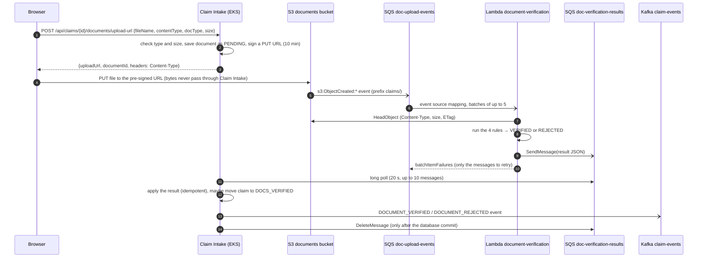

# Document Verification (AWS Lambda)

How claim documents are uploaded, checked and reported back. This covers the serverless part of the platform: what the Lambda does, how Terraform deploys it, and how S3, SQS and the Lambda trigger each other.

| | |
|---|---|
| Code | [backend/functions/document-verification](backend/functions/document-verification) (README with the rule table and the tests) |
| Infrastructure | [infra/terraform/modules/lambda](infra/terraform/modules/lambda), [modules/sqs](infra/terraform/modules/sqs), [modules/s3](infra/terraform/modules/s3), the `lambda` role in [modules/iam](infra/terraform/modules/iam/main.tf) |
| Caller and consumer | Claim Intake: [DocumentService](backend/services/claim-intake/src/main/java/com/claims/intake/service/DocumentService.java), [PresignedUrlService](backend/services/claim-intake/src/main/java/com/claims/intake/storage/PresignedUrlService.java), [VerificationResultListener](backend/services/claim-intake/src/main/java/com/claims/intake/messaging/VerificationResultListener.java) |
| Runtime | Java 21, 512 MB, 60 s timeout, SnapStart, **not** in the VPC |
| Entry point | `com.claims.docverify.Handler::handleRequest` |

---

## 1. The whole flow at a glance



Every arrow after the browser's PUT is **asynchronous**. The browser gets its answer when it next reads the claim's document list. Nothing waits on the Lambda.

---

## 2. Step by step

### Step 1: Claim Intake signs an upload URL

`POST /api/claims/{claimId}/documents/upload-url`, policyholders only. See `DocumentService.createUpload`.

1. It normalises the Content-Type (`application/pdf; charset=binary` → `application/pdf`) and rejects anything other than PDF, JPEG or PNG, or anything over 10 MB. These checks are only an early, friendly error. The Lambda enforces the real ones.
2. It checks that the claim belongs to the caller and still accepts uploads (status `SUBMITTED` or `DOCS_PENDING`).
3. It generates a `documentId` and builds the object key:

   ```
   claims/{claimId}/{docType}/{documentId}-{safeFileName}
   e.g. claims/6f1c…/FINAL_BILL/91ab…-hospital-bill.pdf
   ```

   The key carries everything the Lambda needs, so the Lambda never has to call back to Claim Intake or read its database.
4. It saves a `ClaimDocument` row with status **PENDING**. A new upload of a type that was earlier **REJECTED** supersedes the rejected one.
5. It signs a PUT URL with `S3Presigner`, valid for 10 minutes. Signing is local: no AWS call is made. The Content-Type is part of the signature, so the browser must send exactly that header.

The URL only works because Claim Intake's pod runs with the `claim-intake` **IRSA role**, which allows `s3:PutObject` and `s3:GetObject` on `documents-bucket/claims/*` and nothing else.

### Step 2: The browser uploads straight to S3

`uploadToSignedUrl` in [frontend/src/api/client.js](frontend/src/api/client.js) sends an `XMLHttpRequest` PUT to the signed URL. XHR is used rather than `fetch` so it can show upload progress. No `Authorization` header is sent, because the signature is in the URL.

The bucket's **CORS rule** (`modules/s3`, `aws_s3_bucket_cors_configuration.documents`) allows `PUT` and `GET` only from `frontend_origins` in `dev.tfvars`: the local dev server and the site's ALB address. If the ALB is recreated, its hostname changes, and this list has to be updated or browser uploads fail with a CORS error.

Why upload directly to S3?

- File bytes never pass through a Java pod, so Claim Intake needs no large request buffers, and an upload doesn't use up a service thread.
- S3 absorbs any number of parallel uploads.
- A pre-signed PUT cannot limit the file size, so the size limit is enforced afterwards, by the Lambda.

### Step 3: S3 notifies SQS

```hcl
# modules/s3/main.tf
resource "aws_s3_bucket_notification" "documents" {
  queue {
    queue_arn     = var.upload_events_queue_arn
    events        = ["s3:ObjectCreated:*"]
    filter_prefix = "claims/"
  }
}
```

Every new object under `claims/` produces an S3 event notification, a JSON document with `Records[].s3.bucket.name` and `Records[].s3.object.key`. The notification goes into the SQS queue `claims-dev-doc-upload-events`.

S3 can only write to that queue because of the **queue policy** in `modules/sqs`. It allows the `s3.amazonaws.com` service principal to `sqs:SendMessage`, but only when `aws:SourceArn` is the documents bucket and `aws:SourceAccount` is this account. Another bucket, or another account, can't inject messages.

### Step 4: SQS triggers the Lambda

```hcl
# modules/lambda/main.tf
resource "aws_lambda_event_source_mapping" "uploads" {
  event_source_arn                   = var.upload_events_queue_arn
  function_name                      = aws_lambda_alias.live.arn
  batch_size                         = 5
  maximum_batching_window_in_seconds = 1
  function_response_types            = ["ReportBatchItemFailures"]
}
```

The **event source mapping** is a poller that AWS runs for you. It long-polls the queue, gathers up to 5 messages (or waits at most 1 second), and invokes the function once with that batch as an `SQSEvent`. While the function runs, those messages are invisible to other consumers. On success, the mapping deletes them.

Why put a queue between S3 and the Lambda, when S3 can invoke a Lambda directly?

| With the queue | Directly from S3 |
|---|---|
| Messages wait safely (4 days) if the Lambda is failing or throttled | S3 retries a failing async invoke twice, then the event is lost unless a destination is set |
| Batching: one invocation handles up to 5 uploads | one invocation per object |
| Retries *per message* (`ReportBatchItemFailures`), then a **dead-letter queue** to inspect | coarser retry control |
| Lambda concurrency is smoothed when many uploads arrive at once | each upload is its own invocation |

### Step 5: The Lambda verifies the document

See [Handler.java](backend/functions/document-verification/src/main/java/com/claims/docverify/Handler.java). For each message, and each created object in it:

1. **Parse** the S3 event (`S3EventParser`). URL-encoded keys are decoded. `ObjectRemoved` events and the `s3:TestEvent` S3 sends when the notification is created are skipped.
2. **Filter.** Events for another bucket (when `DOCUMENTS_BUCKET` is set), and keys with no document ID, are logged as `IGNORED`.
3. **`HeadObject`** reads the stored Content-Type, size and ETag. The file itself is never downloaded, which keeps the function fast and cheap.
4. **Run every rule** (`DocumentValidator`), and list all the failures in `reason`:

   | Rule | Rejects when |
   |---|---|
   | `KeyFormatRule` | the key isn't `claims/{uuid}/{docType}/{uuid}-{name}`, or `docType` isn't DISCHARGE_SUMMARY, FINAL_BILL, PRESCRIPTION, LAB_REPORT or ID_PROOF |
   | `NonEmptyRule` | the size is 0 |
   | `SizeRule` | the size is above `MAX_SIZE_MB` (10) |
   | `ContentTypeRule` | the Content-Type isn't allowed, or the file extension doesn't match an allowed type. This catches `setup.exe` uploaded with a signed `application/pdf` |

5. **Publish** the result to `claims-dev-doc-verification-results` (`ResultPublisher`):

   ```json
   {"claimId":"…","documentId":"…","docType":"FINAL_BILL","status":"VERIFIED","reason":null,
    "checkedAt":"2026-11-18T10:00:01Z","s3Key":"claims/…/FINAL_BILL/…-bill.pdf","checksum":"etag:9b2c…"}
   ```

6. **Log** one JSON line per document (`status` is VERIFIED, REJECTED, RETRY, DROPPED or IGNORED), which CloudWatch Logs Insights can filter on.

A failed rule is a **REJECTED result**, not an error. The policyholder sees the reason and can upload again.

### Step 6: Claim Intake applies the result

`VerificationResultListener` runs on its own thread inside Claim Intake. It long-polls the results queue (20 s wait, up to 10 messages), and for each message it does this:

1. `DocumentService.applyResult` runs in one database transaction:
   - The document is PENDING: it records VERIFIED or REJECTED, the reason and the checksum. Outcome `APPLIED`.
   - The document already has the same result: nothing changes. Outcome `DUPLICATE`, so redelivered messages are harmless.
   - The document already has a different result: the new one is ignored, with a warning.
   - It emits a `DOCUMENT_VERIFIED` or `DOCUMENT_REJECTED` event to the Kafka topic `claim-events`, which feeds the audit trail.
   - If every required type (DISCHARGE_SUMMARY, FINAL_BILL, PRESCRIPTION, ID_PROOF) now has a current VERIFIED document, the claim moves from `DOCS_PENDING` to **`DOCS_VERIFIED`**.
2. **After the commit**, the workflow orchestrator starts the eligibility and assessment checks over gRPC.
3. Only then does it **delete the message**. If anything failed, the message stays on the queue and comes back after the visibility timeout.

---

## 3. Failure handling

| What happens | Result |
|---|---|
| A rule fails | REJECTED result: a normal outcome |
| The object is gone (`HeadObject` 404) | REJECTED: "The uploaded file no longer exists" |
| S3 or SQS throttling, a 5xx error or a network error | The message is added to `batchItemFailures`, so **only that message** is retried. The others in the batch succeed |
| S3 answers 403 | Retried. The role has no `s3:ListBucket`, so S3 reports a missing object as 403 rather than 404 |
| A message fails 3 times (`maxReceiveCount = 3`) | SQS moves it to **`doc-upload-events-dlq`**, kept for 14 days for inspection |
| The body isn't an S3 event | Logged as DROPPED and not retried, because a retry can't fix it |
| Claim Intake can't apply a result (unknown document, bad JSON) | Not deleted. After 3 receives it moves to **`doc-verification-results-dlq`** |
| Claim Intake is down | Results wait in the queue (4 days) and are applied when it comes back |

**Visibility timeout = 6 × Lambda timeout (360 s).** AWS recommends this for SQS-triggered functions. A message stays hidden long enough that it isn't redelivered while a slow invocation, plus its retries inside the batch window, is still working on it.

**At-least-once, made safe.** SQS can deliver a message more than once, and a retried message can resend results for objects that already succeeded. Both are fine, because Claim Intake applies results idempotently on the document ID.

---

## 4. How the Lambda is built and deployed

### The jar

```bash
cd backend
mvn -pl functions/document-verification -am package
# → backend/functions/document-verification/target/document-verification.jar  (about 12 MB)
```

`pom.xml` sets `<finalName>document-verification</finalName>` and uses the **Maven Shade plugin**, which builds one self-contained ("fat") jar holding the handler and all its dependencies (AWS SDK v2 for S3 and SQS with the lightweight URL-connection HTTP client, Jackson, `aws-lambda-java-events`). It excludes signature files and `module-info.class`, and merges the `META-INF/services` files so the SDK's service loaders still work. There is no Spring, so the jar stays small and the function starts fast.

In CI, the `lambda-jar` job in [.github/workflows/deliver.yml](.github/workflows/deliver.yml) builds the same jar and keeps it as a workflow artifact.

### How the jar reaches AWS

The jar is **not** uploaded to an S3 bucket. Terraform sends the file straight to the Lambda API as part of `CreateFunction` / `UpdateFunctionCode`:

```hcl
# modules/lambda/main.tf
resource "aws_lambda_function" "this" {
  filename         = var.jar_path                      # ../../../backend/functions/document-verification/target/document-verification.jar
  source_code_hash = filebase64sha256(var.jar_path)    # a new hash means a new deployment
  runtime          = "java21"
  handler          = "com.claims.docverify.Handler::handleRequest"
  publish          = true                              # every code change publishes a new version
  snap_start { apply_on = "PublishedVersions" }
  environment { variables = { RESULTS_QUEUE_URL, DOCUMENTS_BUCKET, ALLOWED_TYPES, MAX_SIZE_MB } }
  lifecycle {
    precondition { condition = fileexists(var.jar_path) ... }   # clear error if the jar isn't built
  }
}
```

- **`source_code_hash`** is how Terraform notices new code. If the jar's SHA-256 changes, the next `apply` uploads it. If it doesn't, nothing happens.
- A direct upload is limited to 50 MB (zipped). At about 12 MB the jar fits comfortably. A much larger artifact would have to be put in the `artifacts` bucket and referenced with `s3_bucket` / `s3_key` instead.
- The **precondition** stops the plan with build instructions when the jar is missing, so nobody deploys an empty function by accident.

To deploy new Lambda code: rebuild the jar, then run `terraform apply -var-file=dev.tfvars` in `infra/terraform/infra`. Argo CD isn't involved, because the Lambda isn't a Kubernetes workload.

### Versions, the `live` alias and SnapStart

```hcl
resource "aws_lambda_alias" "live" {
  function_version = aws_lambda_function.this.version
}
resource "aws_lambda_event_source_mapping" "uploads" {
  function_name = aws_lambda_alias.live.arn
}
```

1. `publish = true` makes each code change a new, immutable **version** (1, 2, 3…).
2. **SnapStart** works on published versions only. When a version is published, Lambda runs the function's initialisation once, takes a snapshot of the memory, and later starts new instances by restoring that snapshot instead of starting the JVM again.
3. The SQS trigger points at the **`live` alias**, not at `$LATEST`. When Terraform moves the alias to the new version, the switch is atomic. No message is ever handled half by old code and half by new.

The handler is written for SnapStart. The S3 and SQS clients, the parser, the rules and the Jackson mapper are all built in the constructor. `prime()` also runs one in-memory parse, validate and serialise, so class loading and Jackson's set-up are captured in the snapshot.

### Why not in the VPC

The function only calls the public S3 and SQS endpoints. Leaving it out of the VPC avoids network-interface (ENI) set-up on cold start, and keeps its traffic off the NAT gateway, which charges per GB.

### Permissions (least privilege)

The Lambda role (`aws_iam_role.lambda` in `modules/iam`) allows exactly:

| Permission | On |
|---|---|
| `s3:GetObject`, `GetObjectVersion`, `GetObjectTagging` | `documents-bucket/*` (`HeadObject` needs `GetObject`) |
| `sqs:ReceiveMessage`, `DeleteMessage`, `GetQueueAttributes`, `ChangeMessageVisibility` | the upload queue (used by the event source mapping) |
| `sqs:SendMessage`, `GetQueueUrl` | the results queue |
| `logs:CreateLogStream`, `PutLogEvents` | its own log group, `/aws/lambda/<function>` |

The log group is created by Terraform with 7-day retention, so `terraform destroy` removes it too.

---

## 5. Resources involved

| Resource | Name (dev) | Defined in |
|---|---|---|
| S3 bucket (versioned, encrypted, private, CORS) | `claims-dev-documents-<account_id>` | `modules/s3` |
| S3 event notification (`ObjectCreated`, prefix `claims/`) | | `modules/s3` |
| SQS upload queue + DLQ | `claims-dev-doc-upload-events`, `…-dlq` | `modules/sqs` |
| SQS results queue + DLQ (20 s long polling) | `claims-dev-doc-verification-results`, `…-dlq` | `modules/sqs` |
| Queue policy (only the documents bucket may send) | | `modules/sqs` |
| Lambda function, `live` alias, event source mapping | `claims-dev-document-verification` | `modules/lambda` |
| CloudWatch log group (7 days) | `/aws/lambda/claims-dev-document-verification` | `modules/lambda` |
| IAM roles: Lambda, and claim-intake IRSA | | `modules/iam` |
| `DOCUMENTS_BUCKET` and `RESULTS_QUEUE_URL` for the pods | ConfigMap `platform-endpoints` | `platform/secrets.tf` |

### Check it on AWS

```bash
aws lambda get-alias --function-name claims-dev-document-verification --name live
aws lambda list-event-source-mappings --function-name claims-dev-document-verification \
  --query 'EventSourceMappings[].[State,BatchSize]'
aws sqs get-queue-attributes --queue-url <url> --attribute-names ApproximateNumberOfMessages   # one queue, or its DLQ
MSYS_NO_PATHCONV=1 aws logs tail /aws/lambda/claims-dev-document-verification --follow        # one JSON line per document
```

Grafana's "Claims platform" dashboard also shows the SQS depths and the Lambda's invocations, errors and duration, from CloudWatch.
