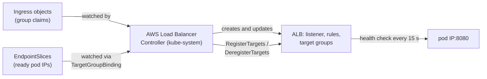

# Load testing and autoscaling

How to run the load test against the deployed platform, read its HTML report, and understand what happens when traffic grows: how the AWS load balancer is set up, what makes Kubernetes add pods, how fast that happens, and how the load balancer starts sending traffic to the new pods.

The test itself is described in detail in [loadtest/README.md](loadtest/README.md). Past results are listed in [loadtest/reports/README.md](loadtest/reports/README.md).

---

## 1. Run the load test

### What you need

| Tool | Check | Why |
|---|---|---|
| **k6** | `k6 version` | generates the load ([install](https://grafana.com/docs/k6/latest/set-up/install-k6/)) |
| **Node.js 20+** | `node --version` | builds the report |
| **kubectl** connected to the cluster | `kubectl -n claims get hpa` | records the autoscalers during the run (optional, but without it the report has no autoscaling section) |
| **Git Bash** (on Windows) | | `run.sh` is a bash script |

Connect kubectl once with `aws eks update-kubeconfig --name claims-dev --region ap-south-1`.

### Find the website address

```bash
kubectl -n claims get ingress frontend -o jsonpath='{.status.loadBalancer.ingress[0].hostname}'; echo
# k8s-claims-8285bb1f19-797935702.ap-south-1.elb.amazonaws.com   (changes if the ALB is ever recreated)
```

### Start it

Run from the repository root, in Git Bash:

```bash
BASE_URL=http://k8s-claims-8285bb1f19-797935702.ap-south-1.elb.amazonaws.com \
PROFILE=stress WRITES=false ./loadtest/run.sh
```

| Setting | Values | Default |
|---|---|---|
| `PROFILE` | `smoke`: 1 min, 2 users + 1 sign-in/s, to check that everything works · `load`: 10 min, up to 40 users + 5 sign-ins/s · `stress`: 10 min, up to 150 users + 15 sign-ins/s, which **makes the autoscalers add pods** | `smoke` |
| `WRITES` | `true` files a claim in 1 of 10 policyholder visits · `false` is read-only | `true` |
| `WATCH_HPA` | `auto` / `true` / `false`: record the autoscalers every 10 s | `auto` |
| `KEEP_RAW` | `true` keeps the raw k6 samples in `loadtest/results/` | `false` |

Use `WRITES=false` against the shared dev environment. With writes on, a stress run files hundreds of claims. They clutter the adjuster's claim list, and the fraud detector flags them, since more than 2 claims on one policy within 10 minutes counts as fraud.

What the script does:

1. Starts recording every autoscaler (HPA) in the `claims` namespace every 10 seconds.
2. Runs k6 with three kinds of virtual users at once:
   - **policyholders** (70%): read their policy, coverage and claims;
   - **adjusters** (30%): read the queue and search claims;
   - **sign-ins**: a steady rate of password checks, which are CPU-heavy.
3. Keeps recording for 60 seconds after the load stops, so the report shows the scale-in starting.
4. Builds the report and copies the HTML version to the repository root.

### Watch it live (optional, in a second terminal)

```bash
kubectl -n claims get hpa -w                 # pods and CPU per service, as the autoscalers see them
kubectl -n claims get pods -w                # new pods being created and becoming Ready
```

Grafana's **Claims platform** dashboard shows the same, plus request rate and latency per service: rows *Overview*, *Services: REST* and *Kubernetes cluster health*, with the *HPA current vs desired* panel. See [cloudwatch.md](cloudwatch.md).

### Open the HTML report

| File | What it is |
|---|---|
| **`load-test-report.html`** (repository root) | the newest run's report, a single self-contained page. Double-click it, or `start load-test-report.html` |
| `loadtest/reports/<date>-<profile>/report.html` | the same page, kept for each run |
| `loadtest/reports/<date>-<profile>/report.md` | the same content as Markdown with Mermaid charts (GitHub and VS Code draw them) |
| `loadtest/reports/<date>-<profile>/summary.json`, `hpa.csv` | k6's own summary, and the raw autoscaler recording |
| `loadtest/reports/README.md` | one row per run: requests, p95, failures, which services scaled out, verdict |

The report contains:
- **the verdict**: under 1% failed requests, 95% of requests within 1 s (sign-in within 1.5 s), and over 99% of checks passed;
- graphs over time of users, requests per second, p95 latency and failures;
- a table per endpoint;
- **an autoscaling section**, with pods and CPU for each service that scaled out.

k6 exits with code 99 if a threshold fails, and the report is still written.

---

## 2. The load balancer (ALB) configuration

### One ALB for the whole site

All public traffic enters through **one internet-facing Application Load Balancer**. Nobody creates it by hand, and Terraform doesn't create it either. The **AWS Load Balancer Controller** (installed by `infra/terraform/platform/alb-controller.tf`) creates and updates it from the Kubernetes Ingress objects in `k8s/base/*/ingress.yaml`:

```yaml
annotations:
  alb.ingress.kubernetes.io/group.name: claims            # every service's Ingress joins ONE ALB
  alb.ingress.kubernetes.io/group.order: "10"             # rule priority inside that ALB
  alb.ingress.kubernetes.io/scheme: internet-facing
  alb.ingress.kubernetes.io/target-type: ip               # send traffic straight to pod IPs
  alb.ingress.kubernetes.io/listen-ports: '[{"HTTP": 80}]'
  alb.ingress.kubernetes.io/healthcheck-path: /actuator/health/readiness
```

Because every Ingress has `group.name: claims`, the controller **merges** them: one ALB, one HTTP listener on port 80, and one routing rule plus target group per service.

| Path | Target group → Service | Health check path |
|---|---|---|
| `/api/auth` | login | `/actuator/health/readiness` |
| `/api/policies` | policy | `/actuator/health/readiness` |
| `/api/claims` | claim-intake | `/actuator/health/readiness` |
| `/api/eligibility` | eligibility | `/actuator/health/readiness` |
| `/api/assessments` | assessment | `/actuator/health/readiness` |
| `/api/approvals` | approval | `/actuator/health/readiness` |
| `/api/audit`, `/api/analytics`, `/api/ops` | ops-dashboard | `/actuator/health/readiness` |
| `/` (everything else) | frontend (nginx) | `/` |

Argo CD and Grafana each have their **own** ALB, created by the platform stack, with IP allow-lists (`ingress_allowed_cidrs`, `grafana_allowed_cidrs`).

### Settings in effect (read from AWS)

| Setting | Value | What it means |
|---|---|---|
| Type / scheme | Application LB, internet-facing, IPv4 | layer-7 HTTP routing from the internet |
| Availability zones | ap-south-1a, ap-south-1b | one node of the cluster in each |
| Cross-zone load balancing | **on** | either zone's ALB node can send to a pod in either zone |
| Listener | HTTP :80 only | no TLS in dev (would need an ACM certificate and a hostname) |
| HTTP/2 | on (client side) | |
| Idle timeout | 60 s | |
| **Target type** | **`ip`** | the ALB sends to **pod IPs** directly (VPC CNI), not to node ports. A new pod is a new target; no kube-proxy hop |
| **Algorithm** | **round robin** | requests rotate evenly across the healthy targets |
| Stickiness | off | any request can go to any pod. The services are stateless (JWT auth) |
| **Health check** | `GET /actuator/health/readiness` every **15 s**, timeout 5 s, **2** passes = healthy, **2** failures = unhealthy | a pod receives traffic only when Spring reports it ready |
| Slow start | 0 s | a new target gets its full share at once |
| **Deregistration delay** | **300 s** | a removed pod gets no new requests, and in-flight requests have up to 5 minutes to finish |

**The ALB itself scales automatically.** AWS adds capacity to the load balancer as traffic grows (it is billed in LCUs). There is nothing to configure, and the stress test is far below its limits. What *we* scale is the **pods behind it**.

### How the ALB learns about pods



For each service, the controller keeps a **TargetGroupBinding** (`kubectl -n claims get targetgroupbindings`). It watches the Service's EndpointSlices. When a pod becomes **Ready**, its IP appears there and the controller registers it in the target group. When a pod is removed, the controller deregisters it, and the deregistration delay starts.

---

## 3. Autoscaling: what triggers it, and how fast

### The trigger: CPU above 70% of the request

Every service has a **HorizontalPodAutoscaler** (`k8s/base/<service>/hpa.yaml`):

```yaml
metrics:
  - type: Resource
    resource: { name: cpu, target: { type: Utilization, averageUtilization: 70 } }
```

"Utilization" is measured against the pod's **CPU request**, not its limit. The services request `200m` (0.2 vCPU) and may use up to `1` vCPU. So a pod using 140m is at 70%, and a pod using a full vCPU is at 500%.

| | dev (`k8s/overlays/dev`) | prod (`k8s/overlays/prod`) |
|---|---|---|
| login, claim-intake, policy, eligibility, assessment, payment, gateway-simulator, ops-dashboard, frontend | **1 – 2 pods** | 2 – 6 pods |
| approval (the 3PC coordinator) | exactly 1 | exactly 1 |

Approval never scales: two coordinators would each run their own three-phase commits.

### The rate: how the numbers are computed

1. **metrics-server** (installed by the platform stack) reads every pod's CPU from the kubelets about every **15 s**.
2. The **HPA controller** re-evaluates every **15 s**:

   ```
   desired pods = ceil( current pods × current CPU% / 70% )        capped at maxReplicas
   ```

   It does nothing while the ratio is within **10%** of the target.
3. **Scale-up is immediate.** The HPAs use Kubernetes' default `behavior`: no stabilization window, and at most +100% of the pods (or +4 pods) per 15 s.
4. **Scale-down is cautious.** The default **5-minute stabilization window** means a pod is removed only after 5 minutes in which the recommendation stayed lower. This stops flapping when load is spiky.

### From "CPU is high" to "the ALB sends traffic to the new pod"

```
  t ≈ 0 s         CPU crosses 70 %
  ≤ 15 s          metrics-server sample + HPA evaluation → desiredReplicas = 2
  + ~1 s          Deployment creates the pod; the scheduler places it (on the other node, preferably)
  + ~25–35 s      JVM and Spring start; startupProbe (every 5 s) passes, then readinessProbe (every 10 s) passes
  + ~1 s          pod is Ready → its IP appears in the EndpointSlice → controller registers it in the target group
  + 15–30 s       ALB health checks: 2 consecutive passes, 15 s apart → target "healthy" → round robin includes it
  ─────────────
  ≈ 1–1.5 min     from overload to the new pod serving traffic
```

Scale-in runs in reverse. After 5 minutes of low CPU, the HPA lowers the pod count. The pod is deregistered and stops receiving new requests, and Kubernetes stops it after its 30 s grace period.

### Limits to keep in mind

- **Nodes don't autoscale.** The cluster has a fixed 2 × `t3.large` (min = max = 2, held by the 8-vCPU account quota; see [capacity.md](capacity.md)). Pods can only scale while the nodes have **unrequested** CPU. At the time of this run, about 1.4 vCPU was free across both nodes: room for about 7 more pods at 200m each, which is enough for every scaled service to reach its dev maximum of 2.
- **The dev maximum is 2.** Under the stress profile, the busiest services hit that cap within a minute and then simply ran hotter. They stayed fast, because each pod may burst to a full vCPU.

---

## 4. Verified run: stress, 27 Nov 2026

Profile `stress`, read-only, against the dev ALB. The report is [loadtest/reports/2026-11-27-132326-stress](loadtest/reports/2026-11-27-132326-stress/report.md), and the HTML is at `load-test-report.html`.

| | |
|---|---|
| Requests | **97,059** in 10 min (162/s on average), up to 165 concurrent virtual users |
| Failed | **0 (0%)** |
| Latency | median 75 ms · **p95 188 ms** · p99 299 ms |
| Verdict | ✅ all four thresholds passed |

### The autoscalers

| Service | Pods | Peak CPU (% of request) | Timeline (from the start of the run) |
|---|---|---|---|
| **login** (password hashing) | 1 → **2** | 395% | +0:57 wants 2 at 114% · +1:08 running 2 |
| **claim-intake** | 1 → **2** | 220% | +0:57 wants 2 at 107% · +1:08 running 2 |
| **policy** | 1 → **2** | 181% | +1:19 wants 2 at 100% · +1:42 running 2 |
| approval, assessment, eligibility, payment, gateway-simulator, ops-dashboard, frontend | 1 | ≤ 11% | not loaded by this test, and correctly did not scale |

### The ALB (CloudWatch, `AWS/ApplicationELB`, 1-minute data)

| Target group | `HealthyHostCount` | `RequestCountPerTarget` (per minute) |
|---|---|---|
| login | **1 → 2 at +1 min**, 2 until the end | 461 → 1,239 at the peak, then 0 |
| claim-intake | **1 → 2 at +1 min** | 1,728 → 4,821 at the peak |
| policy | **1 → 2 at +1 min** | 882 → 2,443 at the peak |

So the chain worked end to end:
1. CPU crossed 70%.
2. Within the next 15-second evaluation, the HPA asked for a second pod.
3. The pod was Ready about 11–23 seconds later.
4. The load balancer controller registered its IP, and it passed the ALB health checks within the same minute.
5. Round robin then split the requests across both pods.

No request failed during any of the scale-outs.

**Scale-in.** All three returned to 1 pod about 5 minutes after the load dropped. That is the default stabilization window, and the HPA events read `New size: 1; reason: All metrics below target`: policy first, then claim-intake, then login, about a minute apart.

### Reading this

- **The autoscaling works, and quickly:** about 1 minute from overload to an extra serving pod.
- **In dev, it reaches its ceiling straight away.** login stayed at about 4× its CPU request even with 2 pods. To absorb more, raise `maxReplicas` in `k8s/overlays/dev/kustomization.yaml`. Each extra pod needs 200m of free node CPU: about 7 more fit today. Beyond that, a third node (and a higher vCPU quota) would be needed.
- **The ALB was never the bottleneck.** No 5xx responses, and latency stayed flat while pods were added.

---

## 5. Checking it yourself without a full run

```bash
kubectl -n claims get hpa                                   # TARGETS = current CPU % / 70 %, REPLICAS
kubectl -n claims describe hpa login | sed -n '/Events/,$p' # "New size: 2; reason: cpu resource utilization above target"
kubectl -n claims get targetgroupbindings                   # one per service, target type ip
kubectl get --raw /apis/metrics.k8s.io/v1beta1/namespaces/claims/pods | head   # metrics-server is answering

# target health as the ALB sees it (pick a target group from the list)
aws elbv2 describe-target-groups --query "TargetGroups[?starts_with(TargetGroupName,'k8s-claims')].TargetGroupName" --output text
aws elbv2 describe-target-health --target-group-arn "$(aws elbv2 describe-target-groups --names k8s-claims-login-53bf4659ea \
  --query 'TargetGroups[0].TargetGroupArn' --output text | tr -d '\r')"
```

On Windows, `tr -d '\r'` is there because the AWS CLI's text output ends in CRLF, and a trailing `\r` makes an ARN invalid. The target group name suffixes change if the ALB is recreated.
