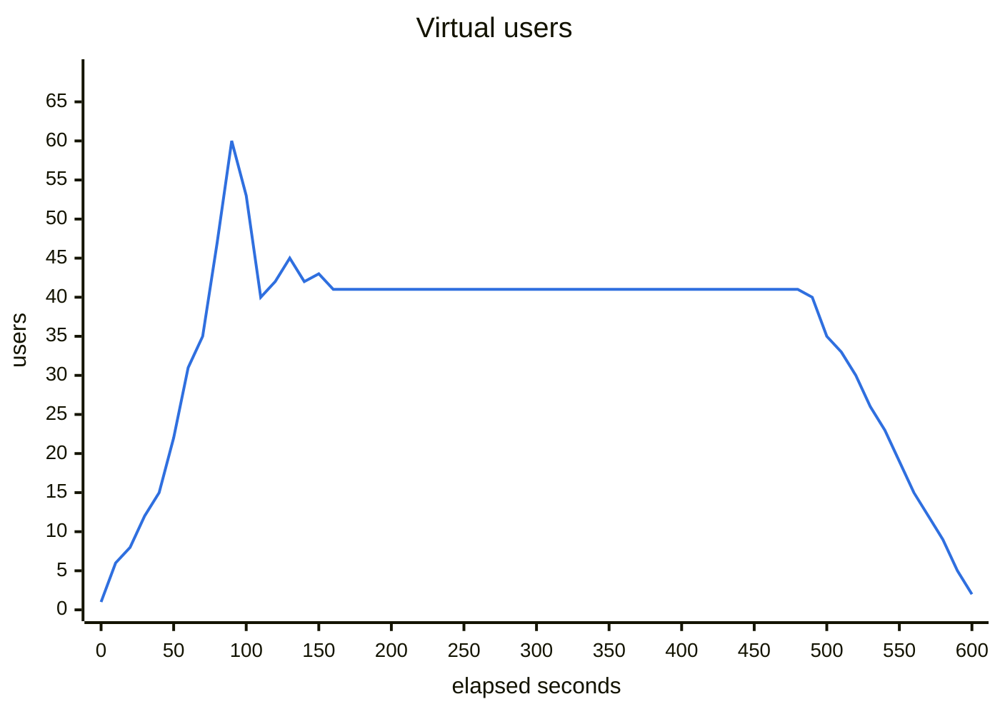
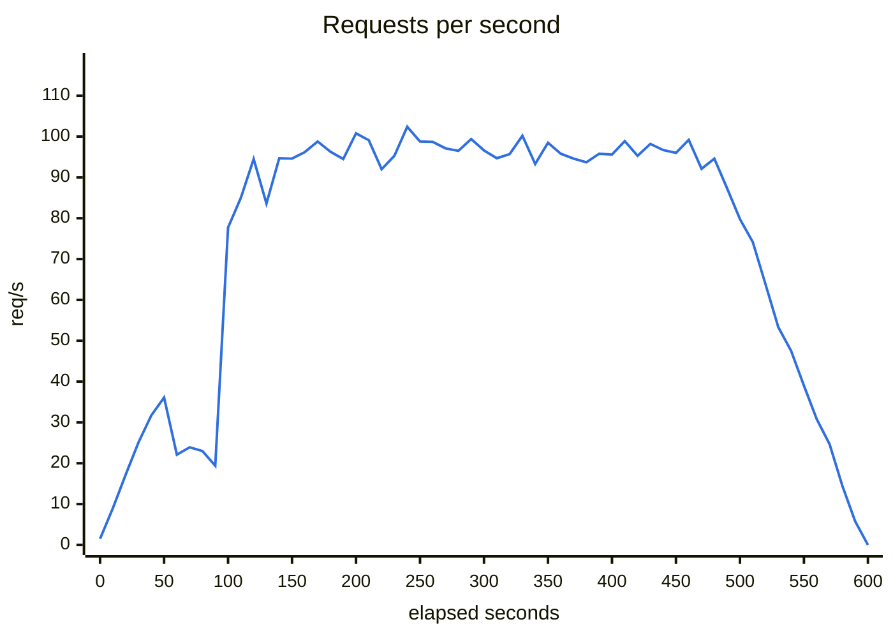
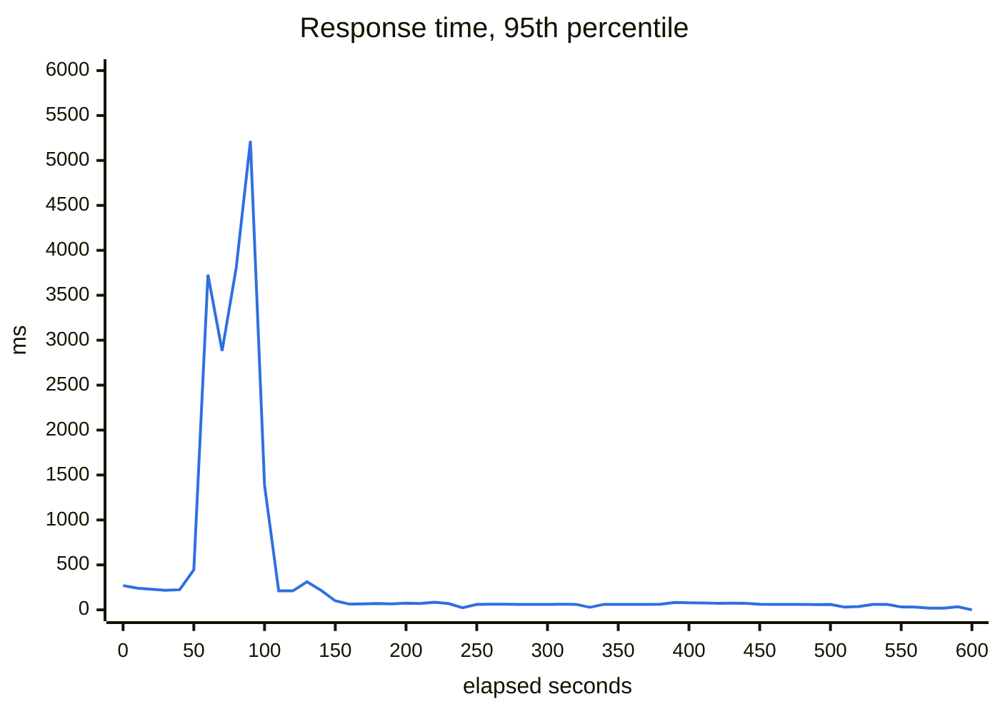
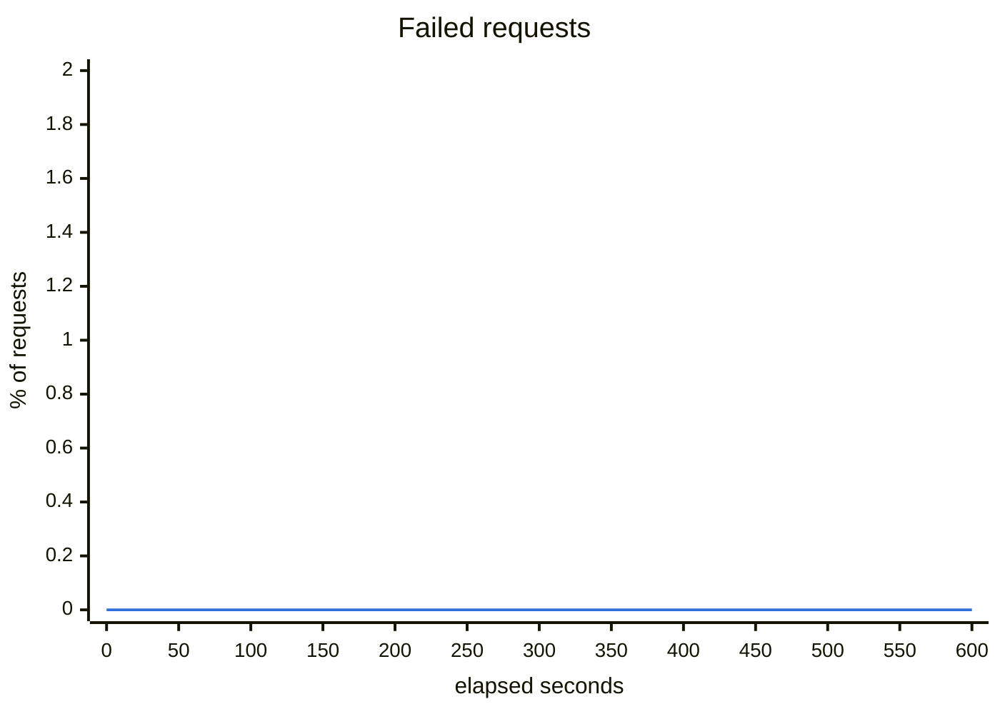
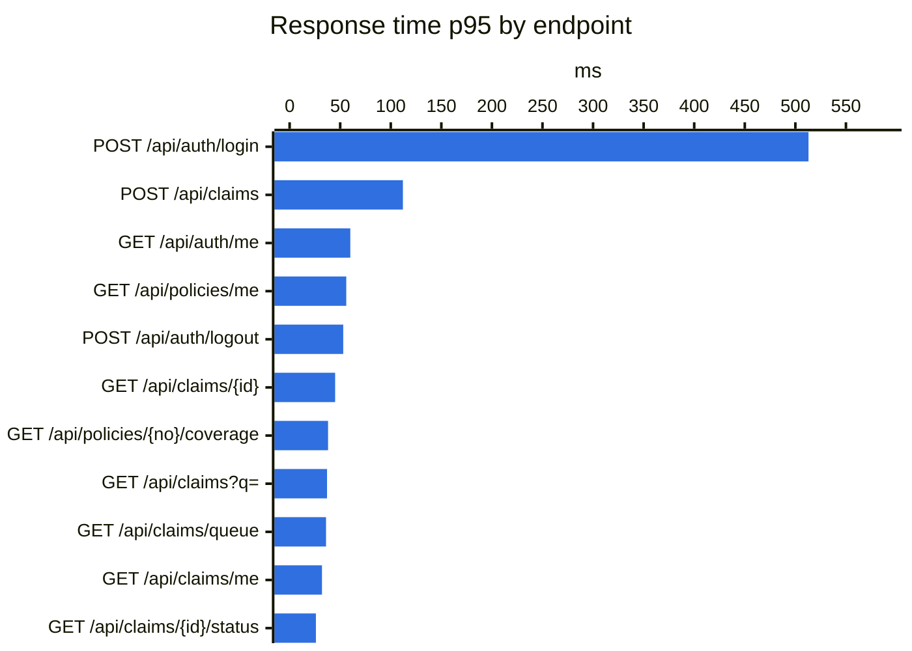

# Load test report

| | |
| --- | --- |
| **Started** | 2026-11-19 05:18:36 UTC |
| **Target** | `http://127.0.0.1:5174` |
| **Profile** | `load` |
| **Duration** | 10 min 1 s |
| **Requests** | 44,512 (74.1 per second on average) |
| **Failed** | 0 (0 %) |
| **Latency** | median 8 ms · p95 84 ms · p99 951 ms |
| **Verdict** | ✅ all thresholds passed |

| Metric | Threshold | Result |
| --- | --- | --- |
| `checks` | `rate>0.99` | ✅ pass |
| `http_req_duration` | `p(95)<1000` | ✅ pass |
| `http_req_duration{name:POST /api/auth/login}` | `p(95)<1500` | ✅ pass |
| `http_req_failed` | `rate<0.01` | ✅ pass |

> **Note:** a local run. All nine services, the Vite proxy and k6 shared one Windows laptop, so there are no HPAs.
> The p95 spike between 50 s and 100 s is the services warming up (JIT compilation and connection pools filling)
> while the users ramped up; after that, p95 stays under about 100 ms.

## Load over time

Data for these charts (one row per 10 s)

| Elapsed s | Users | Req/s | p95 ms | Failed % |
| --- | --- | --- | --- | --- |
| 0 | 1 | 1.5 | 270 | 0 |
| 10 | 6 | 9 | 241 | 0 |
| 20 | 8 | 17.2 | 230 | 0 |
| 30 | 12 | 25.1 | 218 | 0 |
| 40 | 15 | 31.7 | 224 | 0 |
| 50 | 22 | 36.1 | 445 | 0 |
| 60 | 31 | 22.1 | 3729 | 0 |
| 70 | 35 | 23.9 | 2881 | 0 |
| 80 | 47 | 23 | 3808 | 0 |
| 90 | 60 | 19.4 | 5217 | 0 |
| 100 | 53 | 77.7 | 1386 | 0 |
| 110 | 40 | 85 | 211 | 0 |
| 120 | 42 | 94.5 | 211 | 0 |
| 130 | 45 | 83.6 | 313 | 0 |
| 140 | 42 | 94.7 | 216 | 0 |
| 150 | 43 | 94.6 | 100 | 0 |
| 160 | 41 | 96.2 | 64 | 0 |
| 170 | 41 | 98.8 | 66 | 0 |
| 180 | 41 | 96.3 | 70 | 0 |
| 190 | 41 | 94.5 | 67 | 0 |
| 200 | 41 | 100.8 | 75 | 0 |
| 210 | 41 | 99.1 | 70 | 0 |
| 220 | 41 | 92 | 85 | 0 |
| 230 | 41 | 95.3 | 70 | 0 |
| 240 | 41 | 102.4 | 24 | 0 |
| 250 | 41 | 98.8 | 60 | 0 |
| 260 | 41 | 98.7 | 62 | 0 |
| 270 | 41 | 97.1 | 62 | 0 |
| 280 | 41 | 96.5 | 61 | 0 |
| 290 | 41 | 99.4 | 60 | 0 |
| 300 | 41 | 96.6 | 61 | 0 |
| 310 | 41 | 94.7 | 62 | 0 |
| 320 | 41 | 95.7 | 61 | 0 |
| 330 | 41 | 100.2 | 28 | 0 |
| 340 | 41 | 93.3 | 61 | 0 |
| 350 | 41 | 98.5 | 60 | 0 |
| 360 | 41 | 95.8 | 61 | 0 |
| 370 | 41 | 94.6 | 61 | 0 |
| 380 | 41 | 93.7 | 62 | 0 |
| 390 | 41 | 95.8 | 82 | 0 |
| 400 | 41 | 95.6 | 78 | 0 |
| 410 | 41 | 98.9 | 76 | 0 |
| 420 | 41 | 95.3 | 73 | 0 |
| 430 | 41 | 98.2 | 74 | 0 |
| 440 | 41 | 96.7 | 72 | 0 |
| 450 | 41 | 96 | 63 | 0 |
| 460 | 41 | 99.2 | 60 | 0 |
| 470 | 41 | 92.1 | 61 | 0 |
| 480 | 41 | 94.6 | 60 | 0 |
| 490 | 40 | 87.3 | 59 | 0 |
| 500 | 35 | 79.8 | 60 | 0 |
| 510 | 33 | 74.2 | 30 | 0 |
| 520 | 30 | 63.8 | 37 | 0 |
| 530 | 26 | 53.3 | 61 | 0 |
| 540 | 23 | 47.5 | 61 | 0 |
| 550 | 19 | 39 | 32 | 0 |
| 560 | 15 | 30.8 | 30 | 0 |
| 570 | 12 | 24.7 | 19 | 0 |
| 580 | 9 | 14.5 | 19 | 0 |
| 590 | 5 | 5.8 | 34 | 0 |
| 600 | 2 | 0 | 0 | 0 |

## By endpoint

| Endpoint | Requests | Req/s | Avg ms | p50 | p95 | p99 | Max | Failed % | Status codes |
| --- | --- | --- | --- | --- | --- | --- | --- | --- | --- |
| `GET /api/policies/me` | 6246 | 10.4 | 36 | 11 | 56 | 560 | 4242 | 0 | 200×6246 |
| `GET /api/policies/{no}/coverage` | 6246 | 10.4 | 24 | 7 | 38 | 427 | 3482 | 0 | 200×6246 |
| `GET /api/claims/me` | 6246 | 10.4 | 30 | 10 | 32 | 367 | 4543 | 0 | 200×6246 |
| `GET /api/claims/{id}` | 6246 | 10.4 | 36 | 8 | 45 | 505 | 4813 | 0 | 200×6246 |
| `GET /api/claims/{id}/status` | 6246 | 10.4 | 24 | 5 | 26 | 419 | 4353 | 0 | 200×6246 |
| `GET /api/claims/queue` | 2765 | 4.6 | 40 | 6 | 36 | 1289 | 4001 | 0 | 200×2765 |
| `GET /api/claims?q=` | 2765 | 4.6 | 36 | 6 | 37 | 917 | 3951 | 0 | 200×2765 |
| `POST /api/auth/login` | 2375 | 4 | 248 | 79 | 513 | 4575 | 6133 | 0 | 200×2375 |
| `GET /api/auth/me` | 2375 | 4 | 46 | 5 | 60 | 1382 | 3334 | 0 | 200×2375 |
| `POST /api/auth/logout` | 2375 | 4 | 42 | 5 | 53 | 1367 | 4043 | 0 | 204×2375 |
| `POST /api/claims` | 627 | 1 | 41 | 23 | 112 | 222 | 814 | 0 | 201×627 |

## Autoscaling (HPA)

_Not recorded: this run was not against Kubernetes (no `kubectl` context), so there are no HPAs to watch._

---
_Generated by `loadtest/scripts/report.mjs` from the k6 results. The k6 summary (`summary.json`) are stored next to this file._
