# Load test report

| | |
| --- | --- |
| **Started** | 2026-11-27 07:53:28 UTC |
| **Target** | `http://k8s-claims-8285bb1f19-797935702.ap-south-1.elb.amazonaws.com` |
| **Profile** | `stress` (read-only) |
| **Duration** | 10 min 0 s |
| **Requests** | 97,059 (161.8 per second on average) |
| **Failed** | 0 (0 %) |
| **Latency** | median 75 ms · p95 188 ms · p99 299 ms |
| **Verdict** | ✅ all thresholds passed |

| Metric | Threshold | Result |
| --- | --- | --- |
| `http_req_duration` | `p(95)<1000` | ✅ pass |
| `http_req_duration{name:POST /api/auth/login}` | `p(95)<1500` | ✅ pass |
| `http_req_failed` | `rate<0.01` | ✅ pass |
| `checks` | `rate>0.99` | ✅ pass |

## Load over time

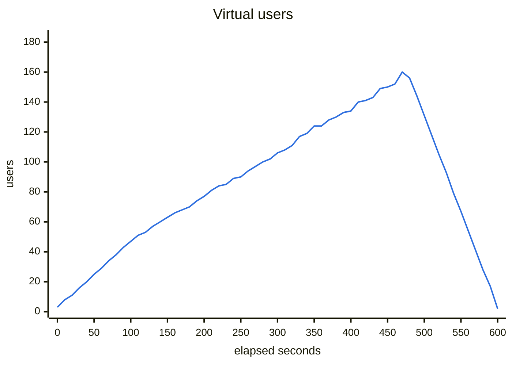

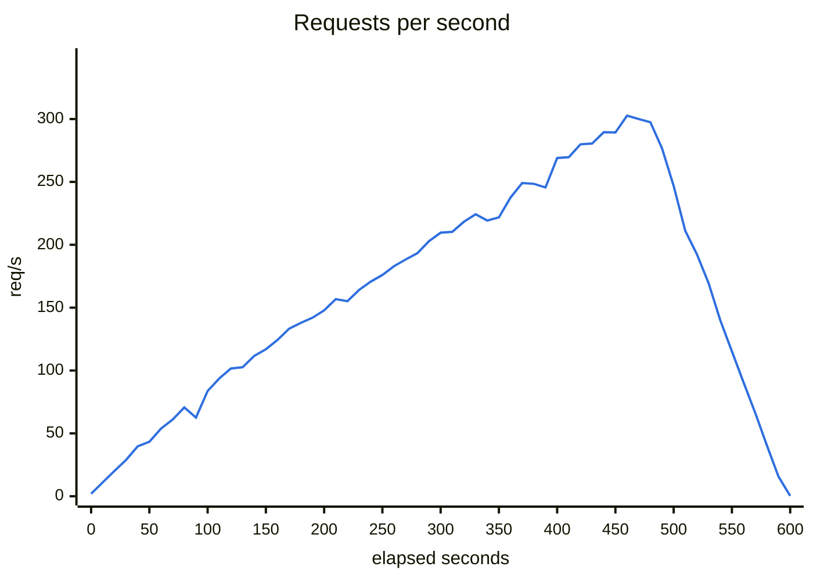

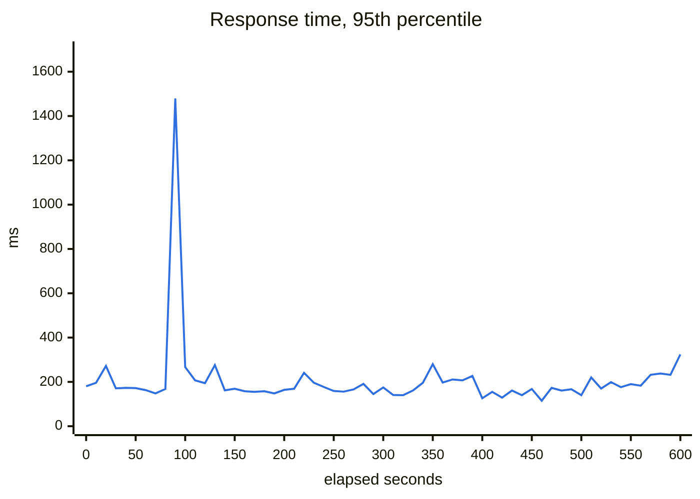

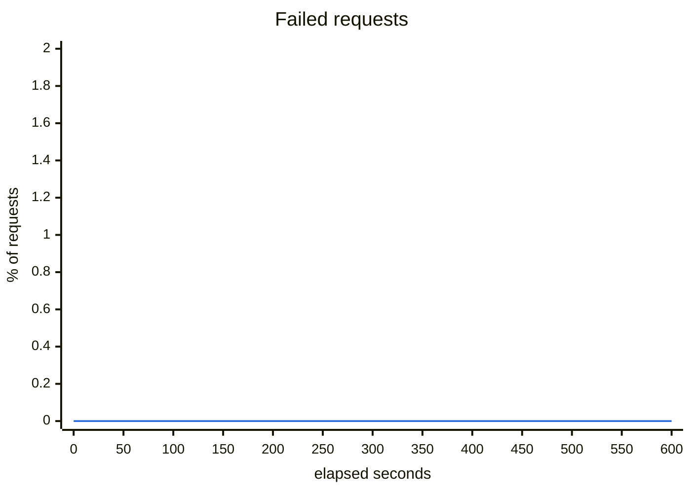

Data for these charts (one row per 10 s)

| Elapsed s | Users | Req/s | p95 ms | Failed % |
| --- | --- | --- | --- | --- |
| 0 | 3 | 2 | 180 | 0 |
| 10 | 8 | 11.1 | 196 | 0 |
| 20 | 11 | 20.1 | 272 | 0 |
| 30 | 16 | 28.9 | 171 | 0 |
| 40 | 20 | 39.7 | 173 | 0 |
| 50 | 25 | 43.3 | 172 | 0 |
| 60 | 29 | 53.8 | 163 | 0 |
| 70 | 34 | 61 | 148 | 0 |
| 80 | 38 | 70.6 | 168 | 0 |
| 90 | 43 | 62.6 | 1479 | 0 |
| 100 | 47 | 83.7 | 267 | 0 |
| 110 | 51 | 93.7 | 207 | 0 |
| 120 | 53 | 101.6 | 194 | 0 |
| 130 | 57 | 102.6 | 276 | 0 |
| 140 | 60 | 111.6 | 162 | 0 |
| 150 | 63 | 116.9 | 169 | 0 |
| 160 | 66 | 124.3 | 158 | 0 |
| 170 | 68 | 133.3 | 155 | 0 |
| 180 | 70 | 137.9 | 158 | 0 |
| 190 | 74 | 142 | 148 | 0 |
| 200 | 77 | 147.8 | 164 | 0 |
| 210 | 81 | 156.8 | 169 | 0 |
| 220 | 84 | 155.1 | 241 | 0 |
| 230 | 85 | 164.1 | 196 | 0 |
| 240 | 89 | 170.7 | 177 | 0 |
| 250 | 90 | 176 | 159 | 0 |
| 260 | 94 | 183 | 156 | 0 |
| 270 | 97 | 188.3 | 166 | 0 |
| 280 | 100 | 193.3 | 191 | 0 |
| 290 | 102 | 202.9 | 145 | 0 |
| 300 | 106 | 209.6 | 175 | 0 |
| 310 | 108 | 210.3 | 141 | 0 |
| 320 | 111 | 218.3 | 140 | 0 |
| 330 | 117 | 224.3 | 161 | 0 |
| 340 | 119 | 219.3 | 196 | 0 |
| 350 | 124 | 221.8 | 280 | 0 |
| 360 | 124 | 237.6 | 197 | 0 |
| 370 | 128 | 249.1 | 211 | 0 |
| 380 | 130 | 248.5 | 207 | 0 |
| 390 | 133 | 245.6 | 227 | 0 |
| 400 | 134 | 269 | 126 | 0 |
| 410 | 140 | 269.7 | 155 | 0 |
| 420 | 141 | 279.9 | 129 | 0 |
| 430 | 143 | 280.5 | 161 | 0 |
| 440 | 149 | 289.5 | 140 | 0 |
| 450 | 150 | 289.3 | 168 | 0 |
| 460 | 152 | 302.7 | 115 | 0 |
| 470 | 160 | 300 | 173 | 0 |
| 480 | 156 | 297.5 | 161 | 0 |
| 490 | 144 | 276.7 | 167 | 0 |
| 500 | 131 | 246.8 | 140 | 0 |
| 510 | 118 | 211 | 220 | 0 |
| 520 | 105 | 192.4 | 170 | 0 |
| 530 | 93 | 169.4 | 199 | 0 |
| 540 | 79 | 140 | 176 | 0 |
| 550 | 67 | 115.2 | 190 | 0 |
| 560 | 54 | 90.5 | 183 | 0 |
| 570 | 41 | 66.3 | 232 | 0 |
| 580 | 28 | 40.5 | 238 | 0 |
| 590 | 17 | 15.6 | 232 | 0 |
| 600 | 2 | 0.3 | 324 | 0 |

## By endpoint

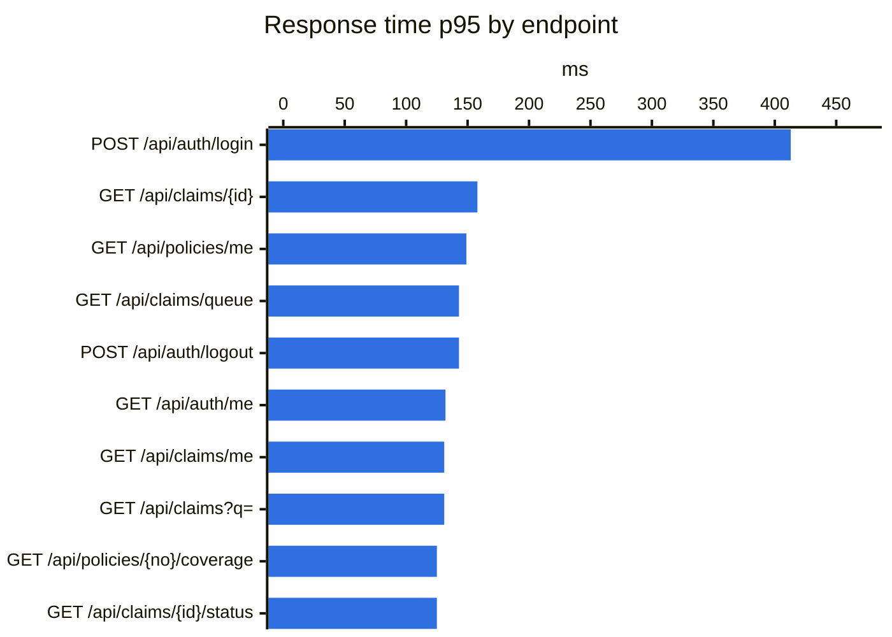

| Endpoint | Requests | Req/s | Avg ms | p50 | p95 | p99 | Max | Failed % | Status codes |
| --- | --- | --- | --- | --- | --- | --- | --- | --- | --- |
| `GET /api/policies/me` | 13905 | 23.2 | 87 | 76 | 149 | 251 | 2461 | 0 | 200×13905 |
| `GET /api/policies/{no}/coverage` | 13905 | 23.2 | 82 | 73 | 125 | 215 | 2545 | 0 | 200×13905 |
| `GET /api/claims/me` | 13905 | 23.2 | 82 | 74 | 131 | 211 | 2663 | 0 | 200×13905 |
| `GET /api/claims/{id}` | 13905 | 23.2 | 93 | 81 | 158 | 249 | 2918 | 0 | 200×13905 |
| `GET /api/claims/{id}/status` | 13905 | 23.2 | 80 | 72 | 125 | 211 | 1500 | 0 | 200×13905 |
| `GET /api/claims/queue` | 6582 | 11 | 83 | 71 | 143 | 222 | 2636 | 0 | 200×6582 |
| `GET /api/claims?q=` | 6582 | 11 | 82 | 72 | 131 | 225 | 1664 | 0 | 200×6582 |
| `POST /api/auth/login` | 4790 | 8 | 228 | 198 | 413 | 639 | 2019 | 0 | 200×4790 |
| `GET /api/auth/me` | 4790 | 8 | 81 | 73 | 132 | 207 | 581 | 0 | 200×4790 |
| `POST /api/auth/logout` | 4790 | 8 | 84 | 75 | 143 | 235 | 443 | 0 | 204×4790 |

## Autoscaling (HPA)

Each HPA adds pods when the average CPU goes above 70 % of the pod's CPU request, up to its maximum.
The table shows the fewest and most pods seen during the run.

| HPA | Min pods seen | Max pods seen | Peak CPU | Result |
| --- | --- | --- | --- | --- |
| `approval` | 1 | 1 | 2 % | — |
| `assessment` | 1 | 1 | 11 % | — |
| `claim-intake` | 1 | 2 | 220 % | **scaled out** |
| `eligibility` | 1 | 1 | 9 % | — |
| `frontend` | 1 | 1 | 4 % | — |
| `gateway-simulator` | 1 | 1 | 6 % | — |
| `login` | 1 | 2 | 395 % | **scaled out** |
| `ops-dashboard` | 1 | 1 | 2 % | — |
| `payment` | 1 | 1 | 8 % | — |
| `policy` | 1 | 2 | 181 % | **scaled out** |

#### claim-intake

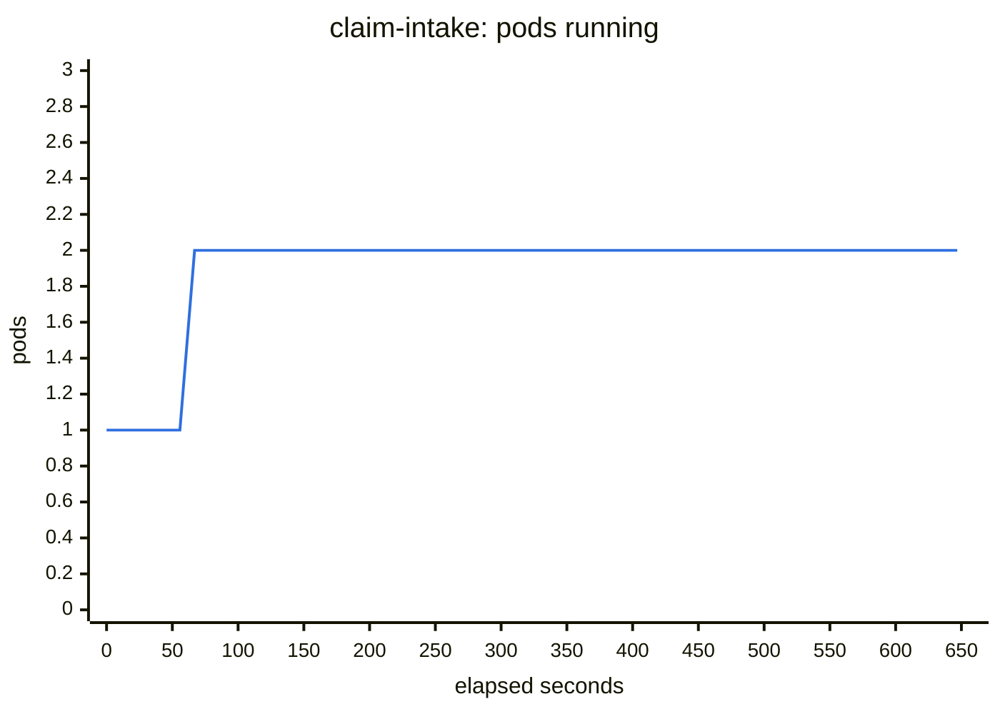

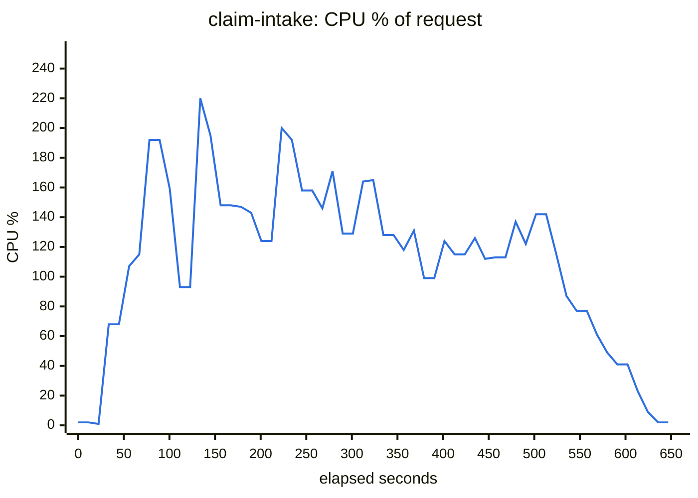

#### login

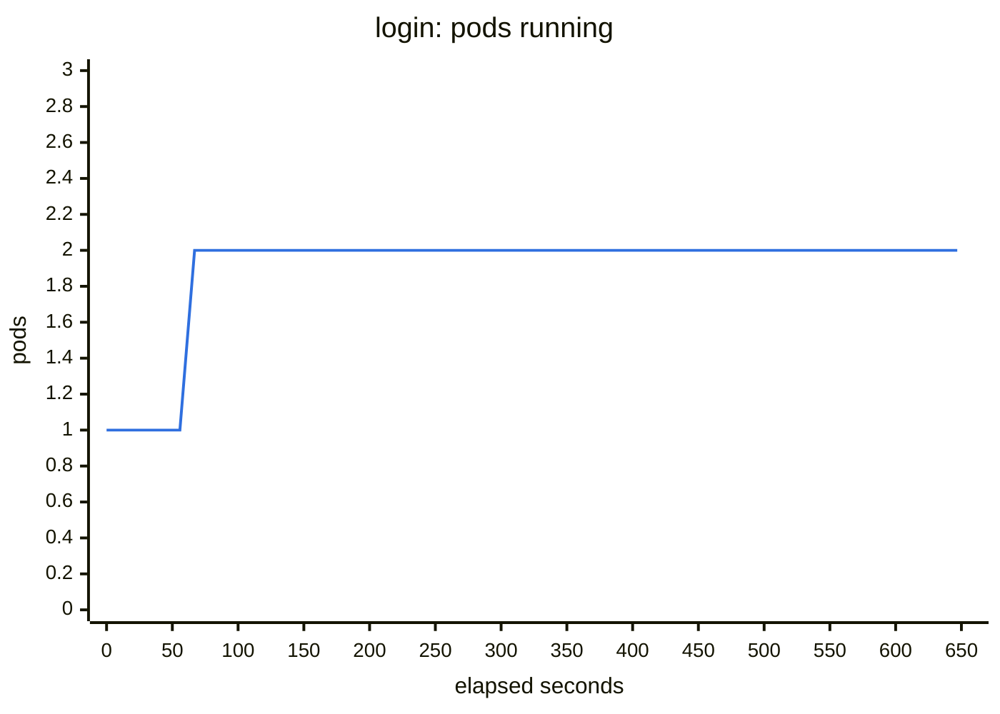

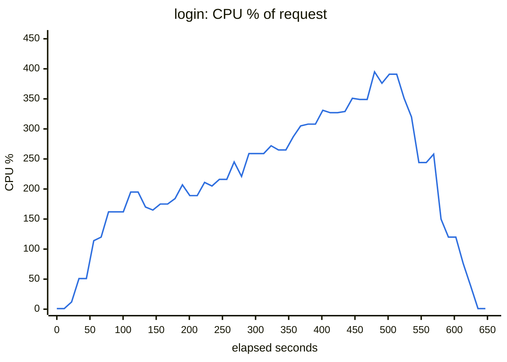

#### policy

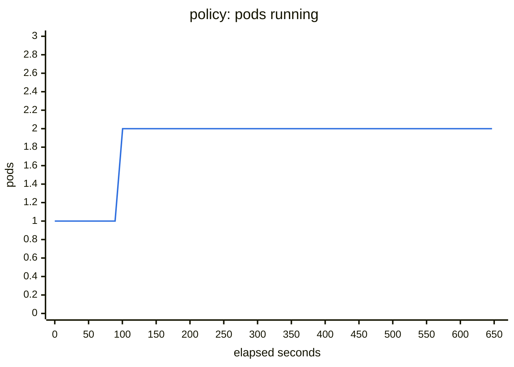

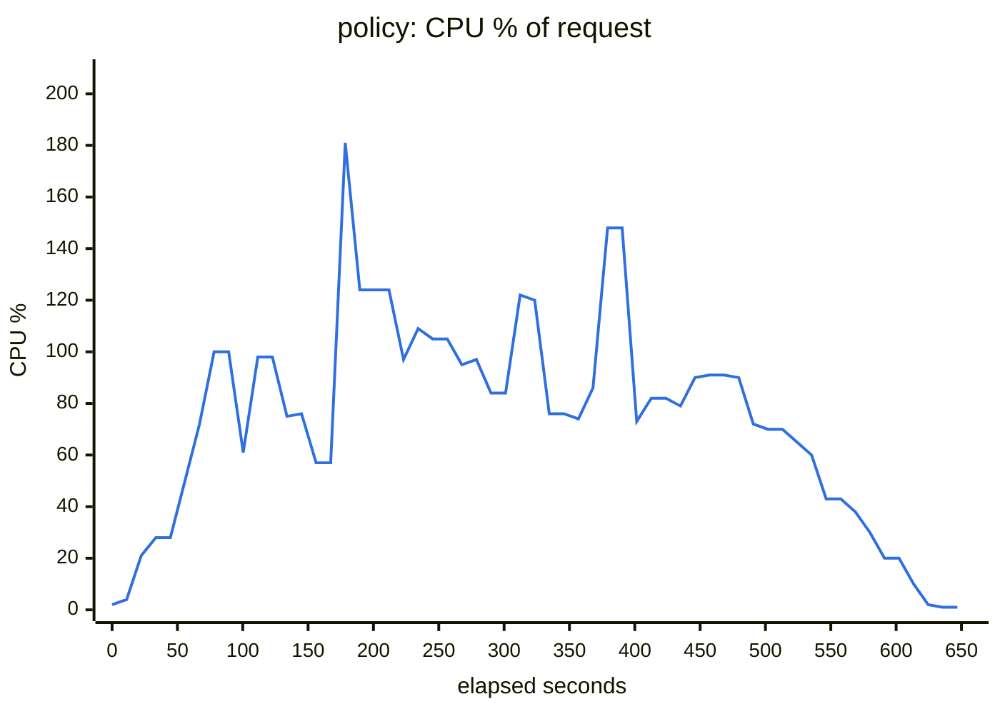

---
_Generated by `loadtest/scripts/report.mjs` from the k6 results. The k6 summary (`summary.json`) and the HPA recording (`hpa.csv`) are stored next to this file._
