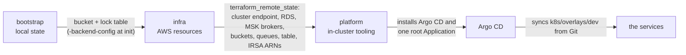

# Terraform

How the claims platform's AWS infrastructure is built and managed with Terraform: the everyday commands, how the code is split into three stacks, and why it is designed that way.

The step-by-step first deployment and the teardown order are in [infra/README.md](infra/README.md). This file is the reference to keep open while you work.

---

## 1. Everyday commands

Run every command inside one stack's folder: `infra/terraform/bootstrap`, `infra/terraform/infra` or `infra/terraform/platform`. Each folder keeps its own state, so a command only ever sees that stack.

### What is running right now?

| Question | Command |
|---|---|
| **Does the real infrastructure still match the code?** (the main status check) | `terraform plan -var-file=dev.tfvars -detailed-exitcode` |
| Which resources does Terraform manage? | `terraform state list` |
| How many are there? | `terraform state list \| wc -l` |
| Every attribute of one resource | `terraform state show 'module.eks.module.eks.aws_eks_cluster.this[0]'` |
| Everything in the state, readable | `terraform show` |
| The endpoints and names other tools need | `terraform output` (one value: `terraform output -raw msk_bootstrap_brokers`) |
| How much of the 8-vCPU quota is used | `terraform output ec2_vcpu_usage` |
| Pick up changes made outside Terraform, without changing anything | `terraform apply -refresh-only -var-file=dev.tfvars` |

`plan -detailed-exitcode` is the status check to remember. Its exit code says:

- **`0`**: no changes. Everything in AWS matches the code and the state.
- **`2`**: there are changes. Either someone edited the code, or something changed in AWS (drift). The plan lists every one.
- **`1`**: an error, such as an expired login, no network, or a lock held by someone else.

In the `platform` stack, leave out `-var-file`, because its values come from `terraform.tfvars`, which Terraform loads automatically.

### Read the status from outside Terraform

Terraform only knows what is in its state. These commands ask AWS and Kubernetes directly:

```bash
aws eks list-clusters                                              # claims-dev
aws kafka list-clusters-v2 --query 'ClusterInfoList[].[ClusterName,State]' --output text
aws rds describe-db-instances --query 'DBInstances[].[DBInstanceIdentifier,DBInstanceStatus]' --output text
aws emr list-clusters --active --query 'Clusters[].[Id,Status.State]' --output text
aws ec2 describe-instances --filters Name=instance-state-name,Values=running \
  --query 'Reservations[].Instances[].InstanceType' --output text   # what is using the vCPU quota

kubectl get nodes
kubectl get pods -A
kubectl -n argocd get applications                                 # claims-root and claims-dev: Synced / Healthy
```

### Changing things

```bash
terraform init -backend-config="bucket=claims-dev-tfstate-<account_id>" \
               -backend-config="region=ap-south-1" \
               -backend-config="dynamodb_table=claims-dev-tf-locks"   # once per folder, or after a module/provider change
terraform fmt -recursive          # format the code
terraform validate                # check the syntax and references without calling AWS
terraform plan  -var-file=dev.tfvars -out=change.tfplan   # see what would change and save that exact plan
terraform apply change.tfplan     # apply exactly the saved plan
terraform apply -var-file=dev.tfvars -target=module.s3    # only one module (use rarely; see section 5)
terraform destroy -var-file=dev.tfvars                    # delete everything in this stack
```

The `bootstrap` stack prints the exact `-backend-config` arguments: run `terraform output backend_config_args` there.

### When something goes wrong

| Situation | Command |
|---|---|
| `Error acquiring the state lock` and you are sure nobody else is running Terraform | `terraform force-unlock <LOCK_ID>` (the ID is in the error message) |
| An apply failed with `Failed to save state` (for example, the network dropped) | Terraform wrote the state to `errored.tfstate` in the folder. Push it back with `terraform state push errored.tfstate`, then run `plan` |
| A resource is marked `tainted` after a timeout, but it is healthy in AWS | `terraform untaint '<address>'`, so it isn't destroyed and rebuilt |
| A resource exists in AWS but not in the state | `terraform import '<address>' <aws-id>` |
| You renamed a resource or moved it into a module | add a `moved { from = ..., to = ... }` block, or run `terraform state mv` |
| Stop managing a resource without deleting it | `terraform state rm '<address>'` |

---

## 2. How the code is laid out

```
infra/terraform/
├── bootstrap/            stack 1: the S3 bucket and DynamoDB table that store the other stacks' state
├── infra/                stack 2: every AWS resource
│   ├── main.tf           calls the modules below and wires them together
│   ├── variables.tf      every setting, with defaults
│   ├── dev.tfvars        the dev environment's values
│   ├── quota.tf          fails the plan if the EC2 sizing needs more vCPUs than the account allows
│   ├── outputs.tf        everything the platform stack (and you) need
│   └── backend.tf        state key infra/terraform.tfstate
├── platform/             stack 3: everything inside the Kubernetes cluster
│   ├── data.tf           reads the infra stack's outputs (terraform_remote_state)
│   ├── alb-controller.tf AWS Load Balancer Controller and metrics-server
│   ├── argocd.tf         Argo CD (Helm), plus its Ingress when expose_argocd = true
│   ├── argocd-root-app.tf the claims AppProject and the claims-root Application (app of apps)
│   ├── observability.tf  kube-prometheus-stack (Prometheus and Grafana), Loki, Promtail
│   ├── dashboards.tf     the "Claims platform" Grafana dashboard, generated in HCL
│   ├── secrets.tf        db-init Job, kafka-topics Job, <svc>-db Secrets, jwt-keys, IRSA service accounts, platform-endpoints ConfigMap
│   ├── .charts/          the Helm charts at pinned versions, for networks that block chart downloads
│   └── backend.tf        state key platform/terraform.tfstate
└── modules/              reusable building blocks, used only by the infra stack
    ├── network/   VPC, 2 public + 2 private subnets, 1 NAT gateway, S3 and DynamoDB gateway endpoints
    ├── eks/       EKS 1.33 cluster, managed node group, EBS CSI driver, gp3 StorageClass
    ├── ecr/       one image repository per service
    ├── rds/       PostgreSQL 16, password managed in Secrets Manager
    ├── msk/       Kafka (MSK) 3.8, 2 brokers
    ├── emr/       single-node EMR 7.6 cluster for the Flink job, idle auto-termination
    ├── s3/        documents, emr-logs and artifacts buckets, CORS, lifecycle, the upload notification
    ├── sqs/       doc-upload-events and doc-verification-results, each with a dead-letter queue
    ├── lambda/    the document-verification function, its alias and its SQS trigger
    ├── dynamodb/  the analytics table that the Flink job writes
    └── iam/       IRSA roles, the Lambda role, EMR roles, GitHub Actions OIDC role
```

### The three stacks

| Stack | Creates | State | When you run it |
|---|---|---|---|
| **bootstrap** | S3 bucket `claims-dev-tfstate-<account_id>` (versioned, encrypted, private) and DynamoDB table `claims-dev-tf-locks` | a **local** file, `bootstrap/terraform.tfstate` | once per AWS account |
| **infra** | about 190 AWS resources: network, EKS, ECR, RDS, MSK, EMR, S3, SQS, Lambda, DynamoDB, IAM | `s3://…/infra/terraform.tfstate` | when the AWS side changes |
| **platform** | about 30 resources inside the cluster: Helm releases, Jobs, Secrets, service accounts, the Argo CD root app | `s3://…/platform/terraform.tfstate` | after infra, and whenever the in-cluster tooling changes |

### How the stacks connect



1. **bootstrap → infra/platform.** Only the bucket, region and lock table pass between them, as `-backend-config` arguments to `terraform init`.
2. **infra → platform.** `platform/data.tf` reads the infra state directly with `terraform_remote_state`. No value is copied by hand: the RDS endpoint, Kafka brokers, queue URLs and IAM role ARNs all flow through automatically. Feature toggles flow too. With `enable_msk = false`, the broker output is `null`, so the platform stack skips the `kafka-topics` Job.
3. **platform → Git.** Terraform installs Argo CD and a single root Application. From then on, every service Deployment, Service, HPA and Ingress comes from `k8s/overlays/<env>` in Git, never from Terraform or `kubectl apply`.

---

## 3. Why it is designed this way

### Why three stacks and not one

- **Bootstrap solves the chicken-and-egg problem.** Terraform has to store its state somewhere before it can create anything, but the bucket that holds the state is itself infrastructure. The bootstrap stack creates the bucket and lock table with *local* state. It is tiny, changes almost never, and nearly costs nothing, so a local state file is acceptable for it alone.
- **The Kubernetes providers need a cluster that already exists.** The `kubernetes` and `helm` providers connect to the EKS API endpoint. In a single stack, Terraform would configure those providers from a cluster it hasn't created yet, which breaks plans and makes destroys fail halfway. Splitting at the cluster boundary means `infra` builds the cluster and `platform` only ever talks to one that exists.
- **Blast radius and speed.** A change to a Grafana dashboard plans only about 30 in-cluster resources, in seconds. It can't accidentally touch the database or the VPC, because those aren't in the platform state at all. The infra stack (MSK alone takes about 25 minutes) is only planned when the AWS side changes.
- **Different lifecycles.** The VPC, the cluster and the databases change rarely. Helm chart versions, dashboards and secrets change often. Stacks that change at different rates belong in different states.
- **A clean teardown.** You destroy `platform` first. That removes the Helm releases and the load balancers they created. Then you destroy `infra`. One stack would try to delete the VPC while load balancers that Kubernetes created still hold it.

### Why remote state in S3 with a DynamoDB lock

- **Shared:** every teammate, and CI, sees the same state, so nobody works from a stale copy on their laptop.
- **Locked:** the DynamoDB lock stops two applies from running at once and corrupting the state.
- **Versioned:** the bucket has versioning on, so a broken state can be rolled back to an earlier version.
- **Encrypted and private:** state files contain secrets, such as the RDS master credentials read by the platform stack, so the bucket is SSE-encrypted and blocks all public access.

The S3 backend now offers `use_lockfile` as a replacement for the DynamoDB table. That is why `init` prints a "dynamodb_table is deprecated" warning. The table still works, and switching is a one-line change in each backend's arguments.

### Why modules

Each module wraps one AWS service with sensible defaults (encryption on, public access blocked, log retention set) and exposes only the inputs that vary. `infra/main.tf` then reads like a list of components:

```hcl
module "msk" {
  source = "../modules/msk"
  count  = var.enable_msk ? 1 : 0     # a toggle removes the whole component
  ...
}
```

- **Toggles.** `enable_rds`, `enable_msk`, `enable_emr`, `enable_lambda` and `enable_dynamodb` use `count`, so expensive parts can be left out. For example, the minimal "login test" setup costs about $0.36 an hour instead of $0.80.
- **One way to wire things.** Every module returns IDs and ARNs as outputs, and `main.tf` passes them to the next module. For example, the SQS module's queue ARN goes to the S3 module, so the bucket can notify that queue.

### Why GitOps for the services and Terraform for everything else

Terraform is good at long-lived infrastructure with real dependencies between parts. It is poor at frequent application releases: every image tag change would be a Terraform apply. So the split is:

- **Terraform** owns the cluster and its shared platform: networking, IAM, databases, ingress controller, monitoring, Argo CD itself.
- **Argo CD** owns the workloads. CI builds an image, commits the new tag to `k8s/overlays/dev`, and Argo CD applies it. A rollback is a `git revert`.

The Lambda and the Flink job are not Kubernetes workloads, so they sit outside this split. The Lambda is deployed by the infra stack; see [lambda.md](lambda.md). The Flink job is submitted to EMR as described in [RUN.md](RUN.md).

### Other design decisions

| Decision | Why |
|---|---|
| **IRSA** (IAM Roles for Service Accounts) instead of access keys | Each pod gets short-lived credentials for exactly one IAM role, for example the claim-intake role, which can only sign URLs for `claims/*` in the documents bucket. No long-lived keys are stored anywhere |
| **GitHub OIDC role** for CI | GitHub Actions assumes an AWS role with a short-lived token. No AWS keys are stored in GitHub secrets |
| **`quota.tf`** checks vCPUs during the plan | The account allows 8 vCPUs of on-demand EC2, and EKS nodes and EMR share it. Failing the *plan* is better than an apply that dies 20 minutes in with `VcpuLimitExceeded` |
| **`exec`-based Kubernetes authentication** (`aws eks get-token`) | A token fetched once at plan time expires after 15 minutes, and a slow Helm install can outlast it. `exec` fetches a fresh token whenever one is needed |
| **Default tags** (`Project`, `Environment`, `ManagedBy = terraform`) on the AWS provider | Every resource can be found, and costed, by tag |
| **Pinned versions and local charts** (`platform/.charts`) | The same input gives the same result, even on networks that block chart downloads |
| **`force_destroy = true`** on the demo buckets | `terraform destroy` also empties them. A production setup would turn this off |
| **One NAT gateway, single-AZ RDS, small instances** | Dev-environment cost choices, each controlled by a variable (`single_nat_gateway`, instance classes) |

---

## 4. A Terraform primer, applied to this project

| Concept | What it means | Where to see it here |
|---|---|---|
| **Provider** | A plugin that talks to one API | `aws`, `kubernetes`, `helm`, `random`, `tls` in `providers.tf` and `versions.tf` |
| **Resource** | One thing Terraform creates and owns | `resource "aws_sqs_queue" "upload"` in `modules/sqs/main.tf` |
| **Data source** | Something Terraform only reads | `data "aws_caller_identity" "current"`, which gives the account ID used in bucket names |
| **Variable / tfvars** | Inputs, and one environment's values for them | `infra/variables.tf` and `infra/dev.tfvars` |
| **Output** | Values a stack exposes to people and to other stacks | `infra/outputs.tf`, which `platform/data.tf` reads |
| **Module** | A reusable group of resources | `modules/*`, called from `infra/main.tf` |
| **State** | Terraform's record of what it created, mapped to real IDs | the files in S3. Never edit them by hand; use the `terraform state …` commands |
| **Plan / apply** | Compare code, state and reality, then make reality match the code | `terraform plan`, then `terraform apply` |
| **`count` / `for_each`** | Create zero, one or many copies | `count = var.enable_msk ? 1 : 0` for toggles; `for_each` over the three buckets in the S3 module |
| **`precondition`** | Stop early with a clear message | the Lambda module refuses to apply when the jar hasn't been built |
| **Dependency graph** | Terraform orders the work from references, and runs independent parts in parallel | MSK, EKS and EMR are created at the same time. The Lambda waits for its queue and its role |

### What a plan line means

```
+ create      a new resource
~ update      changed in place
-/+ replace   destroyed and created again (check why: it usually means downtime)
- destroy     removed
<= read       a data source being read
```

Always read a `-/+` line before you type `yes`. On this project, replacing the EKS cluster, the RDS instance or the MSK cluster takes a long time and loses data.

---

## 5. Habits that keep the state healthy

1. **Run `plan` before every `apply`**, and read the summary line: `Plan: X to add, Y to change, Z to destroy`.
2. **Never change Terraform-managed resources in the AWS console.** The next plan will undo the change (drift). If you must, use `apply -refresh-only` afterwards and then bring the code in line.
3. **Use `-target` only to get out of trouble.** It applies part of the graph and can leave the rest out of date.
4. **Destroy in order:** delete the Ingresses (and wait for their load balancers to go), then destroy `platform`, then `infra`. Leave `bootstrap` in place. See step 9 of [infra/README.md](infra/README.md).
5. **Don't commit state or plan files.** They contain secrets, and `.gitignore` already excludes them.
